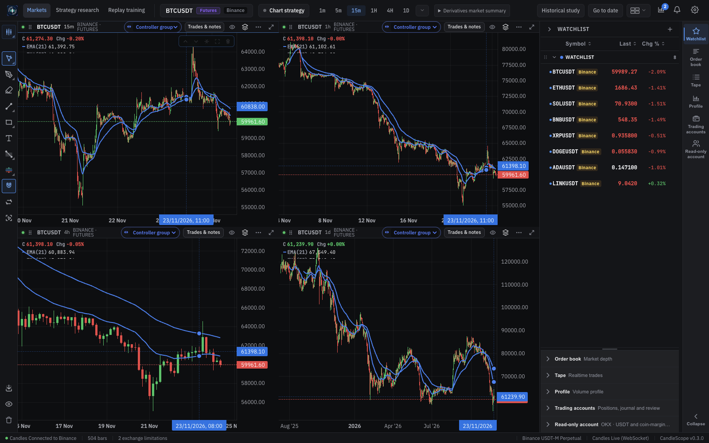
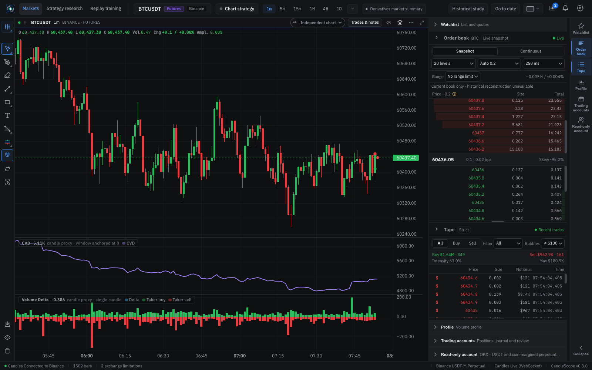
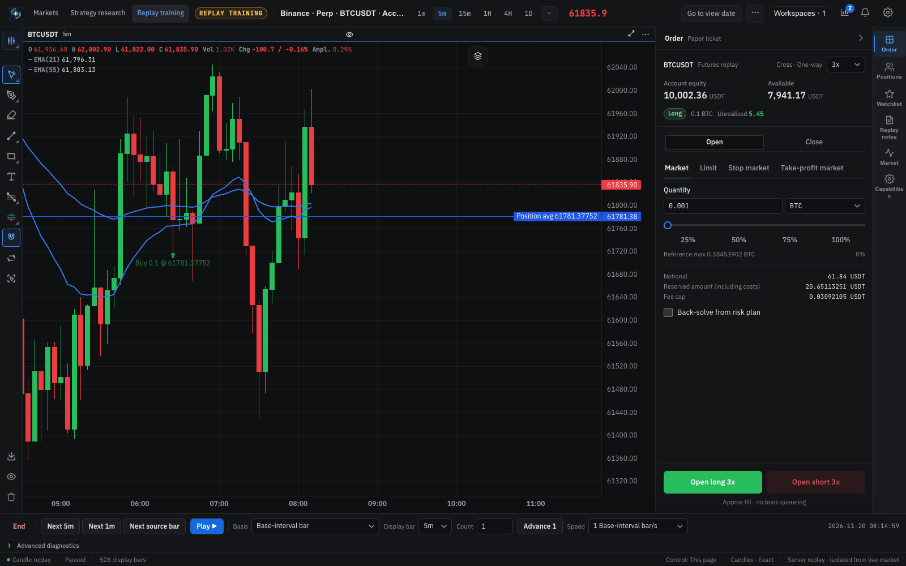
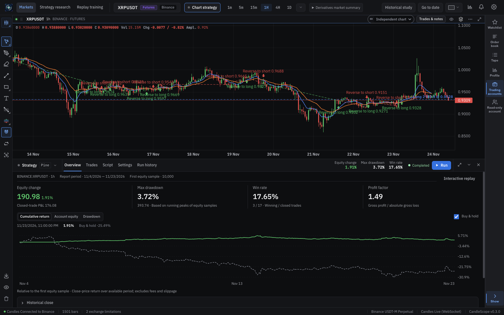
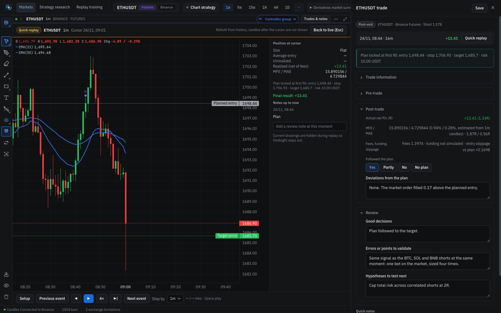

<h1 align="center">
  <picture>
    <source media="(prefers-color-scheme: dark)" srcset="frontend/public/brand/candlescope-lockup-on-dark.svg" />
    
  </picture>
</h1>

<h3 align="center">Read the market. Replay every decision.</h3>

<p align="center">
  Analyze, practice, test and review — a trader's whole loop in one open-source workstation<br />
  that runs on your own machine, with no caps on exchanges, history, indicators or alerts.
</p>

<p align="center">
  <a href="https://app.candlescope.app"><b>Open in browser</b></a>
  ·
  <a href="https://github.com/helenananaa/CandleScope/releases/latest"><b>Download</b></a>
  ·
  <a href="#quick-start">Quick start</a>
  ·
  <a href="https://candlescope.app">Website</a>
  ·
  <a href="README_zh.md">简体中文</a>
</p>

<p align="center">
  <a href="https://github.com/helenananaa/CandleScope/releases/latest"></a>
  <a href="LICENSE"></a>
  
  <a href="https://app.candlescope.app"></a>
</p>

<p align="center">
  <b>100+</b> exchanges · <b>any</b> interval · <b>15</b> chart types · <b>22</b> drawing tools · up to <b>64</b> linked charts · <b>30</b> languages
</p>

<p align="center">
  
</p>

## Why CandleScope

- **No caps.** Every exchange CCXT supports, spot and perpetuals. Any interval you
  can type — 7m, 45m, 3h. As much history as the exchange will give you, and as
  many indicators and alerts as you want.
- **Practice without hindsight.** Challenge replay starts you at a random moment
  you don't know, on a futures-grade paper account with leverage, funding and
  liquidation. Time you have revealed cannot be taken back.
- **Every trade explains itself.** Backtest in Python or Pine right on the chart
  and open any trade to see the evidence the strategy had when it decided.
- **Your machine, your data.** Everything runs on `127.0.0.1`. No sign-up and no
  cloud account in the middle. Replay and paper trading never send a real order.
- **Open all the way down.** GPL-3.0, every line auditable. Missing something?
  Write a plugin — CandleScope's own Pine runtime ships that way.

## The loop

| | Analyze | Practice | Test | Review |
|---|---|---|---|---|
| **You** | read the market | trade it without risk | prove the idea | learn from every trade |
| **With** | charts, order flow, indicators, alerts, historical study | replay training, paper trading | strategy tester, robustness checks, forward tracking | three-stage journal, replay reports, account sync |

### 1 · Analyze



- **Any interval, fifteen chart types.** Type `7m`, `45m` or `3h` and the chart
  rebuilds. Candles, Heikin-Ashi, bars, line, area, baseline, Renko, line break,
  Kagi, point & figure and more.
- **22 drawing tools.** Lines, rays, arrows, paths, parallel channels, Fibonacci
  retracements, price and time measures, long and short positions, shapes, text,
  pen and highlighter — with style templates and an object list.
- **Up to 64 linked charts.** Four windows of up to sixteen charts. Link symbol,
  interval, crosshair, visible range, drawings or indicators by group.
- **Order flow.** Order book, trade tape, CVD, volume delta and volume profile
  wherever the exchange publishes the data — deepest on Binance, with full-depth
  books, trade history and live liquidations on futures.
- **Unlimited indicators.** Run the Pine indicators you already have on the open
  [pine-compat-runtime](https://github.com/helenananaa/pine-compat-runtime), write new ones in JavaScript, or start from the
  built-ins.
- **Unlimited alerts.** Nest AND, OR and NOT groups over price and any indicator.
  Fire in real time, on bar updates or on bar close, and see which condition
  matched. Deliver in the app, as a browser notification, as a sound or to a
  signed webhook.
- **Historical study.** Pick a moment on the live chart, hide what came after,
  and step forward bar by bar with notes — linked across charts if you like.

### 2 · Practice



- **Replay training.** Every symbol advances on one clock and trades against one
  paper account. Scale in, scale out, reverse, hold several markets at once. Save,
  resume, or drag back and fork from any bar.
- **Sandbox or Challenge.** Sandbox lets you adjust funds, fees and leverage as
  you go. Challenge locks the rules, and a blind random start — you don't know
  the date — earns a strict Challenge result. Every change and every reveal of
  time is recorded.
- **A futures-grade account.** Leverage caps, fees, historical funding, and hedge
  mode where long and short legs each carry their own margin, liquidation and
  protective orders.
- **Live paper trading.** Limit, stop and bracket orders fill against live
  one-minute bars and catch up after a restart.

### 3 · Test



- **Strategy tester on the chart.** Write a strategy in Python or Pine next to
  the chart you are looking at, and open any trade to see why it was taken.
- **Research runs.** Test on imported data or the current chart, then inspect
  every trade, the equity curve, drawdown and parameters. Each result carries the
  assumptions it was tested under — fees, slippage and fill model.
- **Robustness checks.** Walk-forward testing picks parameters on rolling
  training windows and validates them on the unseen window that follows.
- **Compare and iterate.** Put two to four strategies side by side, keep versions,
  and rerun any result.
- **Forward tracking.** Keep a strategy running on live bars from now, or from a
  past date.
- **Your own model.** Connect it through the SDK; CandleScope supplies market
  data, matching and the account, and records every decision.

### 4 · Review



- **A three-stage journal.** Write the plan before entry, notes while the
  position is open, and the review after it closes.
- **Numbers that show progress.** Fills group into trades automatically. Track
  win rate, profit factor, R expectancy and drawdown by tag.
- **Replay reports.** Average R, MAE/MFE and holding time for every session, plus
  an integrity report of everything that changed along the way.
- **Your real account, read-only.** Sync and reconcile positions and fills from
  your exchange account (OKX today), then journal and review the real trades too.

### Everyday tools

- `Ctrl`/`⌘` + `K` symbol search with favorites, and watchlist folders with live prices
- Go to any date (`Alt` + `G`) and export chart screenshots
- Workspaces that bring back layouts, drawings and indicators as you left them
- A data workbench to see stored history and gaps, download history and import CSV
- Proxy settings and proxy subscriptions for reaching exchange APIs (desktop app)
- 30 interface languages, light and dark themes

### Let an AI assistant drive the chart

Turn on the local MCP server in the desktop app and an AI assistant can read
your open charts and replay state, switch intervals and chart types, and step a
replay bar by bar. It is off by default, listens on `127.0.0.1` only, offers
read-only or control access, and offers no order placement, script execution or
file access.

## Data and plugins

| Source | What you get |
|---|---|
| CCXT (built in) | Spot and perpetual markets on 100+ crypto exchanges |
| Binance and OKX (native adapters) | Deeper trade and contract data: full-depth order books and liquidations on Binance, funding and open interest on both |
| Twelve Data (plugin) | US stocks, ETFs, forex and commodities |
| Your provider (plugin template) | Private feeds or any other market |

Plugins can also add indicators, strategies and runtimes. See the
[plugin author guide (Chinese)](docs/PLUGIN_PLATFORM_AUTHOR_RUNTIME_GUIDE_zh.md).

## Ecosystem

| Project | What it is | License |
|---|---|---|
| **CandleScope** (this repository) | The workstation: charts, replay, paper trading, backtesting and the journal | GPL-3.0 |
| [pine-compat-runtime](https://github.com/helenananaa/pine-compat-runtime) | The Pine engine behind CandleScope's Pine plugin: a clean-room runtime for a tested Pine-compatible subset that any app can embed from Rust, Python, WASM or the CLI | MIT |
| [Plugin SDKs](packages/) | Python, TypeScript, Rust/WASM and Java SDKs for data providers, indicators and strategies | GPL-3.0 |

## Quick start

### In the browser — nothing to install

Open **[app.candlescope.app](https://app.candlescope.app)**. Charts, replay
training and paper trading run entirely in your browser, and your data stays
there. Script strategies, exchange account sync and plugins need the desktop app
or a local install. Use a recent Chrome, Edge, Safari or Firefox; Chrome on
Android is not supported yet.

### Desktop app

Download the build for your system from the
[latest release](https://github.com/helenananaa/CandleScope/releases/latest):

| System | Package |
|---|---|
| Windows 10/11 (x64) | `CandleScope-<version>-windows-x64-setup.exe` |
| macOS (Apple Silicon) | `CandleScope-<version>-macos-arm64.dmg` |
| macOS (Intel) | `CandleScope-<version>-macos-x64.dmg` |

Each release also lists `SHA256SUMS` for checking a download.

> [!NOTE]
> Builds are not yet signed with a paid certificate. On macOS, open
> **System Settings → Privacy & Security** after the first launch attempt and
> choose **Open Anyway**. On Windows, choose **More info → Run anyway** in the
> SmartScreen prompt. Uninstalling on Windows keeps your data.

### From source

Requirements: Python 3.11+ (3.12 recommended), Node.js 22.12+ and npm 10+.

```bash
git clone https://github.com/helenananaa/CandleScope.git
cd CandleScope/backend
python3 -m venv .venv
source .venv/bin/activate
python -m pip install -r requirements.txt
./dev-server.sh
```

In a second terminal:

```bash
cd CandleScope/frontend
npm install
npm run dev
```

Open [http://127.0.0.1:15173/](http://127.0.0.1:15173/). The API runs at
`http://127.0.0.1:18080/`.

<details>
<summary>Windows PowerShell</summary>

```powershell
git clone https://github.com/helenananaa/CandleScope.git
cd CandleScope\backend
python -m venv .venv
.\.venv\Scripts\python.exe -m pip install -r requirements.txt
.\dev-server.ps1
```

In a second terminal:

```powershell
cd CandleScope\frontend
npm install
npm run dev
```

</details>

## Safe by design

- Replay and paper trading use simulated orders and never route to an exchange.
- Exchange account sync is read-only.
- No account and no sign-in: the app talks to exchanges and data providers
  directly from your machine.
- The AI control server is off by default, local-only and cannot trade.

## Current scope

- Read-only account sync supports OKX for now.
- Order book, order flow, liquidations, contract data and history depth depend
  on what the selected exchange or provider publishes.
- The standard workspace shows up to four charts. Sixteen-chart and
  multi-window layouts (up to 64 charts) are opt-in.
- Pine support covers a tested subset of the language. The first-party Pine
  plugin runs in the desktop app and local installs on Windows, Linux and macOS
  (Apple Silicon and Intel), not in the browser version.
- The desktop app supports Windows and native macOS (Apple Silicon and Intel).
  Linux runs the browser version or a local install from source.

## Documentation

| Topic | Guide |
|---|---|
| API | [API reference](API.md) |
| Frontend | [Frontend architecture](frontend/ARCHITECTURE.md) |
| Market data and storage | [Data Engine guide](backend/app/data_engine/README.md) |
| Offline data | [Local offline mode](docs/local-offline-mode.md) |
| Desktop on macOS | [macOS packaging guide](docs/MACOS_DESKTOP.md) |
| Plugins | [Plugin author guide](docs/PLUGIN_PLATFORM_AUTHOR_RUNTIME_GUIDE_zh.md) (Chinese) |
| Backtesting | [Python strategy guide](docs/BACKTEST_PYTHON_LOCAL_BETA_GUIDE_zh.md) (Chinese) |
| Replay | [Replay training contract](docs/KLINE_REPLAY_TRAINING_PRODUCT_CONTRACT_zh.md) (Chinese) |
| Alerts | [Alert delivery](docs/ALERTS_DELIVERY_zh.md) (Chinese) |
| Upgrades and downgrades | [Release notes](RELEASE_NOTES.md) |

## Contributing

Bug reports, feature ideas and pull requests are welcome. Start with
[CONTRIBUTING.md](CONTRIBUTING.md) for the development setup and test commands,
browse [open issues](https://github.com/helenananaa/CandleScope/issues), or see
what is planned under the
[`post-launch`](https://github.com/helenananaa/CandleScope/issues?q=is%3Aopen+label%3Apost-launch)
label.

If CandleScope is useful to you, a ⭐ helps other traders find it.

## License

CandleScope is licensed under [GNU GPL-3.0](LICENSE).

CandleScope is a charting and practice tool, not financial advice. Exchange names
are trademarks of their respective owners.
