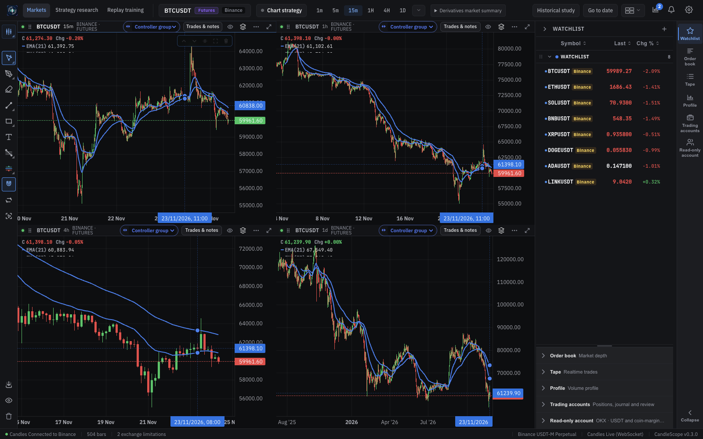
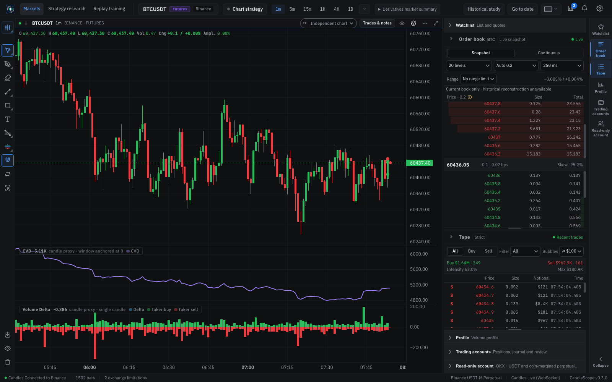
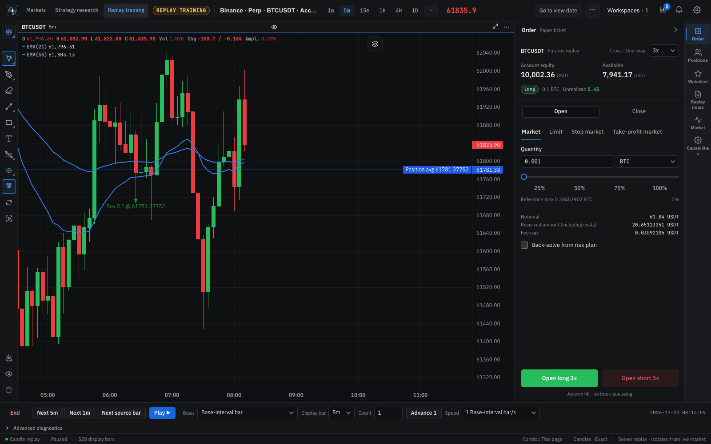
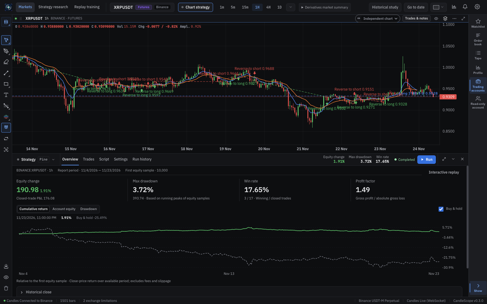
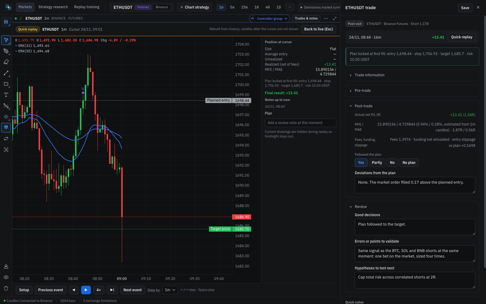

<h1 align="center">
  <picture>
    <source media="(prefers-color-scheme: dark)" srcset="frontend/public/brand/candlescope-lockup-on-dark.svg" />
    
  </picture>
</h1>

<h3 align="center">看懂市场，复盘每一次判断。</h3>

<p align="center">
  看盘、练习、验证、复盘——交易者的完整闭环，放进一个开源、跑在你自己电脑上的工作台。<br />
  交易所、历史数据、指标与警报，都不设上限。
</p>

<p align="center">
  <a href="https://app.candlescope.app"><b>在浏览器中打开</b></a>
  ·
  <a href="https://github.com/helenananaa/CandleScope/releases/latest"><b>下载桌面版</b></a>
  ·
  <a href="#快速开始">快速开始</a>
  ·
  <a href="https://candlescope.app">官网</a>
  ·
  <a href="README.md">English</a>
</p>

<p align="center">
  <a href="https://github.com/helenananaa/CandleScope/releases/latest"></a>
  <a href="LICENSE"></a>
  
  <a href="https://app.candlescope.app"></a>
</p>

<p align="center">
  <b>100+</b> 交易所 · <b>任意</b>周期 · <b>15</b> 种图表 · <b>22</b> 种画图工具 · 最多 <b>64</b> 图联动 · <b>30</b> 种界面语言
</p>

<p align="center">
  
</p>

## 为什么选 CandleScope

- **没有上限。** 内置 CCXT，它支持的交易所都能直接看，现货与永续都有。周期随手输入
  7m、45m、3h；交易所能给多少历史就画多少；指标和警报都不限数量。
- **没有后见之明的练习。** 挑战模式的回放从一个你不知道日期的随机时刻开始，用的是
  带杠杆、资金费率和强平的合约级模拟账户；已经揭示的时间不能收回。
- **每一笔交易都能解释。** 在图表旁用 Python 或 Pine 回测，点开任意一笔交易，就能看到
  策略做决定那一刻掌握的依据。
- **数据留在自己电脑上。** 全部跑在 `127.0.0.1`，无需注册，中间没有云端账户。
  回放与模拟盘永远不会发送真实委托。
- **从头到尾开源。** GPL-3.0，每一行都可审计。缺少某个功能？写一个插件——
  CandleScope 自己的 Pine 运行时也是这样提供的。

## 一个完整的闭环

| | 看 | 练 | 验 | 复盘 |
|---|---|---|---|---|
| **你要做的** | 读懂市场 | 无风险地交易 | 证明想法成立 | 从每一笔交易里学习 |
| **用到的** | 图表、订单流、指标、警报、历史研究 | 回放训练、模拟盘 | 策略测试器、稳健性检验、前向跟踪 | 三阶段交易日志、回放报告、账户同步 |

### 1 · 看



- **任意周期，十五种图表。** 输入 `7m`、`45m` 或 `3h`，图表立刻重建。蜡烛图、平均
  K 线、美国线、折线、面积图、基准线、砖型图、新价线、卡吉图、点数图……
- **22 种画图工具。** 线段、射线、箭头、路径、平行通道、斐波那契回撤、价格与时间
  测量、多空仓位、形状、文字、画笔与荧光笔，并支持样式模板和对象列表。
- **最多 64 张图联动。** 4 个窗口，每个最多 16 张图；商品、周期、十字线、可视范围、
  绘图与指标按联动组同步。
- **订单流。** 只要交易所提供数据，就能看盘口、逐笔成交、CVD、成交量差与成交量分布；
  Binance 最完整，有全深度盘口、成交历史和合约实时强平。
- **指标不限数量。** 现有 Pine 指标由开源的 [pine-compat-runtime](https://github.com/helenananaa/pine-compat-runtime) 直接运行，
  也可以用 JavaScript 写新的，或从内置指标开始。
- **警报不限数量。** 用 AND、OR、NOT 嵌套组合价格与任意指标条件；可在实时、K 线更新
  或收盘时触发，并能看到是哪一条成立。送达方式包括应用内、浏览器通知、声音和带签名的
  Webhook。
- **历史研究。** 在实时图上选一个过去的时刻，隐藏之后的行情，带着笔记逐根往前推；
  也可以在多张图之间联动。

### 2 · 练



- **K 线回放训练。** 所有商品按同一个时钟推进，在同一个模拟账户里交易。可以加仓、
  减仓、反手，同时持有多个商品；随时存档、继续，或把进度条往回拖，从任意一根 K 线分叉。
- **沙盒或挑战。** 沙盒里可以随时调整资金、手续费和杠杆；挑战模式锁定规则，盲抽随机
  起点（你不知道是哪一天）才能获得严格的挑战成绩。每一次改动和时间揭示都有记录。
- **合约级模拟账户。** 杠杆上限、手续费、历史资金费率，以及双向持仓：多空两条腿
  各有自己的保证金、强平和保护单。
- **实时模拟盘。** 限价、止损与括号单按实时 1 分钟 K 线撮合，重启后自动补算。

### 3 · 验



- **图表上的策略测试器。** 在正在看的图表旁用 Python 或 Pine 写策略，点开任意一笔
  交易就能看到它为什么成交。
- **研究运行。** 用导入数据或当前图表测试，检查每笔交易、权益曲线、回撤和参数。
  每份结果都附带测试假设：手续费、滑点与成交模型。
- **稳健性检验。** 滚动前推（walk-forward）：在一段段训练窗口上挑参数，再在紧接着的、
  没见过的窗口上验证。
- **对比与迭代。** 2–4 个策略并排对比，保留版本，任意结果都能重跑。
- **前向跟踪。** 让策略从现在、或从过去某个日期开始，继续跟着实时 K 线运行。
- **你自己的模型。** 用 SDK 接入，由 CandleScope 负责行情、撮合与账户，每一个决策
  都有记录。

### 4 · 复盘



- **三阶段交易日志。** 开仓前写计划，持仓中记笔记，平仓后写复盘。
- **看得见的进步。** 成交自动归并成一笔笔交易；按标签统计胜率、盈亏比、R 期望值
  与最大回撤。
- **回放报告。** 每次训练都有平均 R、MAE/MFE 与持仓时长，另附一份完整性报告，记录
  过程中发生的每一次改动。
- **真实账户，只读。** 同步并对账交易所账户的持仓与成交（目前支持 OKX），真实交易
  同样可以写日志、做复盘。

### 日常好用的细节

- `Ctrl`/`⌘` + `K` 搜索商品与收藏，自选列表分组并显示实时价格
- 跳转到任意日期（`Alt` + `G`），导出图表截图
- 工作区原样恢复布局、绘图和指标
- 数据工作台：查看本地历史与缺口、手动下载历史、导入 CSV
- 代理设置与代理订阅，帮你连上交易所 API（桌面版）
- 30 种界面语言，明暗两种主题

### 让 AI 助手直接操作图表

在桌面版开启本地 MCP，AI 助手就能读取已打开的图表和回放状态，切换周期与图表类型、
逐根推进回放。默认关闭，仅监听 `127.0.0.1`，可选只读或控制权限；不提供下单、脚本
执行与文件访问。

## 数据与插件

| 来源 | 内容 |
|---|---|
| CCXT（内置） | 100+ 家加密交易所的现货与永续 |
| Binance 与 OKX（原生适配） | 更完整的成交与合约数据：Binance 有全深度盘口与强平，两家都有资金费率与持仓量 |
| Twelve Data（插件） | 美股、ETF、外汇与大宗商品 |
| 自定义数据提供商（插件模板） | 私有行情或任何其他市场 |

插件还可以提供指标、策略与运行时。见[插件开发指南](docs/PLUGIN_PLATFORM_AUTHOR_RUNTIME_GUIDE_zh.md)。

## 生态

| 项目 | 是什么 | 许可证 |
|---|---|---|
| **CandleScope**（本仓库） | 工作台本身：图表、回放、模拟盘、回测与交易日志 | GPL-3.0 |
| [pine-compat-runtime](https://github.com/helenananaa/pine-compat-runtime) | CandleScope Pine 插件背后的引擎：独立实现、经过测试的 Pine 兼容子集运行时，任何应用都能通过 Rust、Python、WASM 或命令行嵌入 | MIT |
| [插件 SDK](packages/) | Python、TypeScript、Rust/WASM 与 Java SDK，用于编写数据提供商、指标与策略 | GPL-3.0 |

## 快速开始

### 浏览器版：无需安装

打开 **[app.candlescope.app](https://app.candlescope.app)**。看盘、回放训练与模拟盘直接
在浏览器里运行，数据只保存在你的浏览器中；运行脚本策略、连接交易所账户与插件需要
桌面版或本地安装。需要较新版本的 Chrome、Edge、Safari 或 Firefox，暂不支持安卓 Chrome。

### 桌面版

从[最新版本](https://github.com/helenananaa/CandleScope/releases/latest)下载对应系统的安装包：

| 系统 | 安装包 |
|---|---|
| Windows 10/11（x64） | `CandleScope-<version>-windows-x64-setup.exe` |
| macOS（Apple 芯片） | `CandleScope-<version>-macos-arm64.dmg` |
| macOS（Intel） | `CandleScope-<version>-macos-x64.dmg` |

每个版本都附有 `SHA256SUMS`，可用来校验下载的文件。

> [!NOTE]
> 安装包尚未使用付费证书签名。macOS 首次打开被拦截后，到 **系统设置 → 隐私与安全性**
> 选择 **仍要打开**；Windows 在 SmartScreen 提示中选择 **更多信息 → 仍要运行**。
> 在 Windows 上卸载不会删除你的数据。

### 从源码运行

需要 Python 3.11+（推荐 3.12）、Node.js 20+ 与 npm 10+。

```bash
git clone https://github.com/helenananaa/CandleScope.git
cd CandleScope/backend
python3 -m venv .venv
source .venv/bin/activate
python -m pip install -r requirements.txt
./dev-server.sh
```

在第二个终端里：

```bash
cd CandleScope/frontend
npm install
npm run dev
```

打开 [http://127.0.0.1:15173/](http://127.0.0.1:15173/)。API 运行在 `http://127.0.0.1:18080/`。

<details>
<summary>Windows PowerShell</summary>

```powershell
git clone https://github.com/helenananaa/CandleScope.git
cd CandleScope\backend
python -m venv .venv
.\.venv\Scripts\python.exe -m pip install -r requirements.txt
.\dev-server.ps1
```

在第二个终端里：

```powershell
cd CandleScope\frontend
npm install
npm run dev
```

</details>

## 安全设计

- 回放与模拟盘只使用模拟委托，不会向交易所发送真实订单。
- 交易所账户同步是只读的。
- 无需注册或登录：应用从你的电脑直接连接交易所与数据提供商。
- AI 控制服务默认关闭、只在本机监听，且无法下单。

## 当前范围

- 只读账户同步目前支持 OKX。
- 盘口、订单流、强平、合约信息与历史深度取决于所选交易所或数据提供商能提供的数据。
- 标准工作区默认最多四张图；16 图与多窗口布局（最多 64 张图）需手动开启。
- Pine 兼容覆盖经过测试的子集；第一方 Pine 插件可在桌面版和本地安装中运行，支持 Windows、
  Linux 与 macOS（Apple 芯片与 Intel），浏览器版暂不支持。
- 桌面版支持 Windows 与原生 macOS（Apple 芯片与 Intel）；Linux 可使用浏览器版或从源码运行。

## 文档

| 主题 | 指南 |
|---|---|
| API | [API 参考](API_zh.md) |
| 前端 | [前端架构](frontend/ARCHITECTURE_zh.md) |
| 行情数据与存储 | [Data Engine 指南](backend/app/data_engine/README.md) |
| 离线数据 | [本地离线模式](docs/local-offline-mode.md) |
| macOS 桌面版 | [macOS 打包指南](docs/MACOS_DESKTOP.md) |
| 插件 | [插件开发指南](docs/PLUGIN_PLATFORM_AUTHOR_RUNTIME_GUIDE_zh.md) |
| 回测 | [Python 策略指南](docs/BACKTEST_PYTHON_LOCAL_BETA_GUIDE_zh.md) |
| 回放 | [回放训练产品约定](docs/KLINE_REPLAY_TRAINING_PRODUCT_CONTRACT_zh.md) |
| 警报 | [警报送达](docs/ALERTS_DELIVERY_zh.md) |
| 升级与降级 | [发布说明](RELEASE_NOTES.md) |

## 参与贡献

欢迎提交问题反馈、功能建议与 Pull Request。开发环境与测试命令见
[CONTRIBUTING.md](CONTRIBUTING.md)；也可以浏览[未关闭的 Issue](https://github.com/helenananaa/CandleScope/issues)，
或查看 [`post-launch`](https://github.com/helenananaa/CandleScope/issues?q=is%3Aopen+label%3Apost-launch)
标签下的后续计划。

如果 CandleScope 对你有用，点一个 ⭐ 能帮更多交易者找到它。

## 许可证

CandleScope 使用 [GNU GPL-3.0](LICENSE) 许可证。

CandleScope 是看盘与练习工具，不构成投资建议。交易所名称为其各自所有者的商标。
