# Frontend design refactor: Phase 0–1 QA

- Date: 2026-11-12
- Branch: `design/phase-0-1`
- Plan: [`frontend/FRONTEND_DESIGN_REFACTOR_PLAN.md`](../frontend/FRONTEND_DESIGN_REFACTOR_PLAN.md) §5.1, §6. Contract: [`DESIGN.md`](../DESIGN.md)
- Capture: `npm run design:snapshots` against the Vite dev server and a LIVE-mode backend, headless Chrome, zh-CN. Labels `baseline` (before any change) and `phase-1`; 54 shots each (22 states × dark/light at 1440×900, plus 5 states at 1024×768 and 1366×768 in dark), with no failed steps in either run. The full set and `compare.html` are in `output/design-snapshots/phase-1/` (not committed).

## What changed

| Area | Change |
|---|---|
| Colour | Graphite tokens in `src/styles/tokens.css` for dark and light. Brand blue `#1473e6` for primary actions; neutral surfaces replace Tailwind slate. Every text token reaches WCAG AA on surfaces 0–2 and hover in both themes, enforced by `scripts/design-tokens.test.mjs`. |
| Chart canvas | `src/chart-adapter/chartPalette.ts` holds the Graphite canvas colours, kept equal to the tokens by a test. A chart with a custom background gets text and grid colours chosen by the background's brightness. The crosshair uses brand blue. |
| Type | IBM Plex Sans for the interface (`src/styles/fonts.ts`, shared by all five entry pages). CJK stacks per `:lang()`, so Simplified Chinese uses PingFang SC / Microsoft YaHei and never a Korean font (regression test added). Inter stays registered for text drawings only. |
| Theme model | Settings opened from a chart edits the app theme (dark, light, follow system) and the app up/down colours. A separate 当前图表外观 group gives the chart its own appearance (dark, light or a custom background); 跟随应用主题 clears it. The app theme never overrides a chart's own appearance. A stored app-level 自定义 converts to dark or light by brightness. |
| Desktop | New validated `candlescope:desktop:appearance` IPC. Native windows use the app background, so light mode no longer flashes dark when a window opens or resizes. |
| Tooling | `npm run design:snapshots` (capture and compare) and `npm run check:styles` (warn-only metrics, part of `npm run check`). |

## Before and after

| | Before | After |
|---|---|---|
| Market, dark | 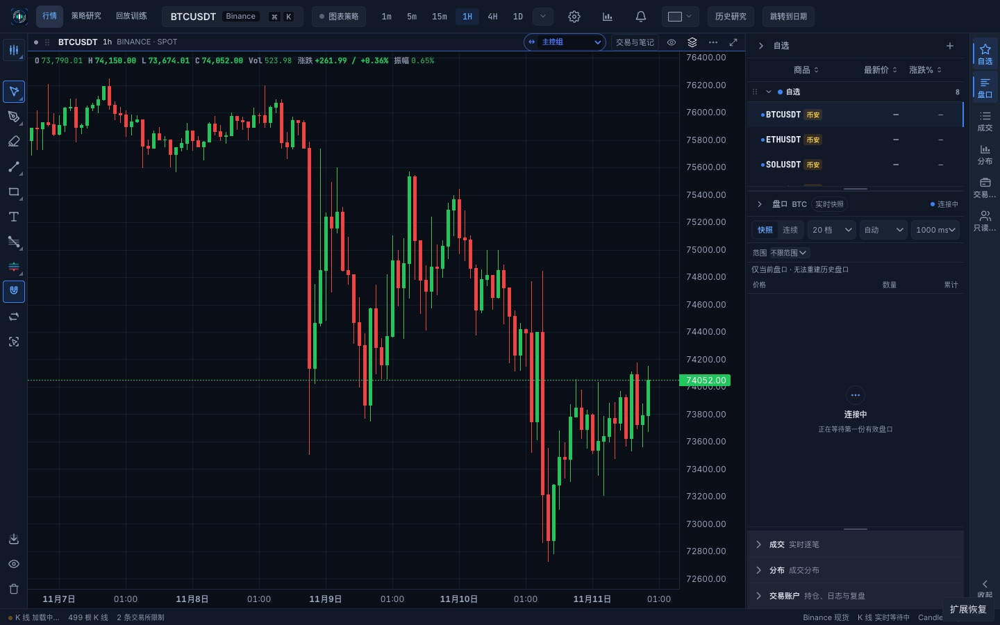 | 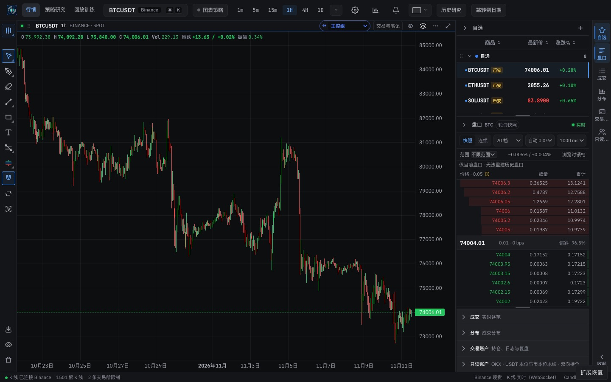 |
| Market, light | 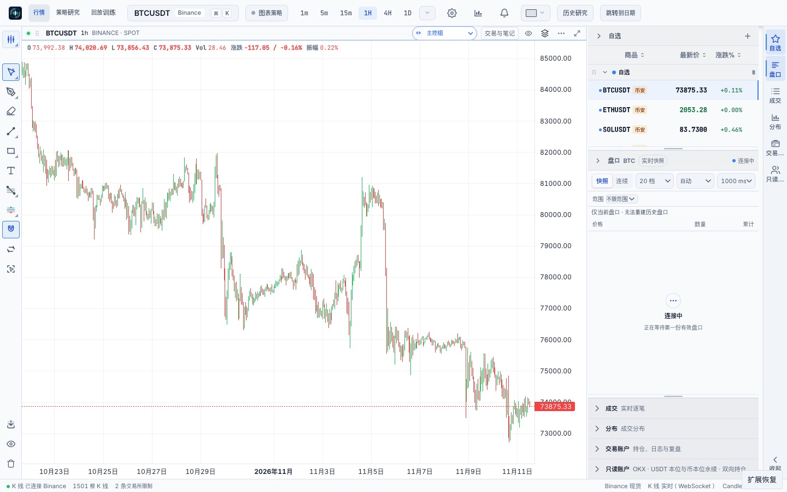 | 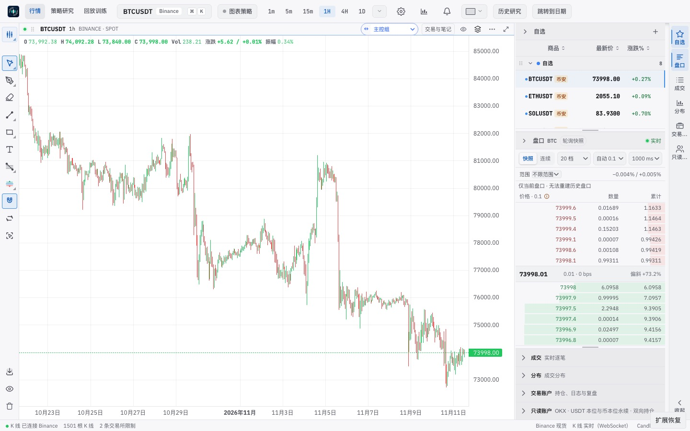 |
| Settings → 外观, dark | 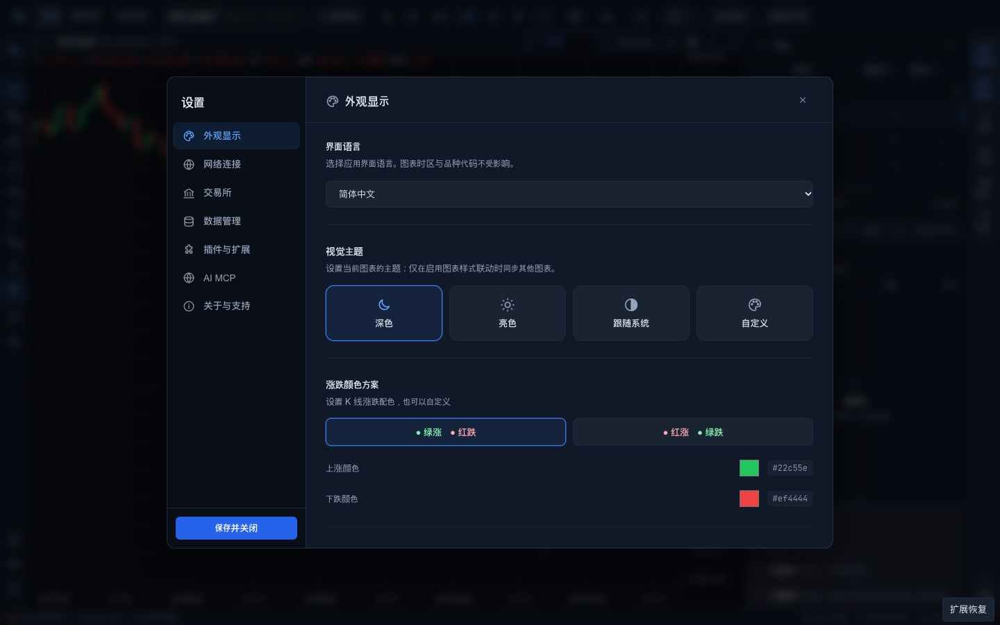 | 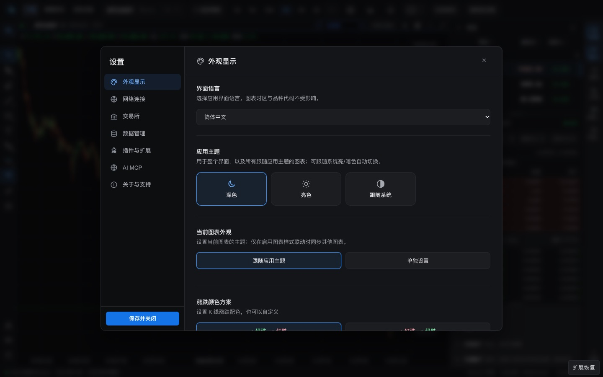 |
| Settings → 外观, light | 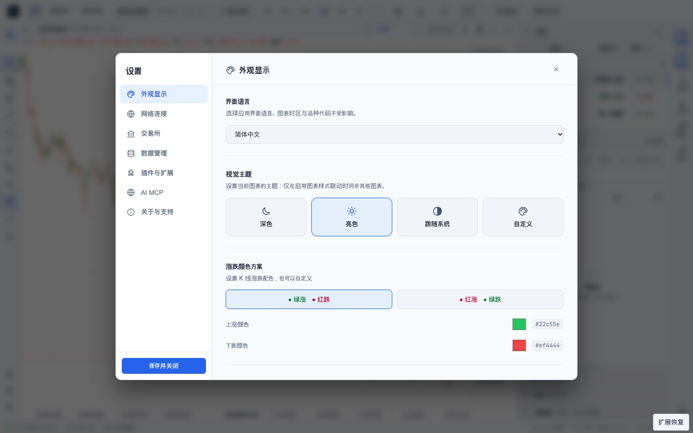 | 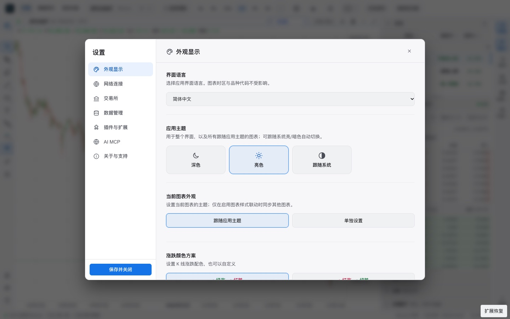 |
| Replay hub, dark | 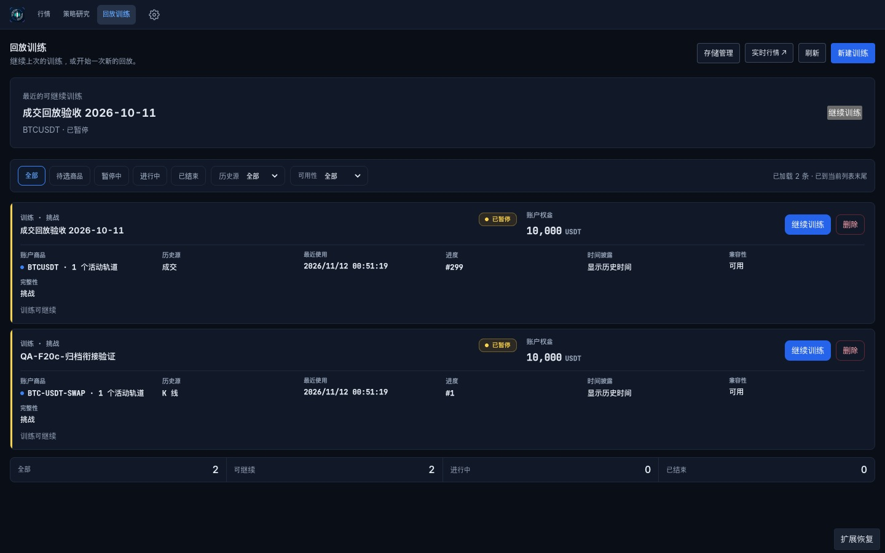 | 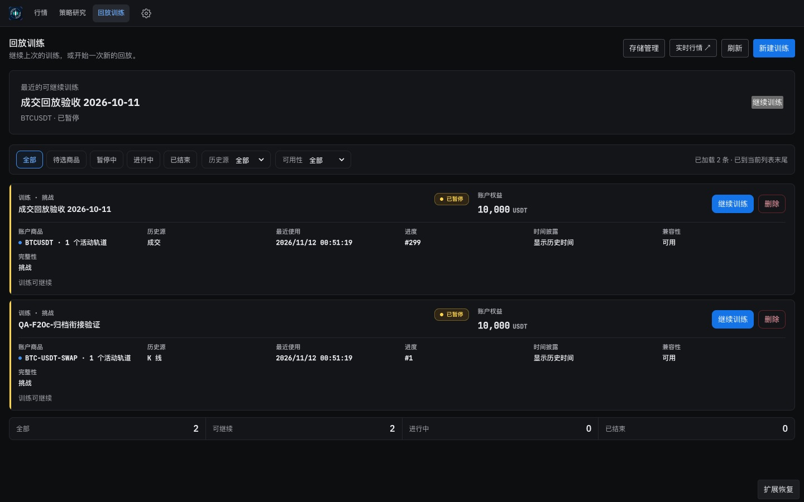 |
| Alerts drawer, dark | 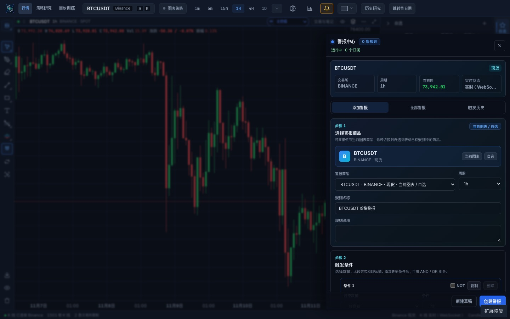 | 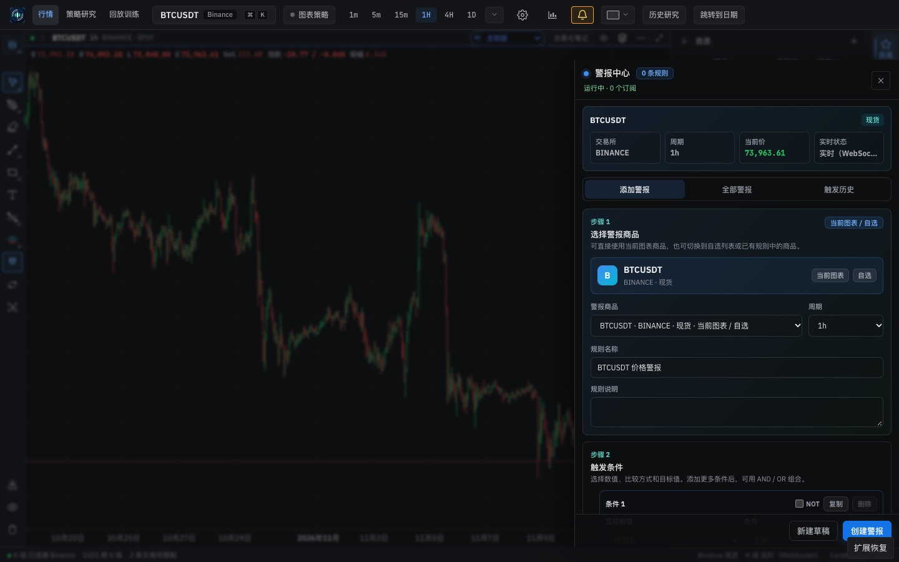 |

## Verified in the running app

- From the market page, Settings → 应用主题 → 亮色 sets `<html data-theme="light">`, `--surface-0: #ffffff`, and persists `theme: "light"`. Before this change the market page could not change the app theme.
- 当前图表外观 → 单独设置 → 深色 gives that chart Graphite dark (`--surface-0: #0d0e10` on its pane) while the app stays light. 跟随应用主题 removes the chart's own appearance and it follows the app again.
- The computed interface font is `"IBM Plex Sans", "PingFang SC", …`. Chrome's platform-font report shows Chinese headings in PingFang SC only, where the baseline mixed Apple SD Gothic Neo and PingFang SC.

## Checks

`npm run check` passes: architecture, plugins, i18n (30 locales), style metrics (warn), both typechecks, lint, 5,085 frontend tests, 137 desktop tests and the production build. New tests cover the snapshot script, the style-metrics scanner, the chart palette, the theme model (migration, chart appearance helpers, reset across a style-linked group, Settings rendering) and the desktop appearance channel.

## Known gaps, intentionally left for later phases

- **Hard-coded component colours stay navy:** the alert cards and exchange status tiles (see the Alerts pair). They move onto tokens when each surface migrates in Phase 5.
- **The selected segmented button is faint in light theme:** the active "单独设置" state is hard to see. This is the existing `.st-preset-btn` style; the Phase 2 segmented-control primitive replaces it.
- **Raw `<button>` count rose from 845 to 848:** the new chart-appearance controls reuse the existing Settings button classes. Phase 2 primitives replace them.
- **Deferred to Phase 4 (plan §5.1):** the "N 个图表使用自己的外观" line, the one-time offer to adopt a common chart override as the app theme, and the chart-header marker.
- **App-level 自定义 is narrowed:** charts that inherited an app-level 自定义 follow the converted dark or light app theme instead of keeping the custom colour (plan §5.1).
- **IBM Plex Mono is not yet compared** with JetBrains Mono.
- **No desktop smoke run:** the IPC change is covered by unit tests only, because no Electron binary was installed in this environment.
- **Light theme is not polished:** it is reachable now, and a full visual pass is planned for Phase 7.
