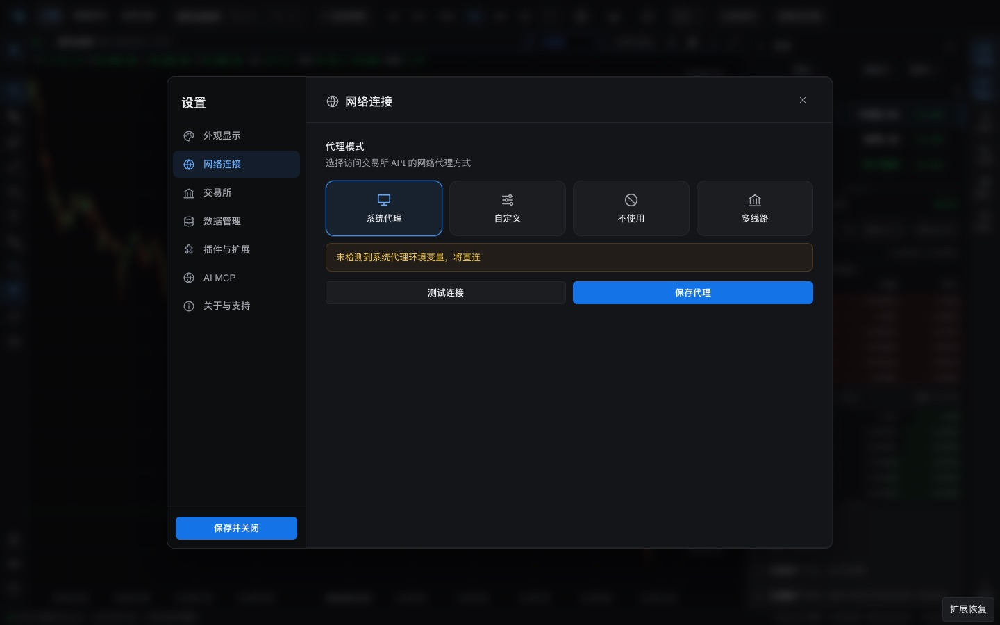
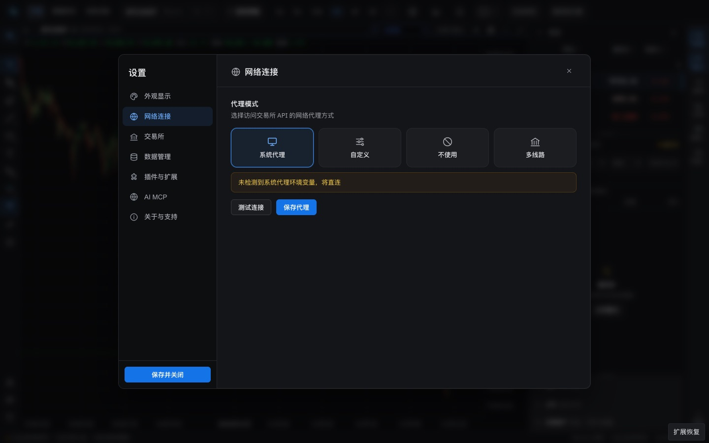
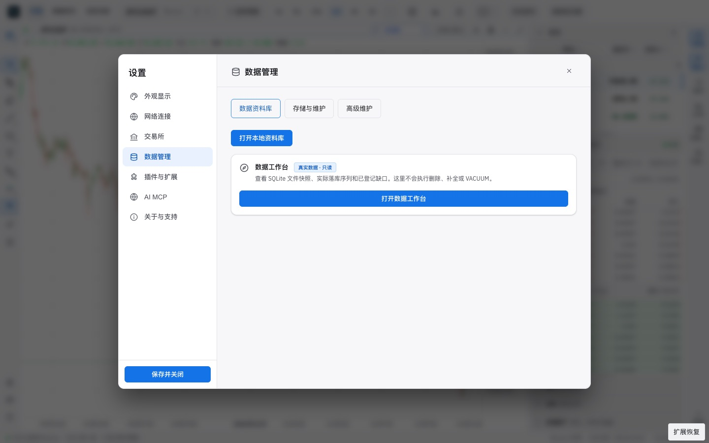
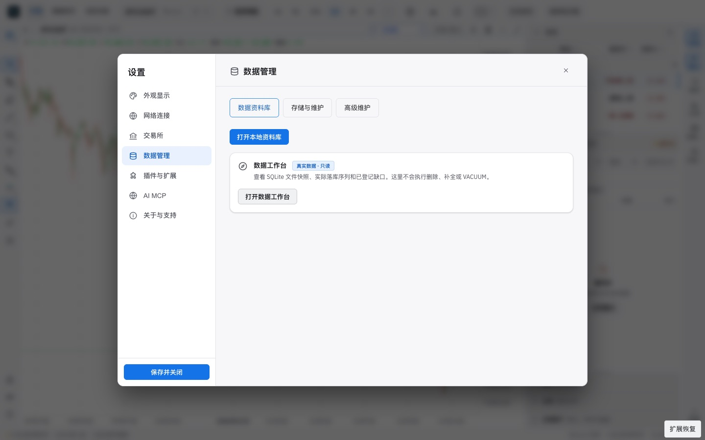
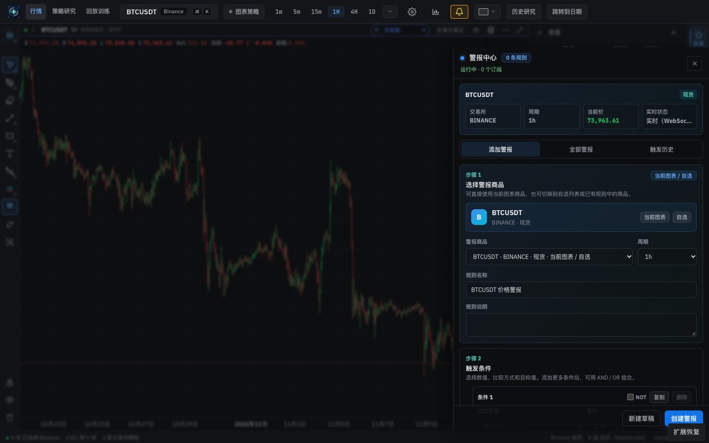

# Frontend design refactor: Phase 2b QA (UI primitives)

- Date: 2026-11-12
- Branch: `design/phase-2b-primitives`, based on `design/phase-2a-css-layers` (PR #360)
- Plan: [`frontend/FRONTEND_DESIGN_REFACTOR_PLAN.md`](../frontend/FRONTEND_DESIGN_REFACTOR_PLAN.md) §5, §6. Contract: [`DESIGN.md`](../DESIGN.md#components)
- **Intended visual change:**
  - Settings, Alerts and plugin center buttons now use the shared `Button`.
  - Settings buttons size to their label instead of stretching across the row.
  - The chart appearance switch in Settings is a segmented control whose selected option is clear in both themes.

## What changed

| Area | Change |
|---|---|
| Primitive kit | `src/components/ui`: `Button` (primary, secondary, ghost, danger; sm and md; full width), `IconButton`, `Field` with `Input`, `Select`, `Textarea`, `DateTimeInput` (always shows its zone, UTC by default), `Checkbox`, `Switch`, `SegmentedControl` and `Tabs`/`TabPanel` (arrow, Home and End keys, one tab stop), `Badge`, `Section`, `Stat`, `Disclosure`, `InlineAlert`, `EmptyState`, `FileDrop`. Pure helpers live in `helpers.ts`. |
| Styles | `button.css`, `field.css`, `choice.css` and `display.css` sit in the `primitives` layer. The `.ui-*` rules moved there from `styles/components.css`. New tokens: `--control-height-sm/md`, `--motion-fast/base`, `--ease-out`. |
| Gallery | `/ui-gallery.html` on the Vite dev server (source in `frontend/dev/`, not part of the build) shows every primitive in both themes. |
| Migration | 43 buttons with `.st-btn*`, `.alert-btn*` or `.pc-primary` became `Button`, plus 4 unclassed plugin center buttons. Their CSS is gone, and so are the `html :is(…)` patches that forced those families to look alike. The plugin center's generic `button` rules now skip `.ui-btn`, so they can't restyle a primitive. |
| Mapping | `st-btn-primary` and `alert-btn-primary` → `primary`; `st-btn-secondary`, `st-btn-accent` and `alert-btn-secondary` → `secondary`; `st-btn-warn` → `danger`; `st-btn-close` → full width. |

## Before and after

| | Before | After |
|---|---|---|
| Settings → 网络连接, dark |  |  |
| Settings → 数据管理, light |  |  |
| Alerts drawer, dark |  |  |

Gallery: [dark](assets/frontend-design-phase-2b/ui-gallery--dark.jpg), [light](assets/frontend-design-phase-2b/ui-gallery--light.jpg).

## Verification

- **Moving `.ui-*` into `primitives` on its own.** Before any migration, a live check against phase 2a compared every element's computed style on the same page, plain and with `:hover`/`:focus`/`:active` forced, across 22 states in both themes. It found one change: the chart tester's entry button in the top bar keeps its own `gap` and weight over `.ui-control`. In the production build that stylesheet already loads after `index.css`, so this only brings the dev server in line with production.
- **Primitive integrity.** In the running app, every `.ui-btn`, `.ui-icon-btn`, `.ui-input` and `.ui-segment` on screen was compared with a reference element carrying only its primitive classes, across all 22 states in both themes. None differed in box, colour or type, so no feature rule restyles a primitive.
- **Tests.** `src/components/ui/__tests__/primitives.test.tsx` covers class composition, labels and descriptions, field wiring (`id`, `aria-describedby`, `aria-invalid`, `required`), roving focus and key handling, tab and panel references, tones and roles, date-time round trips (including rejecting impossible dates), the zone label, and the file input label. `ChartAppearancePanel` tests now expect radio semantics.
- **Full suite.** `npm run check` passes: 5,111 frontend tests, 137 desktop tests, lint, both typechecks and the build.
- **Style metrics** (`npm run check:styles`): raw `<button>` 848 → 801, `<Button>` uses 5 → 50, button class families 58 → 56.

## Known gaps, intentionally left for later phases

- **Overlay primitives:** `Dialog`, `ConfirmDialog`, `Drawer`, `Popover`/`Menu`, `Tooltip` and `Toast` come with the overlay manager in Phase 2c, which also removes `window.confirm` and `window.alert`.
- **Other legacy button families** (for example `.st-preset-btn` for the up/down colour presets, the drawing and replay families) move when their surfaces are rebuilt in Phase 5. The style metrics still count 58 button class families.
- **`!important`:** 45 declarations remain. Each belongs to a surface (trade flow, replay, watchlist, drawings) or is a reduced-motion rule, and goes in Phase 5.
- **Extension recovery overlap:** the chip still overlaps the Alerts drawer footer (visible in the Alerts pair). That is a Phase 3 overlay fix.
