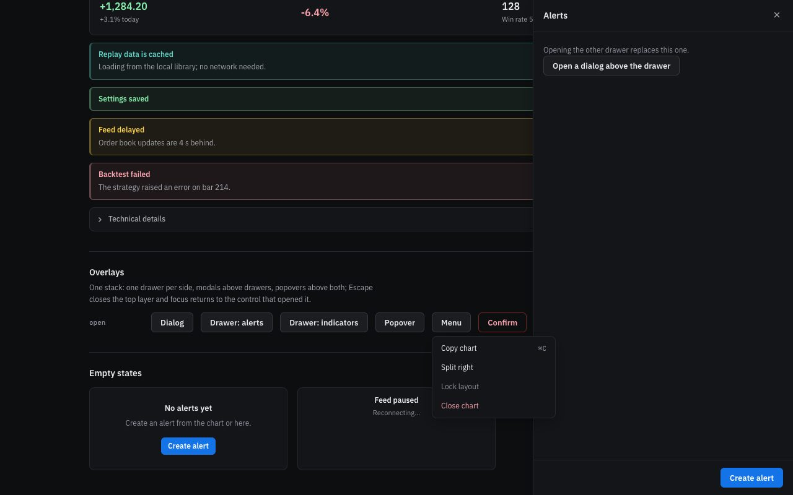
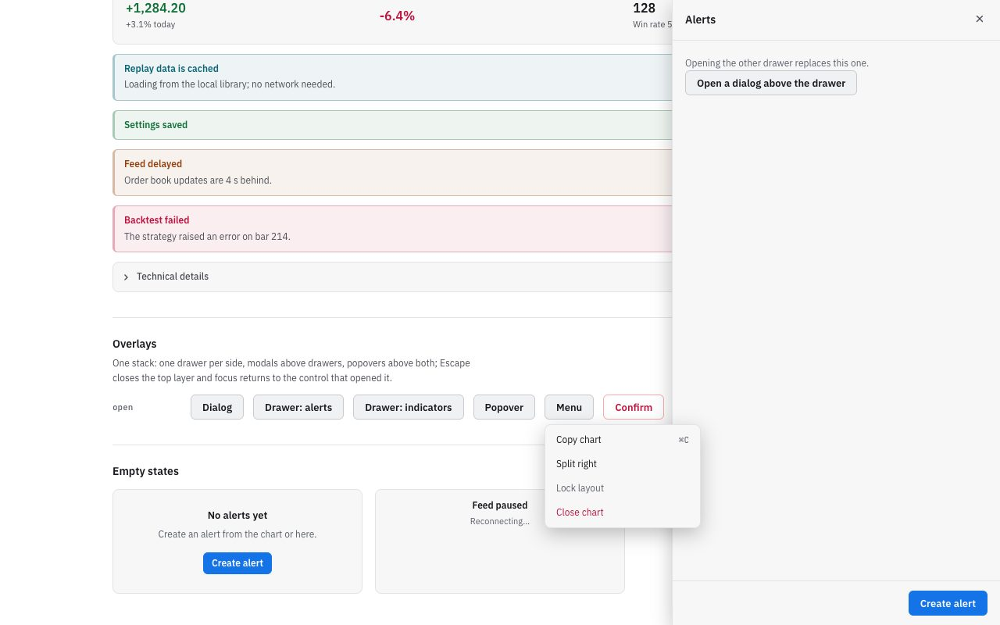
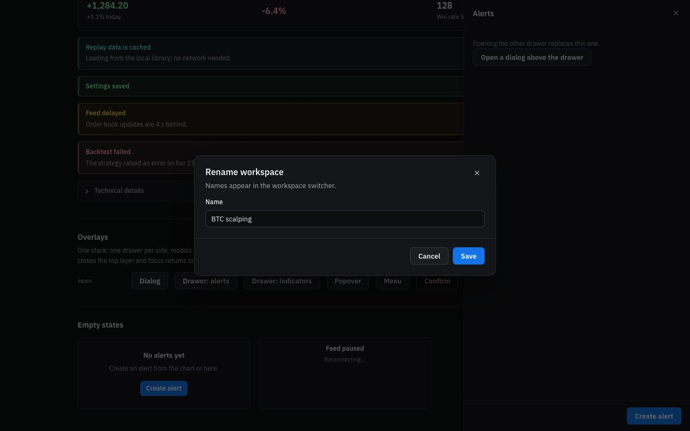
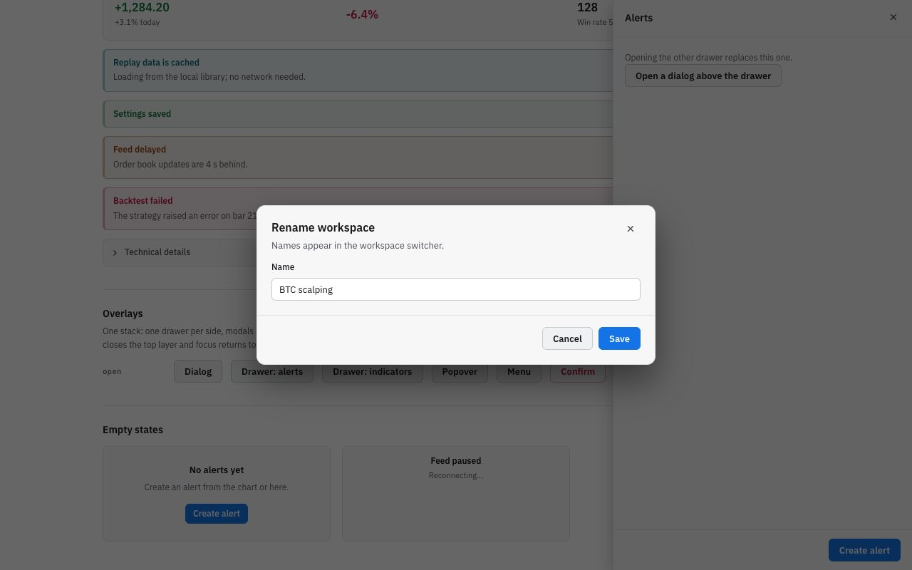
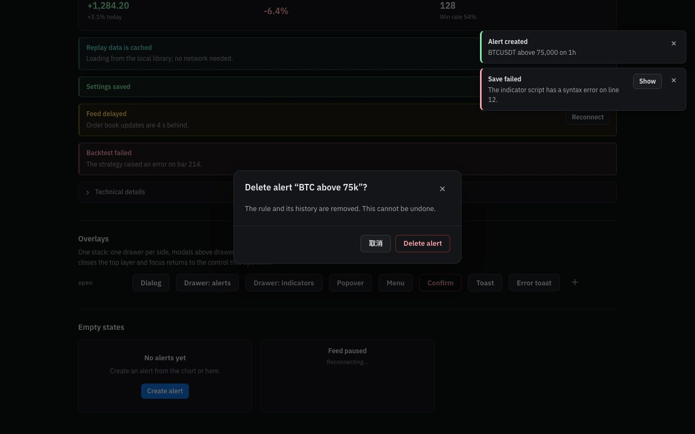
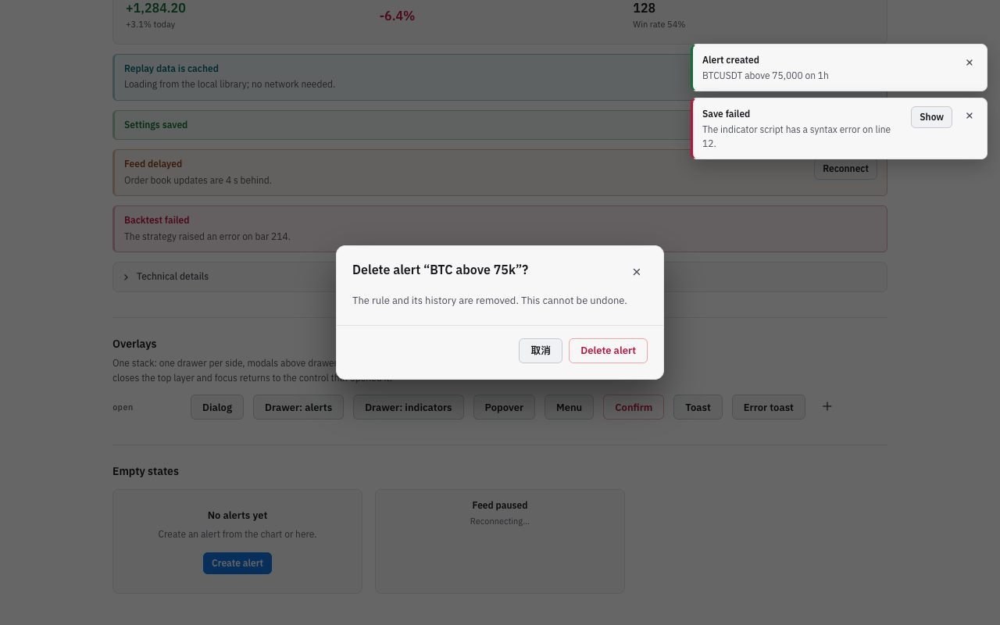

# Frontend design refactor: Phase 2c QA (overlay system)

- Date: 2026-11-12
- Branch: `design/phase-2c-overlays`, based on `design/phase-2b-primitives` (PR #362)
- Plan: [`frontend/FRONTEND_DESIGN_REFACTOR_PLAN.md`](../frontend/FRONTEND_DESIGN_REFACTOR_PLAN.md) §2.2, §5 item 4. Contract: [`DESIGN.md`](../DESIGN.md#components)
- **Intended visible change:** confirmations and error messages that used the browser's `confirm()` and `alert()` boxes now use the app's own dialog and toasts. Nothing else on screen changes; existing drawers and modals move onto the new stack in Phase 3.

## What changed

| Area | Change |
|---|---|
| Overlay stack | `components/ui/overlay/overlayStack.ts` (pure) keeps open layers in bands: drawers, then modals, then popovers and menus. The rules: <ul><li>one drawer per side (opening another closes the first)</li><li>a later modal sits above an earlier one</li><li>Escape closes only the topmost layer, and a layer can refuse it while work runs</li><li>`zIndex` comes from the `--z-overlay`, `--z-modal` and `--z-menu` bands</li></ul> |
| Runtime | `overlayRuntime.ts`: <ul><li>One overlay host outside the app root.</li><li>One capture-phase Escape listener, so the top managed layer closes before any older handler runs.</li><li>While a modal is open, `#root` and the layers under it are `inert`.</li><li>Initial focus skips the header close button.</li><li>Tab wraps inside modals, and focus returns to the opener.</li></ul> |
| Components | `Dialog`, `ConfirmDialog`, `Drawer`, `Popover`, `Menu` (arrow, Home and End keys skip disabled items), `Tooltip` (hover and keyboard focus; Escape hides it), and a toast region with `role=status` (`alert` for danger) that pauses while hovered or focused. Styles are in `overlay.css` in the primitives layer, and motion stops under `prefers-reduced-motion`. |
| Imperative API | `confirmAction(options) → Promise<boolean>` and `notify(options)` mount on demand, so event handlers outside React render paths can use them. |
| Migration | All 9 `window.confirm` calls now use `confirmAction`, and the 2 `window.alert` calls use `notify`. They cover: deleting an alert, deleting a custom indicator, clearing custom intervals, moving a dataset to the trash, switching a dataset revision, revealing replay time, activating a marketplace plugin, resuming paper orders, and applying a v1 compatibility import or rollback. Each confirm button names its action, and destructive ones are red with Cancel focused first. |
| i18n | `common.ok`, `common.cancel`, `common.close` and `common.notifications` in all 30 locales, reusing each locale's existing translations. |
| Tooling | The style-metrics scanner no longer counts `buttonClassName({ variant })` options as class names. |

## Screens

| | Dark | Light |
|---|---|---|
| Drawer with a menu open |  |  |
| Dialog above a drawer |  |  |
| Confirmation with toasts |  |  |

## Verification

**Unit tests** (`overlays.test.tsx`) cover:
- drawer replacement on the same side only;
- band order regardless of open order;
- modal over modal, and inert state below a modal;
- Escape order, and a layer that refuses Escape;
- subscriptions;
- popover placement: below, flipped above, clamped to the viewport, end-aligned;
- Tab wrapping;
- the toast limit and default durations;
- dialog labelling.

**In the running gallery** (`/ui-gallery.html`), using real clicks and key presses:
- Opening the indicators drawer replaced the alerts drawer.
- A dialog opened from the drawer sat above it (z-index 1000 over 500), made the page and the drawer inert, and took focus.
- Escape closed the dialog and returned focus to the drawer's button. A second Escape closed the drawer and returned focus to the button that opened it.
- The menu focused its first item. Arrow keys skipped the disabled item, and Escape returned focus to the trigger.
- The confirmation focused Cancel. Escape resolved "kept", focus returned, and the temporary mount was removed.
- Toasts appeared with `role=status` / `role=alert` above the modal backdrop.

**Full check:** `npm run check` passes: 5,121 frontend tests, 137 desktop tests, lint, both typechecks and the build.

**Style metrics:** `window.confirm` / `window.alert` went from 11 to 0. Unstyled class names stay at 110.

## Known gaps, intentionally left for later phases

- **Older overlays are not on the stack yet.** The Alerts and Indicators drawers, Symbol Search, Export, Settings and the others still manage themselves, so the overlapping drawers and the Escape inconsistencies from audit §2.2 remain until Phase 3 moves them onto it. Meanwhile, a managed confirm dialog opened from inside one of them behaves correctly: it sits on top and makes the page inert, and Escape closes only the confirmation.
- **Popovers and menus that close on an outside click:** an older one closes when its confirmation dialog takes the click. The confirmed action still runs.
- **Toasts sit below the top bar on the right.** Phase 4 decides their final place together with the shell.
