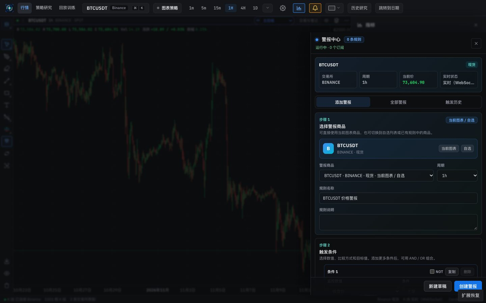
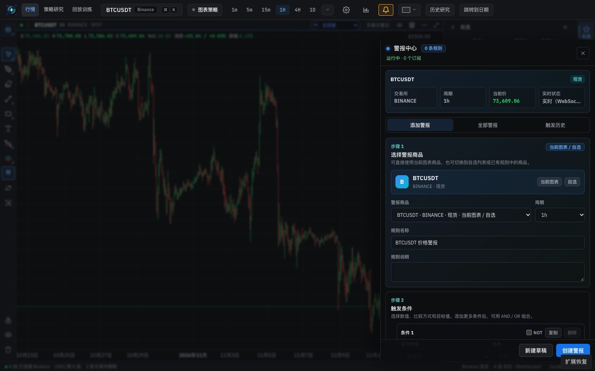
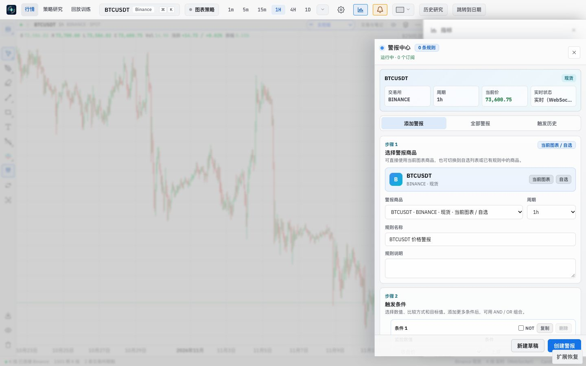
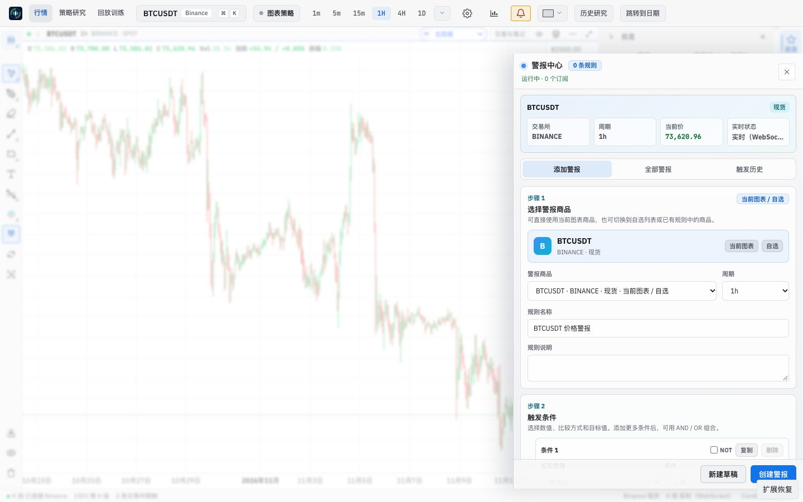
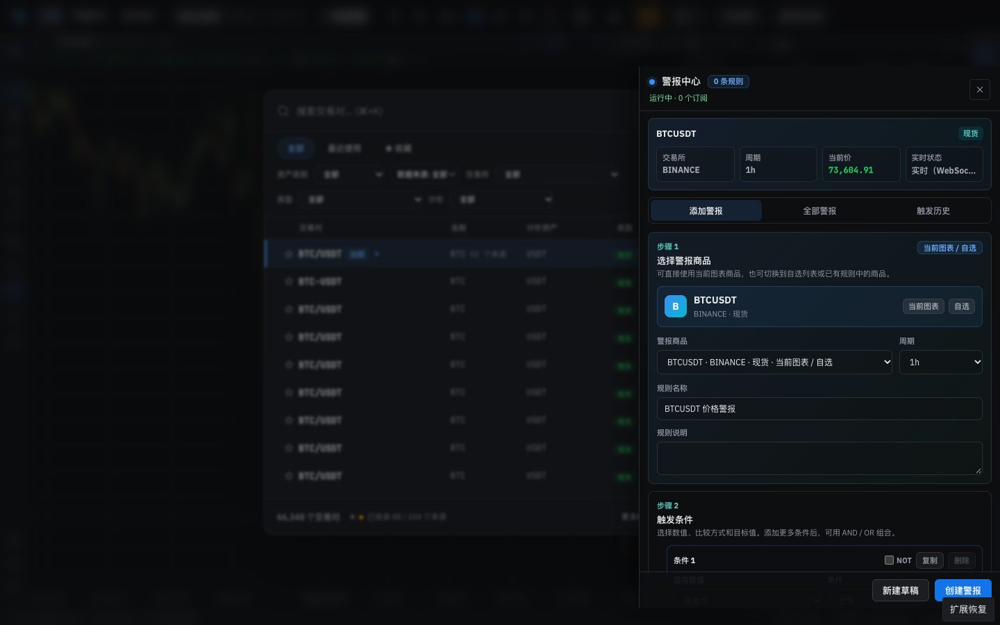
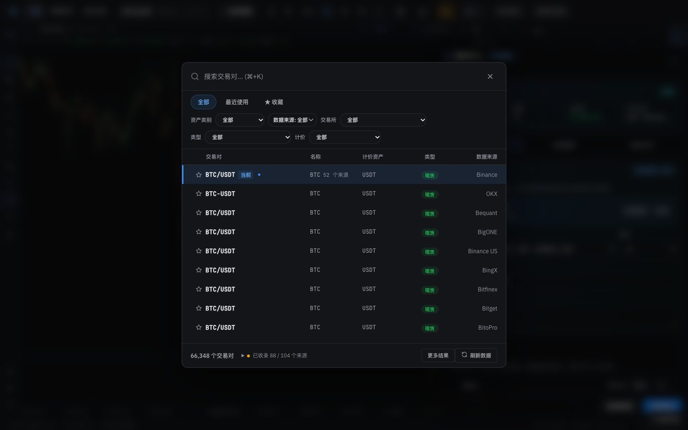
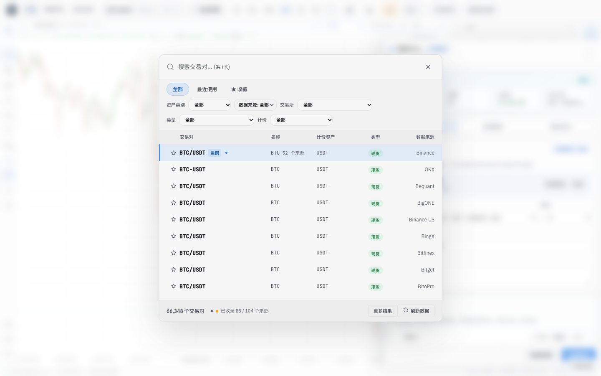

# Frontend design refactor: Phase 3a QA (existing overlays on the stack)

- Date: 2026-11-12
- Branch: `design/phase-3-p0-fixes`, based on `design/phase-2c-overlays` (PR #368)
- Plan: [`frontend/FRONTEND_DESIGN_REFACTOR_PLAN.md`](../frontend/FRONTEND_DESIGN_REFACTOR_PLAN.md) §2.2 and the Phase 3 row. Contract: [`DESIGN.md`](../DESIGN.md#components)
- **Intended visible change:** overlays stop overlapping and stack in the right order, and Escape closes them one at a time. Each surface keeps its current look; restyling is Phase 5.

## What changed

| Area | Change |
|---|---|
| `OverlayLayer` | New adapter in `components/ui/Overlays.tsx`. It puts an existing overlay's markup on the stack without restyling it:<ul><li>The markup moves into the overlay host, inside a full-screen layer that takes the stack's z-index. The surface's own z-index values now only order its own parts.</li><li>It joins the Escape order.</li><li>Focus moves into the layer and returns to the opener.</li><li>A modal also makes the page inert and keeps Tab inside.</li></ul> |
| Surfaces moved | <ul><li>**Drawers (right):** Alerts, Indicators, Workspace, trade journal, plugin side panels, the strategy page's research data, saved accounts and run history drawers, and the replay integrity and results drawers.</li><li>**Modals:** Settings, Plugin Center and the data workbench (each a layer above Settings), page Settings, Symbol Search, the replay launcher, the add-account dialog, and plugin dialogs, including the live-order confirmation.</li></ul> |
| Escape | The stack now decides last. The focused control gets Escape first: a field that cancels its edit, Symbol Search's nested pickers, or the replay launcher stepping back. The top layer closes only if nothing used the key (`preventDefault` or `stopPropagation`). A native modal `<dialog>` keeps its own Escape. While any layer is open, restoring a maximised chart and leaving a drawing tool wait their turn. |
| Escape refusal | `closeOnEscape` is read when Escape is pressed, so it can change without re-registering the layer. The Indicators drawer refuses Escape while the script editor is open, so a stray Escape cannot discard code. The add-account dialog refuses it while saving, and Plugin Center while an install runs. |
| Focus | <ul><li>The opener is captured once per opening, which survives React StrictMode re-running effects.</li><li>Focus returns after the commit, so it can go to a control that was hidden while the layer was open, such as the Settings nav button behind Plugin Center.</li><li>Initial focus skips resize handles and close buttons marked `data-overlay-close`.</li></ul> |
| Removed | The Escape, focus and Tab code that these surfaces each carried: Settings, page Settings, Plugin Center, plugin dialogs, research data drawer, add-account dialog, replay integrity drawer and strategy accounts drawer. Also the dead `.replay-shared-indicator-panel` z-index rule. |
| Smoke script | `scripts/smoke.mjs` waited for `.st-btn-close`, which Phase 2b removed. It now checks the Settings dialog role and its footer button. |

## Screens

The two cases from audit §2.2, captured on the base build (`04429b165`, Phase 2c) and on this branch with the same clicks.

| | Before | After |
|---|---|---|
| Indicators, then Alerts (dark) |  |  |
| Indicators, then Alerts (light) |  |  |
| Alerts, then Symbol Search (dark) |  |  |
| Alerts, then Symbol Search (light) |  |  |

**Before:** both drawers stayed open, one on top of the other. Symbol Search had `z-index: 9000`, but inside the top bar's stacking context (100), so it rendered under the Alerts drawer (142).

**After:** the Alerts drawer replaces Indicators. Symbol Search (stack band 1000) sits above the drawer (500), and the drawer and page are inert.

## Verification

**Looks unchanged.** `output/css-split/surface-diff.mjs` opens the same state on the base build and on this branch. It compares every element under each surface root: the computed style of the element and its `::before`/`::after`, and its box. The run used dark and light at 1440×900, after `document.fonts.ready`.

| State | Elements | Differences |
|---|---|---|
| Settings: appearance, network, exchanges, data, plugins | 105–2,261 per tab | 0 |
| Plugin Center | 72 | 0 |
| Indicators drawer | 180 | 0 |
| Alerts drawer | 268 | 0 |
| Workspace drawer | 71 | 0 |
| Strategy page: saved accounts, run history, research data drawers | 8 / 40 / 140 | 0 |
| Symbol Search | 811–1,329 | 0 in light. In dark, 2: two loading spinners captured at different points in their rotation |
| Data workbench | 313 | Only live data: one status badge read "warning" in one run and "OK" in the other. A control run of this branch against itself shows the same kind of difference |
| Settings under the data workbench | 374 | `interactivity: inert` on every element. This is intended: a modal now makes the layer beneath it inert |

**Behaviour in the running app**, with real clicks and key presses on the market page:
- Indicators, then Alerts: one layer at z 500, and Indicators closed.
- Escape with focus in the Alerts drawer closed it; before this change it had no Escape at all. Focus returned to the Alerts button.
- Alerts, then ⌘K: Symbol Search at z 1000 above the drawer at 500. The drawer and `#root` were inert, and focus was in the search field. The first Escape closed the search and the second closed the drawer, each returning focus.
- Settings, then 插件与扩展: Plugin Center opened as a layer above Settings, with Settings inert. Escape closed only Plugin Center, and focus returned to the 插件与扩展 nav button.
- Settings → 数据管理 → 存储与维护: typing in a cache size field, then Escape, reset the draft and left Settings open, because the field used the key.
- 打开数据工作台: the workbench opened above Settings. Escape closed the workbench only, returning focus to its button, and a second Escape closed Settings.
- Export, a native `<dialog>`, opened over the Alerts drawer: Escape closed Export and left the drawer open.
- Indicators → "+ 自定义" opened the script editor. Two Escapes in the editor left the editor and the drawer open.
- In the 2c gallery, Dialog over Drawer still closes one layer per Escape, returning focus each time.

**Unit tests:**
- `overlays.test.tsx` adds two tests: `closeOnEscape` is read when Escape is pressed, and the Escape decision skips prevented, stopped and composing keys and open native modals.
- `replayTrainingWorkspace.test.tsx` now checks that the integrity drawer sits on the stack.
- Static rendering, used by many component tests, renders `OverlayLayer` content in place.

**Full check:** `npm run check` passes: 5,123 frontend tests, 137 desktop tests, lint (one existing warning), both typechecks and the build. Style metrics are unchanged: 110 unstyled class names and 45 `!important`.

## Known gaps

- **Native modal `<dialog>` surfaces are not on the stack yet:** Export, jump to date, history study, research return, replay screenshots, and the drawing property panels. The browser keeps them above every layer and they handle their own Escape, so they behave correctly next to a drawer. A stack dialog or toast opened from inside one would sit beneath it; none does today. Each moves when it is rebuilt; the history study moves in 3b.
- **Still managing themselves:** the replay hub's create and end-session dialogs, and the trade explanation inside the strategy tester. In the tester, Escape inside the explanation still closes the whole tester panel, as before.
- **Alert notifications** (`AlertNotificationCenter`) render inside the page, so while a modal is open they show but cannot be clicked, like the rest of the page. They move to `notify()` with the Alerts rebuild in Phase 5.
- **ARIA:** the Workspace drawer still declares `aria-modal="true"` although drawers are not modal. Phase 5 replaces its markup.
