# Frontend design refactor: Phase 3b QA (unstyled surfaces and the history study popover)

- Date: 2026-11-12
- Branch: `design/phase-3b-unstyled-surfaces`, based on `design/phase-3-p0-fixes` (PR #371)
- Plan: [`frontend/FRONTEND_DESIGN_REFACTOR_PLAN.md`](../frontend/FRONTEND_DESIGN_REFACTOR_PLAN.md) §2.1 and the Phase 3 row. Contract: [`DESIGN.md`](../DESIGN.md#components)
- **Intended visible change:** the surfaces that rendered with browser defaults now use the kit. The history study setup becomes a popover under its button. Everything else keeps its look.

## What changed

| Area | Change |
|---|---|
| Event markers (strategy page, imported data) | Rebuilt from the kit: `Field` with `Select`, `Input`, `Textarea` and a colour swatch, `Button`, `InlineAlert` for a damaged marker file, `EmptyState`, and a marker list with locate, edit and delete beside each marker. The panel is its own collapsible section. Its old wrapper in the strategy rail was labelled 质量 · 修订 · 项目包, which belongs to dataset management; it now reads 事件标记 with the marker count. |
| CSV event import | `FileDrop` replaces the native file input, whose "Choose file / No file chosen" was in English. Column mapping is a two-column grid of `Field`s; the preview table scrolls inside a frame; the import result is an `InlineAlert`, amber when rows were rejected. |
| Dataset management (data drawer) | Rename, archive and move-to-trash on one row of kit controls; the quality card's label and status no longer run together; revisions are rows with a 当前 badge or compare and switch buttons; the comparison is an `InlineAlert`; project import is a compact `FileDrop`; archived and recycled datasets are rows. The duplicate inner heading is gone, and the busy state says 正在处理… instead of the raw words "ready" or "renaming". |
| History study setup | A `Popover` anchored to the top-bar 历史研究 button (the button toggles it and reports `aria-expanded`). It was a native `<dialog>` pinned over the top-left corner, borrowing the jump-to-date and trading styles, so its buttons ran together unless another feature had loaded first. Now: kit fields, the saved studies as rows, the range error as an `InlineAlert`, Close and Start in a footer. It is on the overlay stack: Escape or a click outside closes it (not while saving) and focus returns to the button. |
| `DateTimeInput` | A text field that writes `2026-01-02 09:30` (or with seconds) in every locale, plus a calendar button that opens the browser's picker. The browser's own control formats dates in the browser's language, so a Chinese UI in an English browser showed `09/09/2026, 10:00:00 PM`. Typed text accepts `-` or `/`, a space or `T`, single-digit parts and a bare date; text that does not parse is marked invalid. `zoneLabel={false}` hides the zone suffix when the label already names it. |
| `FileDrop` | A `compact` one-row form for narrow panels. |
| Strategy toolbar | The custom-interval form uses `Input`, `Checkbox`, `Select`, `DateTimeInput` for the event anchor and a `Button` for 切换. Before, the checkboxes took the text-field padding and 切换 was a grey native button. |
| Smaller fixes | <ul><li>Replay hub: 继续训练 in the resume card is a primary `Button`; it was unstyled because the hub's button rules only covered the header and cards.</li><li>Replay and strategy charts: load errors are an `InlineAlert` with a 重试 button, and the strategy page's page-level errors are alerts with a close button.</li><li>Strategy language picker: `Field`, `Select`, and the Python warning as an `InlineAlert` with a `Checkbox`.</li><li>Data workbench: 添加周期 uses the workbench's button style and the 周期 legend is styled.</li><li>Text drawing toolbar: its drag grip and name now use the main drawing toolbar's styles (grab cursor, size, ellipsis).</li><li>Replay: eyebrow labels above headings, the T0 mark on the market picker, the results notices and the order edit form have styles.</li><li>Plugin center: host-managed runtime and symbol provider rows match the runtime list.</li></ul> |
| Kit controls inside older panels | The strategy page and data drawer style bare `button`, `input` and `select`; those rules now skip kit controls, inside `:where()` so their specificity is unchanged. Same for the replay hub's disabled-button rule. The invalid border of a kit field no longer disappears on hover. |
| Unstyled class names | 110 → 1. <ul><li>The scan no longer counts values compared inside a `className` expression (`side === "short" ? "negative" : …`) as classes.</li><li>Test and script hooks are declared with the reason (`settings-btn`, `export-workspace`, …).</li><li>27 class names that had no rule on an element styled by other classes are removed; this changes no style.</li></ul> |
| Copy | Two strings in all 30 locales: `common.pickDateTime` (the calendar button) and `common.working`. |
| Other metrics | Raw `<button>` outside the kit: 801 → 772. `Button` uses: 53 → 82. Inline styles (176) and `!important` (45) are unchanged. |

## Screens

Captured with the same steps on the base build (Phase 3a, `bcfbdfc9c`) and on this branch, 1440 px wide, `zh-CN`. The event list is seeded with two sample markers; the CSV is a three-row sample whose last row has no time zone.

| | Before | After |
|---|---|---|
| History study (dark) | 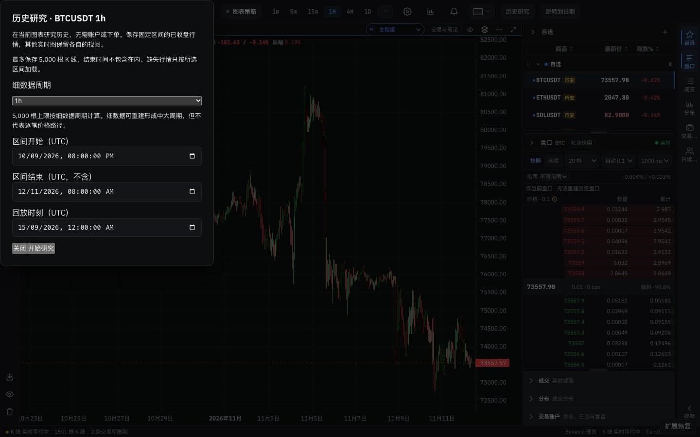 | 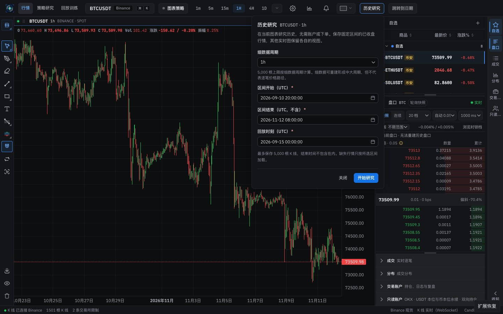 |
| History study (light) | 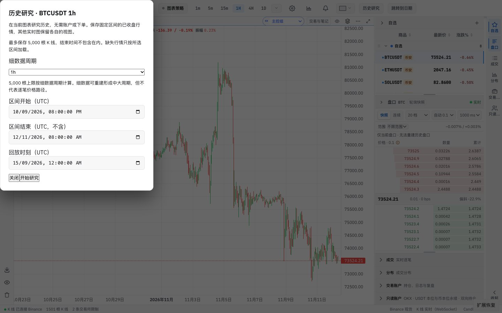 | 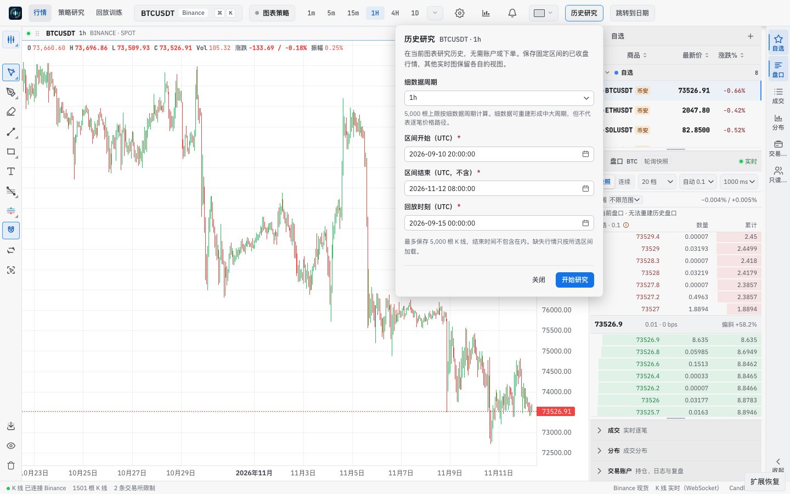 |
| Event markers (dark) | 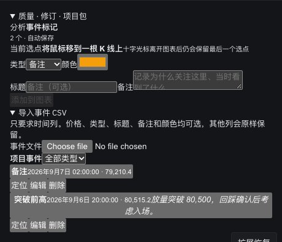 | 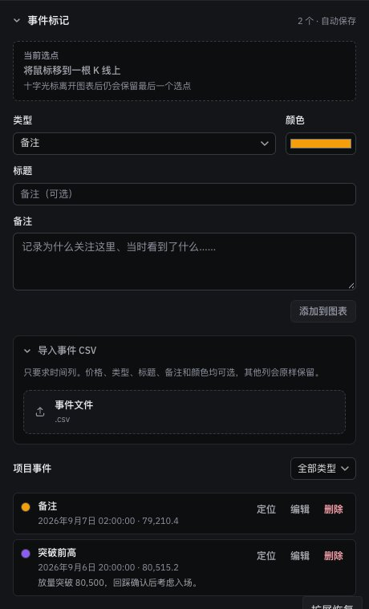 |
| Event markers (light) | 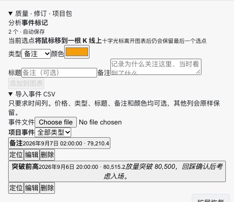 | 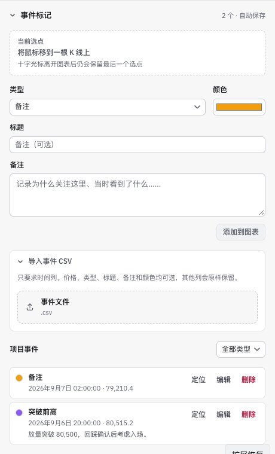 |
| CSV import with a file (dark) | 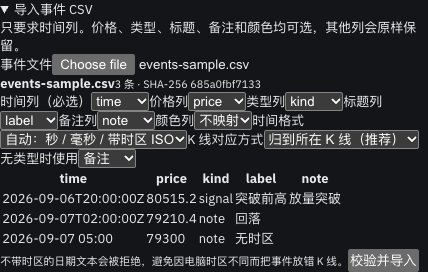 | 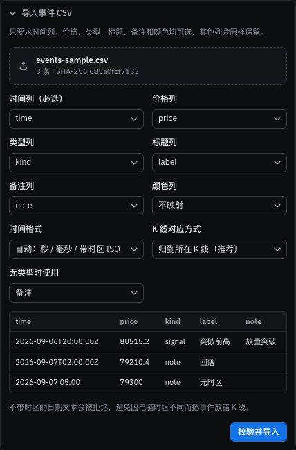 |
| CSV import with a file (light) | 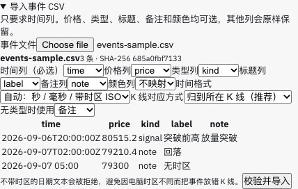 | 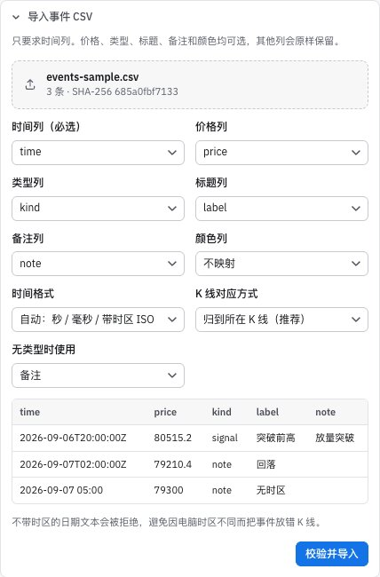 |
| Dataset management (dark) | 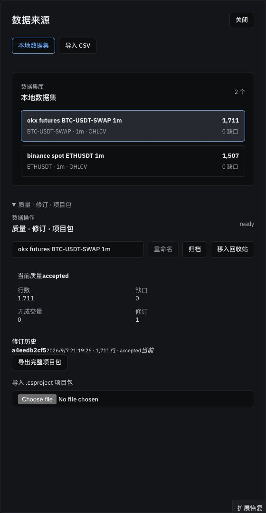 | 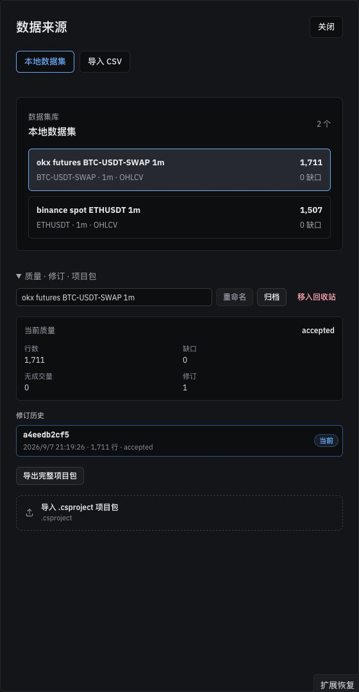 |
| Dataset management (light) | 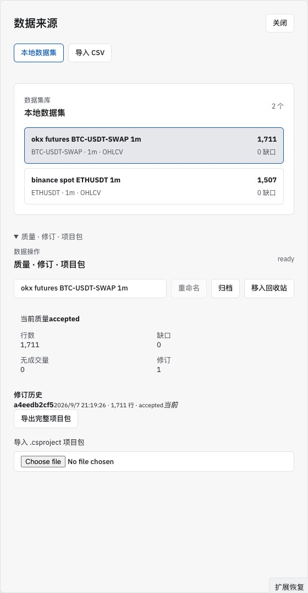 | 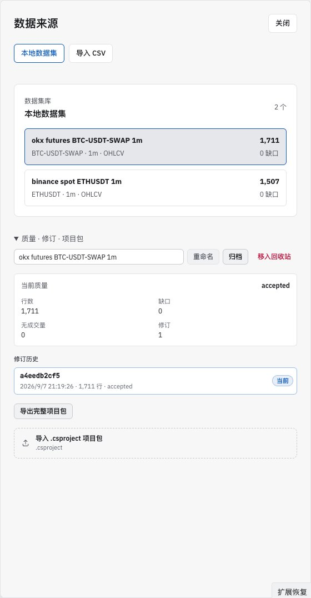 |
| Strategy toolbar with an event anchor (dark) |  |  |
| Replay hub resume card (dark) |  |  |

## Verification

**In the running app**, with real clicks and keys:
- History study: 历史研究 opens the popover below the button at z 10000, labelled 历史研究, with focus in the first field and `aria-expanded="true"` on the button. An impossible start time is marked invalid (red border, also on hover); Start then shows the range error. Escape closes the popover and returns focus to the button. A click on the chart closes it. The calendar button opens the browser's picker without an error; the picker itself is drawn by the browser and does not appear in screenshots.
- Event markers: the seeded markers list newest first with locate, edit and delete. A loaded CSV fills the mapping grid and preview; importing reported two imported and the row without a time zone rejected, with its reason.
- Dataset management, strategy toolbar (anchor and calendar options), replay hub and the gallery's date fields and file pickers render as in the screens, in both themes.

**Unit tests:**
- `primitives.test.tsx`: the date-time input renders text in `2026-01-02 03:04` form with the calendar button and the zone; typed text parses in each accepted spelling and rejects impossible dates and times.
- `check-style-metrics.test.mjs`: compared values inside `className` expressions are not counted as classes.

**Full check:** `npm run check` passes: 5,125 frontend tests, 137 desktop tests, lint (one existing warning), both typechecks and the build. A first run failed in 7 test files because the event panel imported its stylesheet and Node's test runner cannot load CSS; the stylesheet is now imported by the strategy page bootstrap, like the page's other stylesheets.

## Known gaps

- **AI control panel** (Settings, desktop app only) is still plain markup and is the one unstyled class name left. It cannot be shown in a browser; it is rebuilt with Settings in Phase 5.
- **Native date inputs elsewhere** still follow the browser's language, in 14 files: jump to date, the replay launcher, the data workbench, the history study's seek field, alerts, the interval anchor picker, drawing coordinates, manual fills, the account journal, strategy conditions, continuous strategies, research market inputs, market trade import and raw trade retention. Each moves to `DateTimeInput` when its surface is rebuilt. Some, such as the workbench's start time, use the browser's time zone and need `utc={false}`.
- **Raw server text** is still shown as is: quality statuses such as "accepted", the replay chart's "Could not read the provider history boundary", and the strategy toolbar's "source bars" and "dataEpoch". Phase 3c translates them.
- **Not seen in a browser:** the read-only account trade list, the replay order edit form, and the plugin runtime registry and provider rows need live accounts, a working replay order or a host-managed runtime. Their new rules copy neighbouring rows. The flag-off local page (`LocalApp`) was not opened either.
- **A click outside the history study popover closes it** and discards typed times, as for any popover. The old dialog was modal.
- **Desktop app:** not tested.
