# Frontend design refactor: Phase 3c QA (extension recovery and raw errors)

- Date: 2026-11-12
- Branch: `design/phase-3c-recovery-errors`, based on `design/phase-3b-unstyled-surfaces` (PR #375)
- Plan: [`frontend/FRONTEND_DESIGN_REFACTOR_PLAN.md`](../frontend/FRONTEND_DESIGN_REFACTOR_PLAN.md) §2.2, §2.4 and the Phase 3 row. Contract: [`DESIGN.md`](../DESIGN.md)
- **Intended visible change:** the 扩展恢复 button no longer sits over every page. A notice appears only when an extension failed or extensions are off. Extension management uses the kit. The errors and values the audit found in English now read in the user's language.

## What changed

| Area | Change |
|---|---|
| Extension recovery | <ul><li>The fixed 扩展恢复 button (z-index of a modal, over the status bar, the Alerts 创建警报 button and the rail's 收起) is gone.</li><li>Extensions are managed in Settings → 插件与扩展 → 可信扩展, which already existed.</li><li>When an extension fails to load, or extensions are off (`?extensions=off`, or the desktop app's `--extensions-safe-mode`), a notice says so with 管理扩展. It stays until dismissed or resolved, and a newly failed extension shows it again.</li><li>管理扩展 opens the same management in a dialog rendered outside the extension-replaceable slots, so it still works when an extension has broken the page.</li><li>A failed registry read alone does not raise the notice: that is usually a short backend outage, and management shows it.</li></ul> |
| Extension management | Rebuilt from the kit: `FileDrop` for the package (it was a native picker reading "Choose file / No file chosen"), `Select`s in `Field`s for theme and layout, `Checkbox` for the trust confirmation, `Badge` for enabled or disabled, `InlineAlert` for recovery mode, runtime errors and reload prompts, and each realm's status as a definition list. Messages written by an extension or the host stay as written, as technical detail. 不加载扩展并刷新 (or 正常重新加载 in recovery mode) sits outside the locked form, so it works even when management cannot. |
| Desktop app recovery mode | The page now learns from the extension registry that the desktop app started in recovery mode, so the notice also appears there. |
| `describeError` | Codes users meet often get a message of their own, which replaces the English server text instead of following the summary in brackets: `HISTORY_ORIGIN_UNAVAILABLE` (the replay "Could not read the provider history boundary") and `SUBSCRIBE_FAILED` (live data subscription). |
| Replay chart and trade flow | The replay chart's load errors go through `describeError`; they showed the server text as is. The trade-flow stream keeps the code on its error, so `SUBSCRIBE_FAILED: trade-flow…` reads 实时数据订阅失败. The replay order ticket already used `describeError` and picks up the new message. |
| Values | Dataset quality reads 已通过 or 已通过（有缺口） instead of `accepted` / `accepted_with_gaps`; an unknown status is shown as sent. The strategy toolbar reads 1,711 根源 K 线 and 数据版本 a4eedb2cf5c1 (full hash on hover) instead of "source bars" and "dataEpoch". |
| Automation | The two desktop smoke scripts waited for the 扩展恢复 button to know the page was up, and the extensions smoke opened management with it. They now wait for the Settings button and go Settings → 插件与扩展 → 可信扩展, with their extension-panel lookups scoped to the panel (the plugin center has its own 刷新 button). The design snapshot state opens the recovery dialog from the notice in recovery mode. |
| Copy | Six strings in all 30 locales: the two code messages, two quality statuses, the source bar count and the data version. |

## Screens

Captured with the same steps on the base build (Phase 3b, `12a3451d4`) and on this branch, 1440 px wide, `zh-CN`.

| | Before | After |
|---|---|---|
| Market page (dark) | 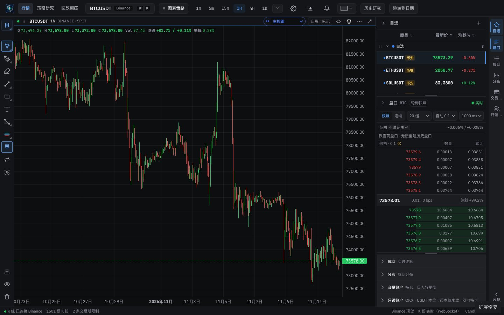 | 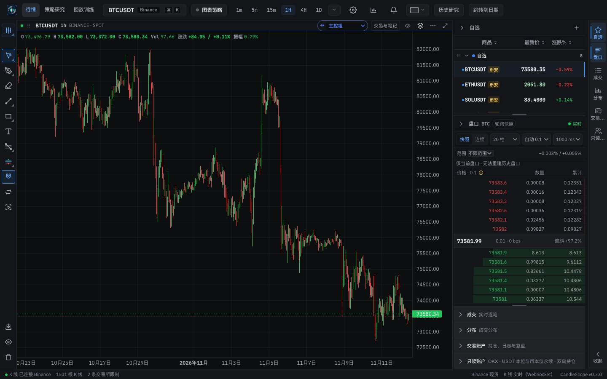 |
| Market page (light) | 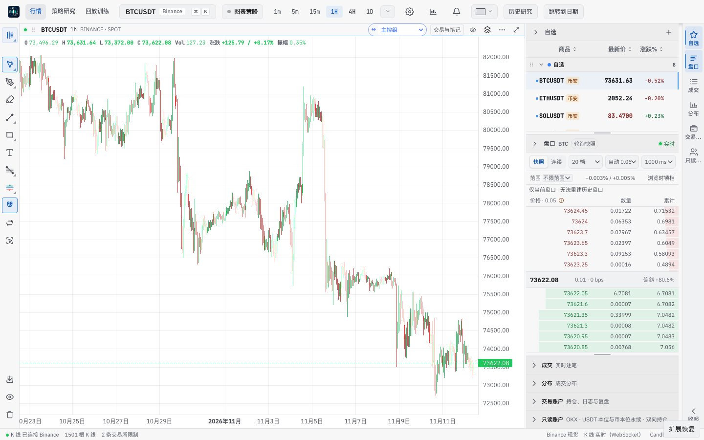 | 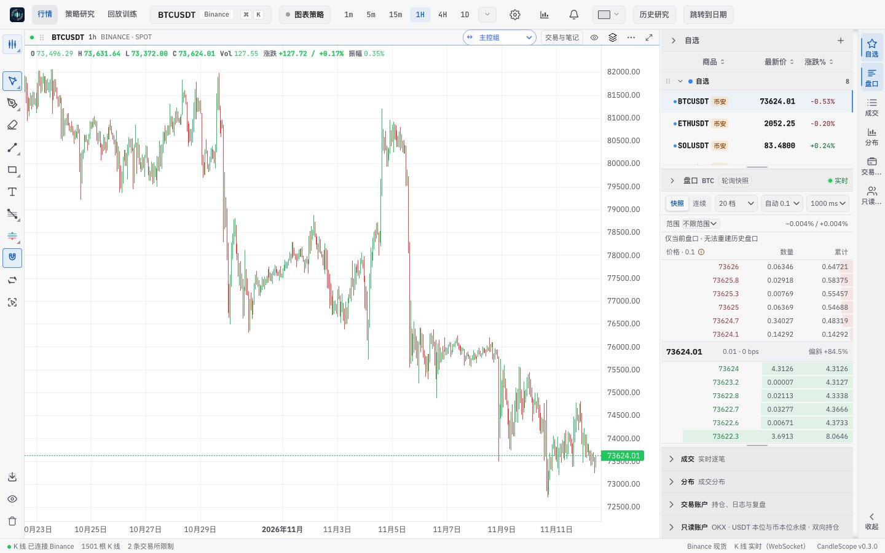 |
| Recovery mode notice (dark): before, the always-on button; after, the notice |  | 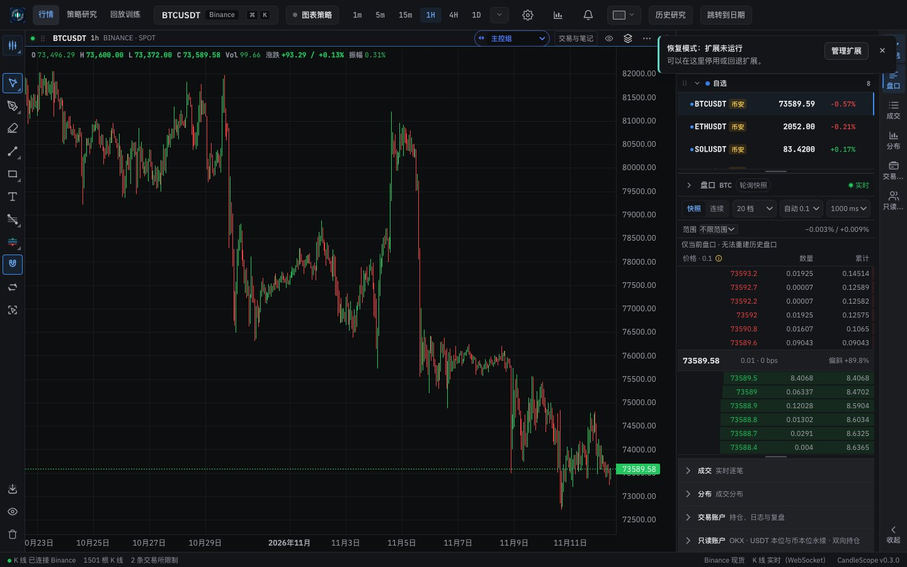 |
| Recovery (dark): the button's panel, and the dialog from the notice | 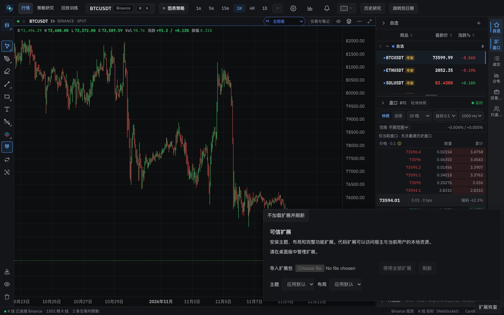 | 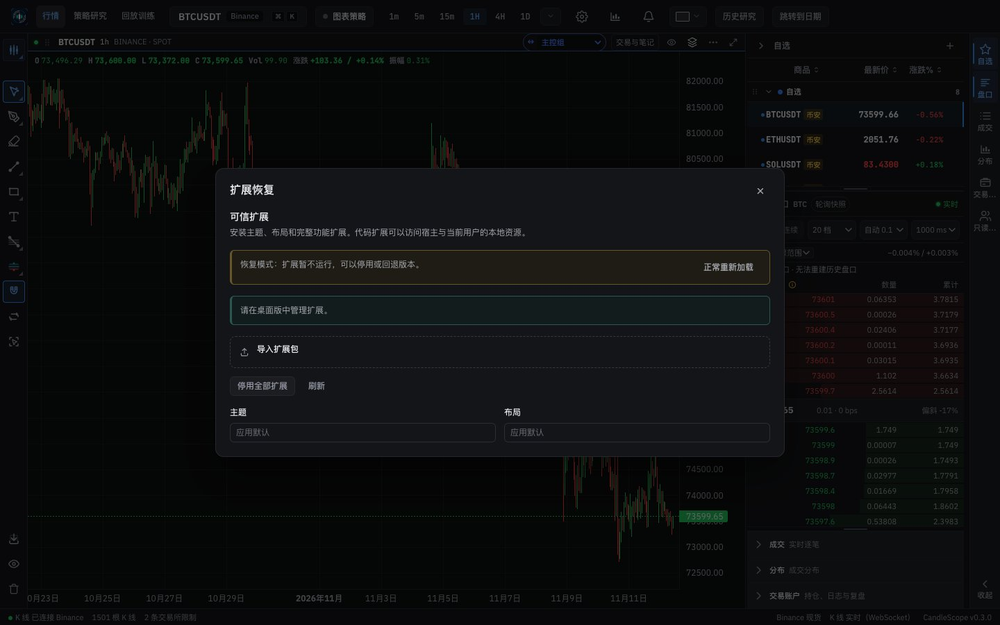 |
| Recovery (light) | 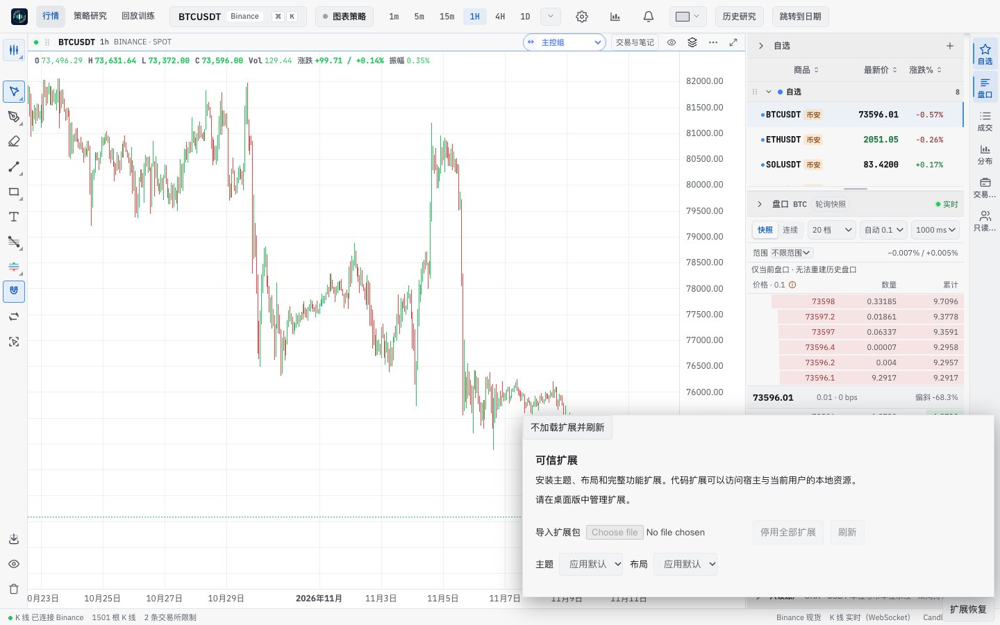 | 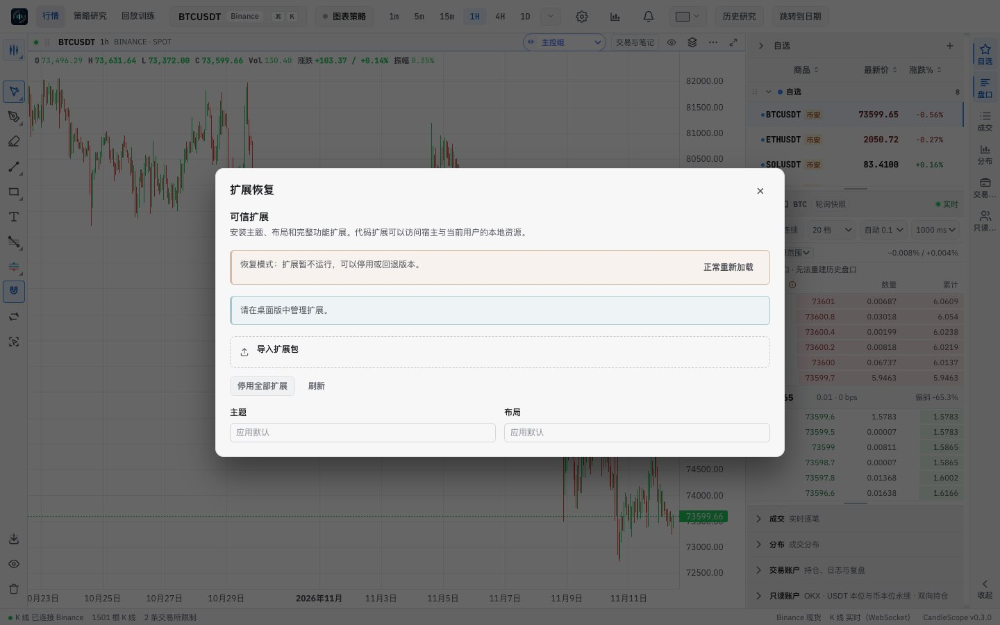 |
| Settings → 插件与扩展 → 可信扩展 (dark) | 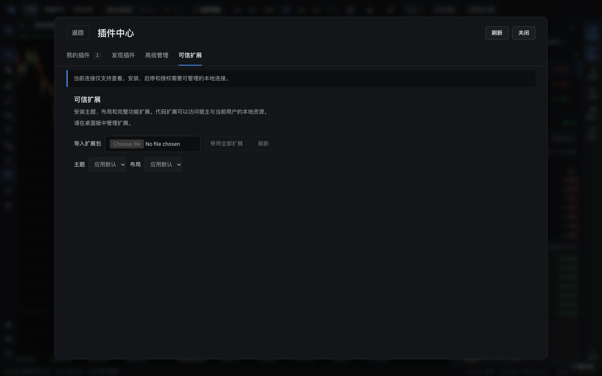 | 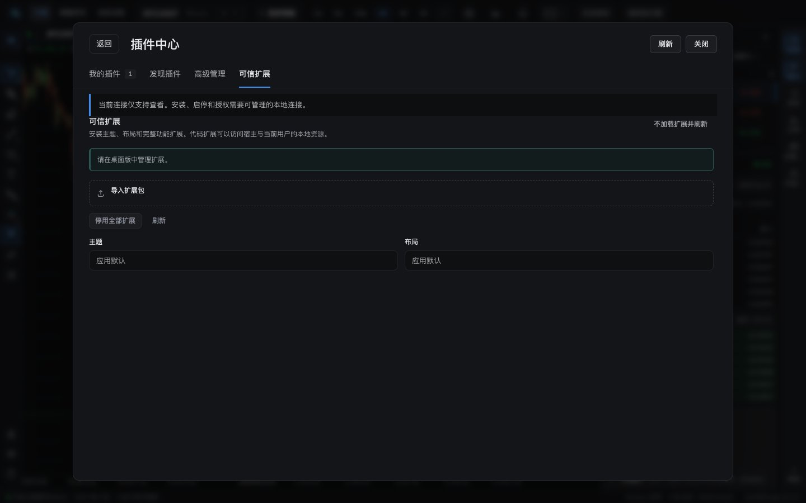 |
| Settings → 插件与扩展 → 可信扩展 (light) | 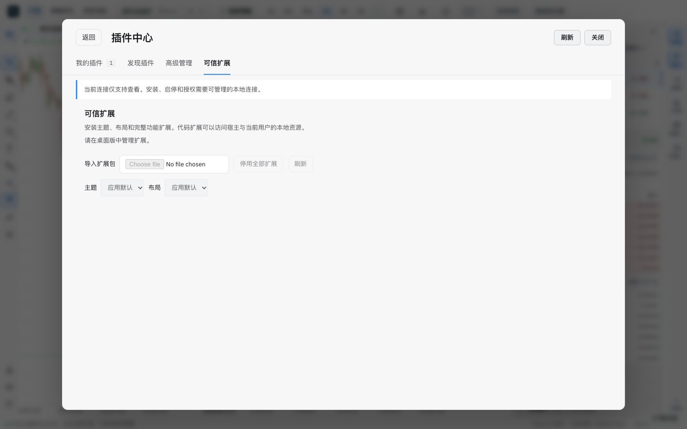 | 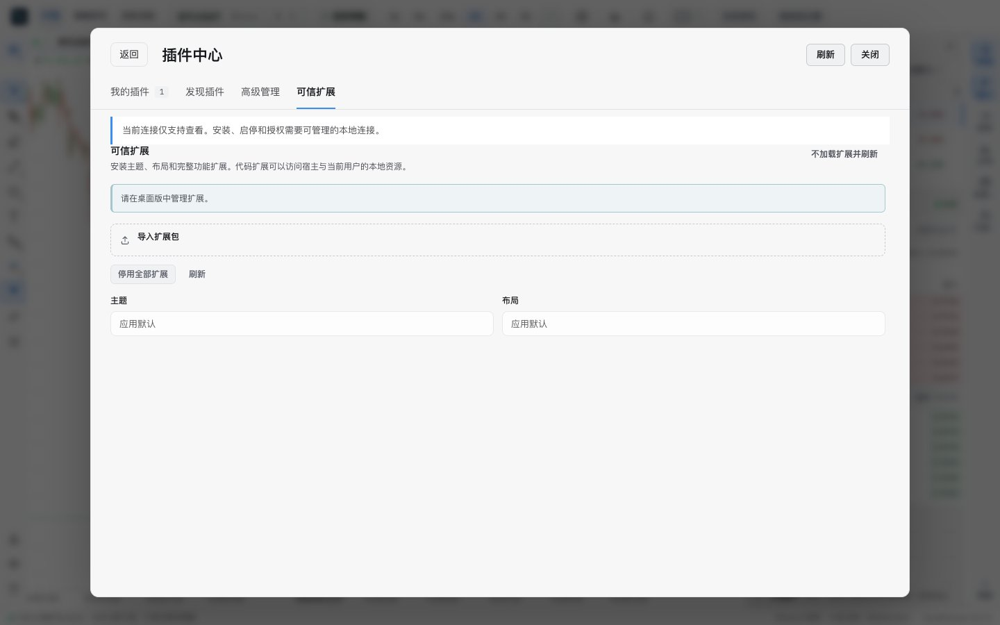 |
| Strategy toolbar (dark) |  |  |
| Dataset quality (dark) | 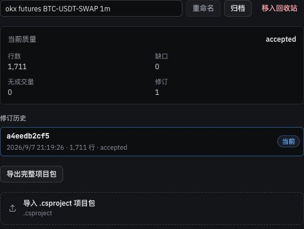 | 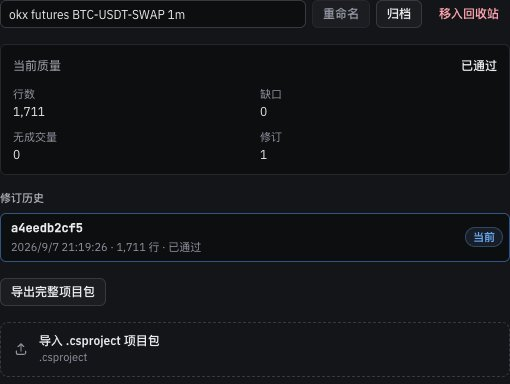 |

## Verification

**In the running app** (browser; plugin management itself needs the desktop app):
- The market page shows no extension control while extensions are healthy.
- With `?extensions=off`, the notice reads 恢复模式：扩展未运行 with 管理扩展. 管理扩展 opens the 扩展恢复 dialog with focus on 正常重新加载, which stays enabled although management is unavailable in a browser.
- Publishing an extension failure into the extension store in dev raised the notice 有扩展加载失败 · qualification.broken, and 管理扩展 opened the dialog. Publishing only a registry error raised nothing.
- Settings → 插件与扩展 → 可信扩展 shows the rebuilt management in both themes.
- A scan of the visible text on the market, replay hub and strategy pages in `zh-CN` found no English words apart from user data (dataset and run names), exchange names and code-like JSON keys in the strategy's input field.

**Unit tests:**
- `recoveryNotice.test.tsx`: when the notice appears; nothing renders while extensions are healthy; management keeps the names the desktop qualification drives (heading, package picker label, recovery reload).
- `serverErrors.test.ts`: a code with its own message shows only that message, in Chinese without Latin letters.
- `researchDataFormat.test.ts`: quality statuses in Chinese and English; an unknown status passes through.

**Full check:** `npm run check` passes: 5,130 frontend tests, 137 desktop tests, lint (one existing warning), both typechecks and the build. Unstyled class names stay at 1.

## Known gaps

- **Desktop app not run.** The extensions qualification smoke (`scripts/trusted-extensions-desktop-smoke.mjs`) and the replay open smoke now take the Settings route; they need a packaged build and were only syntax-checked here. The failure and recovery-mode notices were checked in the browser by publishing state, not with a real failing extension.
- **An extension that hides the Settings button without failing** leaves no notice. The way out is `--extensions-safe-mode` on desktop or `?extensions=off` in a browser, as documented in `docs/trusted-extensions.md`.
- **Extension text is Chinese or English only.** The extension feature has its own two-language text helper; other locales see English there. Phase 6 moves it into the catalogs.
- **Still in English, moved to Phase 6:** internal terms in a running replay session (the status bar's `REPLAY` and `PAUSED`, `AGG_TRADE · EXACT`, `Controller`), "Run" in the replay opening message, and backend messages without a code.
