# Frontend design refactor: Phase 4a QA (one header for every page)

- Date: 2026-11-13
- Branch: `design/phase-4-shell`, based on `design/phase-3c-recovery-errors` (PR #378)
- Plan: [`frontend/FRONTEND_DESIGN_REFACTOR_PLAN.md`](../frontend/FRONTEND_DESIGN_REFACTOR_PLAN.md) §2.8, §5 item 5 and the Phase 4 row. Contract: [`DESIGN.md`](../DESIGN.md#page-header)
- **Intended visible change:** every page has the same header layout. Settings is the last control on the right everywhere, page actions sit at the right and collapse into a 更多 menu when space runs out, and the backtest landing page gets a header.

Phase 4 lands in three PRs: 4a (this one) gives every page one header; 4b groups the market top bar, sets rail width rules and reworks the status bar; 4c moves per-chart appearance into each chart's header menu.

## What changed

| Area | Change |
|---|---|
| `AppHeader` | New in `src/app/AppHeader.tsx`, replacing `MarketTopBarFrame`. Regions, left to right: brand and workspace navigation, an optional `badge`, `context` (what the page is about) and `tools` (controls for it); then on the right `actions`, `extras` (controls that cannot go into a menu), `panels` (panel toggles) and `settings`, always last. It keeps the `top-bar` class, id and data attributes that existing CSS and tests use. |
| Header actions | Page actions are data (`HeaderAction`: label, handler, open state, panel id, link, data attributes). They are right-aligned, measured, and when they do not fit, the last ones move into a 更多 menu (`shell.moreActions`, 30 locales). A popover opened by an action anchors to its button, or to 更多 while it is in the menu. The fit is a pure function with tests. |
| Market page | Settings moves from between the intervals and the panel toggles to the far right; indicators and alerts sit just before it. 历史研究 and 跳转到日期 are header actions; the layout picker and plugin toolbar stay inline. |
| Strategy page | The data source is the context; 保存的常驻账户 and 运行记录 are actions; indicators and Settings follow the market page's order. |
| Replay hub and other pages without a chart | `AppPageShell` uses `AppHeader`; Settings moves from beside the navigation to the far right. |
| Replay session | The training badge, the run identity, intervals, price and market metrics on the left; 定位视图日期, 复盘与完整性, 训练成绩, 存档大厅 and 实时行情 are actions (实时行情 is a link that opens a new window); 工作区, the panel toggles and Settings follow. Settings uses the same icon as on other pages (it was a palette). The integrity toggle keeps `data-replay-action="toggle-integrity"`, `aria-controls` and its purple open and review states, and stays the drawer's focus return target. |
| Backtest | The landing page (研究任务) and its loading and error states render inside `AppPageShell`, so they have the header; they had none. The research workspace header uses `AppHeader` regions. |
| Local page (flag-off) | Uses `AppHeader` with the standard brand instead of its own "◫ CandleScope Analyze". |

## Screens

Header only, the base build (Phase 3c, `1f7d0f65f`) and this branch, `zh-CN`.

| | Before | After |
|---|---|---|
| Market, 1440 px (dark) | 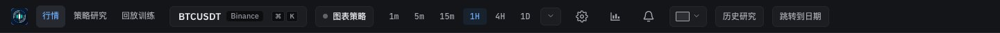 | 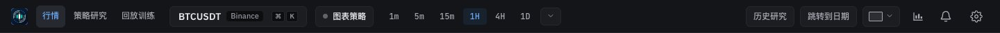 |
| Market, 1440 px (light) | 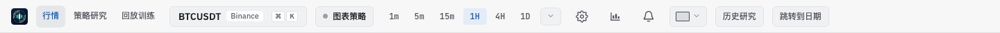 | 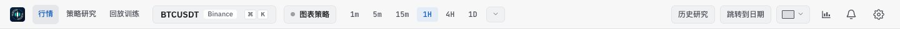 |
| Market, 1024 px: 跳转到日期 is in the 更多 menu | 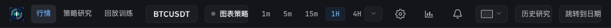 | 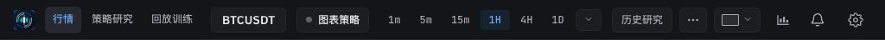 |
| Strategy, 1440 px | 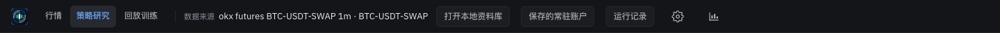 | 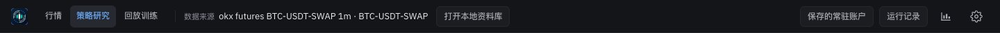 |
| Strategy, 1024 px | 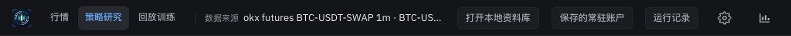 | 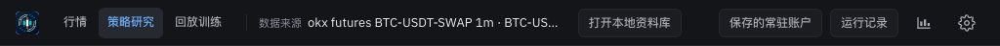 |
| Replay hub, 1440 px | 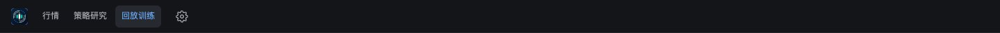 | 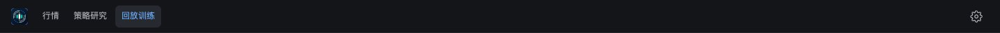 |
| Replay session, 1440 px (captured in the app's browser pane, scaled to 800 px) | 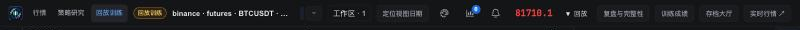 |  |
| Backtest landing, 1440 px | 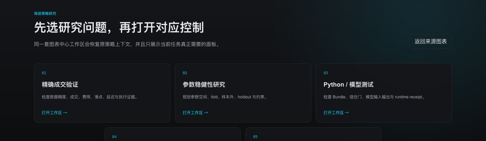 | 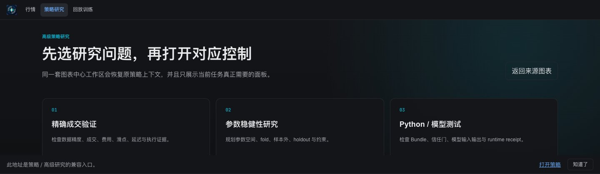 |

## Verification

**In the running app:**
- Market page at 1440 and 1366 px: both actions inline, no horizontal overflow. At 1024 px, 跳转到日期 moves into 更多. 更多 opens a menu with focus on its first item; Enter opened the jump-to-date dialog.
- Strategy page at 1440 and 1024 px: both actions inline; the data source name truncates by its existing rule.
- Replay session at 1440 px: the five actions with 实时行情 in 更多. The integrity toggle opened its drawer with `aria-expanded="true"` and the purple open state; Escape closed it and focus returned to the toggle.
- Replay hub and backtest landing show the header with Settings (hub) at the far right.

**Unit tests:**
- `headerActionsModel.test.ts`: all actions stay inline while they fit; otherwise room is kept for 更多 and later actions move into it, in order.
- `marketPageFrame.test.tsx`: the header keeps its DOM owner attributes and renders its regions in order, with Settings last.
- `replayTrainingWorkspace.test.tsx`: the replay shell uses `AppHeader` and the integrity action controls its drawer.

**Full check:** `npm run check` passes: 5,132 frontend tests, 137 desktop tests, lint (one existing warning), both typechecks and the build.

## Known gaps

- **The market top bar is not regrouped yet.** Its symbol, intervals and chart tools keep their current narrow-width rules; 4b groups them and reviews the page at 1440, 1366 and 1024 px.
- **The backtest landing has no Settings button**, as before: that page has no settings runtime. The page itself (cyan glow, numbered cards) is rebuilt with the strategy research merge (§6.1).
- **Panel toggles and Settings keep their current icon-button look**; the kit `IconButton` replaces them with the top bar rework in 4b.
- **The replay session could not be opened in headless Chrome**, so its pair was captured in the app's browser pane and is scaled down.
- **Desktop app:** not tested.
