# Frontend design refactor: Phase 4b QA (market top bar, right rail, status bar)

- Date: 2026-11-13
- Branch: `design/phase-4b-market-shell`, based on `design/phase-4-shell` (PR #379)
- Plan: [`frontend/FRONTEND_DESIGN_REFACTOR_PLAN.md`](../frontend/FRONTEND_DESIGN_REFACTOR_PLAN.md) §2.8 and the Phase 4 row. Contract: [`DESIGN.md`](../DESIGN.md#page-header)
- **Intended visible change:** at narrow widths and in longer languages the header gives way in a fixed order instead of overlapping; the right rail is narrower on small windows and its tab labels no longer truncate; the status bar drops whole items. At 1440 px in Chinese the header gains the wordmark and a divider, and otherwise looks as before.

## What changed

| Area | Change |
|---|---|
| Header compaction | `AppHeader` measures itself and sets compaction steps on `data-compact`, replacing window-width `@media` rules tuned for Chinese labels. Steps 1–2 come before any page action moves into 更多: inline market metrics become the 合约市场摘要 button, then the wordmark, the ⌘K hint and the replay price-change label hide. Steps 3–4 come only once the left side still does not fit: the exchange badge and the 图表策略 label hide (its status dot stays), then intervals scroll and long names truncate. A resize recomputes; content changes can only add steps, so ticking prices cannot make it flicker. The decision is a pure function with tests. |
| Header fixes | Nothing on the left shrinks before the last step, so the measurement sees what it needs; header actions keep their width and fold into 更多 instead of squeezing (the replay session's labels were cut to 定位, 复盘…); the actions no longer set the header's minimum width. The 图表策略 button's text no longer wraps over the intervals. |
| Grouping | Every page has the same divider between the navigation and its context (the strategy page had its own); the strategy page uses the standard brand instead of "CandleScope 策略研究". |
| Right rail | The chart keeps at least 65% of the window (was 55%), up to 760 px. At 1024 px the rail and its tab strip take 318 px, 31% (was 364 px, 36%); from about 1180 px the default 320 px rail fits. |
| Rail tabs | The tab strip is 60 px (was 44) and labels wrap onto two lines between words, hyphenated where the language allows, instead of truncating: 交易账户 and 只读账户 on one line, "Order book", "Trading accounts", "Read-only account" on two, German "Beobach-tungsliste". |
| Watchlist at that width | The exchange badge gives way at 270 px; change % stays down to 230 px (it disappeared at 260 px, which a 1024 px window now reaches). |
| Status bar | Each side drops its later items whole when it runs out of room (the version first on the right), with a thin separator between items and tabular figures. Colours come from classes instead of six inline styles. |

## Screens

The base build (Phase 4a, `8b4b5fc2c`) and this branch. Chinese unless marked; the review widths are 1440, 1366 and 1024 px.

| | Before | After |
|---|---|---|
| Market, 1440 px | 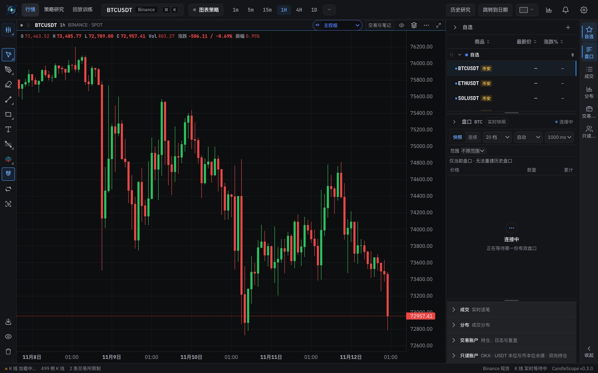 | 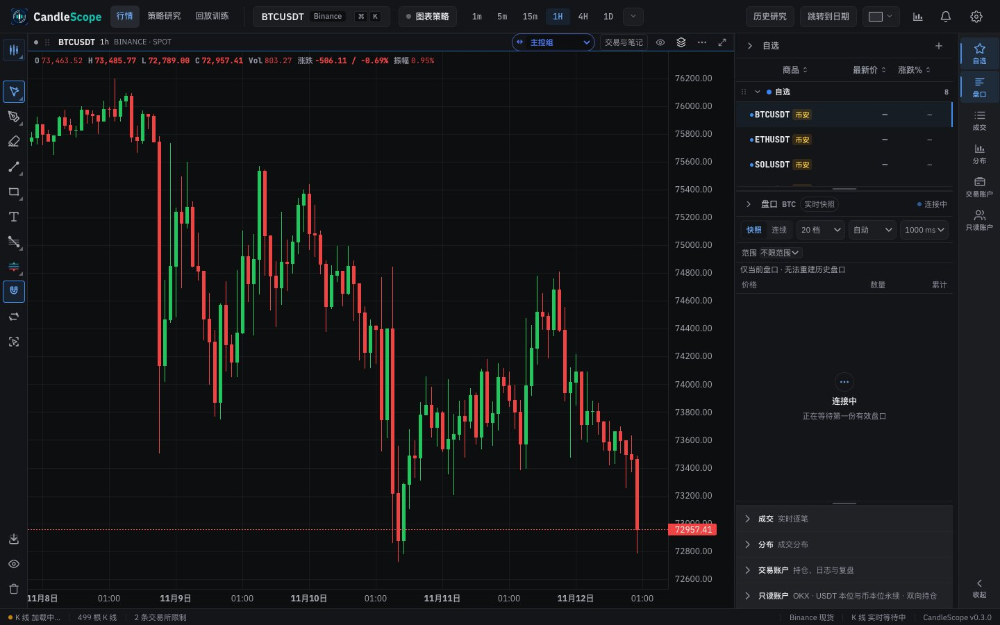 |
| Market, 1440 px (light) | 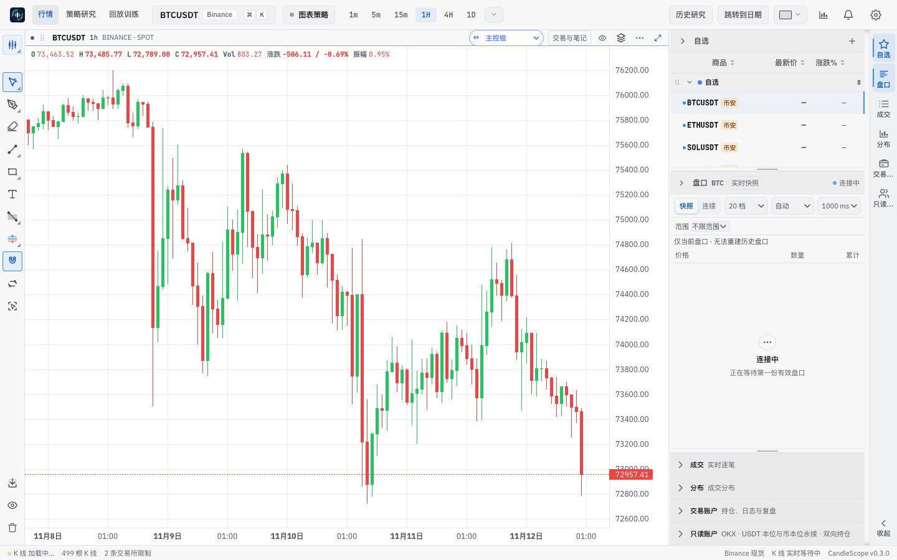 | 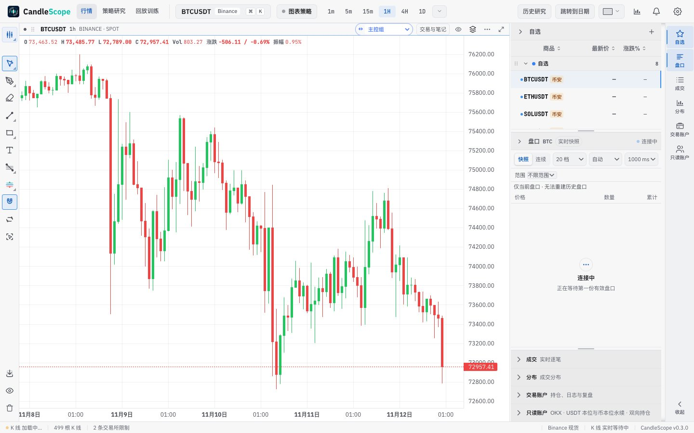 |
| Market, 1366 px | 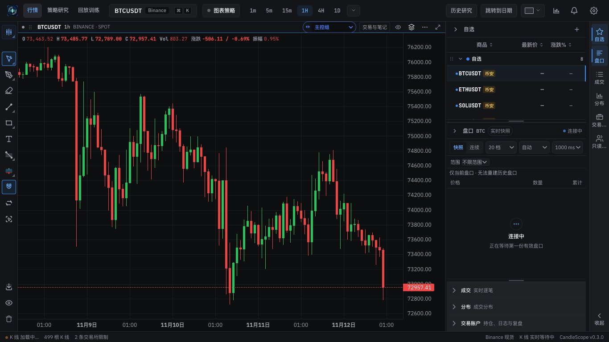 | 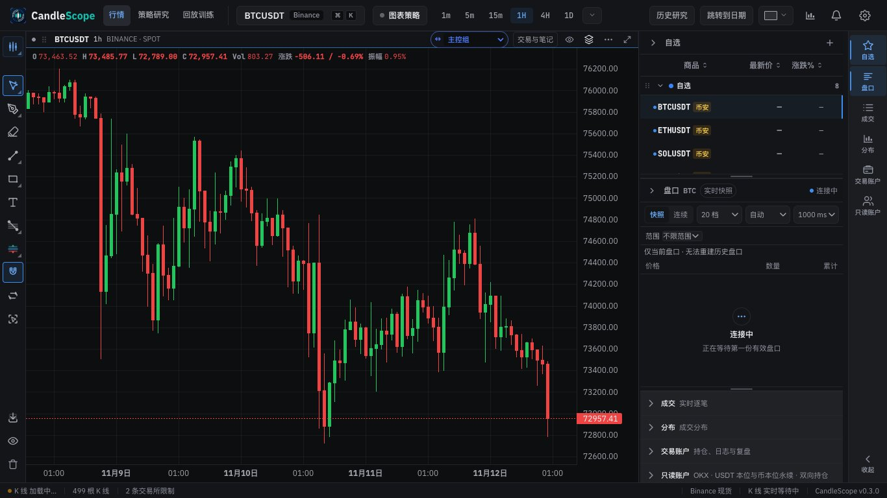 |
| Market, 1024 px | 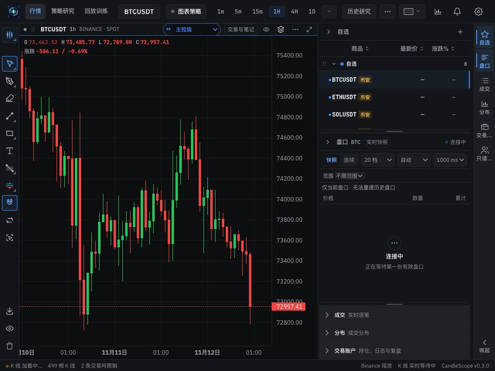 | 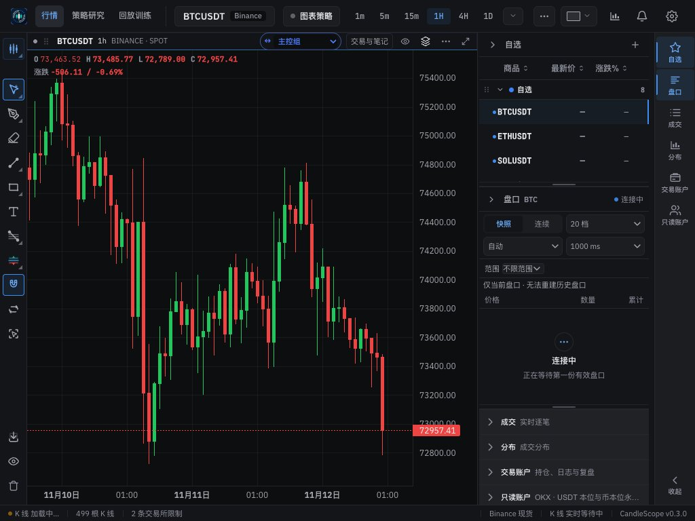 |
| Market, 1024 px, English | 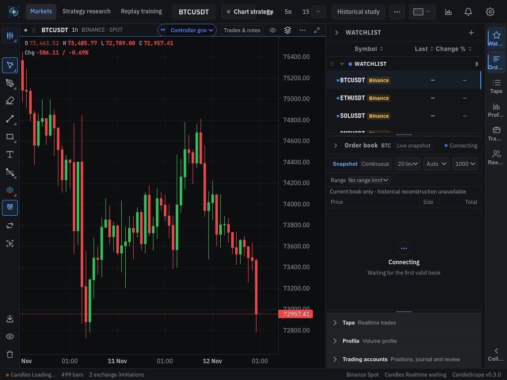 |  |
| Header, 1440 px, English | 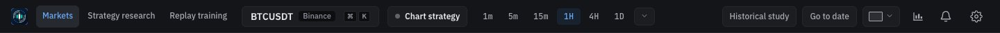 | 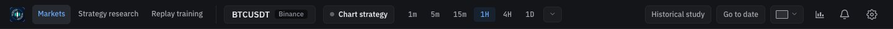 |
| Header, 1366 px, English | 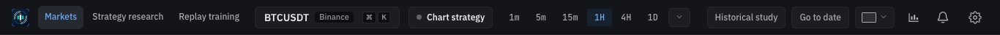 | 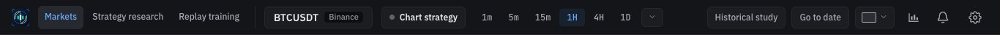 |
| Header, 1024 px, English | 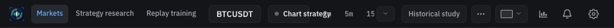 | 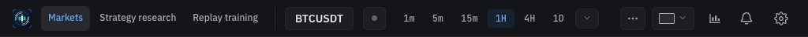 |
| Rail tabs, English | 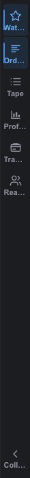 | 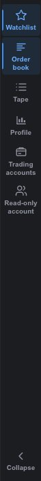 |
| Rail tabs, German | 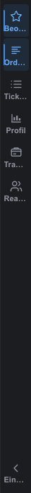 | 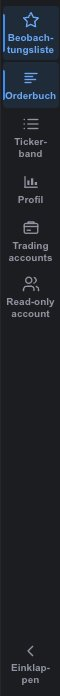 |
| Status bar, 600 px, English | 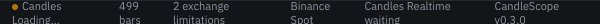 | 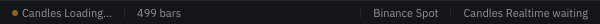 |

## Verification

**Header, measured in the running app** (compaction steps and where the two market actions end up):

| | 1440 px | 1366 px | 1024 px |
|---|---|---|---|
| Chinese | none; both inline, wordmark shown | none; both inline, wordmark shown | 1–2; both in 更多 |
| English | 1–2; both inline | 1–2; both inline | 1–3; both in 更多, every interval visible |

No width overflowed the header. Before this branch, English at 1024 px cut the interval strip to "5m 15" with the active 1H hidden, and "Chart strategy" overlapped it.

**Replay session at 1366 px** (browser pane): steps 1–2; 定位视图日期 and 复盘与完整性 inline, the other three in 更多; the status bar's items keep their separators.

**Rail:** 31% of a 1024 px window in Chinese, English and German; the watchlist keeps ticker, last price and change %.

**Status bar:** at 600 px in English, "2 exchange limitations" and the version drop out whole; nothing is cut mid-word.

**Unit tests:**
- `headerActionsModel.test.ts`: page actions take only the early steps and go to 更多 instead of the later ones; an overflowing left side takes every step; a content change never relaxes the header.
- `useRightDrawerResize.test.ts`: the rail bounds at 1440, 1366, 1024, 640, 320 and 100 px.

**Full check:** `npm run check` passes: 5,132 frontend tests, 137 desktop tests, lint (one existing warning), both typechecks and the build.

## Known gaps

- **Panel toggles and Settings keep their icon-button look.** The kit `IconButton` has no slot for the indicator count badge yet; they move with the shell's icon set in Phase 5. (The 4a QA note said this would happen in 4b.)
- **English truncation inside surfaces** stays for those surfaces' rebuilds and the Phase 7 hardening pass: the chart header's link group ("Controller gro…") and the order book's controls.
- **The replay session at 1366 px** keeps three of its five actions in 更多; its identity, intervals and price leave room for two.
- **Replay session screens** were checked in the app's browser pane; headless Chrome does not open a run, so there is no before/after pair for it.
- **Desktop app:** not tested.
