# Frontend design refactor: Phase 4c QA (chart appearance in the chart menu)

- Date: 2026-11-13
- Branch: `design/phase-4c-chart-appearance`, based on `design/phase-4b-market-shell` (PR #387)
- Plan: [`frontend/FRONTEND_DESIGN_REFACTOR_PLAN.md`](../frontend/FRONTEND_DESIGN_REFACTOR_PLAN.md) §5.1 and the Phase 4 row. Contract: [`DESIGN.md`](../DESIGN.md#themes)
- **Intended visible change:** each chart's header menu starts with 图表外观, where the chart follows the app theme or gets its own look. A chart with its own look shows a marker in its header. Settings only sets the app theme, and says how many charts have their own look.

## What changed

| Area | Change |
|---|---|
| Chart menu | The chart's ⋯ menu starts with 图表外观: 跟随应用主题 or 单独设置; then 深色, 亮色 or 自定义 with its background colour; and 单独设置涨跌颜色, which copies the app's up/down colours to start from. Choosing 跟随应用主题 removes the chart's own settings. With chart style linking on, a note says how many linked charts follow the change. The menu opens even when the layout is locked or the chart is maximized; then only 图表外观 can be changed and the layout actions are disabled. Same menu on the market page and in the replay session. The button is now named 图 N 外观与布局 (was 图 N 布局操作) and its tooltip reads 图表外观；拆分、关闭或交换图表. |
| Menu placement | On the market page the menu now renders outside the chart cell, as it already did in the replay session, so a small chart in a grid no longer cuts it off. It opens below its button, stays inside the window and scrolls when taller than the room left. It sits above drawers and below modals and toasts; the replay session's copy sat above both at z-index 2000. |
| Marker | A chart with its own look shows a palette marker beside its menu button ("此图表使用自己的外观"); it opens the menu. |
| Settings | 外观显示 no longer has 当前图表外观 (the second group added in Phase 1 as a stopgap). When charts have their own look, a line under 应用主题 reads 使用自己外观的图表：N with 全部恢复跟随应用, which resets every chart in the workspace. |
| One-time offer | The old chart-scoped picker left layouts where every chart had the same theme set on its own. On the first launch with this branch, if every chart in the layout sets the same theme and the app uses another, a notice offers once: 此图表单独设为亮色。要把它设为应用主题吗？ (or 所有图表都… for several). 设为应用主题 sets the app theme and lets the charts follow it. The check runs once per profile whatever its result, so a chart set on its own later never brings it back. |
| `SegmentedControl` | A label too long for its share wraps (hyphenated where the language allows) instead of running under the next option: French "Suivre le thème de l’application", German "Benutzer-definiert". The control keeps its height when labels fit. |
| Copy | Nine new keys in all 30 locales: the section title, own colours, the linked-chart note, the marker, the override count, reset all, the offer (one chart and several) and its action. The menu button's name and tooltip are reworded. `settings.appearance.chartAppearanceTitle` is gone with the Settings group. |

## Screens

The base build (Phase 4b, `da3776ef8`) and this branch, 1440 px, `zh-CN` unless marked.

| | Before | After |
|---|---|---|
| Chart menu (dark) | 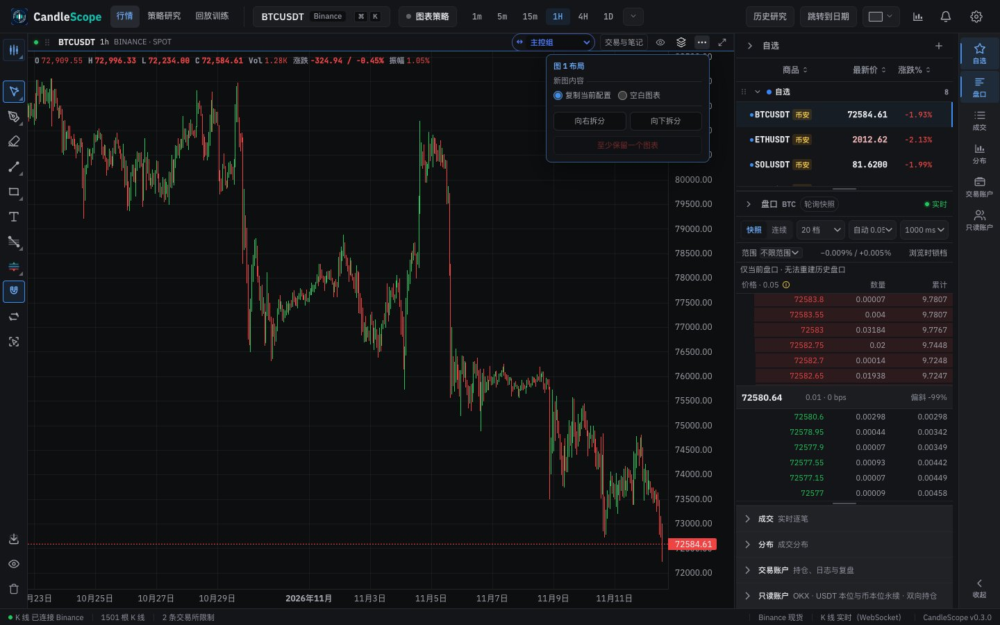 | 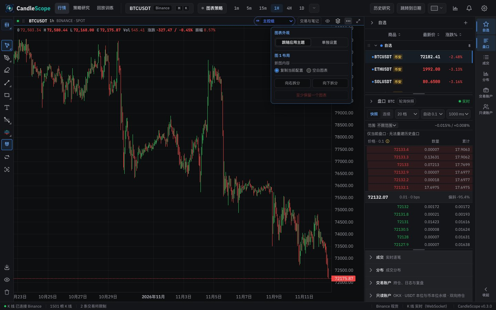 |
| Chart menu (light) | 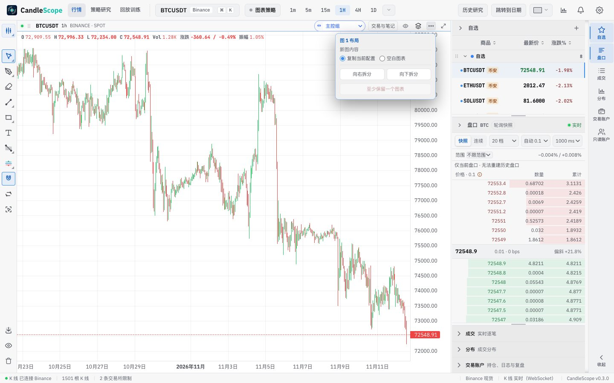 | 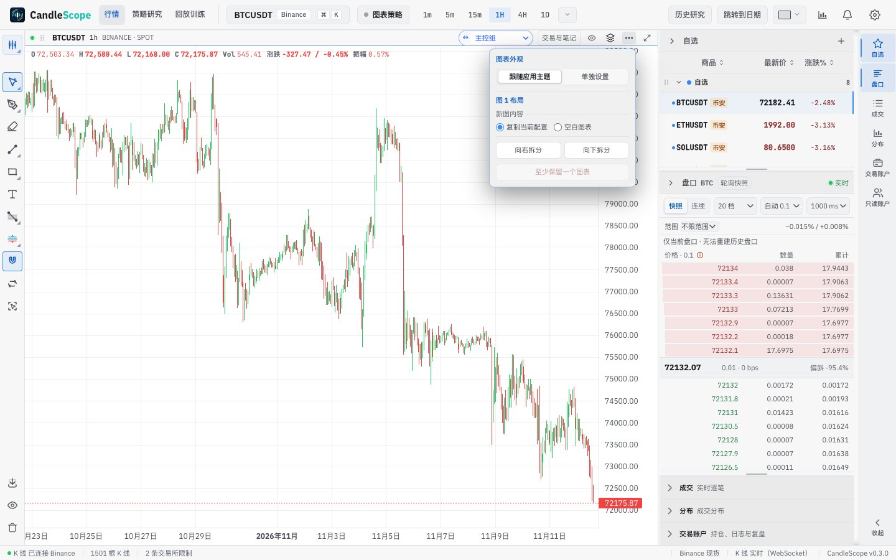 |
| A chart with its own look: 亮色 and its own colours in a dark app, with the marker beside the menu button |  | 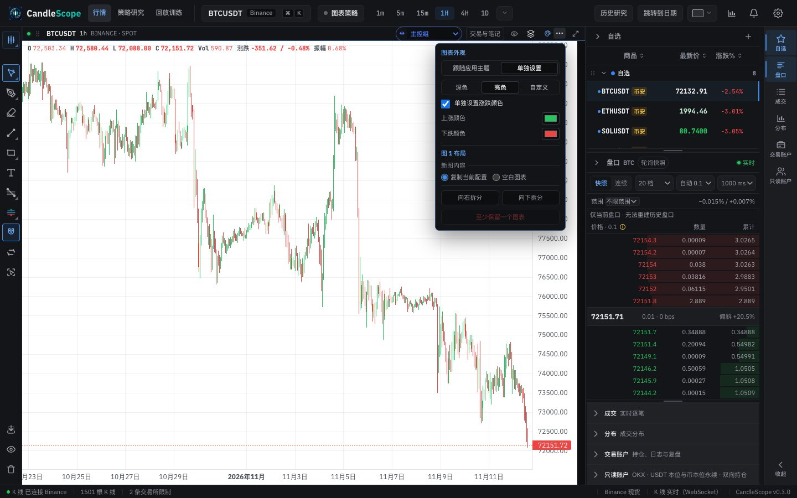 |
| Settings → 外观显示: before, the 当前图表外观 group; after, one chart has its own look | 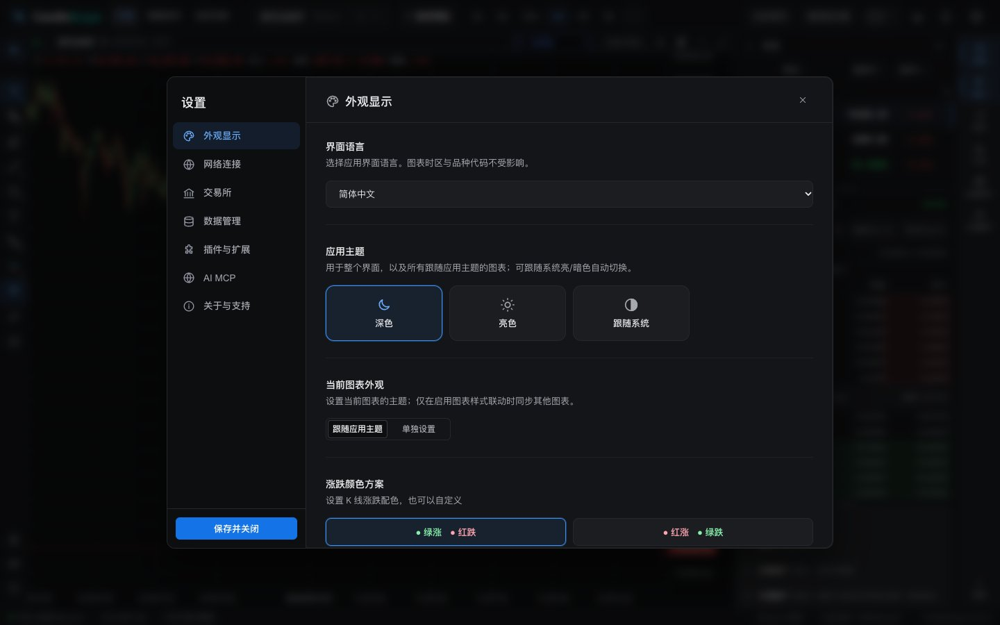 | 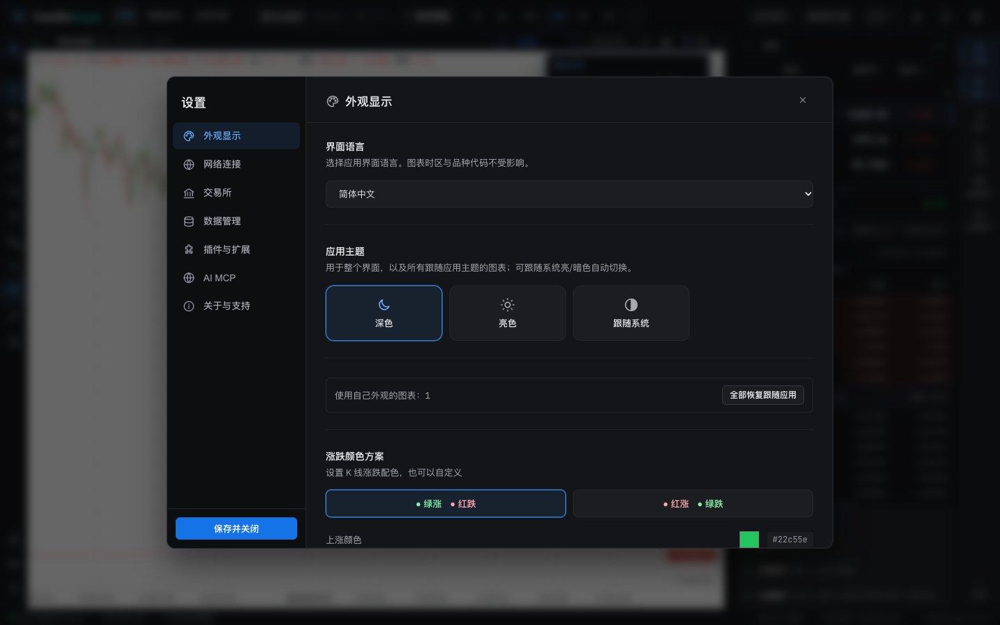 |
| Chart menu, English (after: own look) | 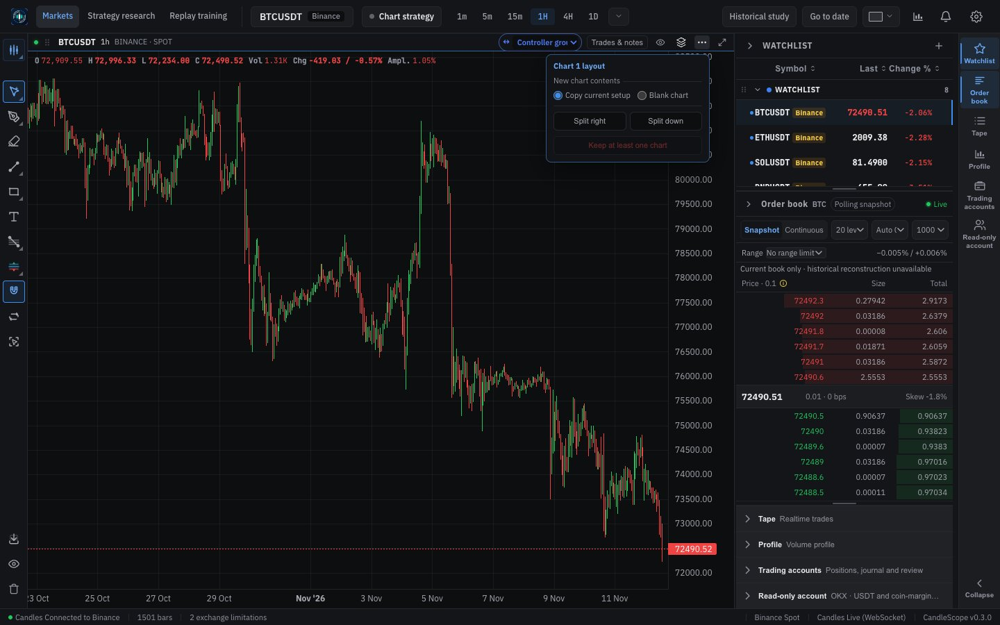 | 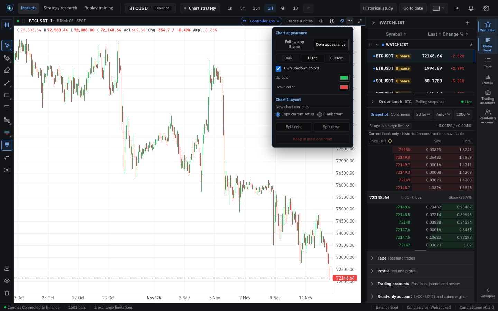 |
| Chart menu, French (after: own look; labels wrap) | 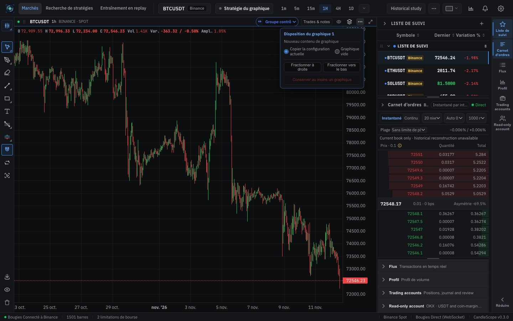 | 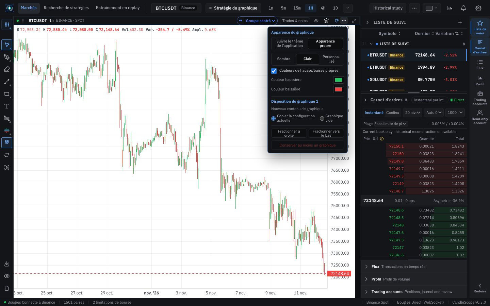 |
| Replay session: its chart set to 亮色 in a dark app (after only; captured in the app's browser pane, scaled to 800 px) | | 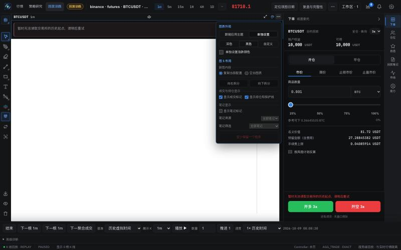 |

## Verification

**In the running app** (browser pane, market page, 1440 px):
- 单独设置 then 亮色 turns only that chart light while the app stays dark; the marker appears. 深色 and back to 亮色 restyle the chart while the menu is open.
- Settings → 外观显示 shows 使用自己外观的图表：1; 全部恢复跟随应用 removes the chart's theme from the workspace, and the marker and the line disappear.
- With chart 1 set to 亮色, the offer key cleared and a reload, the notice read 此图表单独设为亮色。要把它设为应用主题吗？. 设为应用主题 set the app theme to 亮色 and chart 1 followed it, with no marker. After that, setting chart 1 to 亮色 again on purpose and reloading did not bring the offer back.
- Replay session: the chart's menu has the same section; 单独设置 then 亮色 turned its chart light with the marker, and 跟随应用主题 removed both.
- Four-chart layout, bottom-right chart, with its own colours open: the menu (393 px) opens below its button and ends 16 px above the window's bottom edge, over the cell's edge instead of cut off by it. Escape closes it and returns focus to the button; a click outside closes it. With the menu open behind Settings, the Settings dialog covers it.
- English, French and German: every label in the section is whole; French and German labels wrap onto two lines, and the up/down colour rows each take the full width. Where labels fit (Chinese, English), the segments keep their 22 px height.

**Unit tests:**
- `chartWorkspaceChartSettings.test.ts`: which charts have their own look, resetting them (the same document back when nothing changes), and the shared theme that the offer uses.
- `chartAppearanceOffer.test.ts`: the offer only when every chart sets the same other theme, and never after the first check.
- `ChartAppearancePanel.test.tsx`: Settings counts the charts and offers the reset; the menu section follows the app or sets the chart's own look.
- `WorkspaceCellLayoutMenu.test.tsx`: a chart with its own look shows the marker; with the layout locked, the menu button stays enabled for appearance. (That the marker opens the menu, and that the layout actions are disabled inside it, was checked in the app: with the chart maximized, the menu opened with 图表外观 working and 向右拆分, 向下拆分 and 关闭此图表 disabled.)

**Full check:** `npm run check` passes: 5,137 frontend tests, 137 desktop tests, lint (one existing warning), both typechecks and the build. Unstyled class names stay at 1.

## Known gaps

- **The offer was not tested with a multi-chart layout in the app**, only with one chart; the several-charts path differs only in its message and is covered by the unit tests.
- **The replay session** has no before/after pair: headless Chrome does not open a run, so it was checked in the app's browser pane. The run used had no bars (its history boundary could not be read), so the light chart is empty.
- **The older chart-scope picker in `ChartAppearancePanel`** (`legacyChartScope`, for a host that opens Settings in chart scope without appearance targets) has no caller left; it goes with the Phase 8 cleanup.
- **Desktop app:** not tested.
