# Frontend design refactor: Phase 5b QA (the rest of Settings)

- Date: 2026-11-14
- Branch: `design/phase-5b-settings-panels`, based on `design/phase-5a-settings` (PR #398)
- Plan: [`frontend/FRONTEND_DESIGN_REFACTOR_PLAN.md`](../frontend/FRONTEND_DESIGN_REFACTOR_PLAN.md) §2.4, §2.5, §2.6 and the Phase 5 row. Contract: [`DESIGN.md`](../DESIGN.md#settings)
- **Intended visible change:** 交易所 becomes a quiet list with one line per exchange and details on demand; 存储与维护 shows three storage layers with one figure each instead of walls of tiles; 高级维护, 关于与支持 and 外观显示 move onto the kit. Nothing changes what Settings does.

## What changed

| Area | Change |
|---|---|
| 交易所 list | Each exchange is a row: its name and id, one line of plain text (adapter · markets · 仅 REST 轮询 when it applies) and its channels. 当前 and 不可路由 are the only badges; before, a row could carry six coloured pills plus a chip per market. The markets are listed the way each language lists things ("Spot、USDT-M Perpetual", "Spot, USDT-M Perpetual"). |
| 交易所 detail | Product status is a label/value list with a dot for what is connected, instead of four green-tinted tiles. Each market's channel table (transports, quality, field lists) is behind a 数据通道：N disclosure. The verification level moved from the row into 技术详情, reworded: "已通过并行影子验收" is now "已与并行数据比对验证" in all 30 languages. Test results are `InlineAlert`s. |
| 交易所 styling | The panel had its own colour set, including a hard-coded orange; all 96 of its rules are replaced by tokens and kit controls (`Stat`, `Input`, `SegmentedControl` for the filters, `Badge`, `Disclosure`, `Button`). The intro is one sentence. |
| 存储与维护 | One section per layer (浏览器缓存, 后端内存, 本地数据库): a title, one line on what it is, its key figure, and 预估清理 / 清理 (plus 压缩数据库文件 for the database). An estimate or a result is a one-line alert; tiles, the largest series and the full estimate sit in a 详细数据 disclosure. The row of three "待预估" status cards is gone. Labels that were hard-coded English ("DataManager series", "DataManager bars", "Script cache", "Series", "active/subscribed") are translated. |
| Storage policy | The 1-second cache is a segmented control with the capacity, coverage and memory on one line. The four presets come first, then the two budgets as kit fields with a one-line hint each. 高级行数上限 is a disclosure with a checkbox and a real table; its inputs become editable once the limits are on (the separate 高级 toggle is gone). The visible policy texts are rewritten without "WAL", "SHM" or "warm/cold"; the explanation inside 高级行数上限 keeps its wording (it still says "storage intent") for Phase 6. |
| 高级维护 | The three tools use the row pattern from 5a (title, one line, buttons). Results are `InlineAlert`s toned by status, with per-series detail in a disclosure. The repair text no longer contains the English "authoritative" in Chinese, Japanese and Korean. |
| 关于与支持 | The two `
` are kit disclosures; the export range is a kit `Select` and the manual-copy box a kit `Textarea`. |
| 外观显示 | The language and time-zone selects are kit `Select`s; the up/down colour presets are a segmented control (no inline styles); the chart-type parameters (Renko, point and figure, Kagi, line break) use kit fields. A failed language load is an `InlineAlert` with 重新加载. |
| Kit | An inline `SegmentedControl` sizes each segment to its label again; since 5a let labels wrap, it squeezed them ("12 小\n时"). Full-width controls still share the row equally. |
| Clean-up | 138 obsolete Settings rules removed (the old diagnostics tiles, tier table, tool cards, an unused database dialog), and 46 message keys nothing used. `settings.css` is 1,289 lines; it was 2,364 at the start of 5a. |
| Copy | 24 new strings in all 30 languages (the panel and layer descriptions, actions and estimates, the translated labels, the policy hints, the exchange intro and channel count) and two reworded (the verification label, the repair text). Three labels shown as terms lost their trailing colons. |

## Screens

The base build (Phase 5a, `84b008e1e`) and this branch, 1440 px, `zh-CN` unless marked. The 存储与维护 and 关于与支持 pairs are captured with the dialog stretched to its content, so their length can be compared.

| | Before | After |
|---|---|---|
| 交易所 | 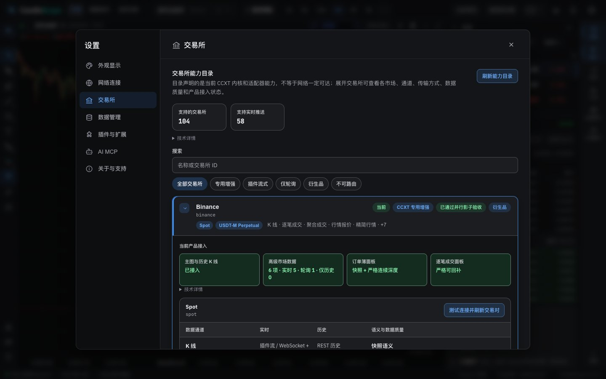 | 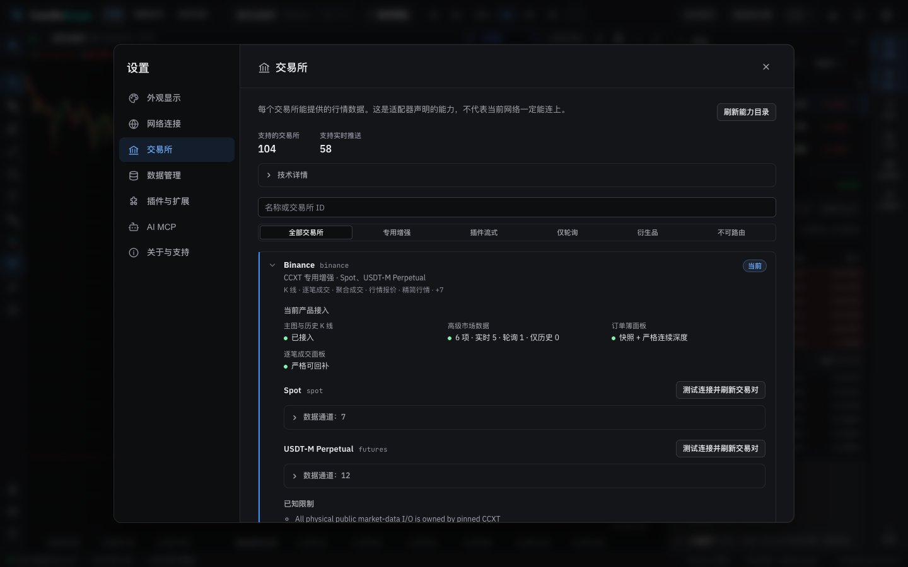 |
| 交易所 (light) | 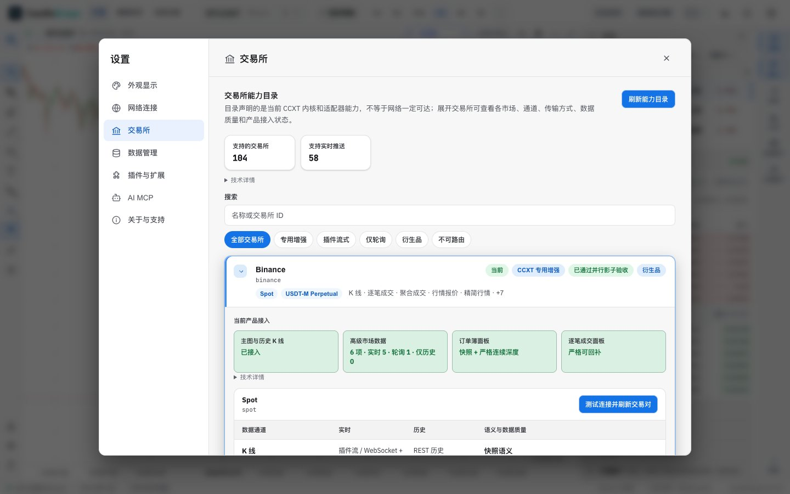 | 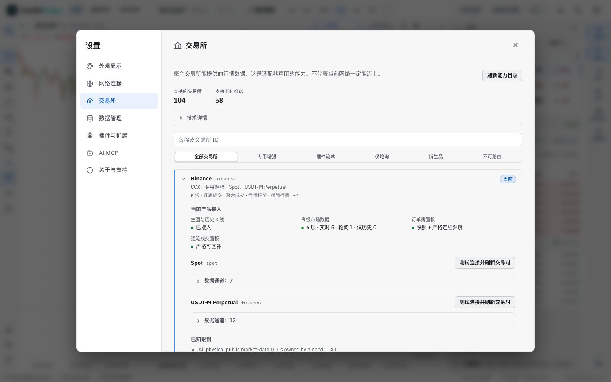 |
| 交易所, English | 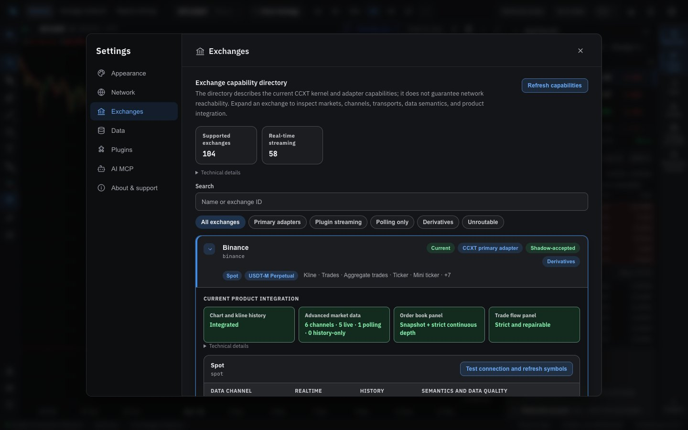 | 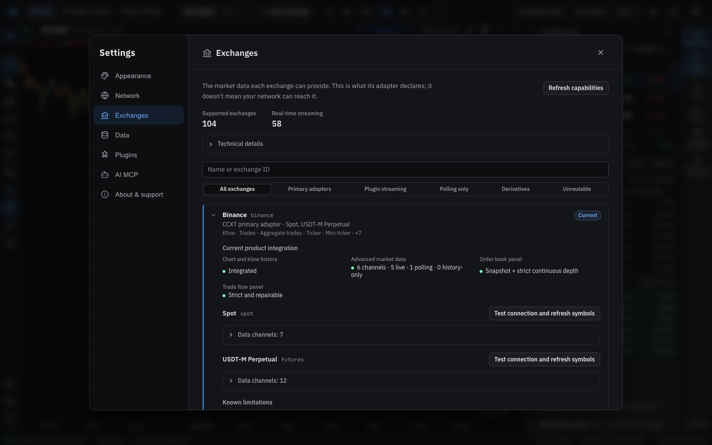 |
| 存储与维护, full length | 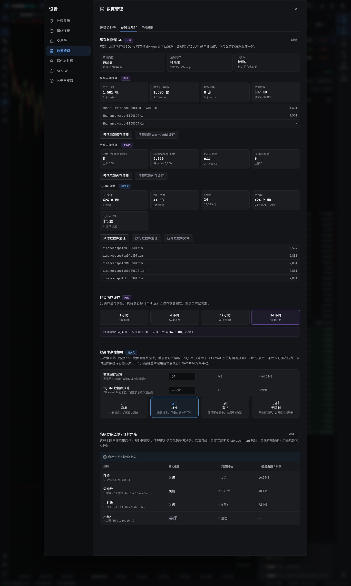 | 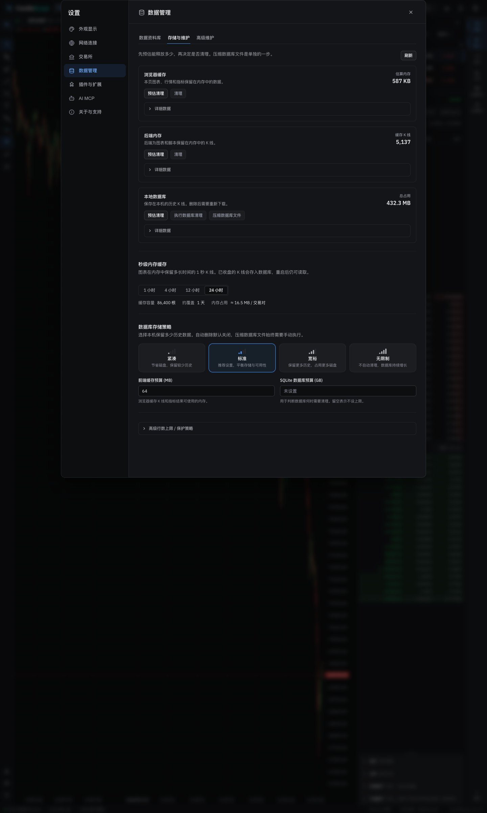 |
| 存储与维护 (light) | 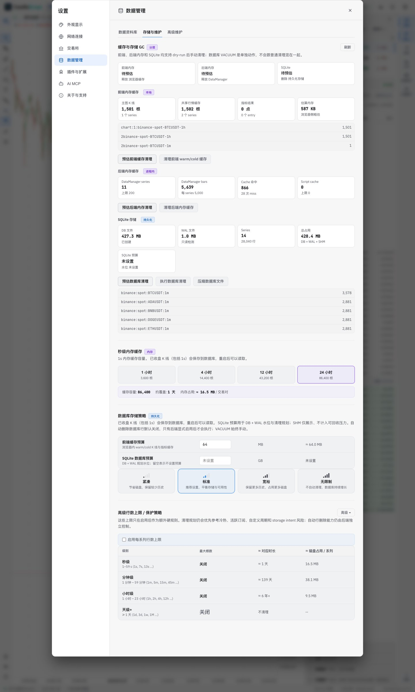 | 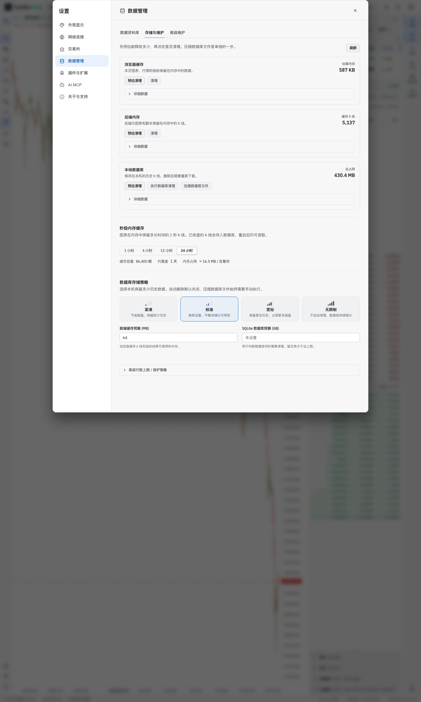 |
| 高级维护 | 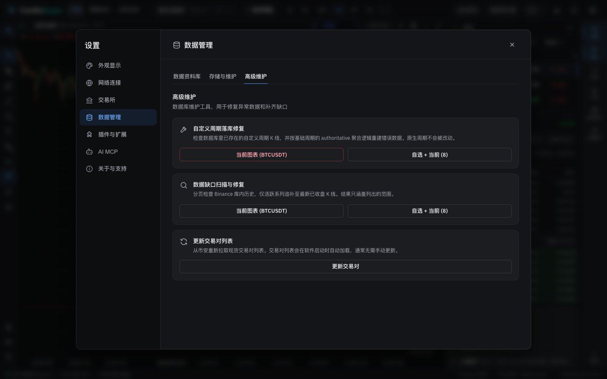 | 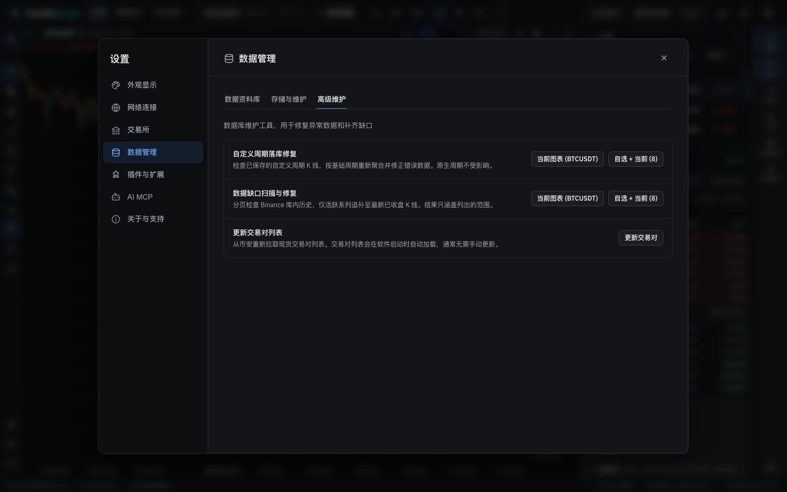 |
| 外观显示 | 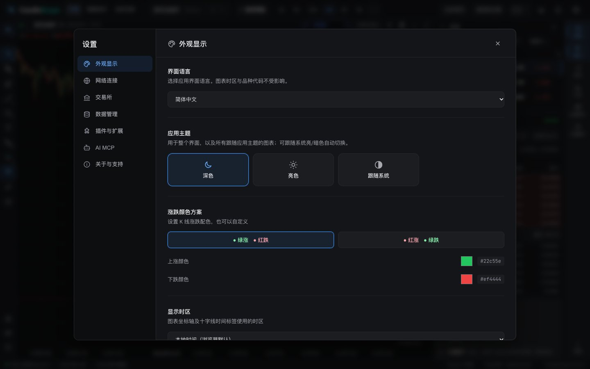 | 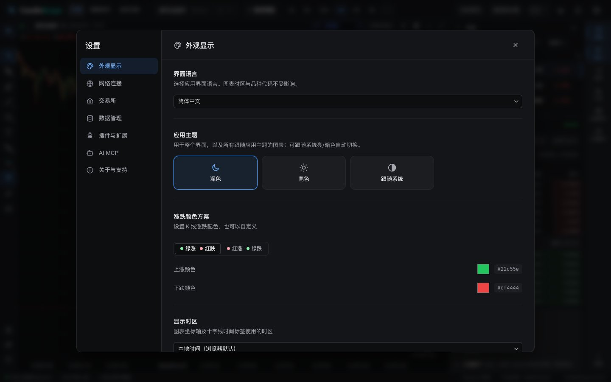 |
| 关于与支持, full length | 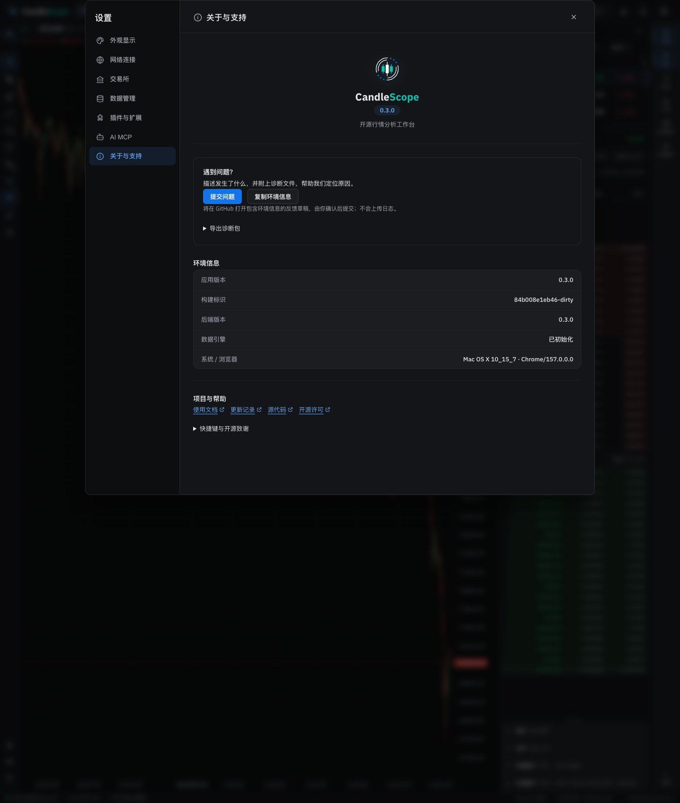 | 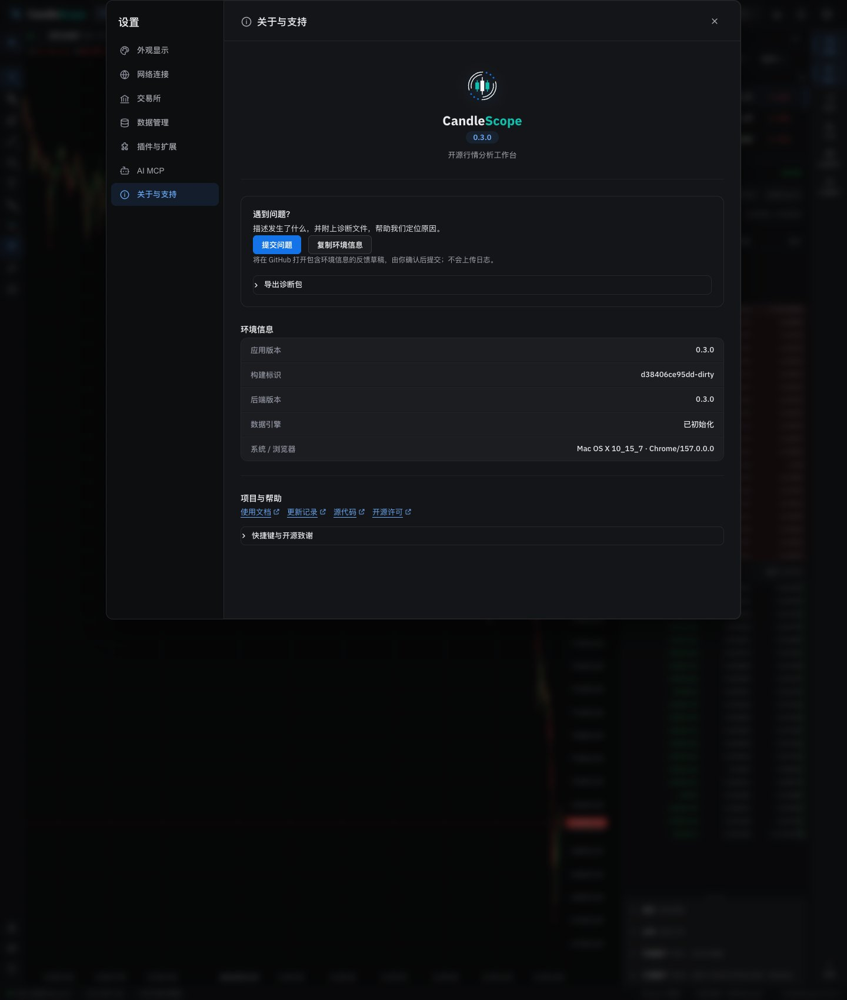 |

## Verification

**In the running app** (browser pane and headless captures, 1440 px):
- 存储与维护 is 1,279 px of content (it was 2,137). 预估清理 on 浏览器缓存 and 本地数据库 each showed a one-line result ("当前预算下没有可建议回收的缓存", "…没有会被删除的数据库行") with 清理 and 执行数据库清理 still disabled, as before when there is nothing to free. The cleanups, the repair, the gap scan and the pair refresh change data and were not run.
- The 1-second cache options are single-line (26 px) in Chinese.
- 交易所 in both themes and in English; the current exchange expands with its product status, two markets with their channel disclosures, known limitations and technical details.

**Unit tests:**
- `ExchangeSettingsPanel.test.tsx` (new): a row is the name, one line of plain text and at most 当前 / 不可路由; the verification wording is only in the technical details and the old "影子验收" term is gone; channels are behind a disclosure.
- `StorageMaintenancePanel.test.tsx`: results are toned alerts (warning for partial and empty, never success) with per-series detail in a disclosure; the existing checks on UTC bounds, unknown coverage and continuation still hold.
- `i18n.test.ts`: the pt-BR copy check caught an English-Portuguese mix in one new string, now reworded.

**Style metrics** (against 5a): class names with no CSS rule 0 (unchanged), raw `<button>` 741 → 732, `<Button>` uses 94 → 98, button class families 56 → 53, inline styles 162 → 147.

**Full check:** `npm run check` passes: 5,144 frontend tests, 137 desktop tests, lint (one existing warning), both typechecks and the build.

## Known gaps

- **Detail wording.** Inside the 详细数据 disclosures, some labels are still technical ("series", "entry", "miss", "WAL", "VACUUM", "压力"); the copy pass in Phase 6 covers them. The exchanges' known limitations and per-channel notes come from the backend in English.
- **Raw buttons that stay**: the choice cards (themes, proxy modes, storage presets), the sidebar and the exchange rows have their own styles and states; colour pickers stay native inputs, as the kit has none.
- **Not exercised**: the destructive actions (database cleanup, compaction, repair, gap scan and fill, pair refresh), since they change local data; their buttons, disabled states and result rendering were checked, the latter in unit tests.
- **Desktop app:** not tested.
