# Frontend design refactor: Phase 5c QA (alerts)

- Date: 2026-11-14
- Branch: `design/phase-5c-alerts`, based on `design/phase-5b-settings-panels` (PR #399)
- Plan: [`frontend/FRONTEND_DESIGN_REFACTOR_PLAN.md`](../frontend/FRONTEND_DESIGN_REFACTOR_PLAN.md) §2.4, §2.5, §2.6 and the Phase 5 row. Contract: [`DESIGN.md`](../DESIGN.md#long-forms-and-lists-in-drawers)
- **Intended visible change:** the alerts drawer is one calm column: kit tabs, a numbered form without cards inside cards, rows for rules and history, and fired alerts on the shared toast stack. What an alert does is unchanged.

## What changed

| Area | Change |
|---|---|
| Drawer frame | The context card (symbol, then four tiles for exchange, interval, price and connection) is gone; it repeated the chart header. The title has the alert engine's status under it; the rule count moved from a pill to the 全部警报 tab's badge. Tabs are kit `Tabs`; the close button is the kit `IconButton`. Loading and errors are an `InlineAlert` with 刷新. |
| 添加警报 | Four numbered sections (商品, 触发条件, 到期条件, 通知方式) separated by dividers, instead of five tinted step cards with more cards inside (the selected product card, condition cards). The one-line descriptions under each step are gone. 到期 and 通知 no longer share a 520 px row. The product line under the select says the exchange, market, list and, for the current chart, its price. |
| Fields | Every select, input and textarea is the kit control; channels are kit checkboxes with their description instead of tiles; the NOT toggles are kit checkboxes; the AND/OR select sits in its group's header. A custom expiry uses `DateTimeInput` (local time, zone shown), so it reads `2026-11-17 01:40` instead of the browser's date format. In a drawer narrower than 480 px, two-column parts stack (a container query). |
| Preview and test | The rule summary is an `InlineAlert`. The dry run with twelve sample values is a closed disclosure, 测试规则 with its state (未测试, 命中) in the summary; its result is an alert plus the condition trace with badges. |
| Actions | 新建草稿 and 创建警报 / 更新警报 sit in a footer that stays visible under the scrolling form. |
| 全部警报, 触发历史 | Rows: the rule name with its symbol as a badge, the condition, then status · limit · channels, then small ghost buttons (编辑, 复制, 停用/启用, 删除; 确认, 查看规则). Unread history has a dot. The row of chips under the search (自选列表, 商品, 条件类型…) looked like filters but were column labels; it is gone. Empty states use `EmptyState`, with 添加警报 when there are no rules. Refresh is an icon button. A rule's channels no longer end in the raw "history". |
| Fired alerts | `AlertNotificationCenter` keeps its event stream and delivery receipts but shows alerts through `notify()`: title 警报 · SYMBOL, the message, and 打开警报. Before, its own toast stack rendered inside the page, so while a dialog was open the toasts showed but could not be clicked (the known gap from 3a). The automation commands (dismiss, open alerts) still work, keyed by dispatch. |
| Styles | `alerts.css` went from 1,500 lines to 372, with no hard-coded colours; the late-loading `alertToasts.css` is merged and deleted. |
| Copy | One new string in all 30 languages (打开警报); 21 unused keys removed (step descriptions, the column labels, the old toast region labels). |

## Screens

The base build (Phase 5b, `00d616db2`) and this branch, 1440 px, `zh-CN` unless marked. The rule and history lists are shown with two sample rules served to the page (nothing was written to the backend); the fired alert comes from a stand-in event stream.

| | Before | After |
|---|---|---|
| 添加警报 | 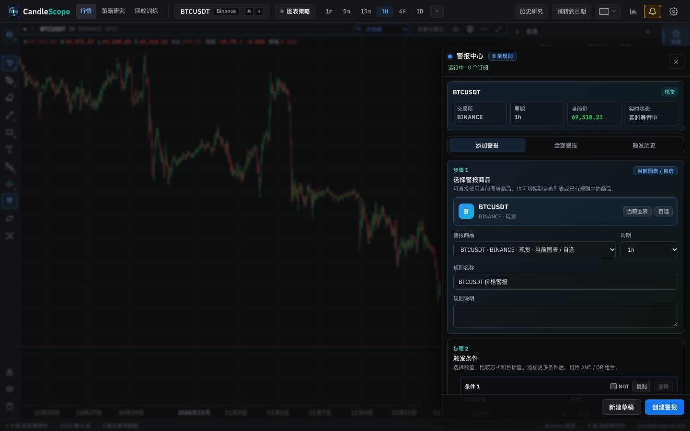 | 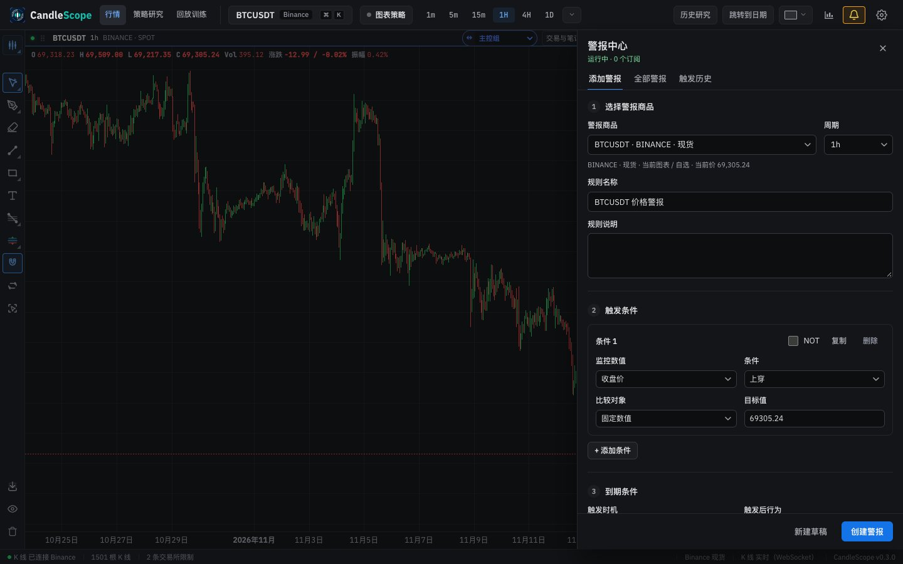 |
| 添加警报, full length | 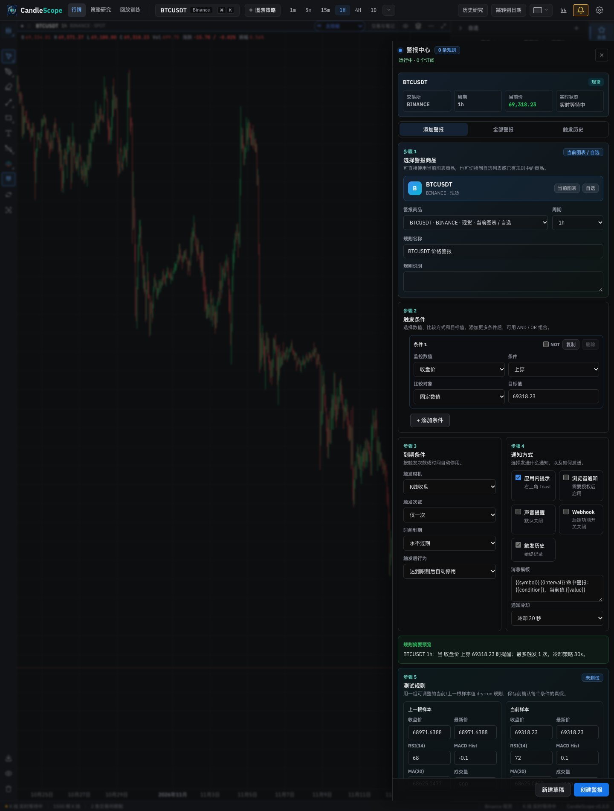 | 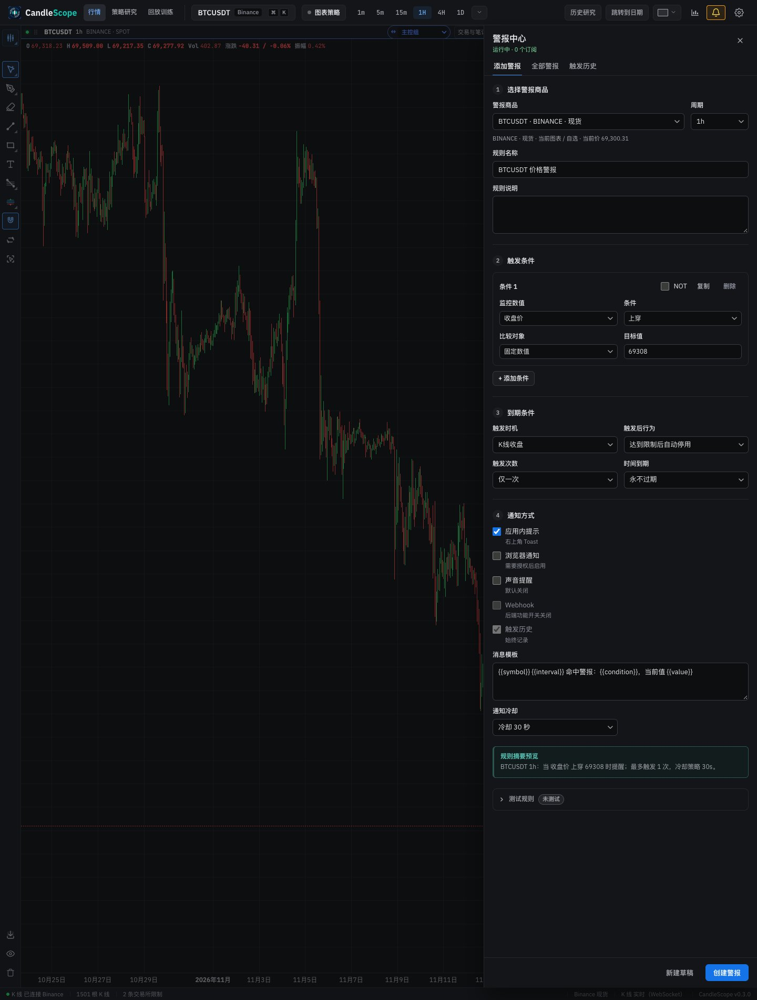 |
| 添加警报 (light) | 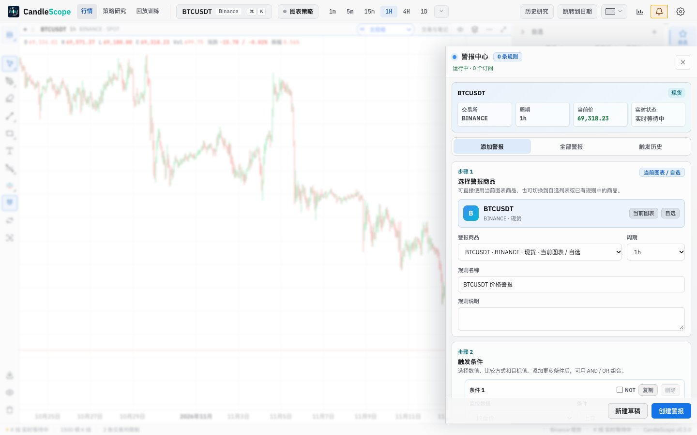 | 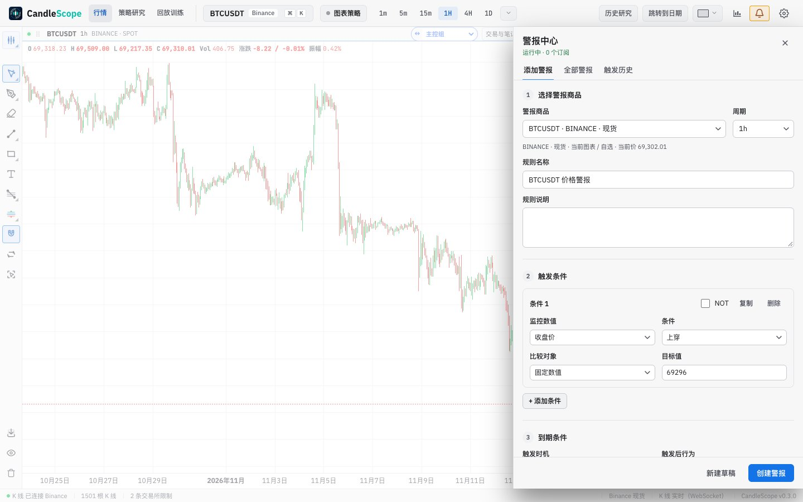 |
| 添加警报, English | 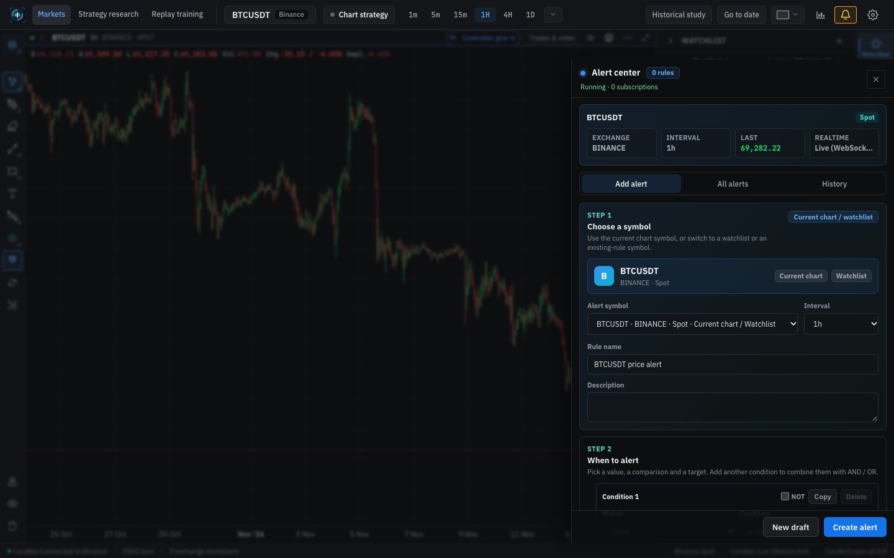 | 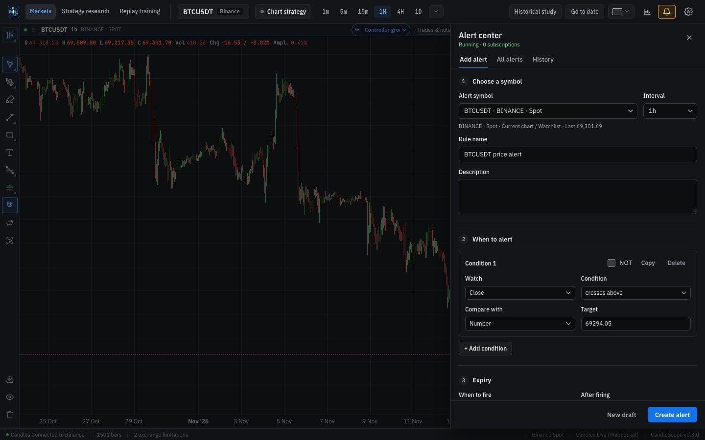 |
| 全部警报 | 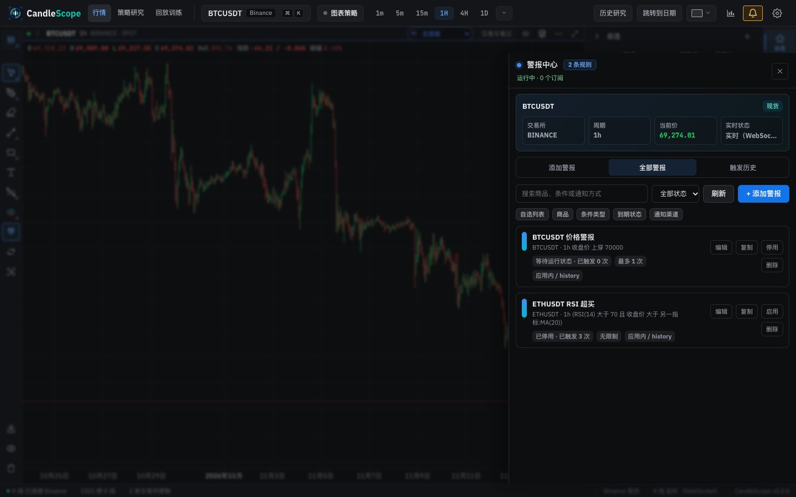 | 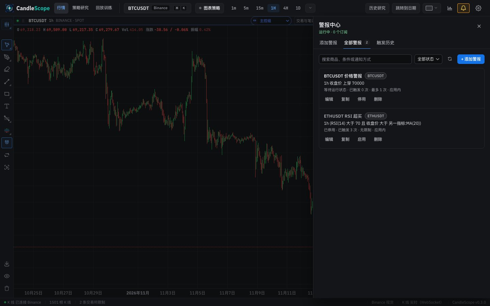 |
| 触发历史 | 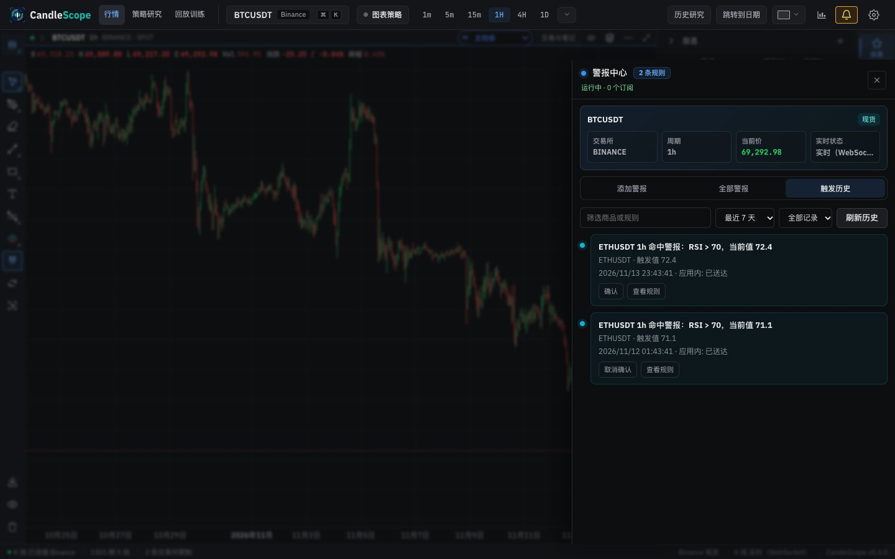 | 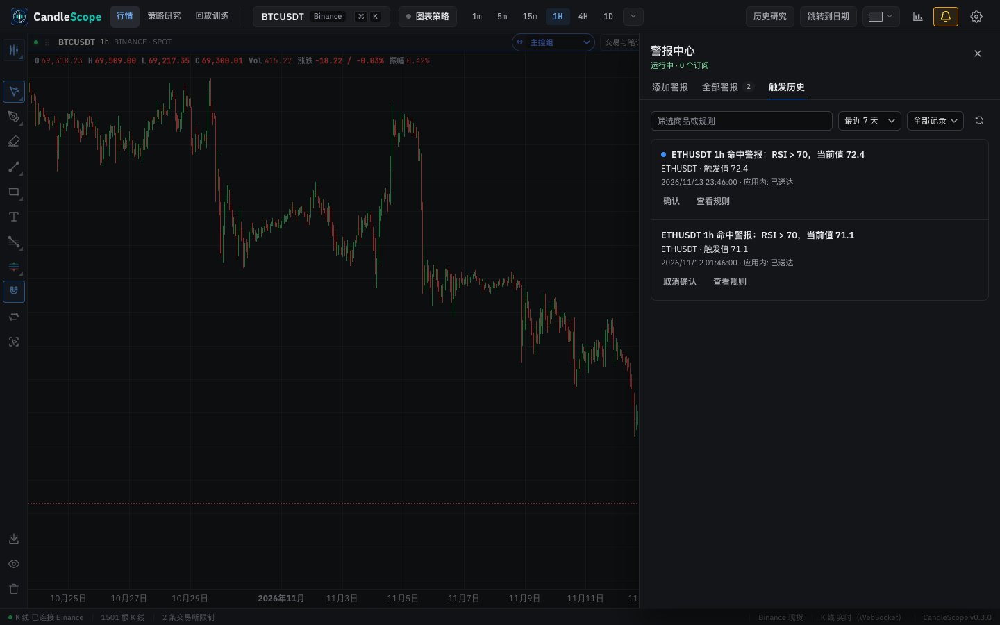 |
| A fired alert | 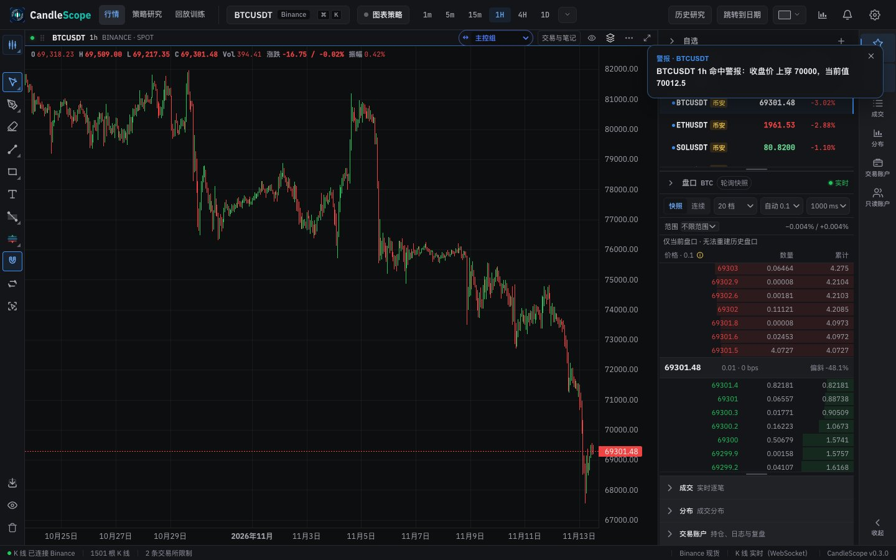 | 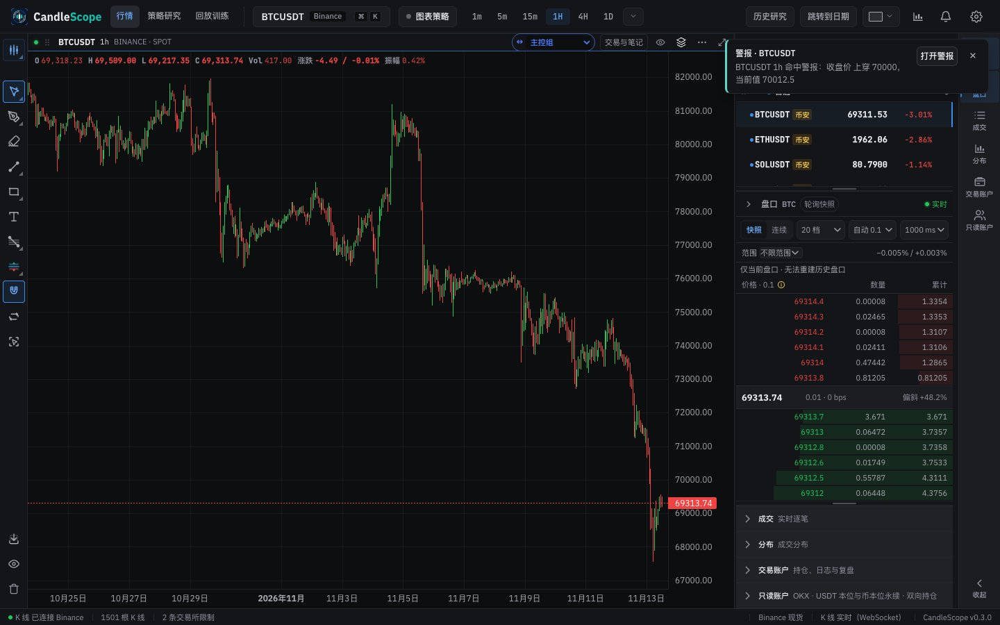 |
| A fired alert while Settings is open | 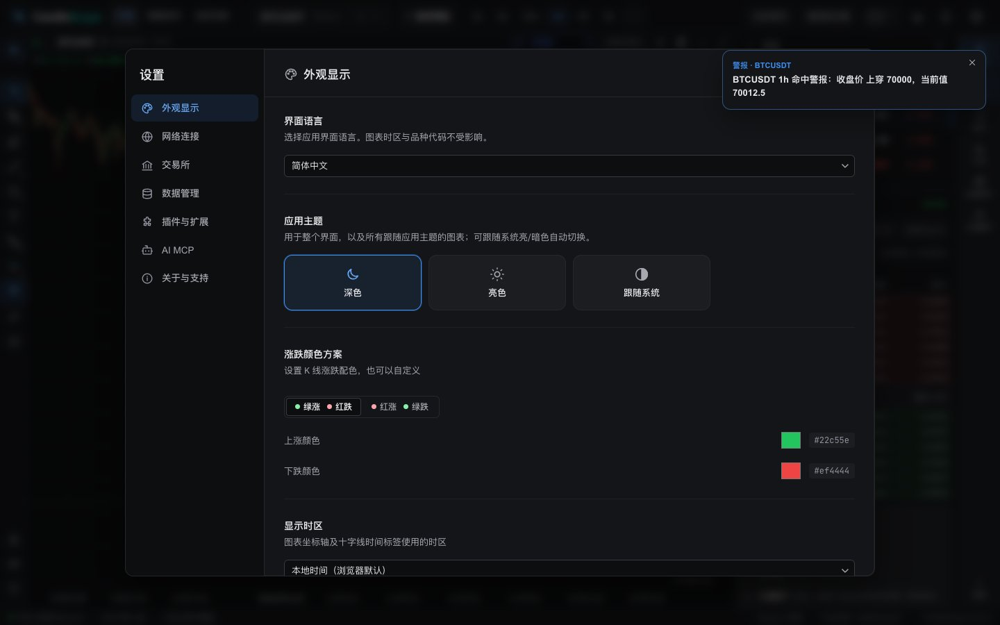 | 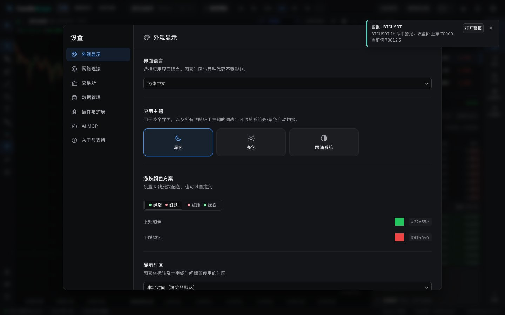 |

## Verification

**In the running app** (browser pane and headless captures, 1440 px):
- With sample rules served to the page, 编辑 on a two-condition rule switched to 添加警报 with its name, both conditions in an AND group, its custom expiry in the date field (`2026-11-17 01:40`) and 更新警报 in the footer. Escape closed the drawer.
- A fired alert from a stand-in event stream showed on the shared toast stack with 打开警报. With Settings open, the toast's 打开警报 was the topmost element under the pointer; in the base build the old toast was covered.
- The dry-run disclosure opens with both samples, three values per row (inputs 133 px wide, so prices are no longer cut).
- Saving, enabling, deleting and acknowledging were not run: they write to the local alert store.

**Unit tests:**
- `AlertsPanel.test.tsx` (new): kit tabs, no context card, the drawer keeps the shared resize handle; the form is sections of kit fields with no cards around them, the test is closed, the current price is under the product and the footer has 创建警报.
- `alertKernels.test.ts`: the channel summary leaves out the history record.
- `rightDrawerBehavior.test.ts` still passes: the drawer keeps the shared resize handle, and its backdrop closes it only on a click on the backdrop itself, as before.

**Style metrics** (against 5b): class names with no CSS rule 0 (unchanged), raw `<button>` 732 → 718, `<Button>` uses 98 → 107.

**Full check:** `npm run check` passes: 5,147 frontend tests, 137 desktop tests, lint (one existing warning), both typechecks and the build.

## Known gaps

- **Not exercised against the backend:** creating, updating, enabling, deleting, duplicating and acknowledging, which change the local alert store. The code paths are the same as before; only their buttons changed.
- **Browser notifications and sound** were not triggered; they go through the unchanged delivery client.
- **Alert copy** still mixes in a few internal words in the condition trace and the runtime status (for example "cooldown 30s" in the preview); Phase 6.
- **Desktop app:** not tested.
