# Frontend design refactor: Phase 5d QA (indicators)

- Date: 2026-11-14
- Branch: `design/phase-5d-indicators`, based on `design/phase-5c-alerts` (PR #400)
- Plan: [`frontend/FRONTEND_DESIGN_REFACTOR_PLAN.md`](../frontend/FRONTEND_DESIGN_REFACTOR_PLAN.md) §2.4, §2.5, §2.6 and the Phase 5 row. Contract: [`DESIGN.md`](../DESIGN.md#long-forms-and-lists-in-drawers)
- **Intended visible change:** the indicator drawer is a quiet list: each indicator is a row with its name, one line of description and pane, and one add toggle; added indicators show their parameters as labelled kit fields. The script editor has a two-line title, its actions and a close button in one toolbar, kit fields, and its advanced inputs folded into disclosures. What indicators compute is unchanged.

## What changed

| Area | Change |
|---|---|
| Drawer frame | The header is the title, a 计算中 badge while computing and a warning badge when updates are historical only or degraded, and the kit close button. 指标库 / 已添加 are kit `Tabs` with the count as the 已添加 badge (it was "已添加 (2)"); 自定义 is a small kit button beside them instead of a third tab-styled link. |
| 指标库 | A row per indicator: its name, then its description and pane on one line ("Simple Moving Average · 主图"), then a small add toggle (+, or ✓ when on the chart, `aria-pressed`). The 内置, 主图 and 副图 pills on every row are gone; a badge is left only for what is unusual: 自定义 for your own indicators, 行情数据 for market studies, and unavailable in replay. Search is a kit `Input`; no match is an `EmptyState`. |
| 已添加 | The added indicators are one bordered list; each has its visibility toggle, name and pane, and edit and remove icon buttons. Parameters are kit fields with the label above, two per row (one per row when the drawer is narrower than 360 px), instead of label and control squeezed into one line; colour inputs are a compact swatch. The line legend stays under them. Errors and runtime notices are `InlineAlert`s; 重新计算全部 is a small button at the end instead of a full-width outlined bar. Nothing added is an `EmptyState`. |
| Script editor | The toolbar has the title with the indicator's name under it, then 运行到图表 and 保存并关闭 (or 复制为自定义 for a built-in), a divider and a close button (in the base build the close button after the divider showed nothing). The name is a kit `Input`; the language a kit `Select` beside the script label; the runtime and the hint are plain lines with the shortcut as a `kbd`. Labels and hints are no longer uppercase: that turned code such as `ta.timeframe` into "TA. TIMEFRAME". |
| Advanced inputs | Pine's library sources, request contexts and currency rates (and a saved Pine indicator's host inputs) were native `
` in 16 px body text with unstyled text areas. They are closed kit disclosures with their help line and a labelled monospace text area; a parse error shows under it and marks it invalid. |
| Status line | The editor's last line keeps its tones (running, error, done) and is announced (`role="status"`); line spacing fits two lines. The editor and its inputs had 40 inline styles; they have none. |
| Styles | `indicators.css` went from 957 lines to 437, with no hard-coded colours: the backdrop uses the same tinted surface as the alerts drawer instead of 35 % black, so in the light theme the chart behind is lightened rather than greyed. The late-loading `indicatorEditorToolbar.css` is merged and deleted. |
| Copy | No new strings; two keys nothing uses any more are gone (`indicator.addedCount`, `indicator.builtin`) from all 30 languages. |

## Screens

The base build (Phase 5c, `168478ddb`) and this branch, 1440 px, `zh-CN` unless marked. 已添加 shows the moving average and MACD, added through the drawer.

| | Before | After |
|---|---|---|
| 指标库 | 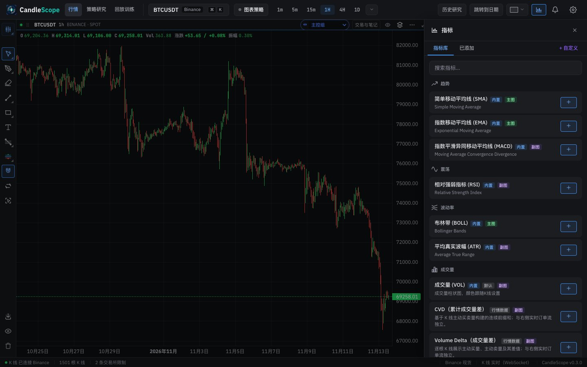 | 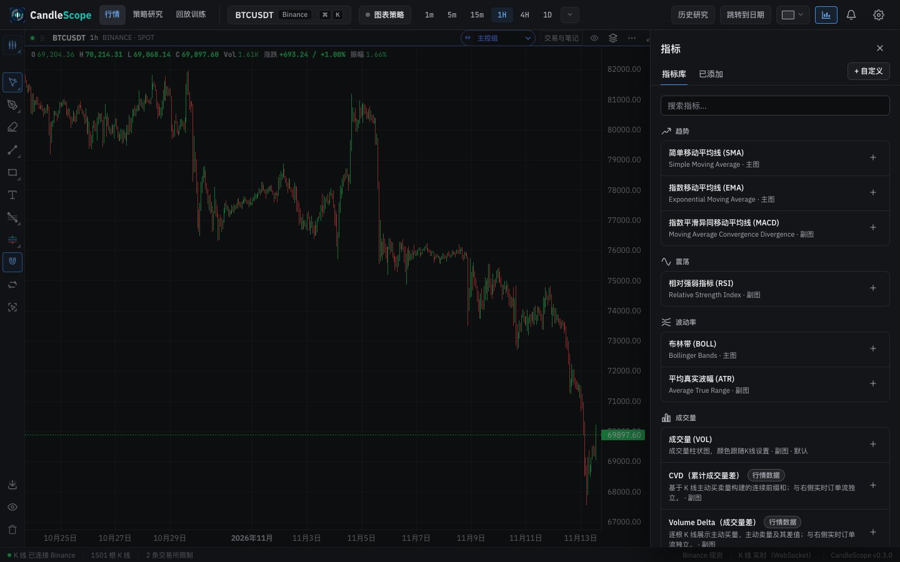 |
| 已添加 | 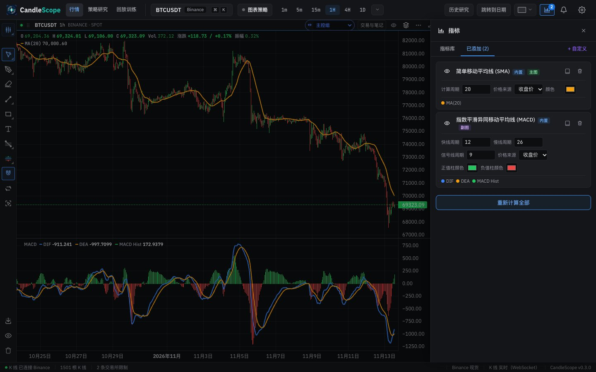 | 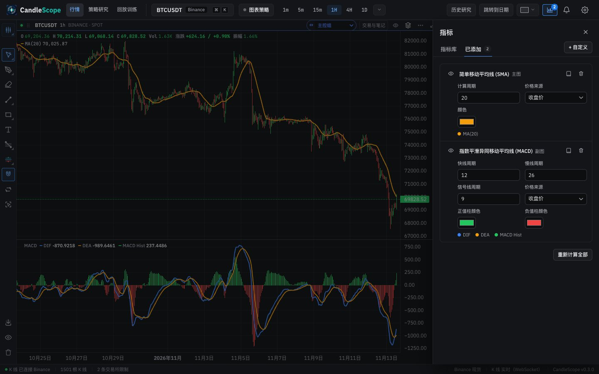 |
| 已添加 (light) | 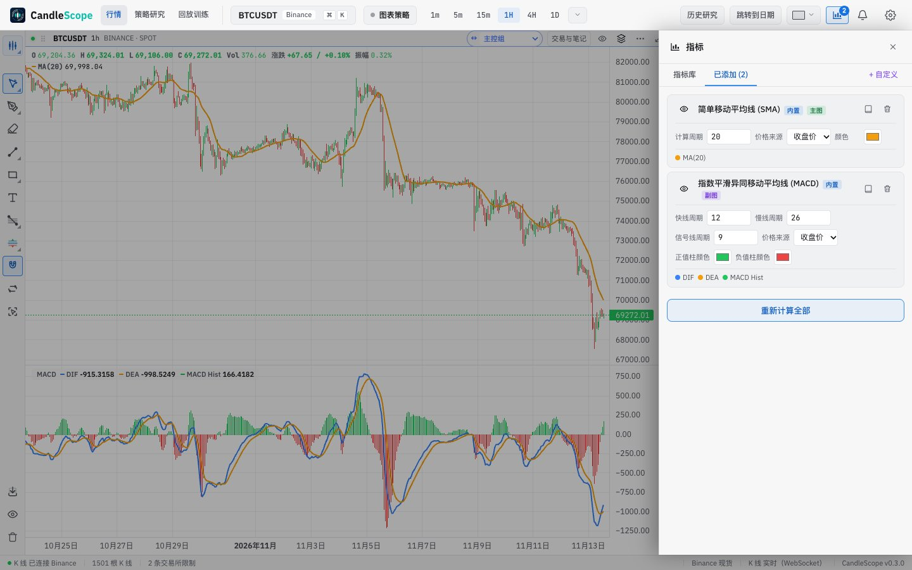 | 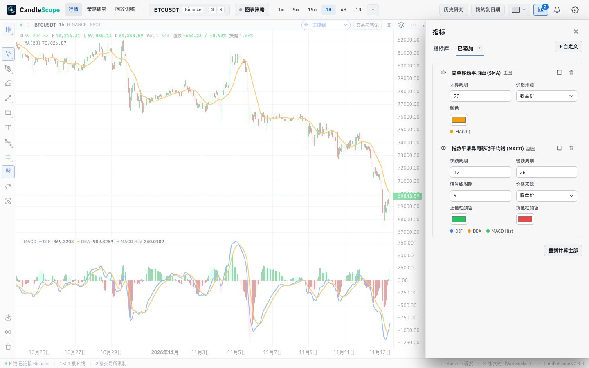 |
| 已添加, English | 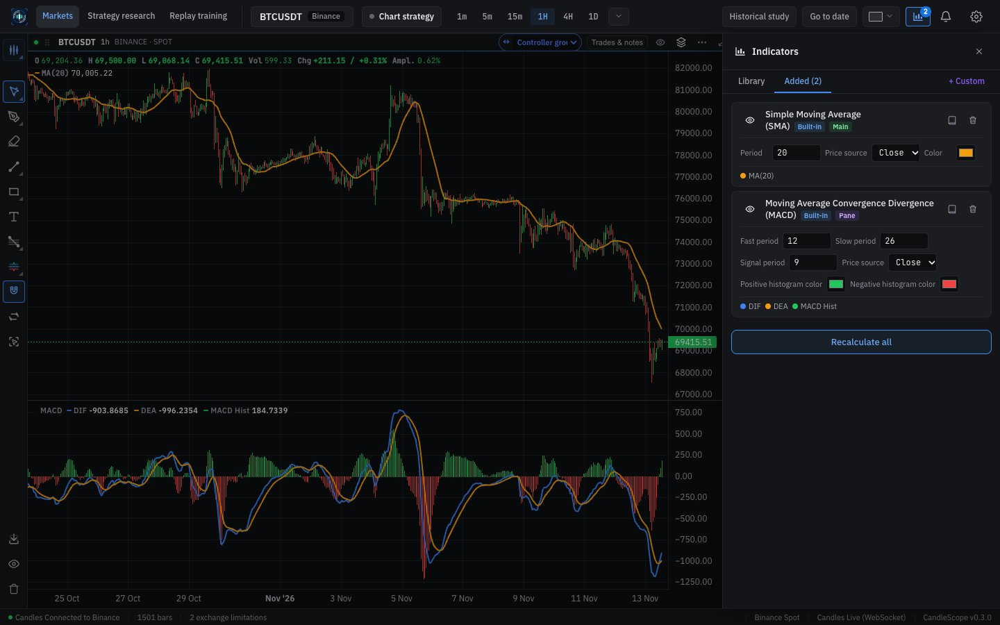 | 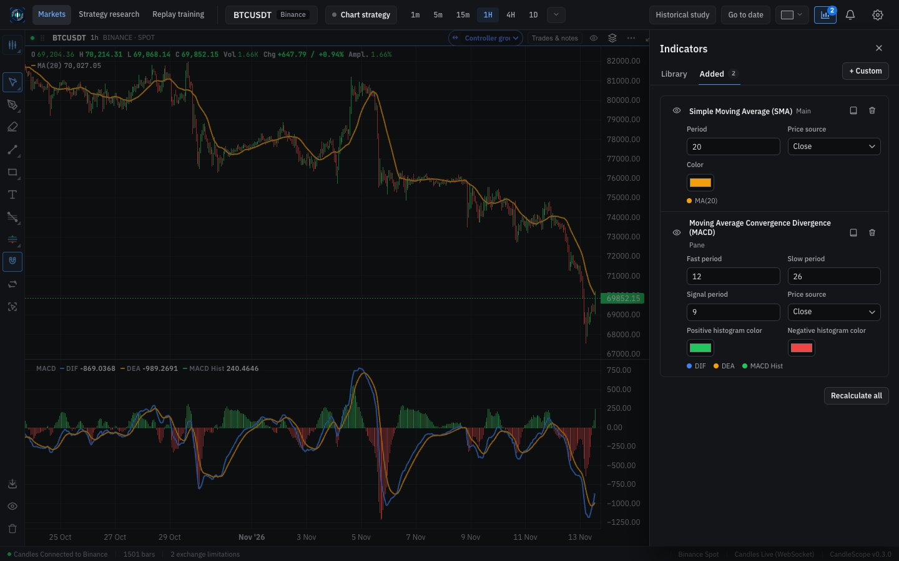 |
| A built-in's reference script | 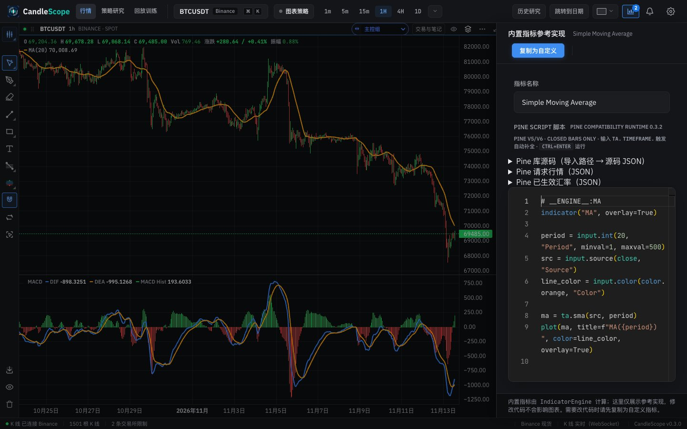 | 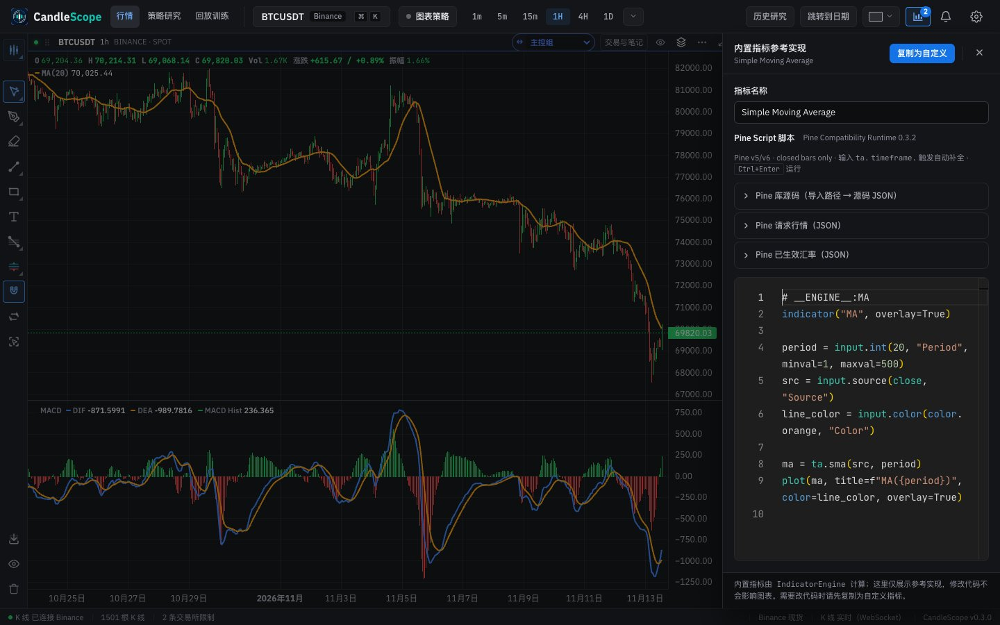 |
| New custom indicator | 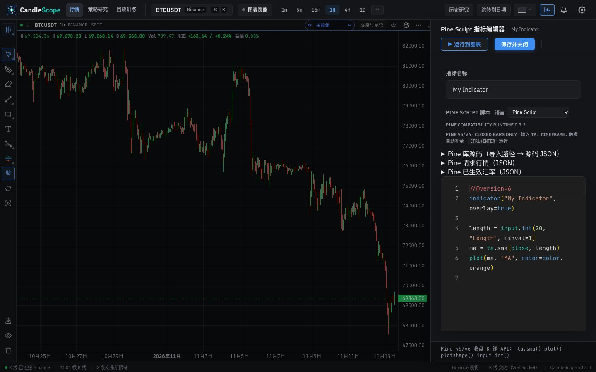 | 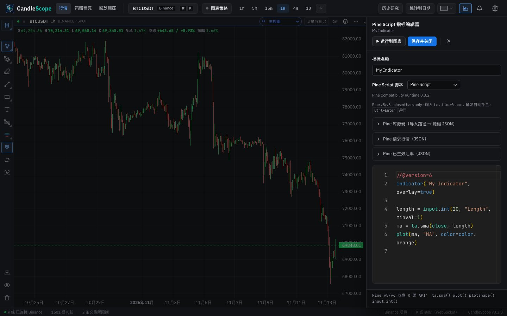 |
| New custom indicator (light) | 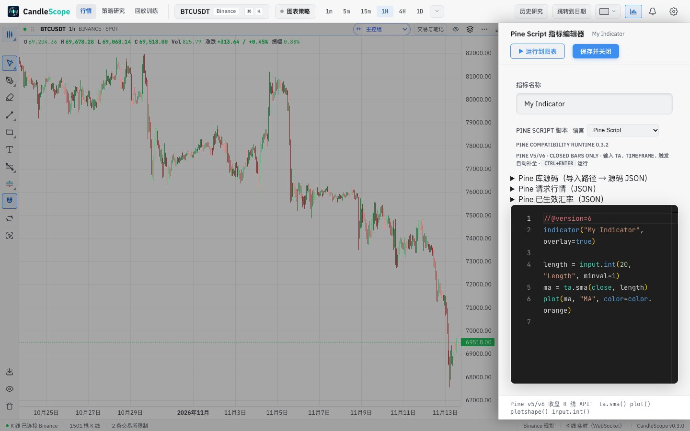 | 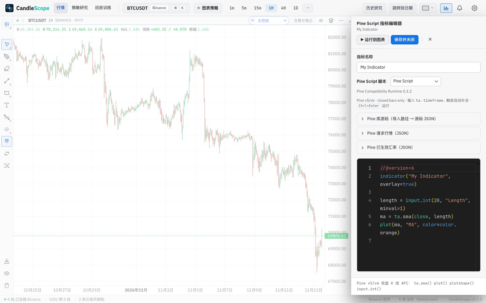 |
| Pine's advanced inputs, opened | 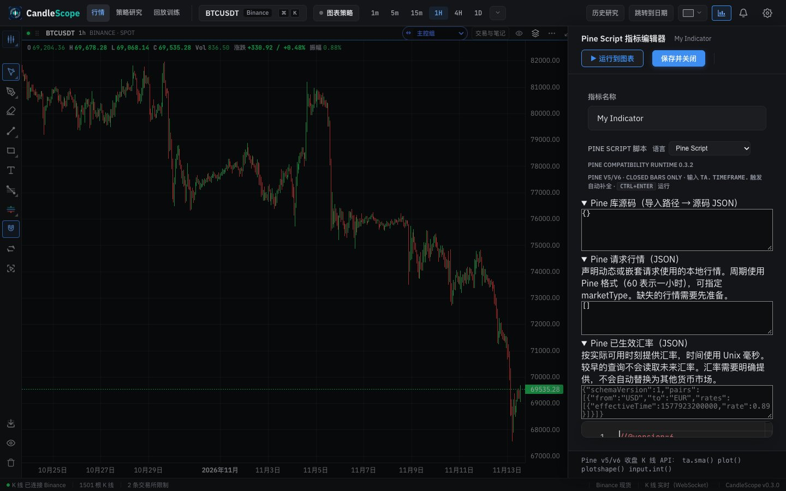 | 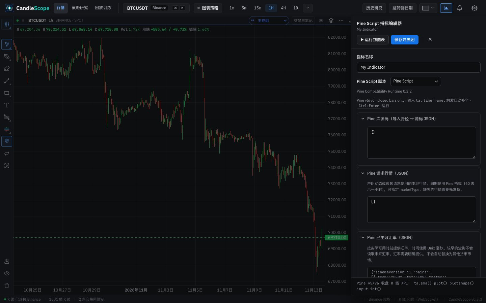 |

## Verification

**In the running app** (browser pane and headless captures, 1440 px):
- Adding the moving average from 指标库 pressed its toggle (✓) and set the 已添加 badge to 1. In the captures, the moving average and MACD added through the drawer draw on the chart and the badge reads 2.
- In 已添加, setting 计算周期 to 30 and pressing Enter recomputed it: the chart's legend read MA(30). Each field's label points at its control.
- 查看参考实现 on a built-in opened its script read-only with 复制为自定义 and 关闭编辑器; closing returned to 已添加.
- 自定义 opened a new Pine Script indicator with three closed disclosures. Opened, a text area took input; incomplete JSON showed "SyntaxError: Unexpected end of JSON input" under it and marked it invalid, and the message went away once the JSON was valid again.
- 运行到图表 sent the calculation; the local backend answered `INDICATOR_CALCULATION_OUTPUT_UNSUPPORTED` for the default template, which the status line showed in the danger tone. The base build gets the same answer (see Known gaps).
- The test indicators were removed afterwards. Saving and deleting custom indicators were not run: they write to the local indicator store.

**Unit tests:** `IndicatorPanel.test.tsx` (new): kit tabs and create button, only the drawer width inline; a library row is the name, one line of description and pane, and a pressed or unpressed add toggle, with no 内置 or pane pills; the editor's toolbar has its actions and close button and no inline styles; the advanced inputs are closed disclosures with labelled text areas and nothing uppercase; a built-in opens read-only with 复制为自定义 as its one action.

**Browser test:** `frontendScript.browser.tsx` (`npm run test:frontend-js:browser`, not part of `npm run check`) failed on the base: it looked for the editor inside the chart's host element, but the drawer renders in the overlay host, and it waited for `window.alert`, while errors now go through `notify()`. It now searches the document and waits for the danger toast, and passes.

**Scripts:** `smoke.mjs` and `multi-chart-capacity.mjs` find the tabs by role in `.indicator-tab-bar`; the capacity script's drawer toggle no longer also matches the alerts toggle.

**Style metrics** (against 5c): class names with no CSS rule 0 (unchanged), raw `<button>` 718 → 698, `<Button>` uses 107 → 113, button class families 53 → 45, inline styles 147 → 100, `!important` 45 → 44.

**Full check:** `npm run check` passes: 5,152 frontend tests, 137 desktop tests, lint (one existing warning), both typechecks and the build.

## Known gaps

- **The code editor stays dark in the light theme**, as before: the script theme is dark only and is shared with the strategy editor. Phase 7.
- **Copy:** the editor hint still has English ("closed bars only") and the built-in note names `IndicatorEngine`; parameter names come from each indicator's script. Phase 6.
- **Running the default Pine template fails against the local backend** with `INDICATOR_CALCULATION_OUTPUT_UNSUPPORTED`, in the base build too, so it is not from this change. The backend raises it when the installed Pine runtime does not offer the output-streaming features it needs, so the local runtime (0.3.2) is likely older than the backend. The status line shows the raw code rather than a sentence (Phase 6).
- **Not exercised against the backend:** saving and deleting custom indicators, which change the local indicator store; only their buttons changed.
- **Desktop app:** not tested.
