# Frontend design refactor: Phase 5e QA (symbol search and Export)

- Date: 2026-11-14
- Branch: `design/phase-5e-search-export`, based on `design/phase-5d-indicators` (PR #401)
- Plan: [`frontend/FRONTEND_DESIGN_REFACTOR_PLAN.md`](../frontend/FRONTEND_DESIGN_REFACTOR_PLAN.md) §2.4, §2.5, §2.6 and the Phase 5 row. Contract: [`DESIGN.md`](../DESIGN.md#search-and-export-dialogs)
- **Intended visible change:** symbol search keeps its shape (search field, filters, list, footer) but its filters become one aligned row of kit selects and its rows lose the pill on every line. Export moves from a native `<dialog>` to the kit `Dialog`: its option cards become segmented controls, and the preview's four tiles become one line. What search finds and what Export saves are unchanged.

## What changed

| Area | Change |
|---|---|
| Search: frame | Kit surface, border and shadow; the scrim is the shared dialog backdrop instead of black with an 8 px blur. The close and clear buttons are kit `IconButton`s (the close button was a hand-drawn glyph). 680 → 720 px wide. |
| Search: filters | 全部 / 最近使用 / 收藏 is a kit `SegmentedControl` instead of pill buttons. The five filters (资产类别, 数据来源, 交易所, 类型, 计价) are one row of labelled small kit selects (three per row when the dialog is narrower than 560 px), instead of two rows of different widths with labels beside them. 数据来源 still opens its searchable list (favourites, recent, all); the button reads like the other selects and the list uses the kit menu's rows. |
| Search: list | 类型 is plain text instead of a green 现货 pill on every row; 当前 is a `Badge`; the star is a kit toggle (`aria-pressed`); a symbol listed by several sources shows "53 个来源" under its name. The 名称 and 数据来源 column labels were borrowed from other features (`workspace.groupName`, `research.drawer.title`); they have their own keys. Loading and no results are `EmptyState`s; a failed search is an `InlineAlert` with 重试. |
| Search: footer | The symbol count, then 已收录 89 / 104 个来源 as a disclosure whose source list opens above the footer, then 更多结果 and 刷新数据 as small ghost buttons. A disabled source in the list reads "aster (无可路由公共行情)" instead of "aster ·  (无可路由公共行情)". |
| Search: right-click | 添加到自选列表 uses the kit menu's rows, hint and disabled state instead of its own colours. |
| Export: frame | The kit `Dialog` on the overlay stack instead of a native `<dialog>`: title, close button, a footer with 关闭 and 保存当前预览, and Escape; it cannot be dismissed while saving. Keys typed inside still stay out of page shortcuts, except Escape, which the stack needs. The subtitle ("调整配置后右侧会自动生成最终图片预览，保存即当前预览。") is gone; the preview's status says it. |
| Export: settings | 导出范围 and 格式 are segmented controls with the chosen option's description under them, instead of six cards each carrying its own description. 缩放倍率 is a segmented control beside 背景 (a kit `Select`). The quality slider has a label tied to it. 保留图表信息, 导出时隐藏绘图 and 添加水印 are kit checkboxes with descriptions instead of bordered cards. The full file name sits under 文件名前缀; it was shown twice, here and again above the preview. |
| Export: preview | One line under 导出预览: the status, toned (保存即此图 green, 配置已变化 amber, generating blue), then format, size and time, instead of four labelled tiles that showed "--" until the first preview. Zoom is a segmented control and refresh an icon button beside it. A failed preview is an `InlineAlert` with 重新生成; waiting states are `EmptyState`s. A checkerboard shows transparent areas. |
| Styles | `symbolSearch.css` from 700 lines to 444 (the symbol button in the top bar keeps its rules) and `exportPanel.css` from 517 to 169, with no hard-coded colours left (17 lines had them) and no light-theme override. |
| Kit | `Dialog` passes `onKeyDown` to its surface; segments and tabs carry `data-value`, so scripts and tests find an option without its label; `Input` takes a `ref`. |
| Copy | 4 new strings in all 30 languages (`search.name`, `search.source`, `search.clear`, `export.zoom`); 7 export keys nothing uses any more are gone (the subtitle, the preview subtitle, the 状态 and 尺寸 tile labels, "↻ 刷新", and the old dialog and close labels). |

## Screens

The base build (Phase 5d, `7f5b03043`) and this branch, 1440 px, `zh-CN` unless marked.

| | Before | After |
|---|---|---|
| Symbol search | 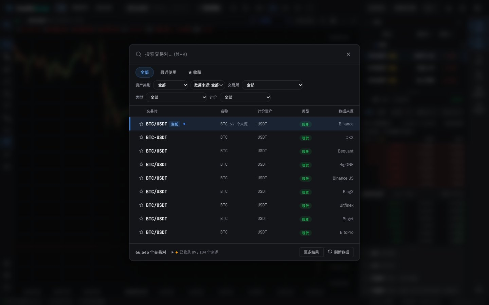 | 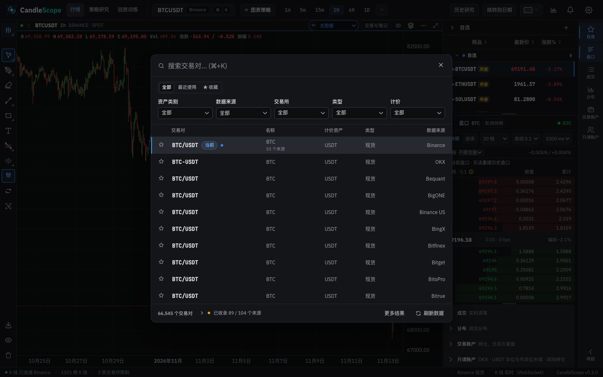 |
| Symbol search (light) | 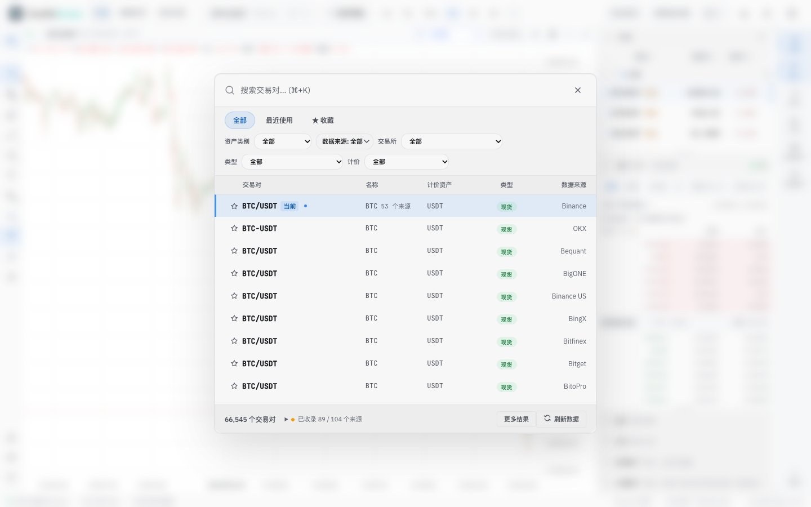 | 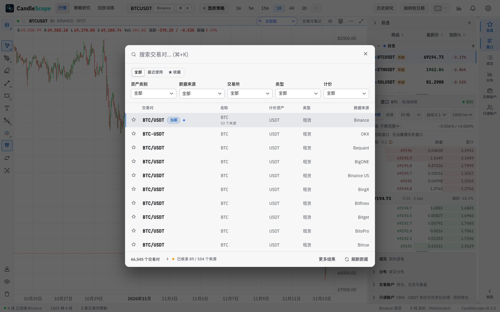 |
| Symbol search, English | 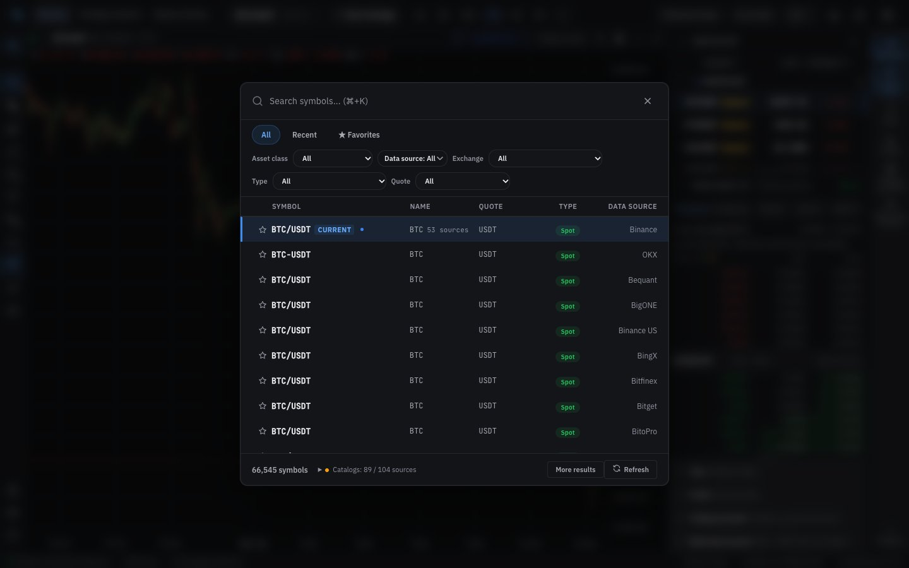 | 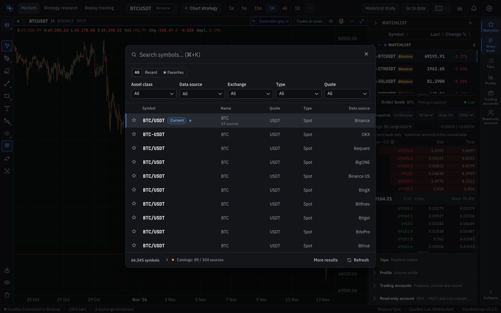 |
| 数据来源 opened | 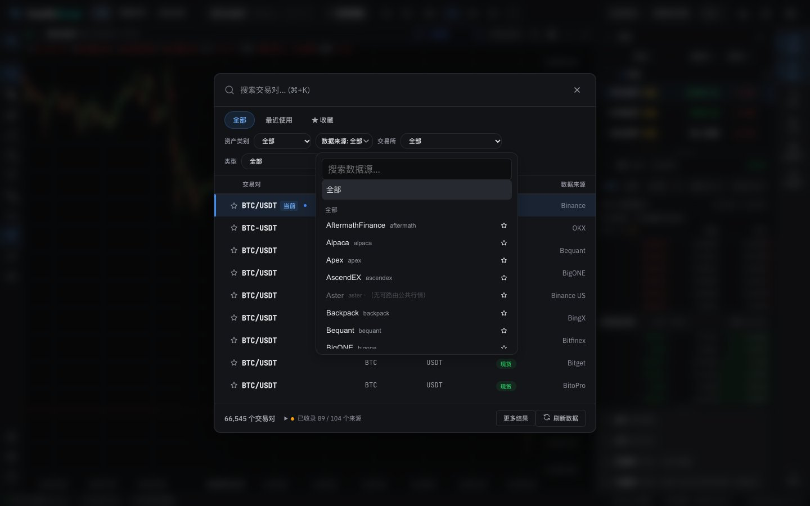 | 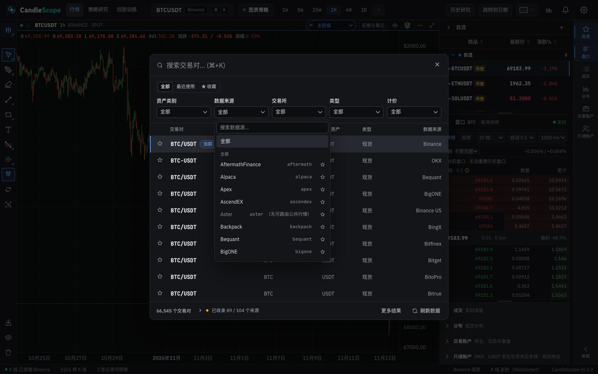 |
| Export | 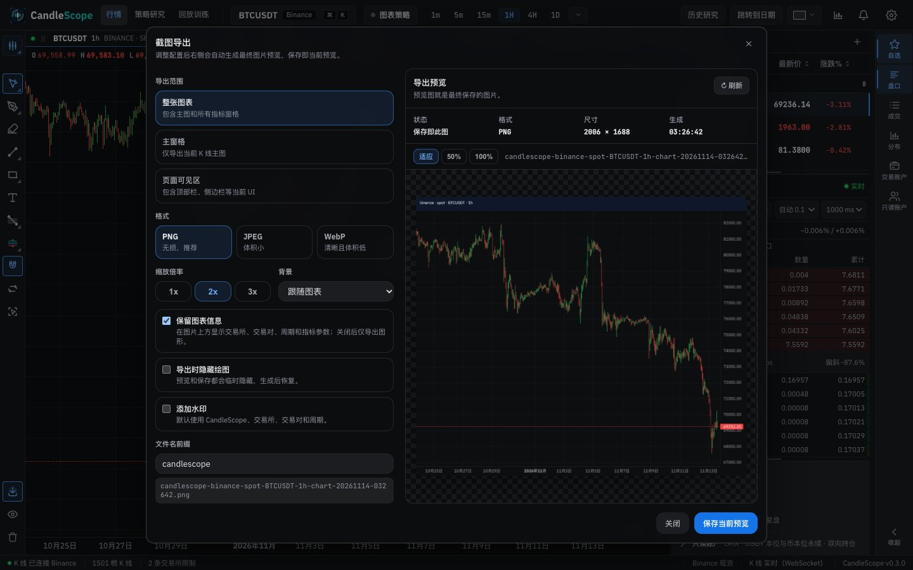 | 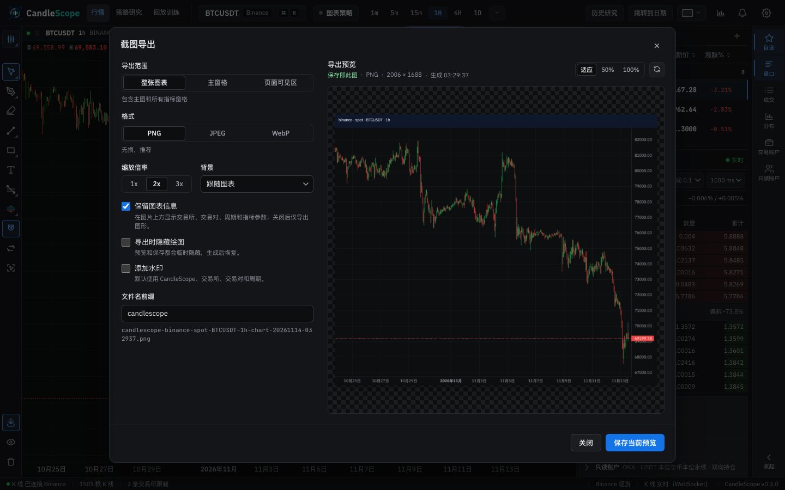 |
| Export (light) | 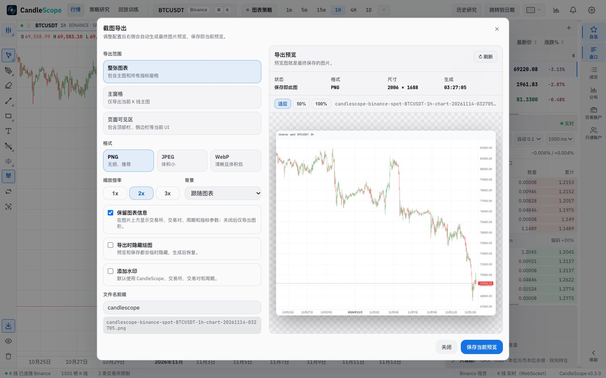 | 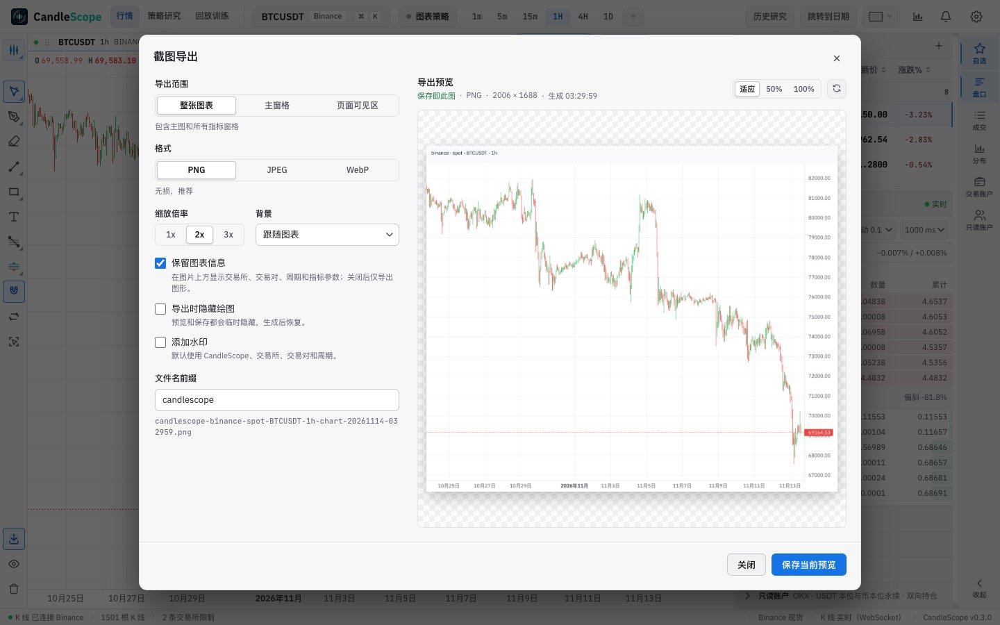 |
| Export, English | 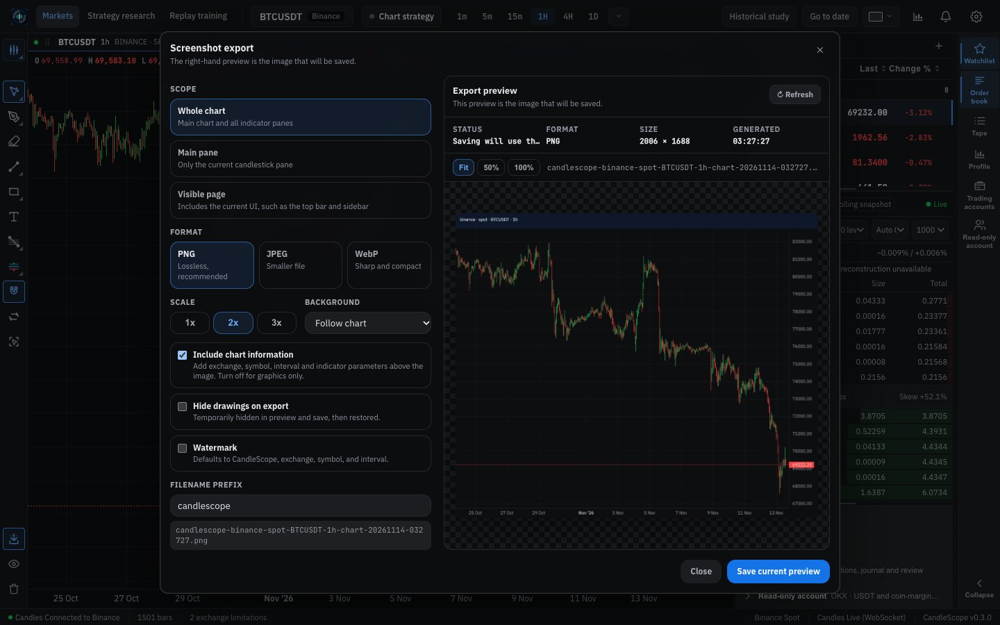 | 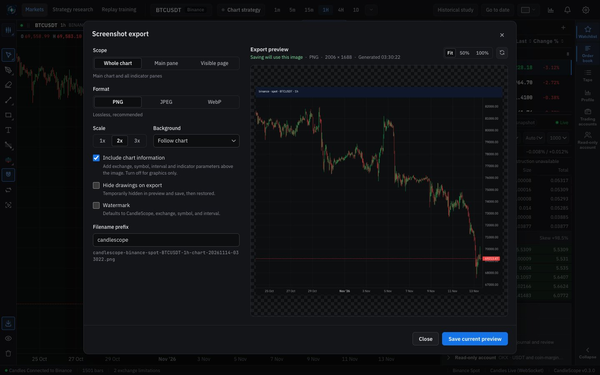 |
| Export as JPEG with a watermark | 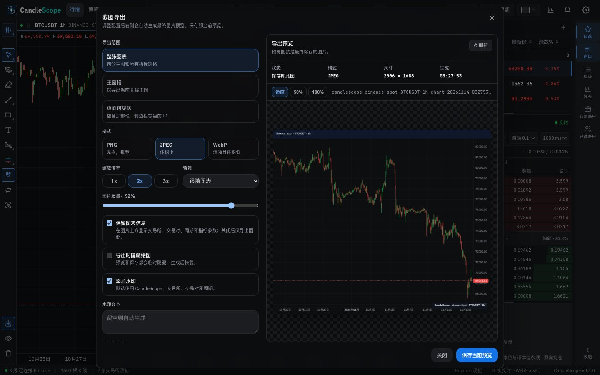 | 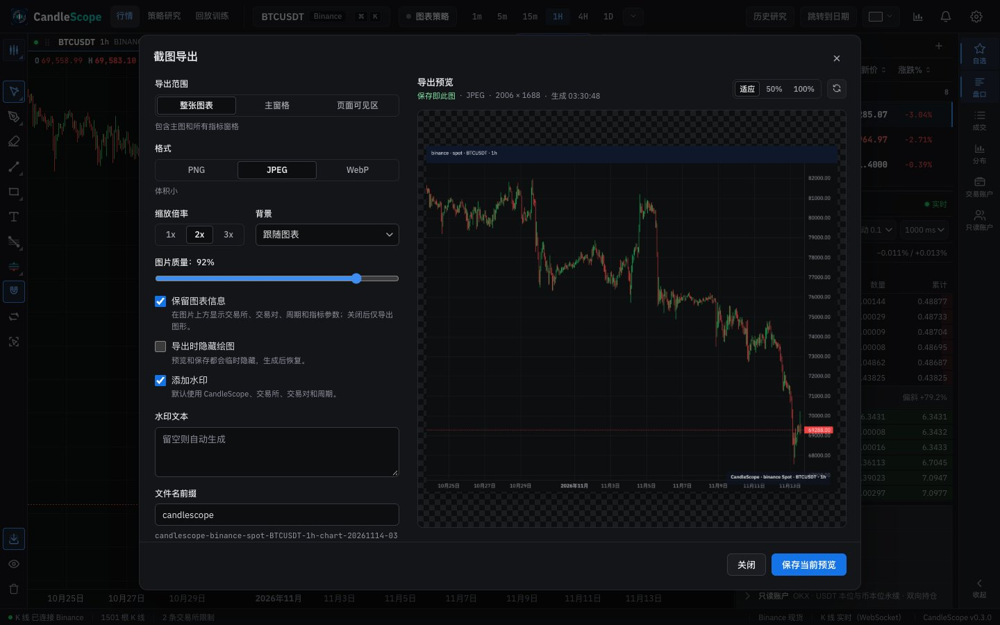 |

## Verification

**In the running app** (browser pane and headless captures, 1440 px):
- Search: opening it focuses the search field. 最近使用 switches the scope; 计价 → USDC leaves only USDC rows; ↓ ↓ moves the highlight and Enter picks the highlighted symbol and closes. 数据来源 opens its list; Escape closes the list first and the dialog on the next press. A right-click on a row opens 添加到自选列表 with the watchlist (nothing was added). The coverage list opens above the footer.
- Export: it opens as a modal dialog with the page behind it inert. A key typed in 文件名前缀 did not open symbol search. 导出范围 → 主窗格 updated the hint and regenerated the preview (new time and file name, 保存当前预览 enabled). 页面可见区 captures the page without the dialog. 100% zoom, Escape closes it and the page is usable again.
- Saving was not run: it downloads a file.

**Unit tests:**
- `SymbolSearchModal.test.tsx` (new): the scope switch, five labelled filters (four kit selects and the source button), search's own column labels, the kit close button.
- `ExportPanel.test.tsx` (new): scope, format and scale are segmented controls with the chosen description, the options are kit checkboxes, the file name appears once; JPEG has a labelled quality slider and no transparent background; the preview's status and details are one line with zoom and refresh; a failed preview is an alert with 重新生成.
- `i18n.test.ts`: the pt-BR spot check used a removed key and now checks 保存当前预览's translation.

**Scripts:** `export-matrix.mjs` and `drawing-rollback-export-browser.mjs` choose scope, format and scale through `data-export-choice` and `data-value`, read errors from the alerts, and close through the dialog's close button. They were syntax-checked, not run.

**Style metrics** (against 5d): class names with no CSS rule 0 (unchanged), raw `<button>` 698 → 682, `<Button>` uses 113 → 119, button class families 45 → 42, inline styles 100 → 99 (what is left in search is the virtual list's offsets and the watchlist colours).

**Full check:** `npm run check` passes: 5,159 frontend tests, 137 desktop tests, lint (one existing warning), both typechecks and the build.

## Known gaps

- **Export drill scripts not run** (`export-matrix.mjs`, `drawing-rollback-export-browser.mjs`): they save files. Their selectors were updated to the new markup.
- **The source and coverage lists stay `
`**: the search's own Escape handling closes an open `
` before the dialog. They look like kit menus but are not on the overlay stack.
- **Copy:** the search placeholder repeats the shortcut shown on the button, and some source statuses are long ("缓存可用，待更新"); Phase 6.
- **Desktop app:** not tested.
