# Frontend design refactor: Phase 5f QA (replay hub)

- Date: 2026-11-14
- Branch: `design/phase-5f-replay`, based on `design/phase-5e-search-export` (PR #403)
- Plan: [`frontend/FRONTEND_DESIGN_REFACTOR_PLAN.md`](../frontend/FRONTEND_DESIGN_REFACTOR_PLAN.md) §2.4, §2.5, §2.6 and the Phase 5 rows. Contract: [`DESIGN.md`](../DESIGN.md#search-and-export-dialogs)
- **Intended visible change:** the replay hub lists runs as rows instead of tiled cards, and 新建训练 becomes a kit dialog with numbered sections, segmented choices and UTC text dates. Deleting a run uses the kit confirmation. What a run is and how it is created are unchanged.

The replay row of the plan was split in three when this phase started: **5f** the hub (this note), **5f2** storage management and the initial market picker, **5f3** the session. Each is about the size of an earlier sub-phase.

## What changed

| Area | Change |
|---|---|
| Header | 存储管理, 刷新 and 新建训练 are kit buttons; 实时行情 is a quiet link. |
| Filters | The run states (全部, 待选商品, 暂停中, 进行中, 已结束) are a segmented control instead of pill buttons; 历史源 and 可用性 are small kit selects with their label beside them. |
| Run list | One bordered list of rows. A row is the name with its state as a `Badge` (and 不可用 in red only when a run cannot be opened), one line of details (挑战 · BTCUSDT · 1 个活动轨道 · 成交, plus the time disclosure only when it hides something), the status and last use, the equity, and 继续训练 / 删除 as small buttons. Before, each run was a card with a coloured edge, a "训练 · 挑战" eyebrow and seven label/value tiles, including the internal progress counter (#299) and 兼容性 可用 on every card. |
| Counts and empty states | The counts strip under the list (全部, 可继续, 进行中, 已结束 over the loaded runs) is gone: it repeated 已加载 2 条 and the filters. A filter that matches nothing now says 没有符合当前筛选的训练 with 清除筛选; before, it showed the first-run state, 还没有训练存档 … 新建第一条训练. Loading and errors use `EmptyState` and `InlineAlert`. |
| 新建训练 | A kit `Dialog` on the overlay stack instead of an overlay of its own: Escape, focus kept inside, the page behind inert, and it cannot be dismissed while a run is being created (unless preparation can continue in the background, as before). The step buttons at the top and their scroll tracking are gone; the sections themselves are numbered 1 to 4, without cards. |
| Choices | 历史源, 开始方式 and 完整性模式 were cards labelled with internal codes (BAR, AGG_TRADE, RANDOM, MANUAL, CHALLENGE…); they are segmented controls with the chosen option's description under them. A disabled option says why (for example 按商品随机 needs automatic K-line preparation). The presets (练习, 挑战, 自定义) are a segmented control too. |
| Fields | Kit fields throughout. The UTC start and the random range are `DateTimeInput` text (`2026-10-09 00:00`) instead of the browser's control, which showed `09/10/2026, 12:00 AM` in a Chinese app; a half-typed year is still kept and nothing before 1970 is accepted. The practice whitelist is kit checkboxes; the manual-start warning and the 训练内选择商品 note are `InlineAlert`s; the advanced settings are a `Disclosure`. |
| Summary column | 配置摘要 and the capability boundary are label/value lists on tokens (no uppercase headings); validation errors are one alert. With automatic preparation, the intro sentence appeared three times (top, first section, footer); it now appears once. |
| Deleting a run | The kit `ConfirmDialog` (alert dialog, 取消 focused, danger action) on the overlay stack, instead of a hand-built dialog outside it (a gap since 3a). |
| Styles | `trainingHub.css` and the late-loading `trainingHubPage.css` are merged (582 → 534 lines). The merged file still carries the page frame the market picker, storage and status pages use, and the old rules that styled every button and input inside the hub now skip kit controls. No hard-coded colours; one of two reduced-motion blocks folded into the other. |
| Kit | `Dialog` renders in place when there is no DOM (static rendering), as `OverlayLayer` already did, so tests see dialog content. `Disclosure` takes `id` and a controlled `open` / `onToggle`. `DateTimeInput` takes `earliest`. |
| Copy | Two new strings in all 30 languages (没有符合当前筛选的训练, 清除筛选); 12 keys nothing uses any more are gone (the tile labels, the counts strip, the step buttons). |

## Screens

The base build (Phase 5e, `5832b044a`) and this branch, 1440 px, `zh-CN` unless marked. The hub shows the two runs in the local store.

| | Before | After |
|---|---|---|
| Hub | 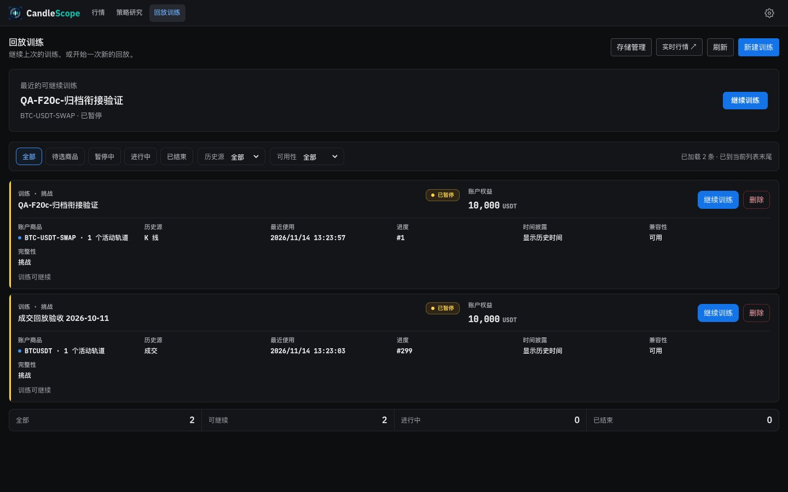 | 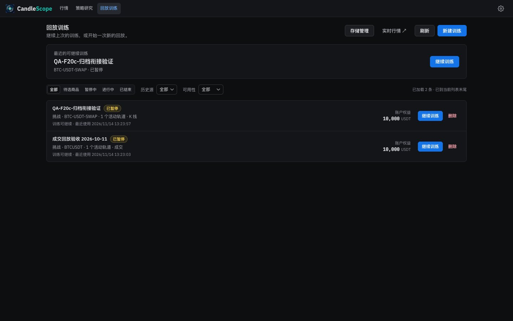 |
| Hub (light) | 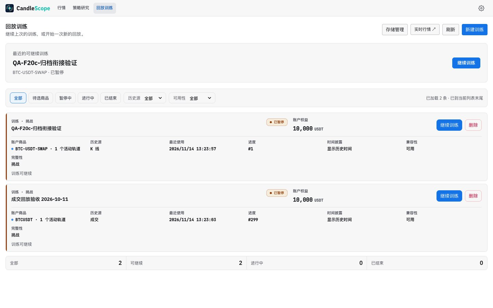 | 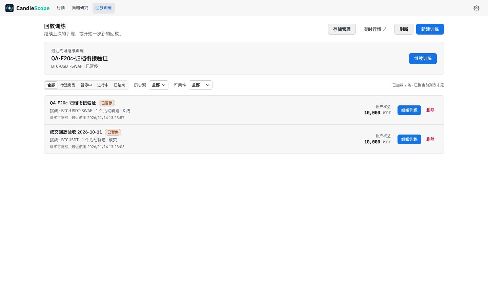 |
| Hub, English | 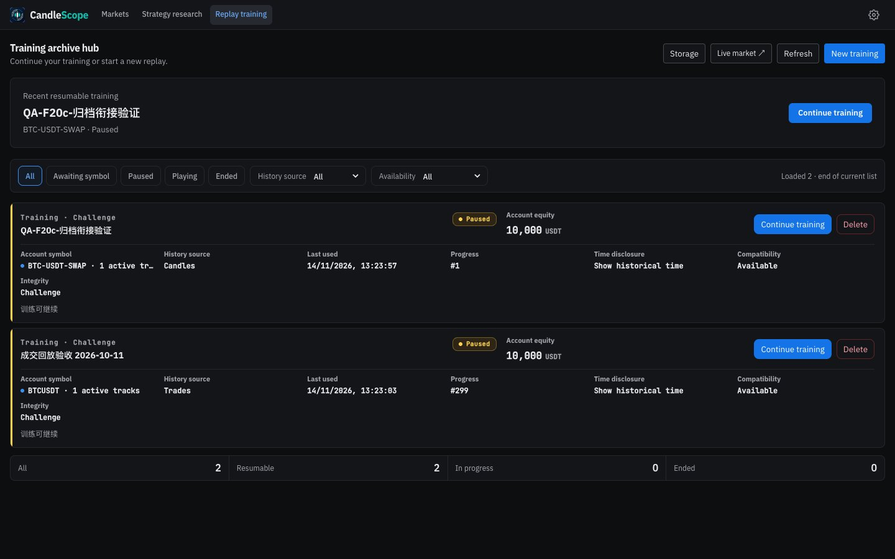 | 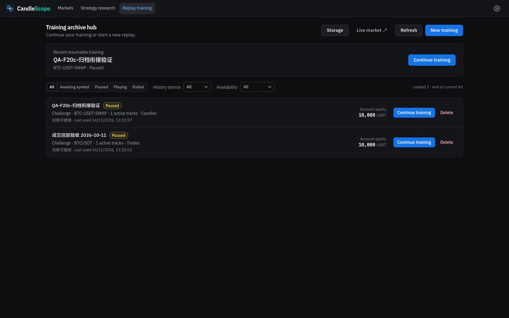 |
| 新建训练 | 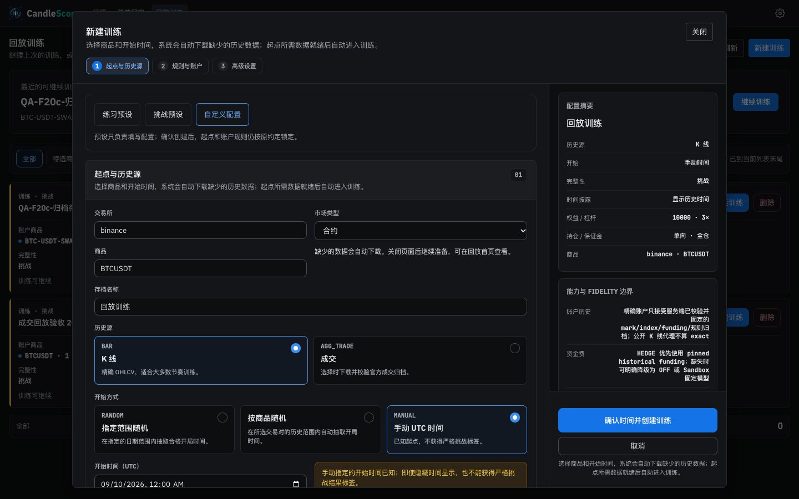 | 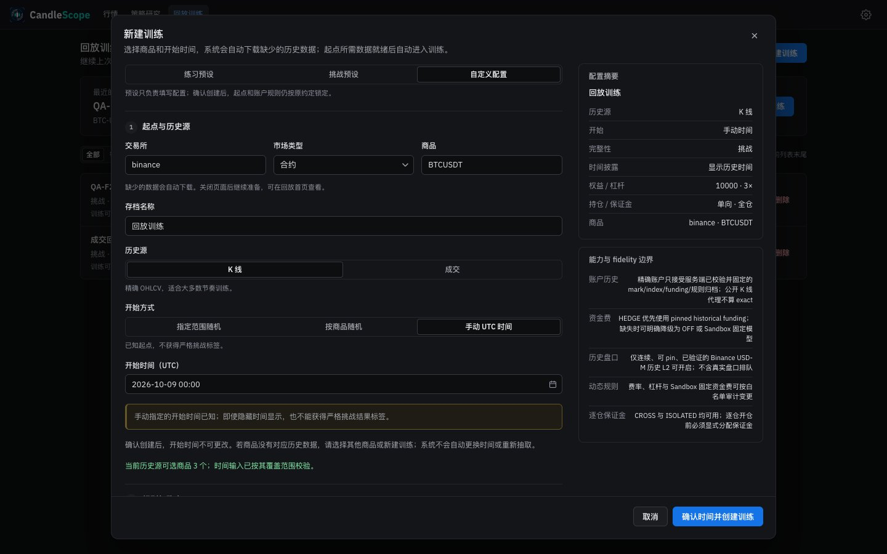 |
| 新建训练 (light) | 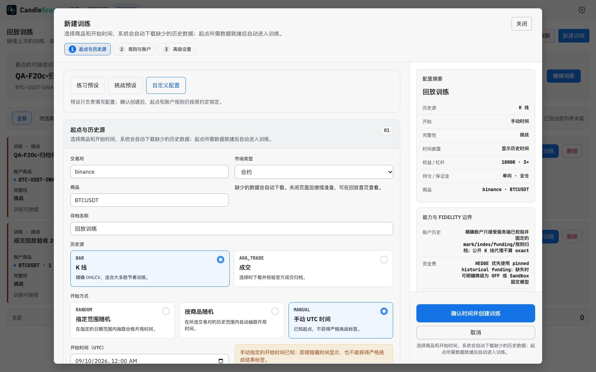 | 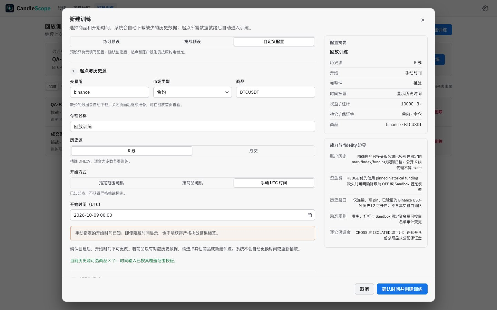 |
| 新建训练, full length with the advanced settings open | 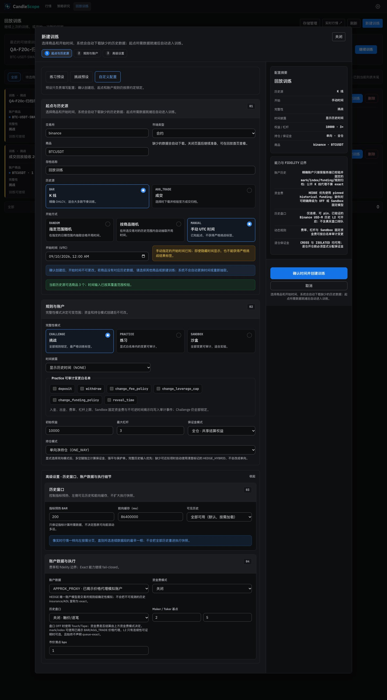 | 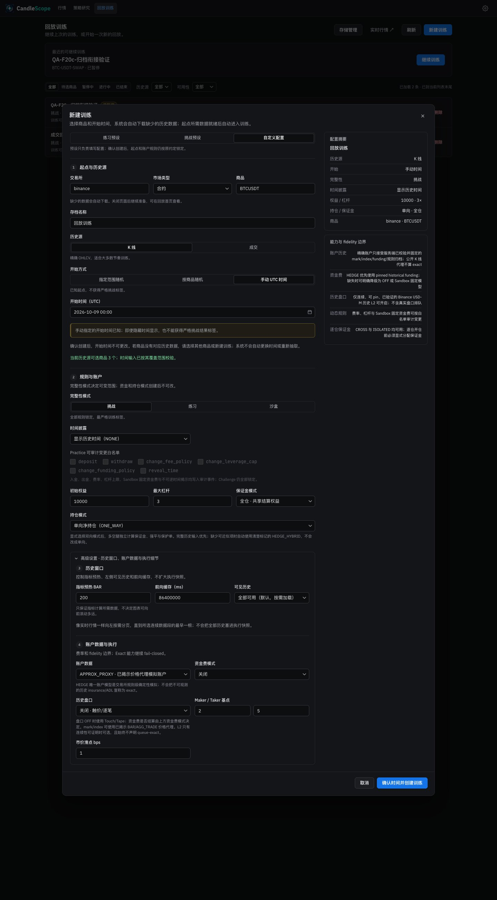 |
| Deleting a run | 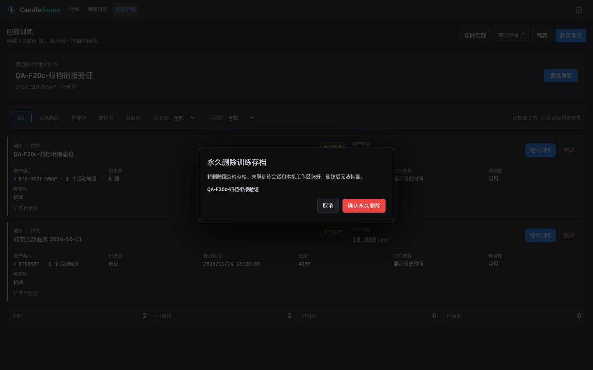 | 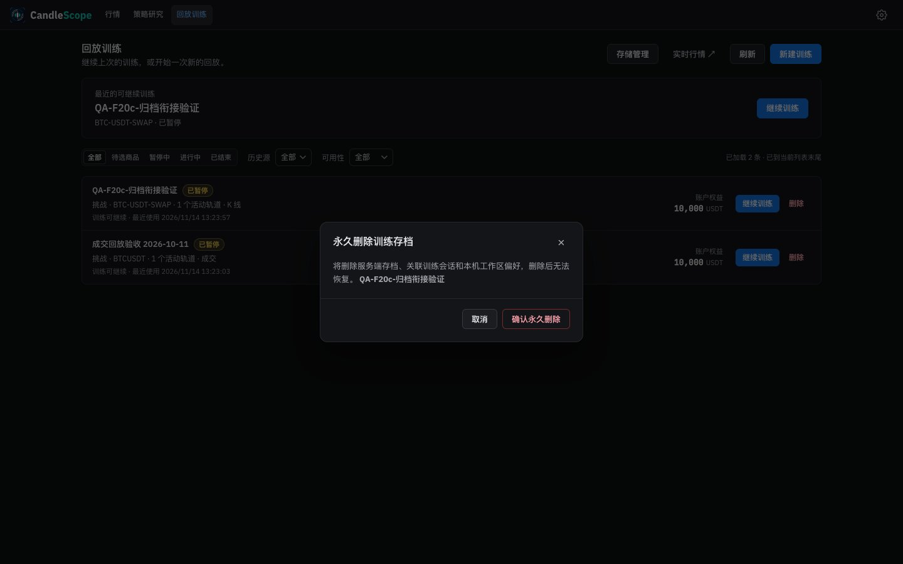 |
| The hub opened from the market page | 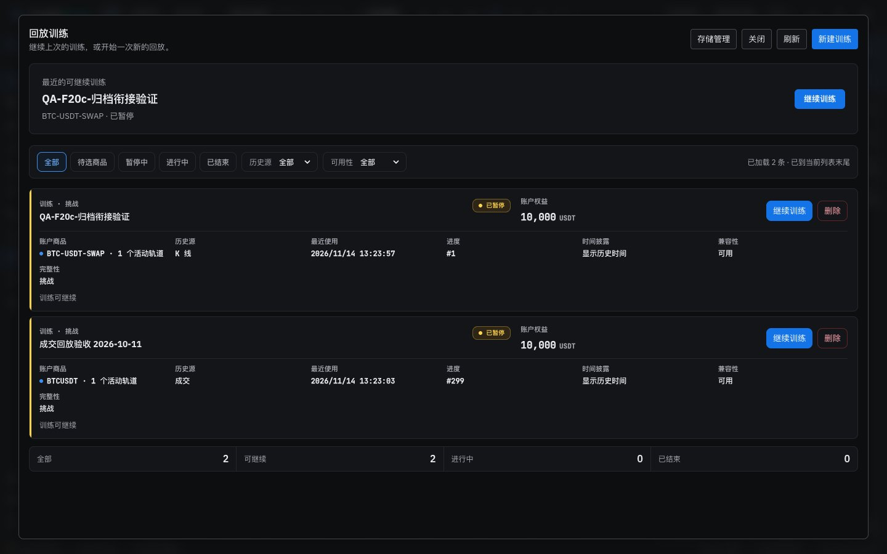 | 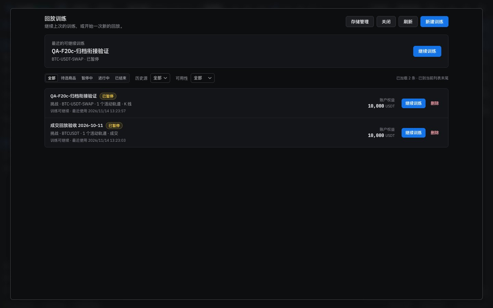 |

## Verification

**In the running app** (browser pane and headless captures, 1440 px):
- 已结束 showed 没有符合当前筛选的训练; 清除筛选 brought back both runs with 全部 selected.
- 新建训练 opened as a modal dialog with the page inert. 挑战预设 switched the integrity choice to 挑战. 指定范围随机 showed the two range fields; a half-typed date (`2026-09-0`) stayed as typed and `2026-09-01 08:00` was accepted. 手动 UTC 时间 brought back the start field. Escape closed the dialog and the page was usable again.
- 删除 opened the confirmation with 取消 focused; 取消 closed it, focus returned to 删除, and both runs were still there.
- The hub opened from the market page's 回放训练 shows the same list. 存储管理 still opens as before (it is 5f2).
- Creating, deleting and continuing a run were not run: they write to the local replay store (and creating may download data).

**Unit tests:** `replayV2Hub.test.tsx` passes unchanged (its tests render the open create form, which now renders in place), plus four new tests: runs are rows with a state badge and one line of details and no tiles or counts strip; a filter that matches nothing offers 清除筛选; the create form is a kit dialog whose choices are segmented controls without internal codes and whose start date is UTC text; deletion is the kit confirm dialog with a danger action.

**Browser test:** the training-input check (`node scripts/frontend-script-integration.mjs --replay-training-input`) now types text dates; it passes: partial year kept, focus kept, valid UTC published, external preset and clear applied.

**Scripts:** `replay-soak.mjs` writes the start as `YYYY-MM-DD HH:mm`; it was syntax-checked, not run (it creates runs). `replay-desktop-open-smoke.mjs` finds runs by `.training-hub-card` and the button names, which are kept.

**Style metrics** (against 5e): class names with no CSS rule 0 (unchanged), raw `<button>` 682 → 656, `<Button>` uses 119 → 134, `!important` 44 → 42.

**Full check:** `npm run check` passes: 5,163 frontend tests, 137 desktop tests, lint (one existing warning), both typechecks and the build. The 12 unused keys were removed after that run; `check:i18n`, the typecheck and the i18n and hub tests were run again and pass.

## Known gaps

- **Copy (Phase 6):** some options carry internal codes in their text ("显示历史时间（NONE）", "单向净持仓（ONE_WAY）", "APPROX_PROXY · 已揭示价格代理模拟账户"); the practice whitelist shows ids (`deposit`, `change_fee_policy`); the capability boundary mixes in English ("fidelity", "exact", "pinned historical funding"); a run's status line comes from the backend in Chinese whatever the language; "1 active tracks".
- **Not exercised against the backend:** creating, deleting and continuing runs.
- **Still to come:** storage management and the market picker (5f2) and the session (5f3) are unchanged; storage now sits in the hub's narrower column.
- **Desktop app:** not tested.
