# Frontend design refactor: Phase 5f2 QA (replay storage and market picker)

- Date: 2026-11-14
- Branch: `design/phase-5f2-replay-storage`, based on `design/phase-5f-replay` (PR #404)
- Plan: [`frontend/FRONTEND_DESIGN_REFACTOR_PLAN.md`](../frontend/FRONTEND_DESIGN_REFACTOR_PLAN.md) §2.4, §2.5, §2.6 and the Phase 5 rows. Contract: [`DESIGN.md`](../DESIGN.md#settings)
- **Intended visible change:** 存储管理 opens as a kit dialog with one row per storage category and its details folded away, instead of a panel of tiles that pushed the run list down. The initial market picker (a run waiting for its first market) lists markets as rows with the run's constraints on one line. What storage management and market selection do is unchanged.

## What changed

| Area | Change |
|---|---|
| 存储管理: frame | A kit `Dialog` on the overlay stack instead of a panel inserted above the run list; 刷新库存 and 关闭 are in its footer, Escape closes it. The "先预演 · 哈希绑定回收" eyebrow is gone. |
| Release status | 生产决策 and 默认开关 are one alert, green when enabled and amber on hold, instead of a full-width banner; storage alerts are alerts toned by severity. |
| Categories | Four rows (segments, historical books, account history, Review/Fork evidence): the name, used / limit and the percentage. Their five counts (对象, 就绪, 已淘汰, 隔离, 受保护) and object lists sit in a closed 详细数据 disclosure; before, each category was a card with five tiles and its objects listed open. An object is a row with its health as a badge, one line of facts and its protections. |
| Cleanup (GC) | The dry-run form uses kit fields; the plan keeps its hash and lists, its confirmation is a kit checkbox and 执行此计划 is a danger button. |
| Verified trade days | Kit fields and buttons. The "keep until" time is `DateTimeInput` UTC text instead of the browser's control. Results are alerts toned by what happened (done, information such as "该日没有已验证收据", a stale or refused step, or a failure). |
| Source matrix | 真实来源与 fidelity (four cards of internal codes) is a closed disclosure listing each mode with its readiness as a badge. |
| Market picker | The "T0" mark and eyebrow are gone. The run's constraints (开局时间, 结算资产, 历史源, and 持仓 when locked) are one line instead of three tiles. Search is a kit field, the market type a segmented control (a select beyond five options) instead of chips, 只看可用 a kit checkbox. A market is a row: the symbol, then venue · 周期 · 覆盖 on one line, and 选择; an unavailable market says why in amber. Notes, errors and the HEDGE_HYBRID downgrade confirmation are `InlineAlert`s; empty and loading states are `EmptyState`. |
| Styles | The storage and picker rules spread over `replay.css`, `replayPanels.css` and the late-loading `trainingHubMarketPicker.css` are replaced by rules in `trainingHub.css` on tokens; `trainingHubMarketPicker.css` is deleted (its two session rules moved to the end of `trainingHub.css`, the same cascade position). The hub frame rules only the old picker used (the brand mark, chip filters, empty block, primary button) are gone, and so are `replay-error-summary` and `replay-primary-action`. |
| Copy | 2 new strings in all 30 languages (本机回放数据, 详细数据); 2 keys nothing uses any more are gone (the two eyebrows). |

## Screens

The base build (Phase 5f, `e03ed8514`) and this branch, 1440 px, `zh-CN` unless marked. The picker is shown for one of the local runs, served to the page as if it were still waiting for a market (the run's state and symbol were rewritten in the response; every other replay write was blocked in the capture).

| | Before | After |
|---|---|---|
| 存储管理 | 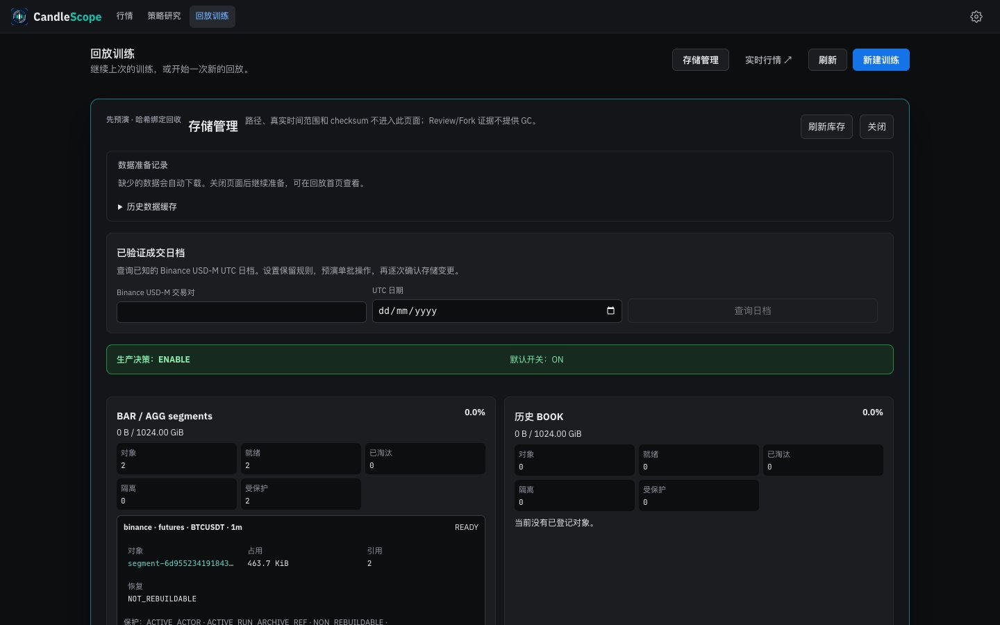 | 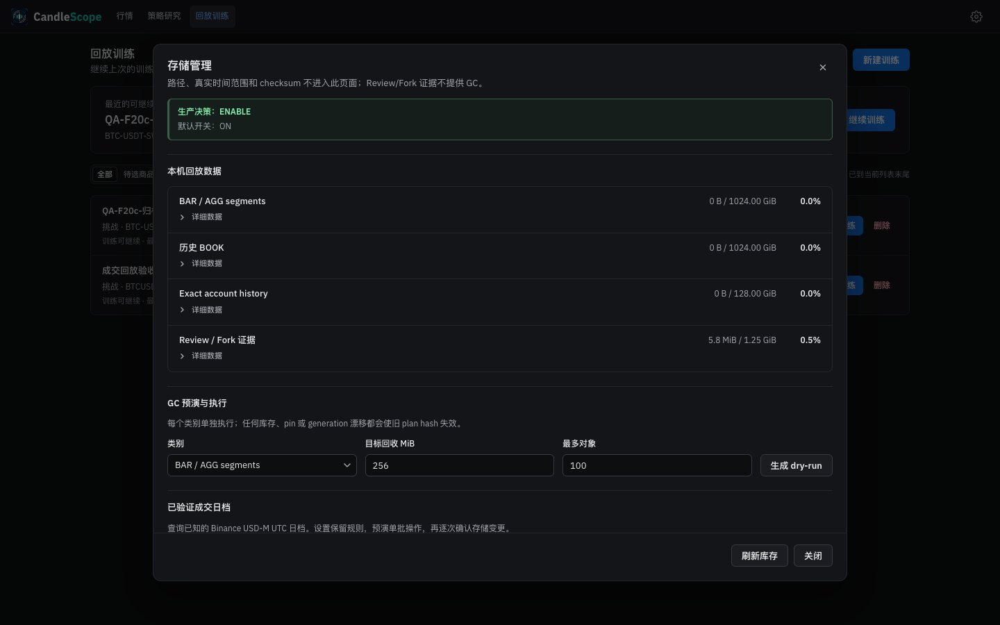 |
| 存储管理 (light) | 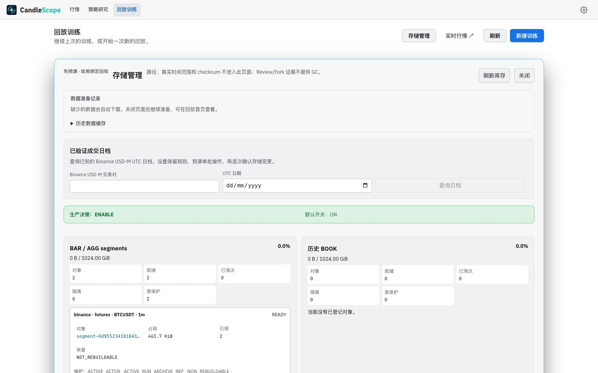 | 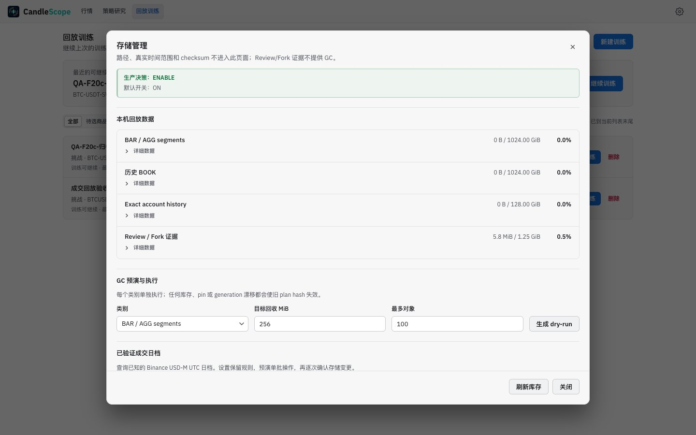 |
| 存储管理, English | 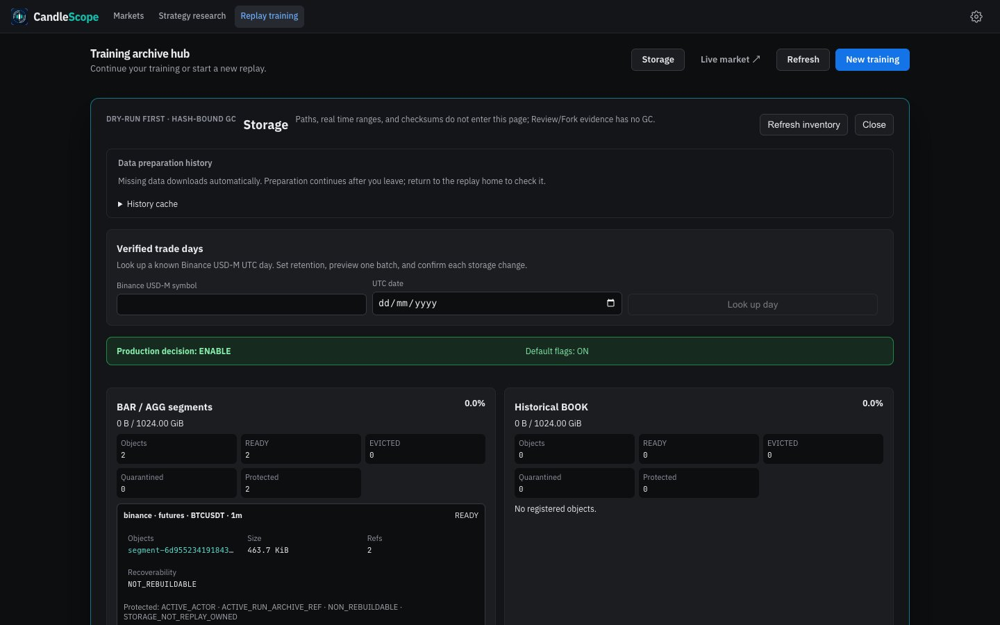 | 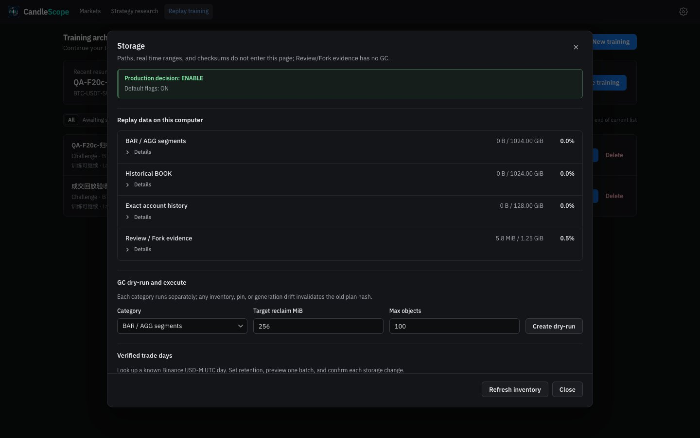 |
| 存储管理, full length (after: details opened) | 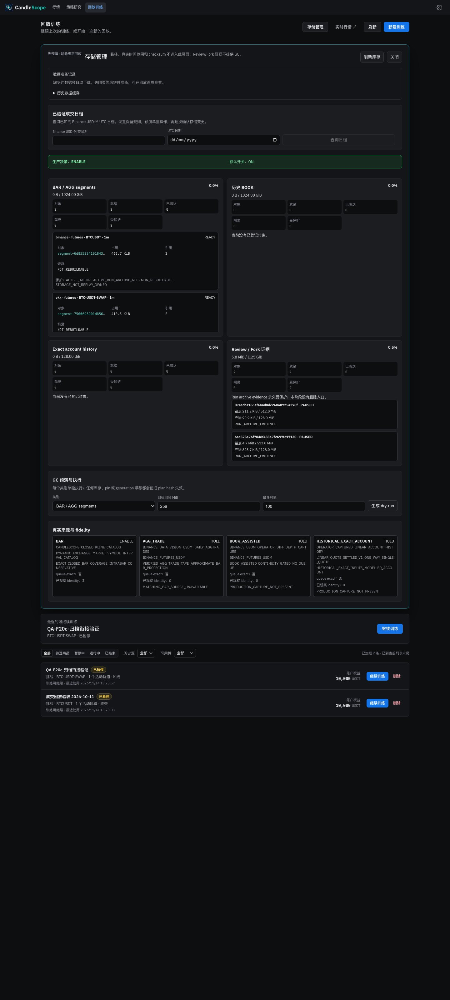 | 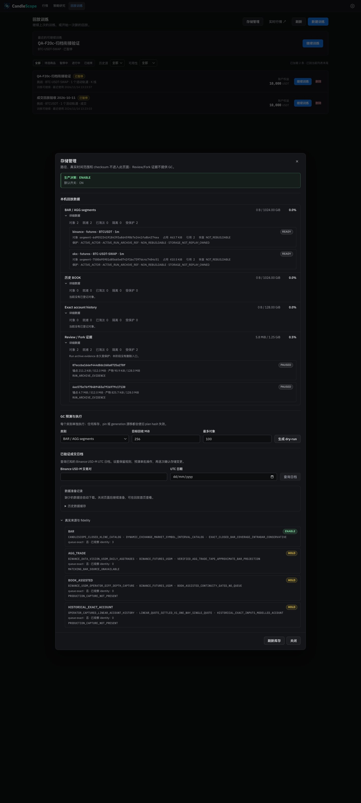 |
| Market picker | 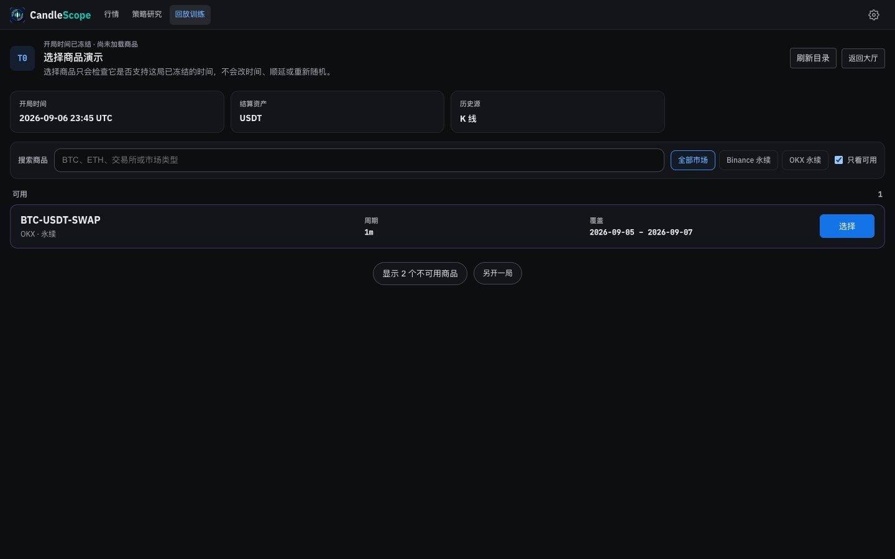 | 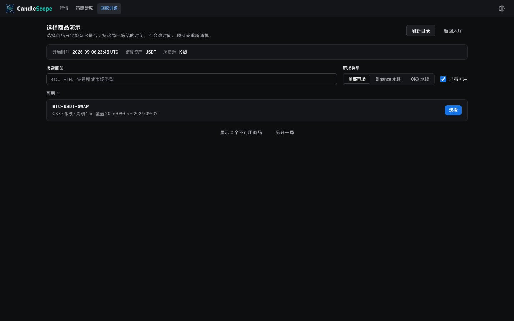 |
| Market picker (light) | 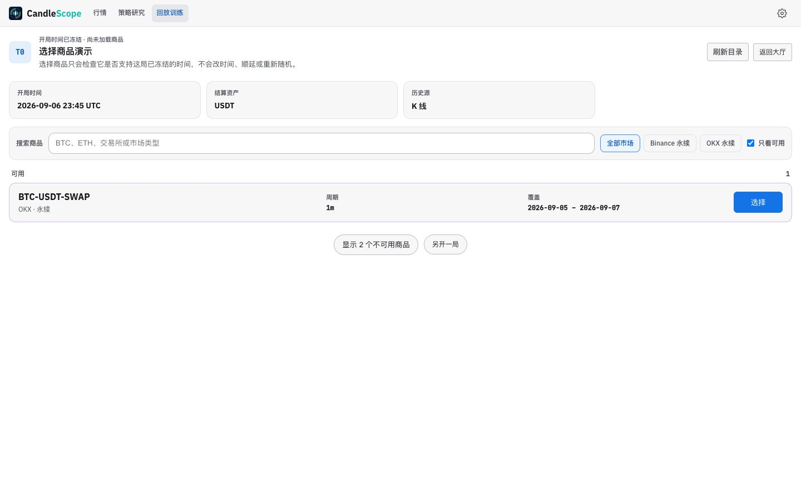 | 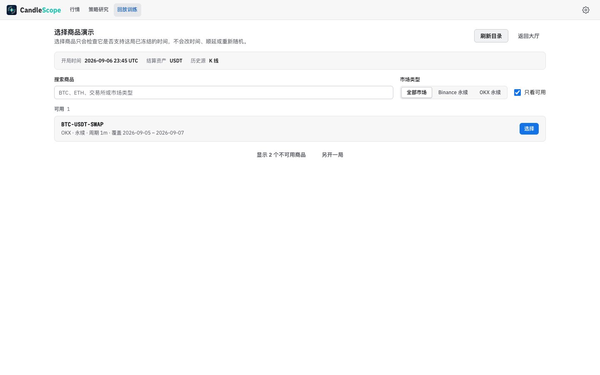 |
| Market picker, English | 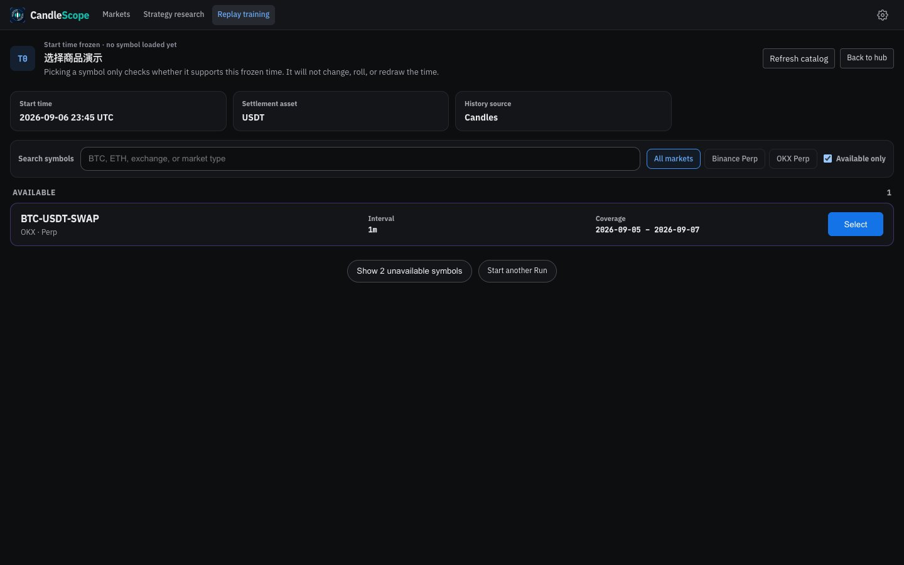 | 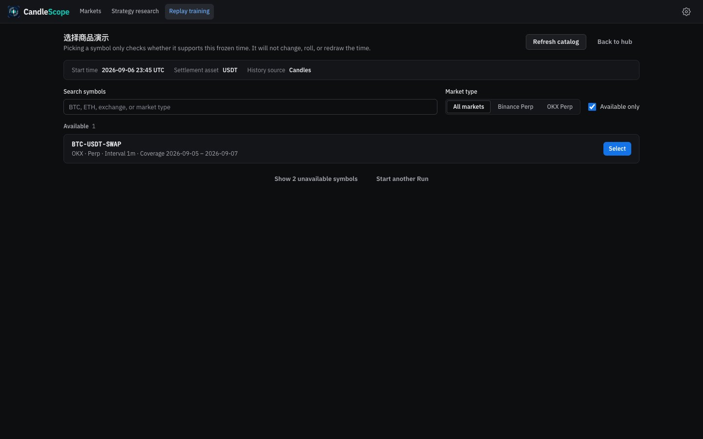 |
| Market picker with the unavailable markets shown | 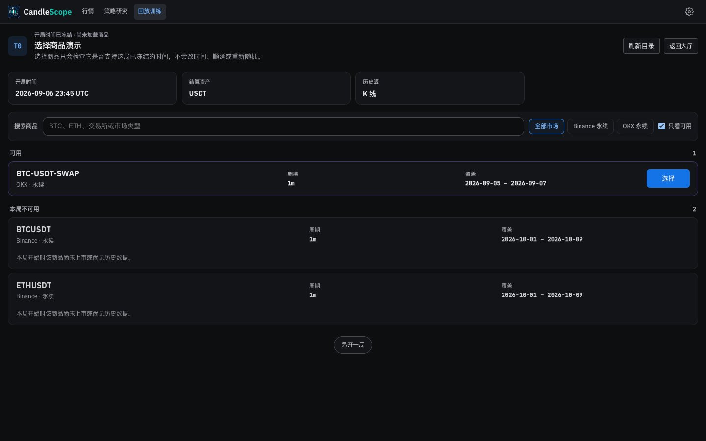 | 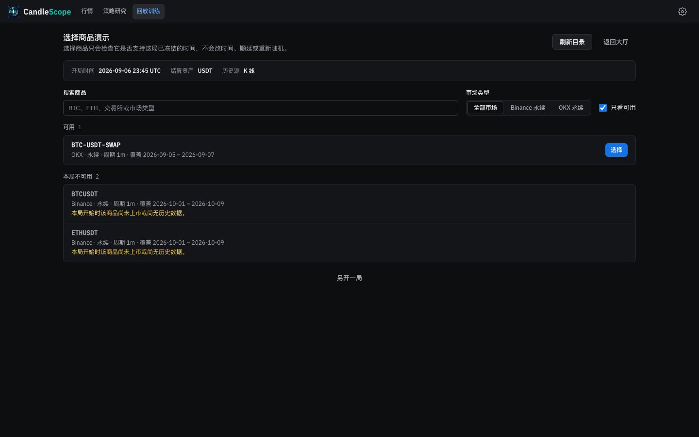 |

## Verification

**In the running app** (browser pane and headless captures, 1440 px):
- 存储管理 opened as a modal dialog with the page inert, four category rows and the decision ENABLE. Opening the first 详细数据 showed its two objects. 已验证成交日档 with BTCUSDT and 2026-10-11 looked the day up (a read) and showed "该日没有已验证收据" as a warning. Escape closed the dialog and the page was usable again.
- Market picker (served as above): 显示 2 个不可用商品 added BTCUSDT and ETHUSDT with their reason; OKX 永续 filtered to the OKX market; searching "eth" left ETHUSDT; turning 只看可用 off showed all three. Focus stayed in the search field.
- Not run, because they change local data: the dry run and cleanup, rehydration, saving a retention policy, retiring or restoring a day, and selecting a market.

**Unit tests:** the existing storage test (`replayV2Phase18.test.tsx`) and picker test pass unchanged in content, with new assertions: storage is a kit dialog with one row per category and its figure, details and the source matrix start closed, the plan confirmation is a kit checkbox and 执行此计划 a danger button; a new picker test checks the constraints line, the kit search field and checkbox, the hub link, and that the mark, eyebrow and chips are gone.

**Scripts:** `replay-soak.mjs` reads command errors from `.replay-command-error` and danger alerts (the picker's errors are alerts now); it finds markets by `.replay-market-picker-row` and its data attributes, which are kept. Syntax-checked, not run.

**Style metrics** (against 5f): class names with no CSS rule 0 (unchanged), raw `<button>` 656 → 638, `<Button>` uses 134 → 150, button class families 42 → 41.

**Full check:** `npm run check` passes: 5,164 frontend tests, 137 desktop tests, lint (one existing warning), both typechecks and the build.

## Known gaps

- **Copy (Phase 6):** storage is still written for engineers (GC, dry-run, plan hash, checksum, fidelity, segment and object ids, protection codes such as `ACTIVE_RUN_ARCHIVE_REF`, `NOT_REBUILDABLE`); the hub tests assert parts of it, so it changes with the copy pass. The market types read "Binance Perp".
- **The day field** in 已验证成交日档 is the browser's date control (the kit has no date-only field), so it follows the browser's locale.
- **The data preparation log** inside the dialog (`PreparationJobsPanel`, data-preparation feature) keeps its own buttons; only its heading and summary are styled here.
- **Not exercised against the backend:** the writes listed above.
- **Desktop app:** not tested.
