# Frontend design refactor: Phase 5f3 QA (replay session controls)

- Date: 2026-11-14
- Branch: `design/phase-5f3-replay-session`, based on `design/phase-5f2-replay-storage` (PR #408)
- Plan: [`frontend/FRONTEND_DESIGN_REFACTOR_PLAN.md`](../frontend/FRONTEND_DESIGN_REFACTOR_PLAN.md) §2.4, §2.5, §2.6 and the Phase 5 rows. Contract: [`DESIGN.md`](../DESIGN.md#components)
- **Intended visible change:** the replay session's bottom bar is built from kit controls with one step button per distinct step, its notices are alerts, ending a run uses the kit dialog, and the capabilities view is a list with state badges. What the controls do is unchanged.

The session was split again when this phase started: **5f3** the controls (this note), **5f4** the review and integrity drawer with training results, **5f5** the right rail's views (account, activity, watchlist, notes, market).

## What changed

| Area | Change |
|---|---|
| Control bar | Kit buttons, selects and input instead of raw ones on the legacy palette. 结束 is a quiet red button set apart by a divider; the step buttons form a group; 播放 is the primary action; 基准, 展示 K, 数量, 推进 and 速度 follow; the replay time sits at the right edge. |
| Duplicate step | With the display interval equal to the base interval, "next display bar" and "next base bar" are the same step and both read 下一根 1m; the base one is now hidden in that case (it shows when the intervals differ). |
| Notices | The read-only notice (当前为只读 … 获取控制权), the reconnecting notice and command errors are `InlineAlert`s with their action as a kit button, instead of a full-width yellow bar and bordered boxes. Command errors lead with the message and keep the code beside it. |
| 高级诊断 | A kit `Disclosure`; the fidelity codes are badges and the period summary's 准备摘要 is a kit button. |
| Ending a run | A kit `Dialog` on the overlay stack: 取消 takes focus, Escape closes it, focus returns to 结束, the page behind is inert, and 确认结束 is a danger button. It replaces a hand-built dialog with its own focus trap and key handling, which sat outside the stack. |
| 能力 view | One row per capability: its name, its value when there is one, and a badge (精确, 近似, 不可用), with the reason under it. Before, it was a two-column grid of tiles whose state codes (`UNSUPPORTED_NO_HISTORY`…) overflowed their tiles. The codes stay in `data-capability-state`. |
| Styles | About 50 one-line rules for the bar, its notices, the dialog and the capability grid are replaced by rules on tokens at the end of `replay.css`; one hard-coded colour and nine legacy colour variables fewer. |
| Copy | Three new strings in all 30 languages (精确, 近似, 不可用). |

## Screens

The base build (Phase 5f2, `3261c0390`) and this branch, 1440 px, `zh-CN` unless marked, on one of the local runs. The capture pages refused replay commands that change the run (play, advance, orders, end), and each waited until it held control of the run, so the bar is enabled.

| | Before | After |
|---|---|---|
| Session | 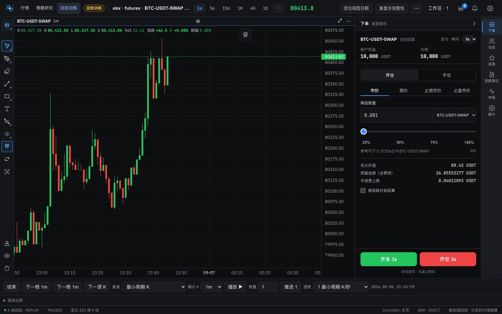 | 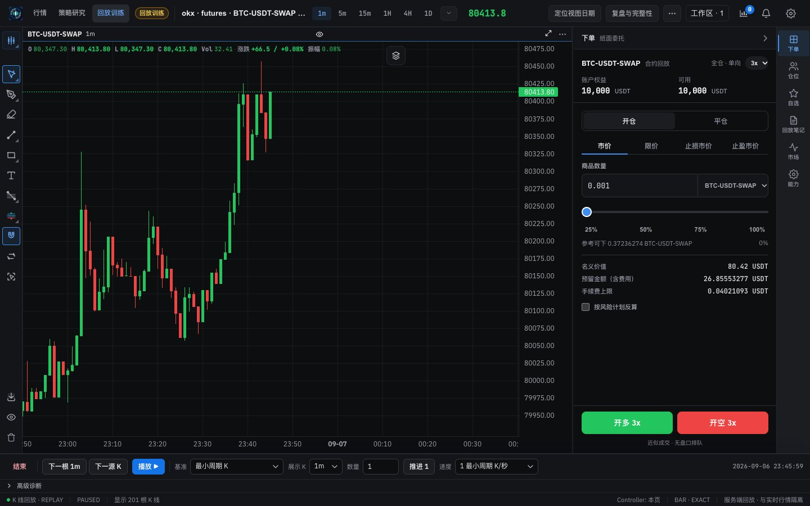 |
| Session (light) | 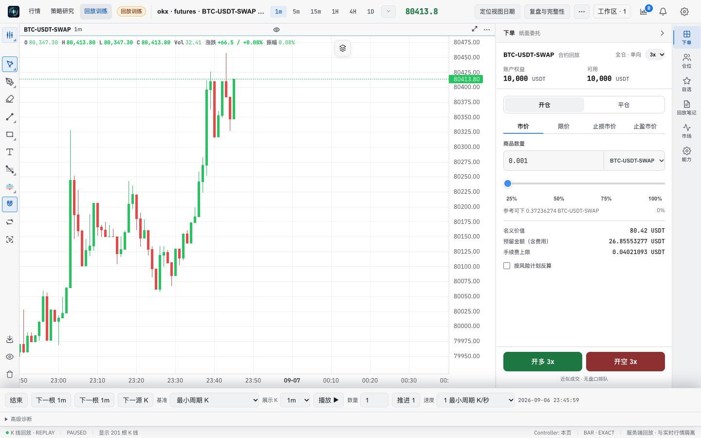 | 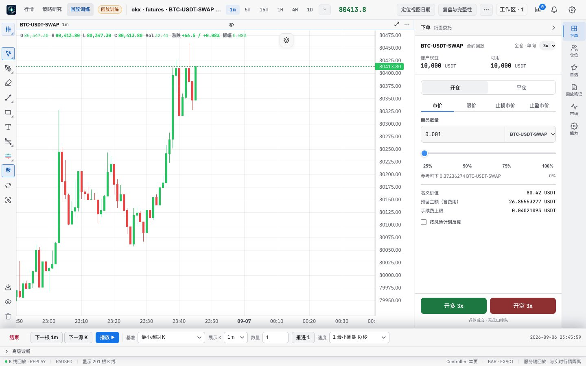 |
| Session, English | 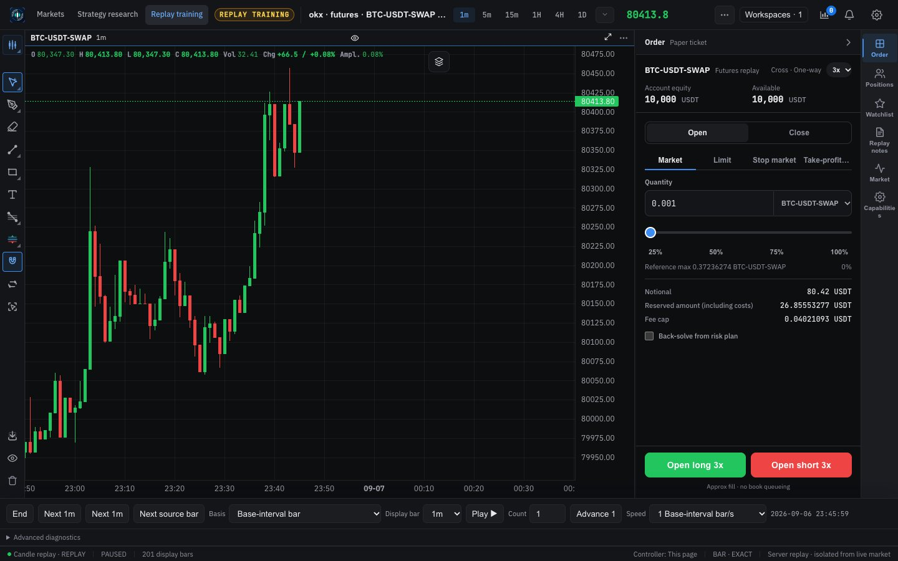 | 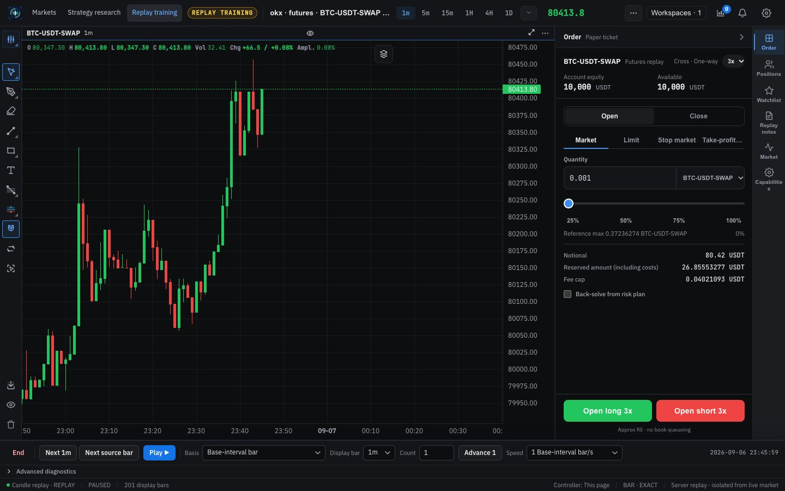 |
| Ending the run | 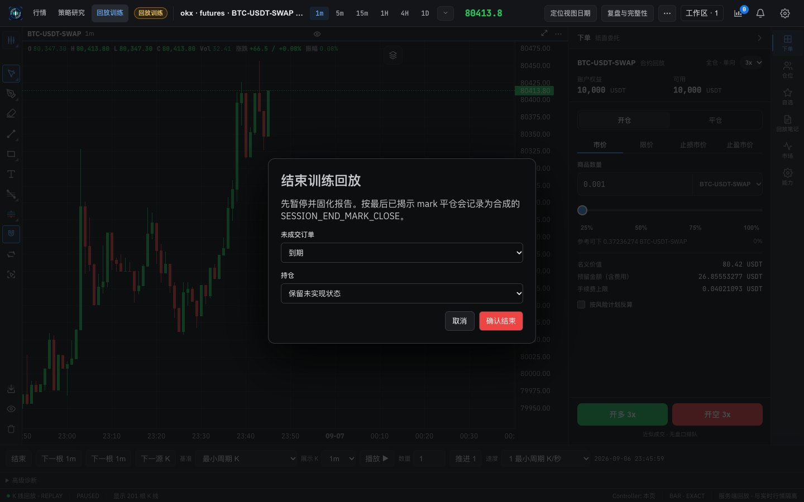 | 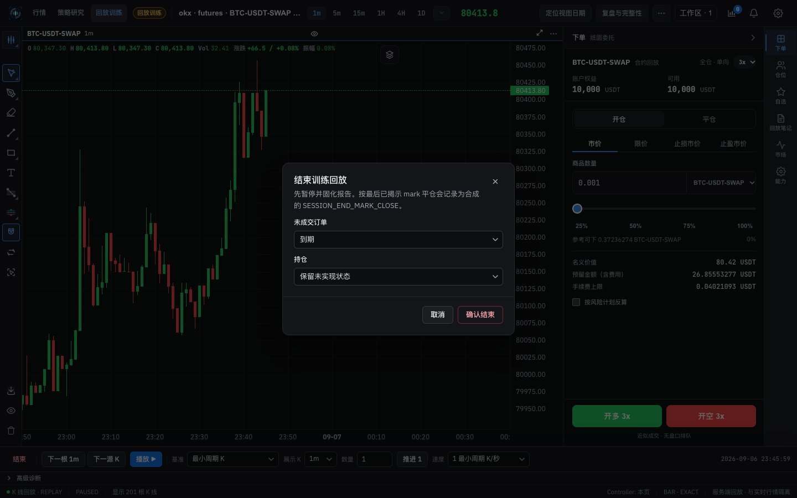 |
| 高级诊断 opened | 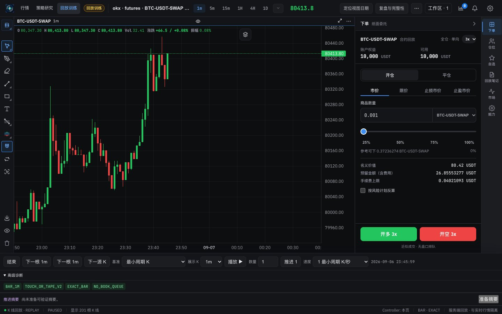 | 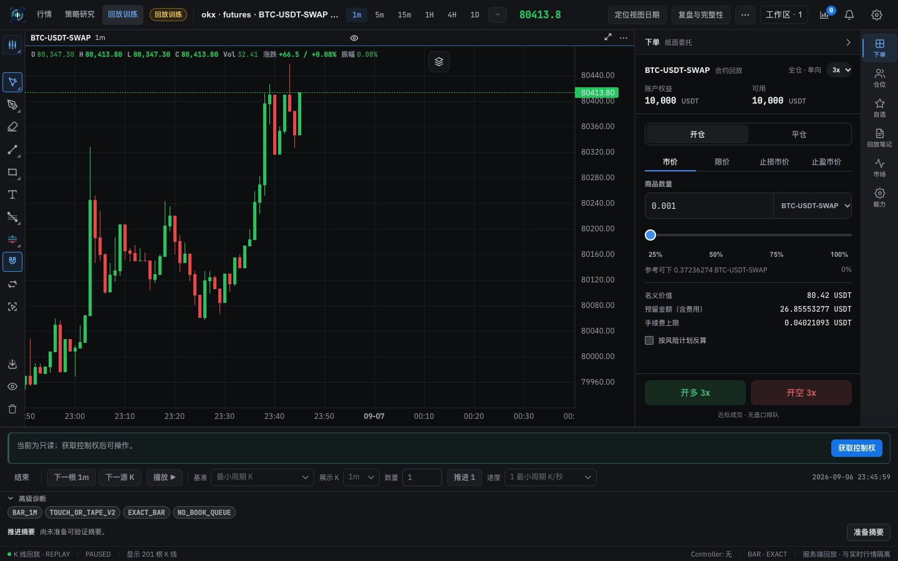 |
| 能力 | 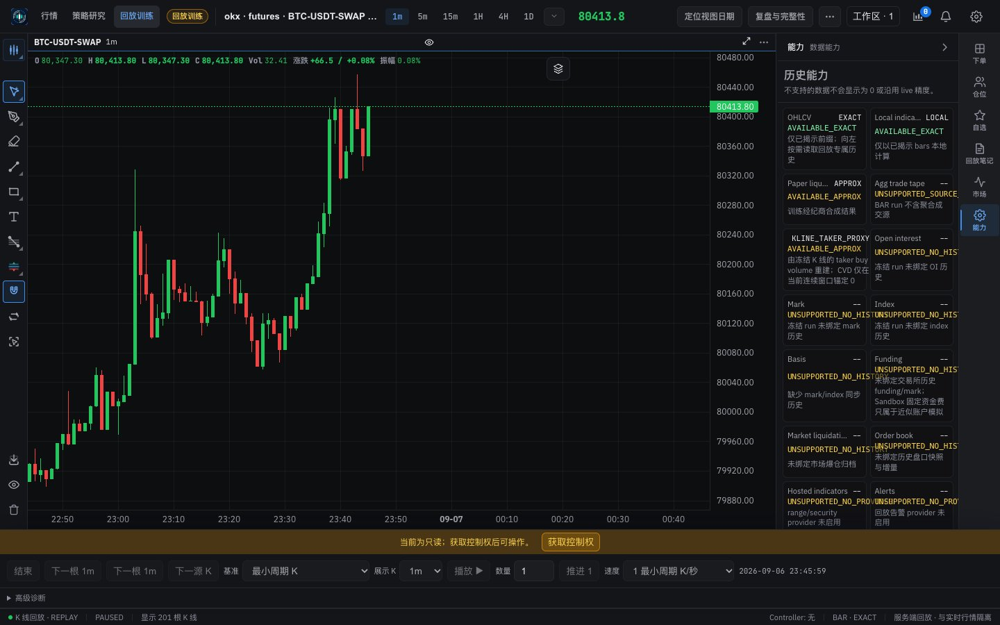 | 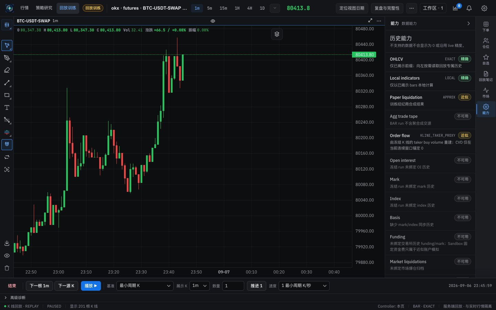 |
| 能力 (light) | 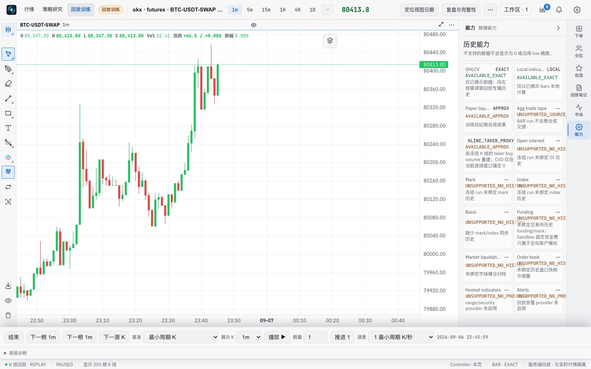 | 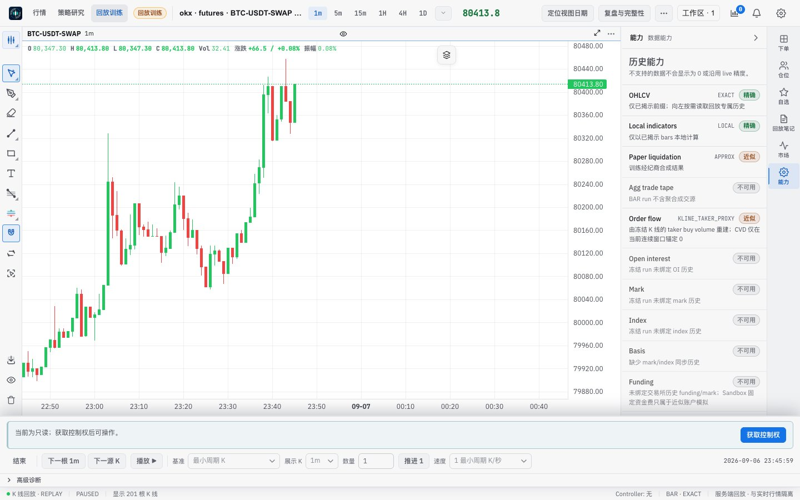 |

## Verification

**In the running app** (headless, 1440 px):
- 结束 opened the dialog with 取消 focused, its description linked and the page inert; Escape closed it, focus returned to 结束 and the page was usable again.
- With the display interval at the base interval (1m), the bar shows one 下一根 1m.
- A page that does not hold control of the run shows the read-only notice with 获取控制权, and the bar's controls are disabled, as before.
- Playing, advancing, preparing the summary, taking control and ending were not run: they change the run.

**Unit and source tests** (`replayTrainingWorkspace.test.tsx`): the end-dialog test now checks the kit `Dialog` (class, description, initial focus on 取消, danger confirm) instead of the hand-built focus trap; the base step is hidden only when its interval equals the display interval; the capability rows show a badge and keep the codes in their data attribute only.

**Scripts:** `replay-soak.mjs` finds the end dialog by `.replay-end-dialog`, checks that its description resolves, and expects focus to wrap to the dialog's close button or a select; its own tests pass (66). `replay-desktop-open-smoke.mjs` advances with whichever step button is shown. Neither was run against the app (the soak plays and trades; the smoke needs the desktop app).

**Style metrics** (against 5f2): class names with no CSS rule 0 (unchanged), raw `<button>` 638 → 625, `<Button>` uses 150 → 163.

**Full check:** `npm run check` passes: 5,164 frontend tests, 137 desktop tests, lint (one existing warning), both typechecks and the build.

## Known gaps

- **Copy (Phase 6):** the end dialog's description names `SESSION_END_MARK_CLOSE`; the diagnostics are internal codes; capability names are English ("Order book", "Open interest"); the status bar reads "K 线回放 · REPLAY", "PAUSED", "BAR · EXACT".
- **Still to come:** the review and integrity drawer (5f4) and the right rail's views (5f5) are unchanged.
- **Desktop app:** not tested.
