# Frontend design refactor: Phase 5f4 QA (replay review drawer and training results)

- Date: 2026-11-14
- Branch: `design/phase-5f4-replay-review`, based on `design/phase-5f3-replay-session` (PR #409)
- Plan: [`frontend/FRONTEND_DESIGN_REFACTOR_PLAN.md`](../frontend/FRONTEND_DESIGN_REFACTOR_PLAN.md) §2.4, §2.5, §2.6 and the Phase 5 rows. Contract: [`DESIGN.md`](../DESIGN.md#long-forms-and-lists-in-drawers)
- **Intended visible change:** the 复盘与完整性 drawer and the training results drawer get one frame (a header with icon buttons, a scrolling body of sections), kit controls, and their detail folded away. What the drawers show and do is unchanged.

## What changed

| Area | Change |
|---|---|
| Drawer frame | Both drawers: the title (and a one-line hint for results) with 刷新 and 关闭 as icon buttons, then a scrolling body. The "服务端校验 · 只读证据" and "训练结果" eyebrows are gone. The drawer itself uses the surface and shadow tokens. |
| 复盘与完整性: facts | The six tiles (模式, 结果标签, 公开时间, 披露策略, 严格资格, 起点已知) are one block of labelled facts; the mode reads 挑战 / 练习 / 沙盒 as a badge and the disclosure policy reads like the hub (显示历史时间) instead of `CHALLENGE` and `NONE`. |
| Sections | 有界权益曲线, 可审计规则动作, 训练规则, 完整复盘预算, 不可变审计事件, the report and 只读复盘 are sections separated by dividers instead of bordered cards in a two-column grid. |
| 训练规则 | The current values are facts; the three revision forms (fee, leverage overlay, Sandbox funding) and the change reason sit in a closed 修改规则 disclosure with kit fields, and the revision history in a 规则历史 disclosure, instead of three bordered forms and a table always open. |
| Actions | Deposit and withdraw use kit fields and buttons; 不可逆揭示时间 is a danger button (it still asks first); 开始只读复盘 is the primary button of its section. The review controls, the event select, jump and fork are kit controls; the proof hashes are in a disclosure; the event timeline is a list of rows instead of a horizontal strip of cards. A forked run is a success alert with its link. |
| Budget and audit | The budget is one line of figures with a warning alert past 85 %; the audit events are in a disclosure. |
| Portfolio equity | 账户组合权益 is a kit disclosure with a kit button and an alert for errors. |
| Training results | The summary is eight kit stats (net P&L green or red); trades are rows: the symbol with 多 / 空 as a badge, the P&L and R tinted, the facts, the plan's reason, and 跳到对应 K 线 / 从这里 Fork as small buttons. Notices are alerts; loading and empty states are `EmptyState`s. Before, the panel had almost no styling (browser buttons, body-size text, no padding). |
| Styles | About 60 rules for the old panels (including one `!important` and an element rule that restyled every button inside the drawer) are replaced by token-based drawer rules at the end of `replay.css`. |
| Copy | One new string in all 30 languages (修改规则); three keys nothing uses any more are gone (the two eyebrows and the drawer's old label). |

## Screens

The base build (Phase 5f3, `18776452a`) and this branch, 1440 px, `zh-CN` unless marked, on one of the local runs. Neither local run has closed trades, so the results with trades are shown with a results response served to the page (two sample trades); replay commands that change the run were refused in every capture.

| | Before | After |
|---|---|---|
| 复盘与完整性 | 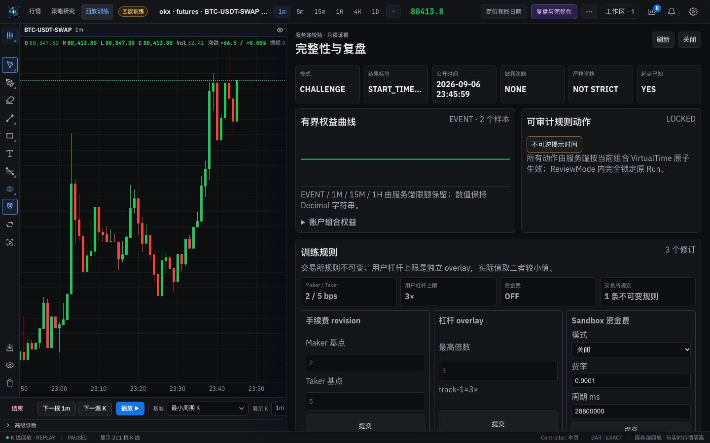 | 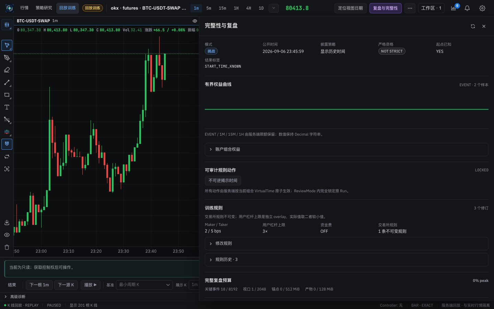 |
| 复盘与完整性 (light) | 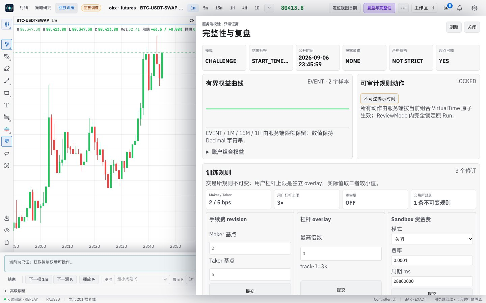 | 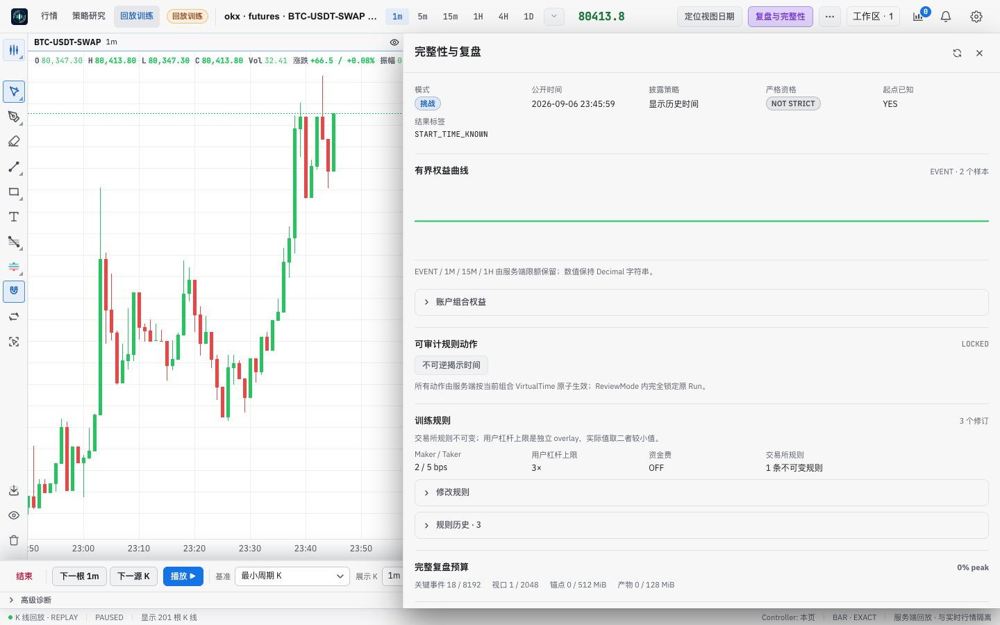 |
| 复盘与完整性, English | 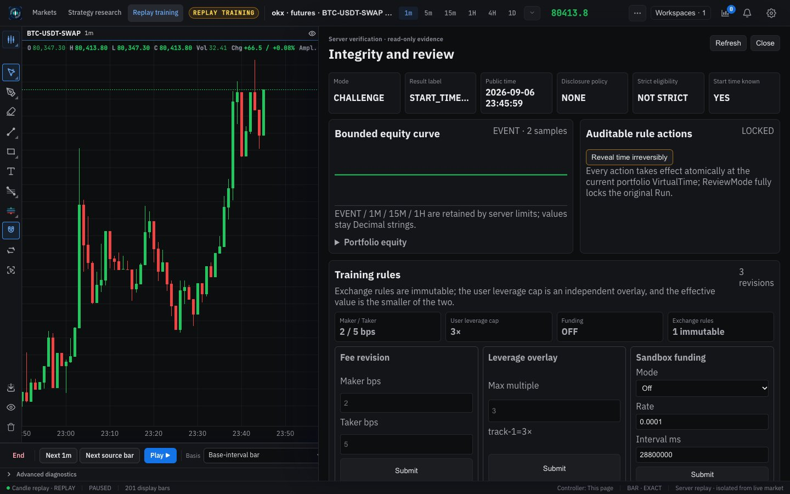 | 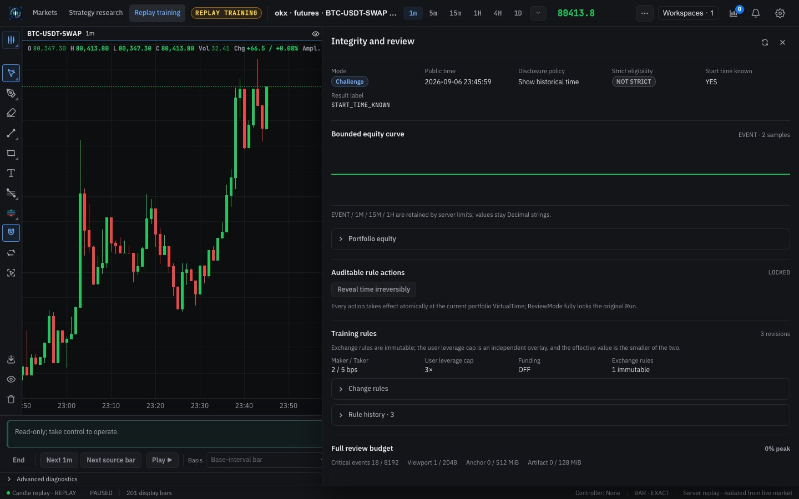 |
| 复盘与完整性, full length with disclosures open | 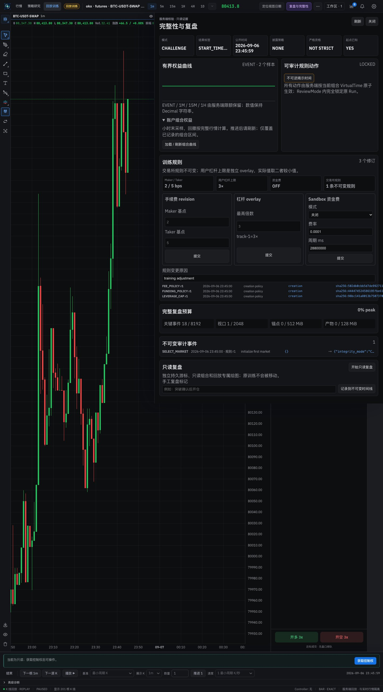 | 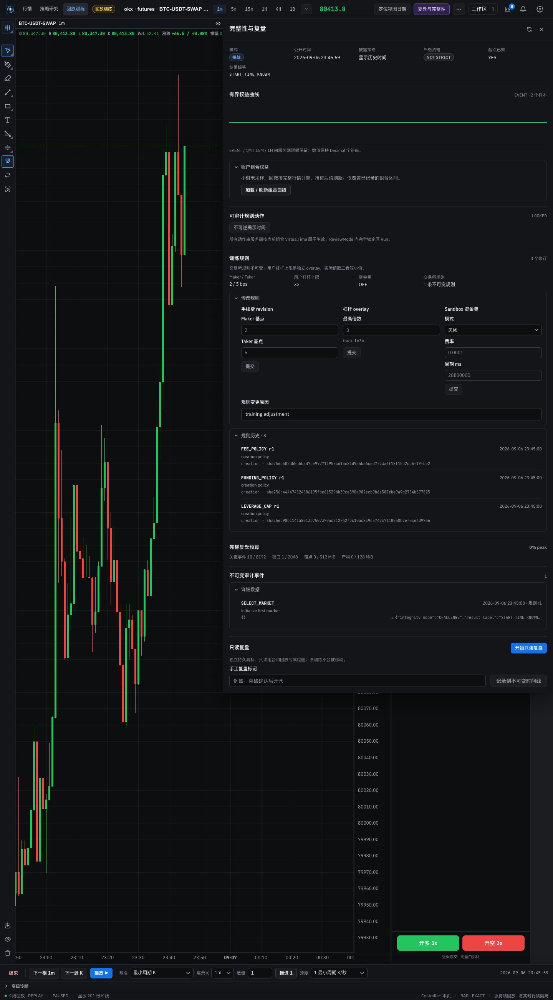 |
| Training results, no trades | 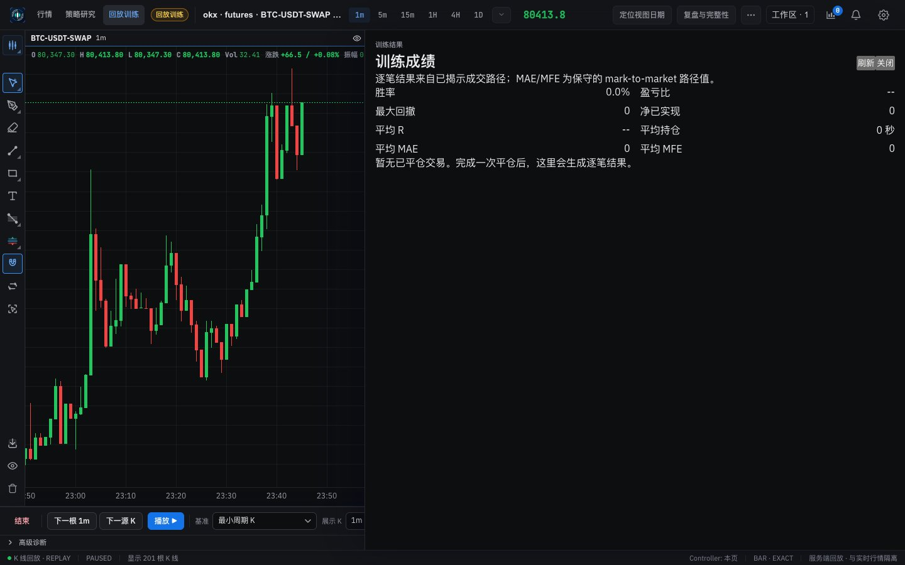 | 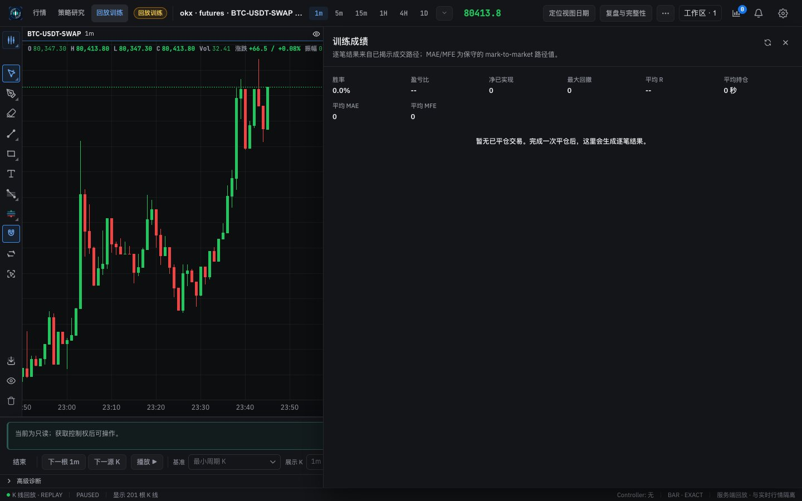 |
| Training results with two trades | 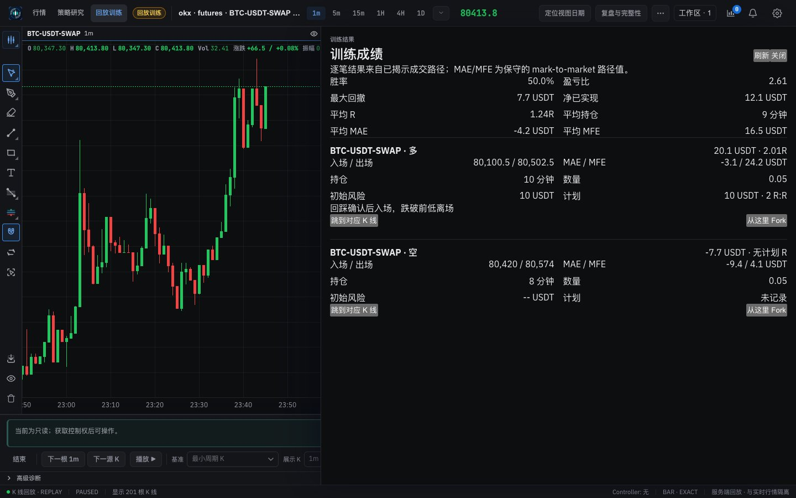 | 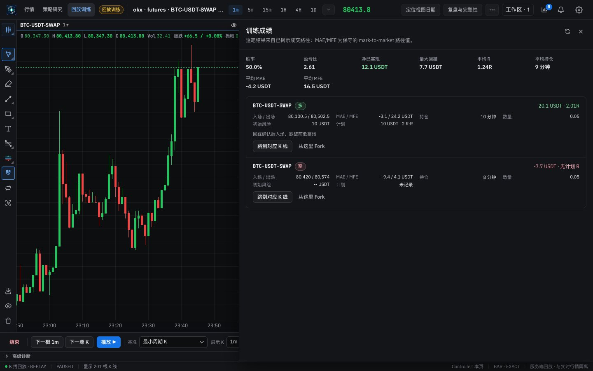 |
| Training results (light) | 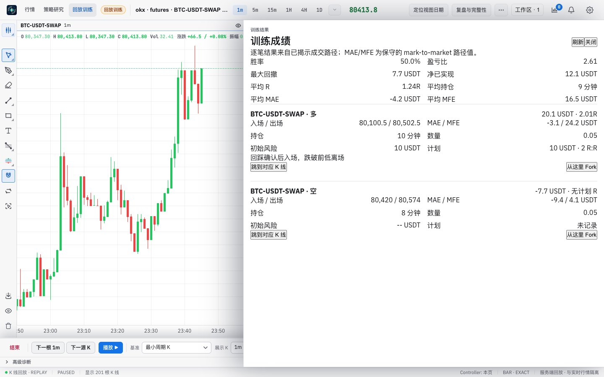 | 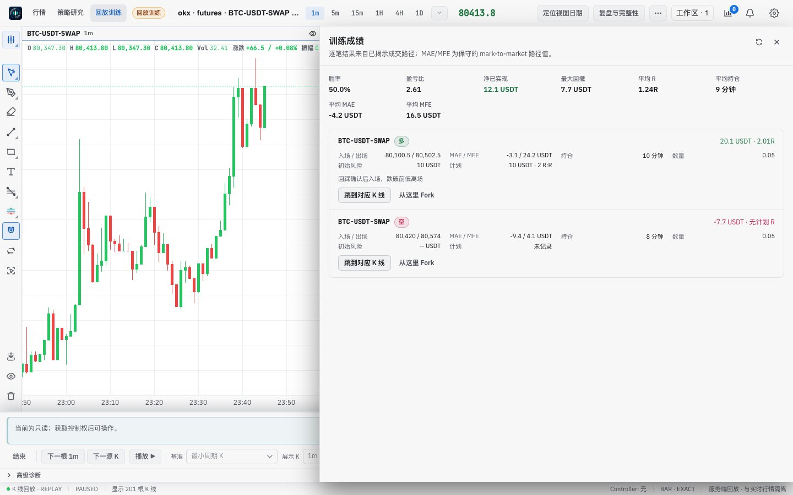 |

## Verification

**In the running app** (headless, 1440 px): both drawers open from the header and render as shown; 修改规则, 规则历史, 审计 and 账户组合权益 open. Nothing that changes the run was run: deposit and withdraw, rule revisions, revealing time, starting or stepping a review, markers, forking, or jumping from a trade. The review player (shown only during a review) was therefore not captured.

**Tests:** the replay tests pass; `replayV2MarketTracks.test.ts` checked the drawer's source for the removed eyebrow and now checks its title. The hooks the soak script reads (`data-replay-panel="integrity"` and `"report"`, `data-replay-action="close-integrity"` and `"reveal-time"`, the review and budget data attributes) are kept.

**Style metrics** (against 5f3): class names with no CSS rule 0 (unchanged), raw `<button>` 625 → 602, `<Button>` uses 163 → 181, `!important` 42 → 41.

**Full check:** `npm run check` passes: 5,164 frontend tests, 137 desktop tests, lint (one existing warning), both typechecks and the build.

## Known gaps

- **Copy (Phase 6):** the drawer is still written in internal terms (`START_TIME_KNOWN`, `NOT STRICT`, `LOCKED`, `FEE_POLICY r1`, overlay, VirtualTime, Decimal, hashes); the strict and start-known values are still codes.
- **Not exercised:** the review player and every action listed above (they change the run).
- **Still to come:** the right rail's views (5f5).
- **Desktop app:** not tested.
