# Frontend design refactor: Phase 5h QA (the data workbench on the kit)

- Date: 2026-11-15
- Branch: `design/phase-5h-data-workbench`, based on `design/phase-5g7-native-panel` (PR #428)
- Plan: [`frontend/FRONTEND_DESIGN_REFACTOR_PLAN.md`](../frontend/FRONTEND_DESIGN_REFACTOR_PLAN.md), the Phase 5 rows. Contract: [`DESIGN.md`](../DESIGN.md)
- **Intended visible change:** the data workbench (Settings → 数据管理 → 打开数据工作台, and from the replay launcher) is a kit dialog with kit controls on tokens: the inventory filters, the summary, the snapshot and integrity sections, the stored series and the manual history download. What it does is unchanged.

## What changed

| Area | Change |
|---|---|
| Frame | The kit dialog (title, the read-only/write sentence as its description, close icon, focus trap) instead of a hand-made overlay. The cyan "库存检查与历史下载" eyebrow is gone. |
| Order | The read-only inventory comes first (filters, summary, snapshot, integrity, stored series); the manual history download, which writes data, follows it instead of sitting between the filters and their results. |
| Filters | A bordered section with LIVE and 库存查询只读 as badges, kit fields and selects, 重置 as a quiet button, 只看当前图表 and the primary 应用并刷新. |
| Figures | The summary and the snapshot's four figures are kit stats in light tiles (gaps and an unstable file set in amber); the integrity figures are stats in mono that wrap instead of being cut off. |
| Sections | SQLite 快照 and 数据完整性 are kit disclosures with their status badge in the summary; the "展开 / 收起" hint text is gone (the chevron says it). Notices and errors are kit alerts; empty and reading states are kit empty states. |
| Rows | Stored series and gaps are rows with the symbol in mono, intervals as badges (a gap's status in amber) and the counts on the right; a multi-interval row expands into a sub-table with an accent edge. |
| Manual download | Exchange and market side by side, symbols as a mono text area with the target count as its hint, intervals as kit checkboxes with the custom interval and 添加周期 in the same group, the start time at a readable width, 预览计划 / 开始下载 (primary) / 取消 (quiet) in one row; recent jobs and protected collections are rows with their state as a toned badge and their action on the right; errors are alerts. |
| Styles | The workbench's 891-line `<style>` string (`DataWorkbenchStyles.tsx`, re-injected on every open) is replaced by `dataWorkbench.css` (150 lines on tokens), loaded with the global stylesheet after Settings', as 5a did for Settings. |
| Copy | No new strings; 4 keys nothing uses any more are gone (the eyebrow, the two fold hints and the old close label). |

## Screens

The base build (Phase 5g7, `347efe256`) and this branch, 1440 px, `zh-CN` unless marked, on the local store (16 series, one open gap, one finished download job and its protected collection). Writes were blocked in the capture and none was attempted.

| | Before | After |
|---|---|---|
| Workbench | 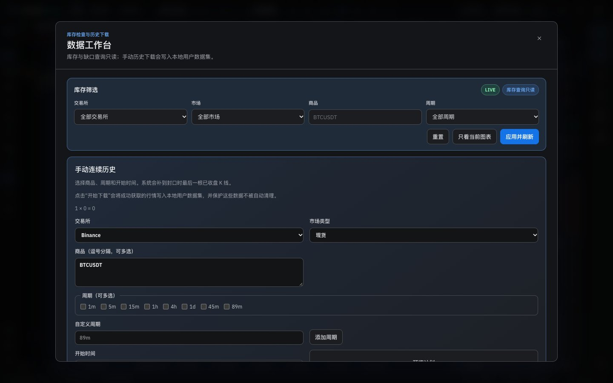 | 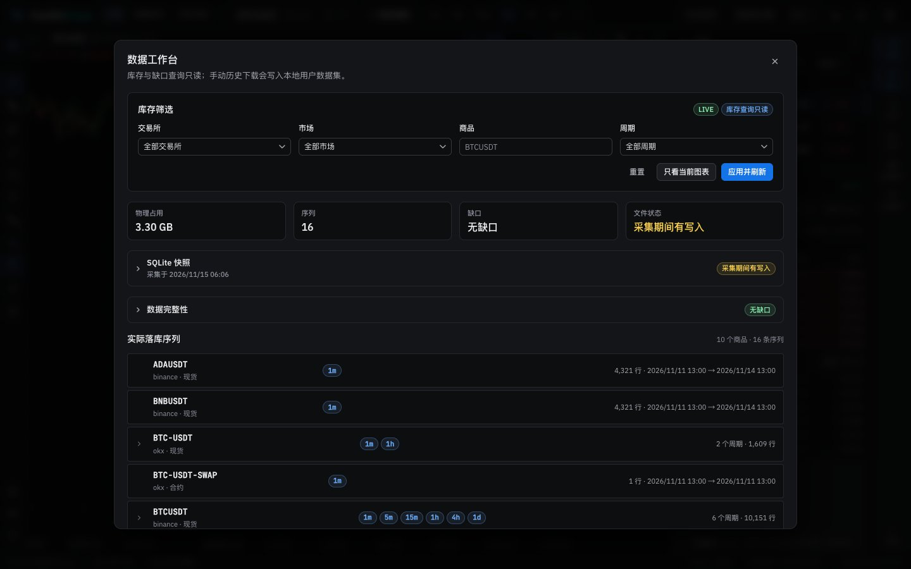 |
| Workbench (light) | 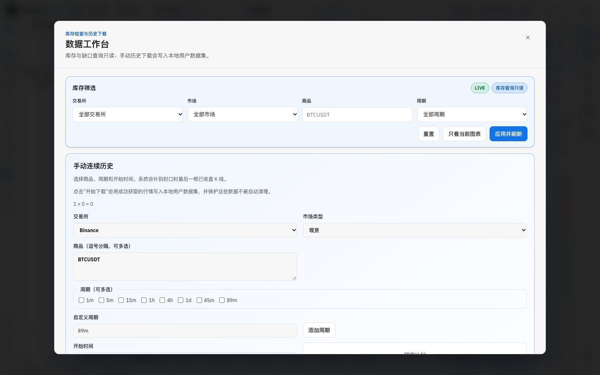 | 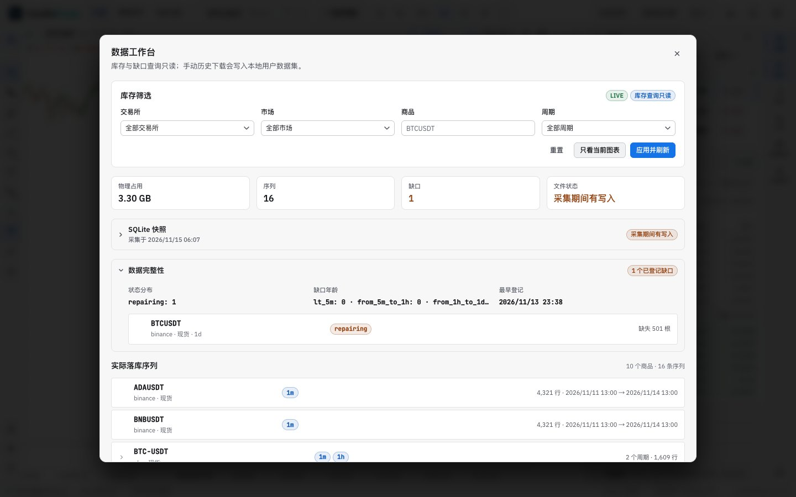 |
| Workbench, English | 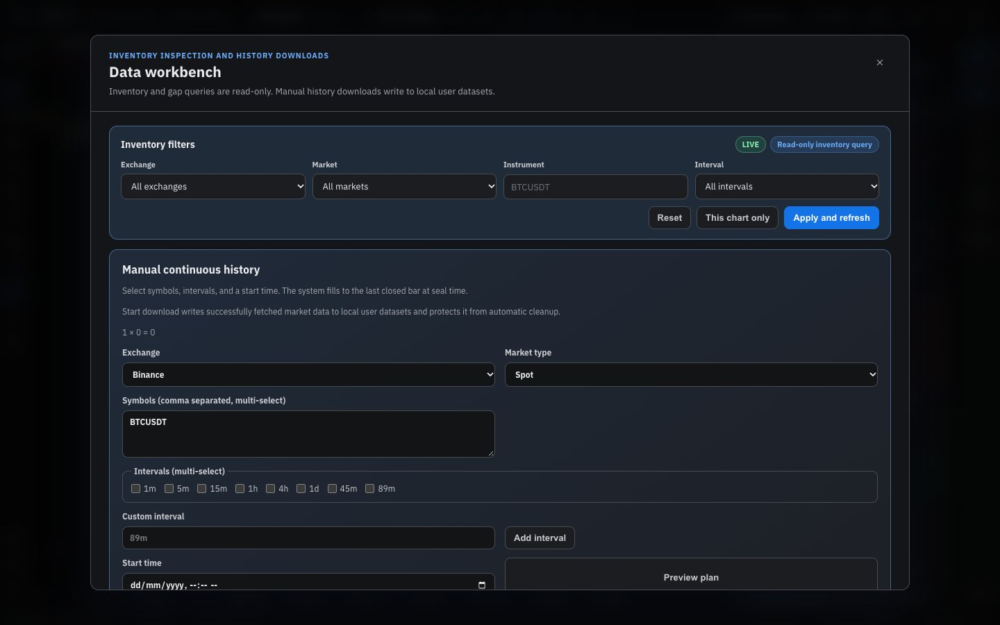 | 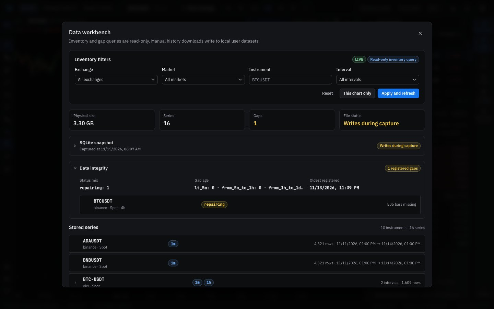 |
| Snapshot and integrity | 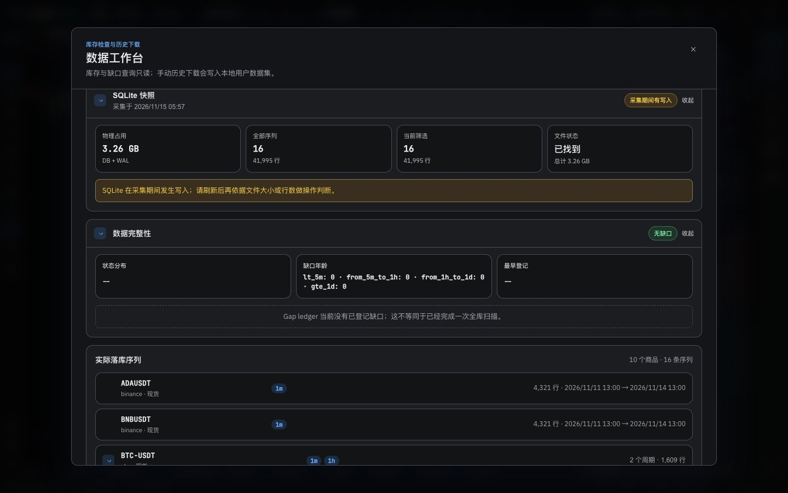 | 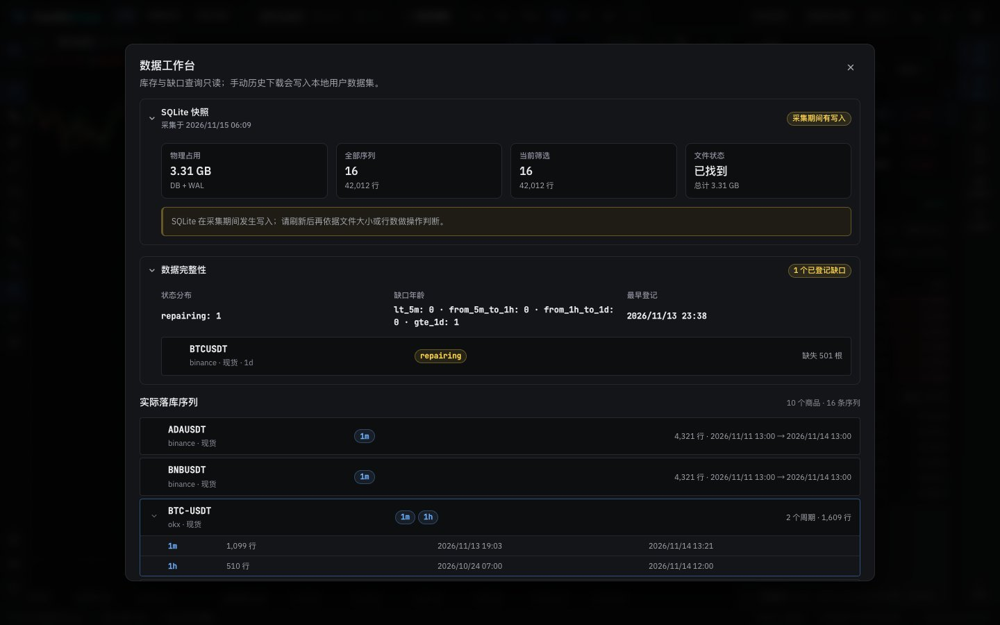 |
| Snapshot and integrity (light) | 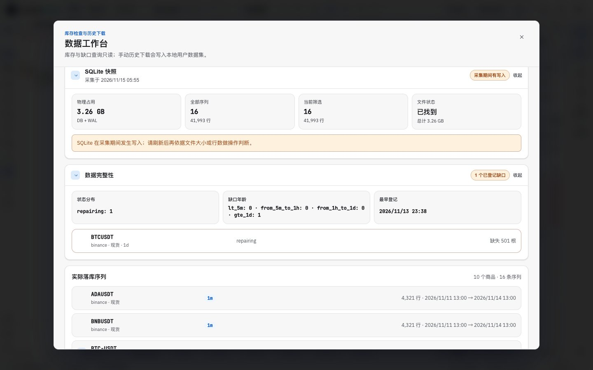 | 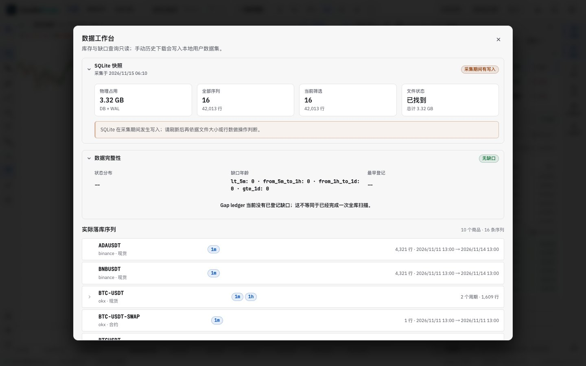 |
| Stored series, one expanded | 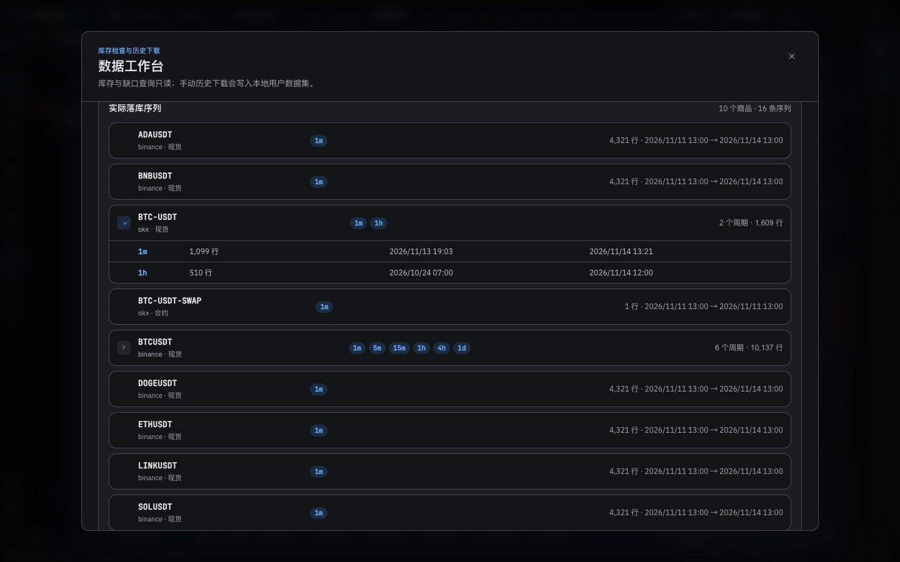 | 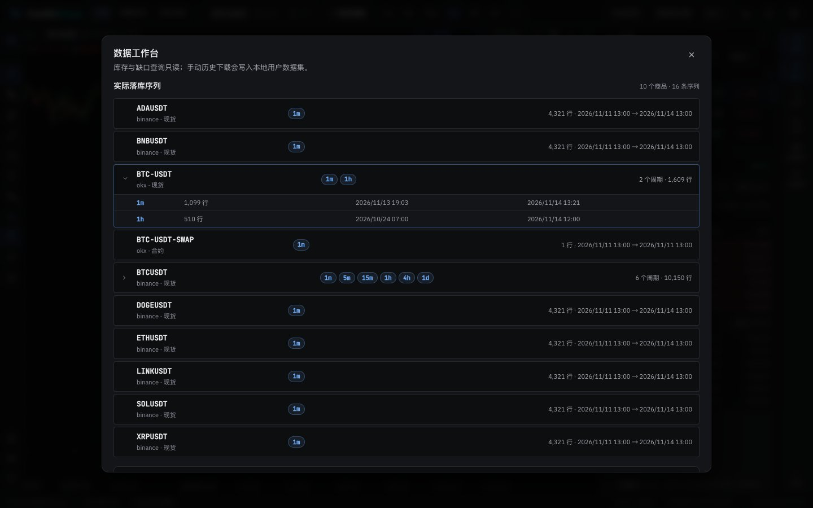 |
| Manual history download | 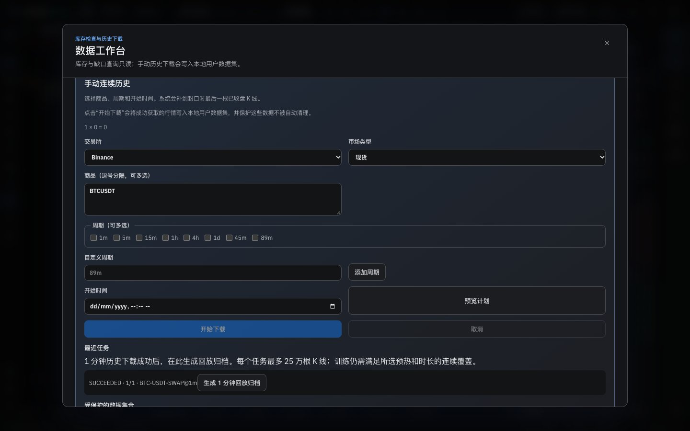 | 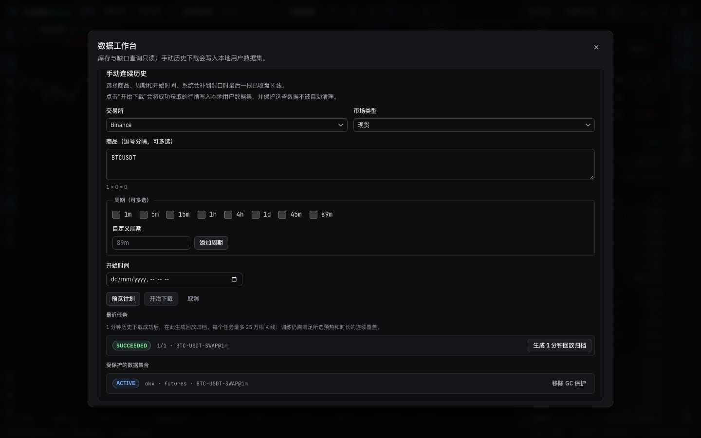 |

## Verification

**In the running app** (headless, 1440 px): Settings → 数据管理 → 打开数据工作台 opened the dialog; the inventory loaded (filters, summary, sections); the snapshot and integrity disclosures opened; a multi-interval series expanded; the manual download panel listed the finished job and the protected collection. Nothing that changes data was run: no filter refresh beyond the initial read, no plan, download, archive or release.

**Tests:** the data-workbench, settings, replay-launcher, app, kit, app-control and i18n tests pass (327). No test needed changing: the panel keeps its hooks (`manual-history-*` test ids, `disabled={!startEnabled}`).

**Style metrics** (against 5g7): class names with no CSS rule 0 (unchanged), raw `<button>` 376 → 364, `<Button>` uses 364 → 373, button class families 34 → 33.

**Full check:** `npm run check` passes: 5,165 frontend tests, 137 desktop tests, lint (one existing warning), the i18n, style and architecture checks, both typechecks and the build.

## Known gaps

- **Copy (Phase 6):** internal terms remain ("SQLite 快照", "DB + WAL", gap states such as `repairing`, age buckets such as `lt_5m`, job and collection states as codes, the target count as `1 × 0 = 0`), and the plan summary shows epoch milliseconds.
- **Two-level expansion** (a section, then a series row) is kept as it was.
- **Desktop app:** not tested.
