# Frontend design refactor: Phase 6a QA (copy foundations and the market page)

- Date: 2026-11-15
- Branch: `design/phase-6-copy`, based on `design/phase-5i2-accounts` (PR #432)
- Plan: [`frontend/FRONTEND_DESIGN_REFACTOR_PLAN.md`](../frontend/FRONTEND_DESIGN_REFACTOR_PLAN.md), Phase 6. Guidelines: [`frontend/COPY_GUIDELINES.md`](../frontend/COPY_GUIDELINES.md)
- **Intended visible change:** the market page no longer shows internal terms (class names, "backend", "ticker", "Top-N", "lane", "evaluator", "死信", "保活", English inside Chinese), and errors without a backend code get a translated summary. Layout is unchanged.

Phase 6 was split when it started (my call, as in Phase 5): the copy left over from Phase 5 spans every surface, and each reworded message changes all 30 catalogs. **6a** is the foundations and the market page; **6b** replay; **6c** strategy research; **6d** data and plugins. The plan lists what each covers.

## What changed

| Area | Change |
|---|---|
| Guidelines | `frontend/COPY_GUIDELINES.md`: voice, rules for Chinese (full-width punctuation, spacing, no English words beyond names and units) and English (sentence case, plain verbs), how codes, errors, exchanges, times and numbers appear, and a glossary from internal terms to user terms (revision → 版本 / version, backend → 本地服务 / local service, dry-run → 预演 / preview, …). The i18n README points to it. |
| Errors | `describeError` now covers failures without a backend code: an HTTP status picks the summary (404 → not found, 409 → changed elsewhere, 503 → unavailable, …) with the backend's message as detail; a request that never reached the local service ("Failed to fetch", "Load failed") reads "无法连接到本地服务"; "… not initialized" / "尚未初始化" reads "本地服务仍在启动，请稍后重试" (a new message in all 30 catalogs). A coded error whose detail arrives as JSON now shows only its message, not the JSON. |
| Check | `check:i18n` rejects internal terms in the zh-CN and en catalogs (`scripts/i18nInternalTerms.mts`): status codes, storage and runtime internals, class names, "backend", project phases, and English jargon inside Chinese. The 171 zh-CN and 225 en messages that still use them (replay 57/57, strategy research 72/108, data and plugins 42/60) are listed in `scripts/i18n-internal-terms-baseline.json`; a new one fails the check, and so does a listed one that no longer needs its entry, so the list only shrinks. `--write-internal-terms-baseline` regenerates it. |
| Watchlist | The subscription tiers say what they keep updated ("持续更新价格列", "不在后台更新价格或 K 线") instead of "保活 ticker"; a full subscription reads "价格 + 16 个周期", its tooltip "价格 + 16 个交易所周期 + 0 个自定义周期" (was "ticker + 16 native + 0 custom"). pt-BR's full tier read "FULL"; it reads "Completo". |
| Order book and trade flow | Mode tooltips describe the top levels and how updates replace each other (no "Top-N", "REST API", "后端"); "最后有效接收" → "最近一次有效更新"; trade-flow states read "实时成交连接中断", "至少漏收 N 笔成交，正在重新同步", … instead of naming `TradeFlow` or the backend. |
| Indicators | The editor hint reads "按已收盘 K 线计算" (was "closed bars only"); built-in indicators are "calculated by CandleScope" (was `IndicatorEngine`). |
| Alerts | "检查结果与实时触发使用同一套判断逻辑" (was "后端 evaluator"); the webhook states read "本地服务未开启 Webhook" and "排队 · 重试中 · 发送失败" (was "后端功能开关", "死信"); loading reads "正在读取规则和触发记录". |
| Elsewhere on the page | Workspace persistence "由主窗口统一保存" (was "WorkspaceBus 单写入者") and the desktop-only multi-window hint; export errors without "Blob"/"Canvas"; the desktop preview limit "预览名额已满"; the trading service message names the local service, not the backend. |
| Account docks | The trade journal names the exchange and market ("BTCUSDT · 币安 现货", was "binance spot", also in the copied Markdown); the read-only coverage and gap lines name fact kinds (成交, 资金流水) instead of `fills`, `bills`. |
| Catalogs | 29 reworded messages and 1 new one, in all 30 catalogs (the account message in its 6 feature catalogs). |

## Screens

The base build (Phase 5i2, `a8cd45096`) and this branch, 1440 × 900, `zh-CN` unless marked, market page on BTCUSDT 1h. The journal and read-only views use the Phase 5i2 capture fixtures (fake accounts served to the page's GET requests; writes refused, none attempted). Tooltip changes don't show in screenshots; the capture scripts read them from the page (see Verification).

| | Before | After |
|---|---|---|
| Watchlist subscription menu | 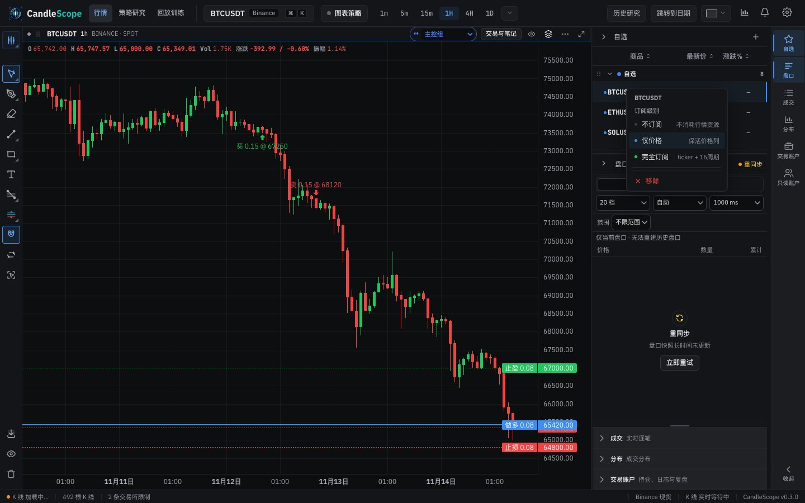 | 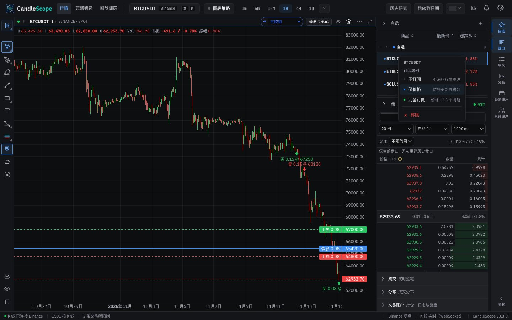 |
| Watchlist subscription menu, English | 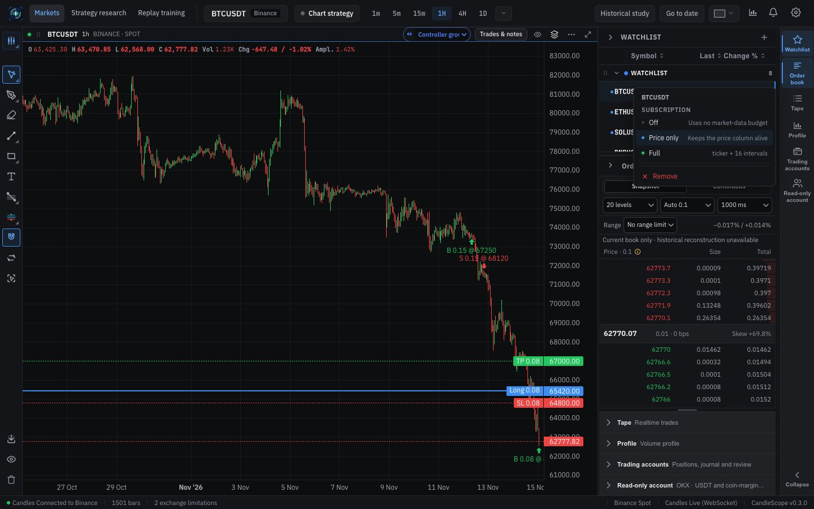 | 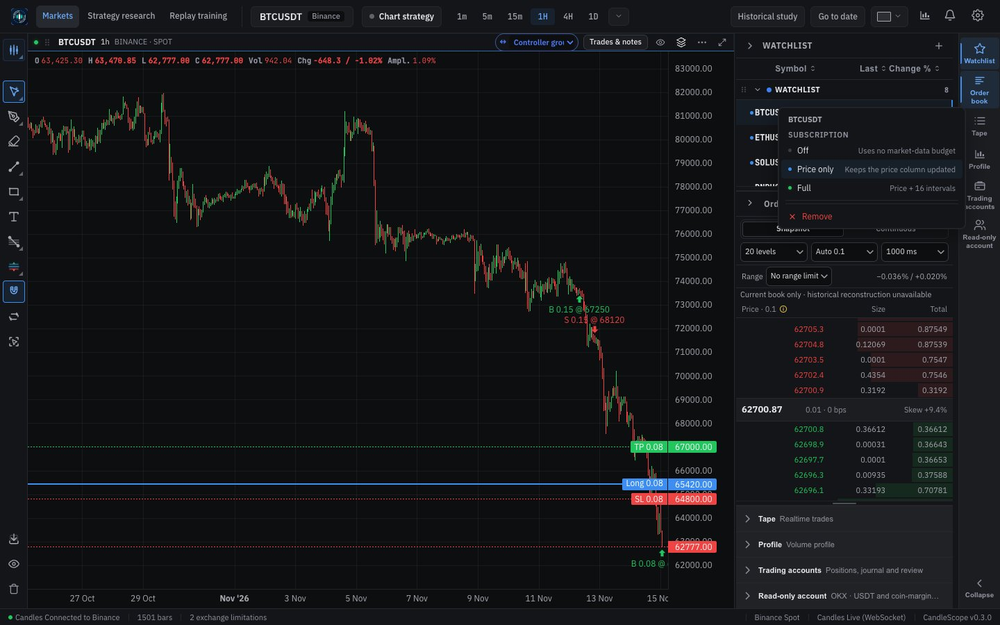 |
| New Pine indicator, editor hint | 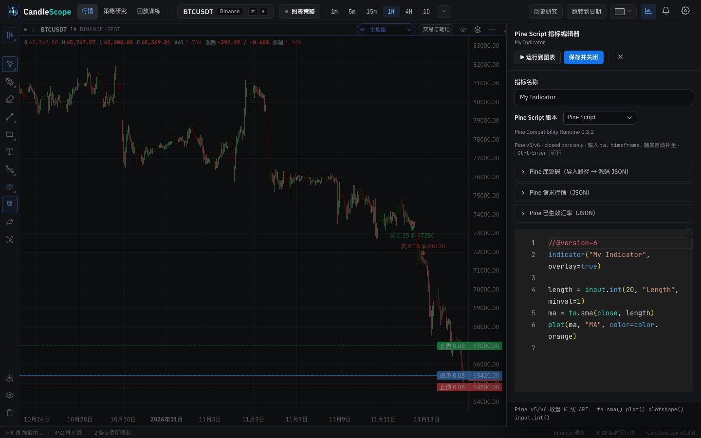 | 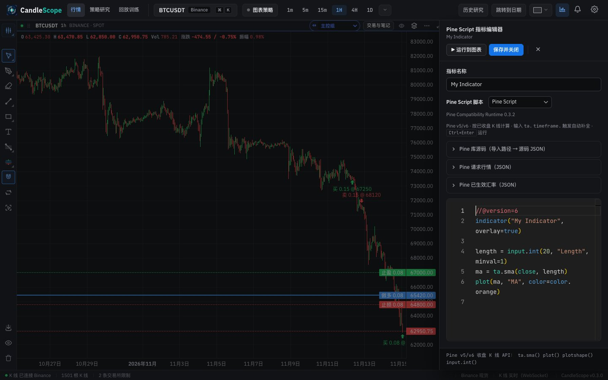 |
| Editor hint, English | 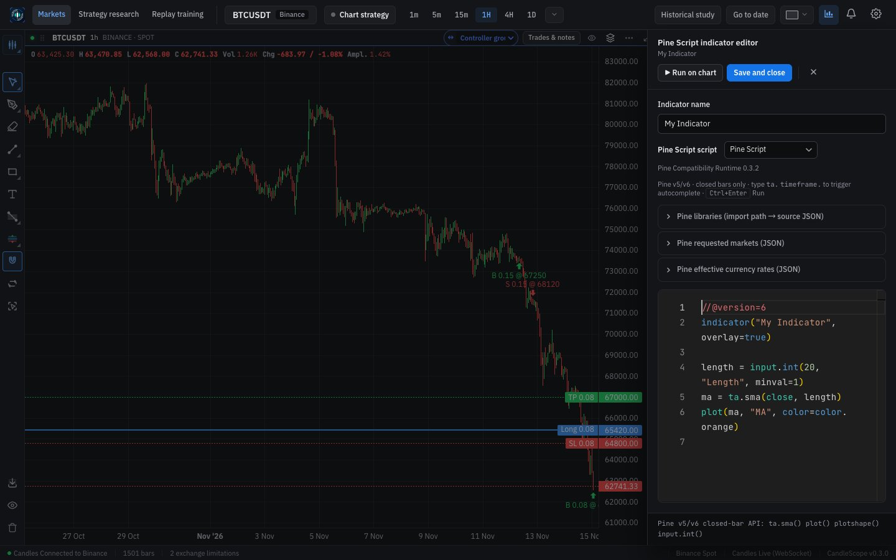 |  |
| Built-in indicator (EMA) reference |  | 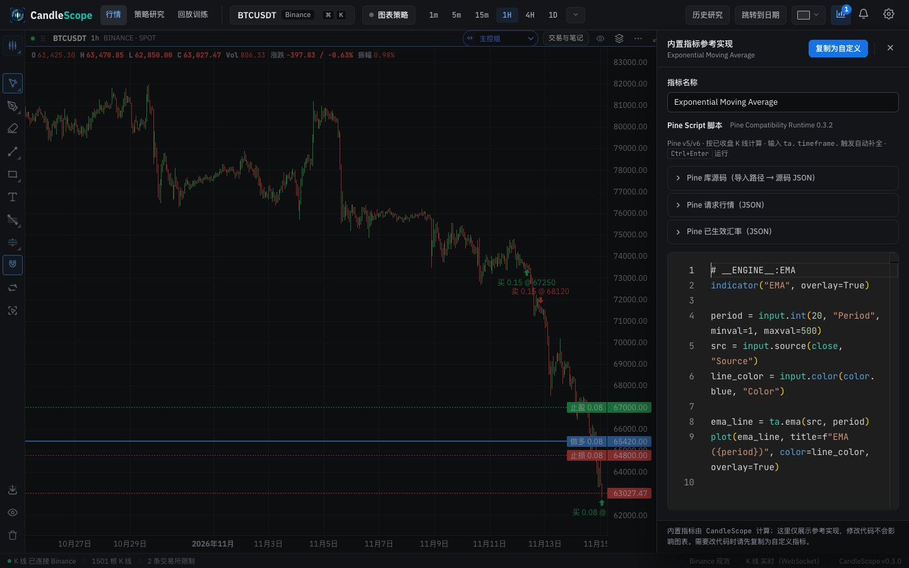 |
| Alerts, webhook channel off | 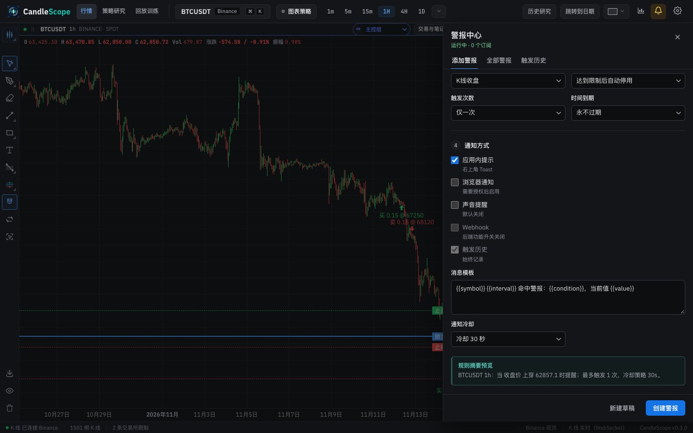 |  |
| Trade journal, instrument line |  | 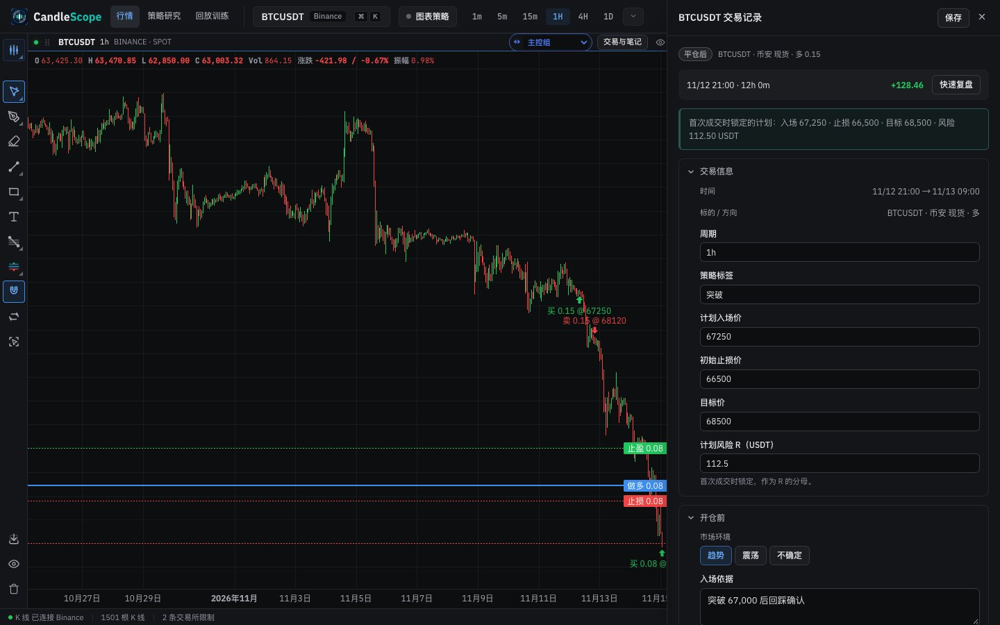 |
| Read-only account, coverage and gaps | 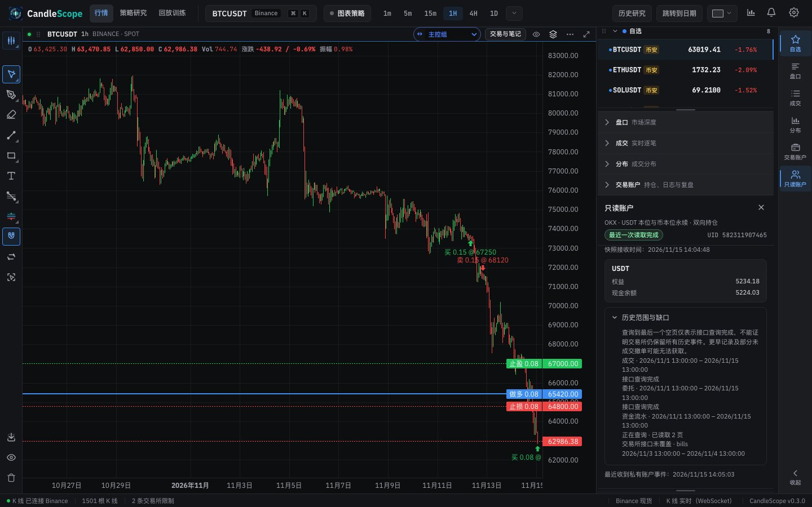 |  |

## Verification

**In the running app** (headless): the capture scripts read the text back from the page. Watchlist menu, before → after: "不订阅：不保活 ticker 或 K 线" → "不订阅：不在后台更新价格或 K 线", "ticker + 16周期 [完全订阅：ticker + 16 native + 0 custom]" → "价格 + 16 个周期 [完全订阅：价格 + 16 个交易所周期 + 0 个自定义周期]"; English "Full subscription: ticker + 16 native + 0 custom" → "Full: price + 16 exchange intervals + 0 custom intervals". Editor hint "closed bars only" → "按已收盘 K 线计算" / "calculated on closed bars". Built-in note `IndicatorEngine` → CandleScope. Alerts "后端功能开关关闭" → "本地服务未开启 Webhook". Journal "binance spot" → "币安 现货". The order book's 快照 tooltip reads "交易所推送前 N 档，每次更新整体替换上一份".

**Tests:** the i18n, script, watchlist, order-book, trade-flow, kit, indicator, export, chart-workspace, app, trading-accounts, read-only accounts and service tests pass (1,721). New: `describeError` cases for HTTP statuses, "not initialized", network failures and JSON details; the internal-terms rule (codes, placeholders ignored, Chinese-only terms, the shrinking baseline). The watchlist policy test expects the new summary and tooltip; the pt-BR catalog test (no English words left in Portuguese) caught one wording, fixed.

**Full check:** `npm run check` passes: 5,171 frontend tests, 137 desktop tests, lint (one existing warning), the i18n check (now including internal terms), style, CSS layer and architecture checks, both typechecks and the build. Style metrics are unchanged (no markup changed beyond text).

## Known gaps

- **6b–6d:** replay, strategy research, data and plugins still use internal terms (listed in the baseline) and still render some codes from data.
- **Not in the catalogs:** messages the backend sends without a code are shown as detail after the translated summary; Chinese backend messages (for example "DataManager 不支持 VACUUM") still name internals.
- **The desktop preview error** still prefixes its code (`CODE: 预览名额已满`); desktop only.
- **Other languages** follow the new English wording; they were not reviewed by native speakers.
- **Desktop app:** not tested.
