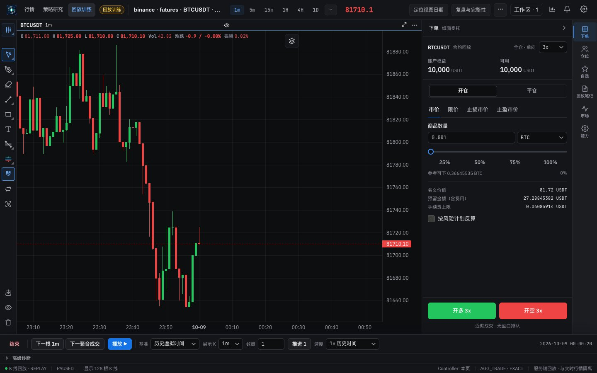
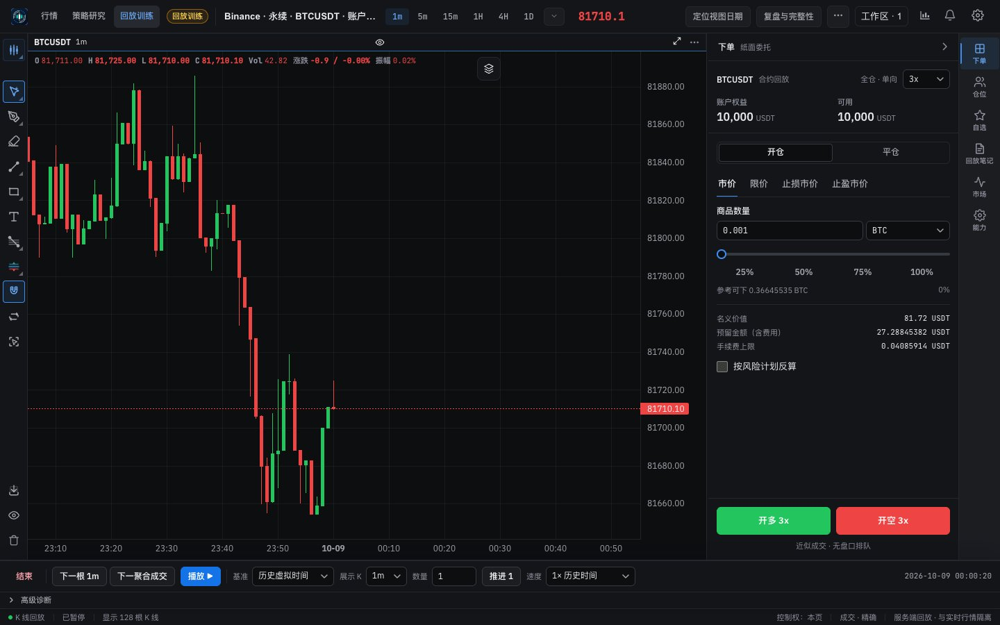
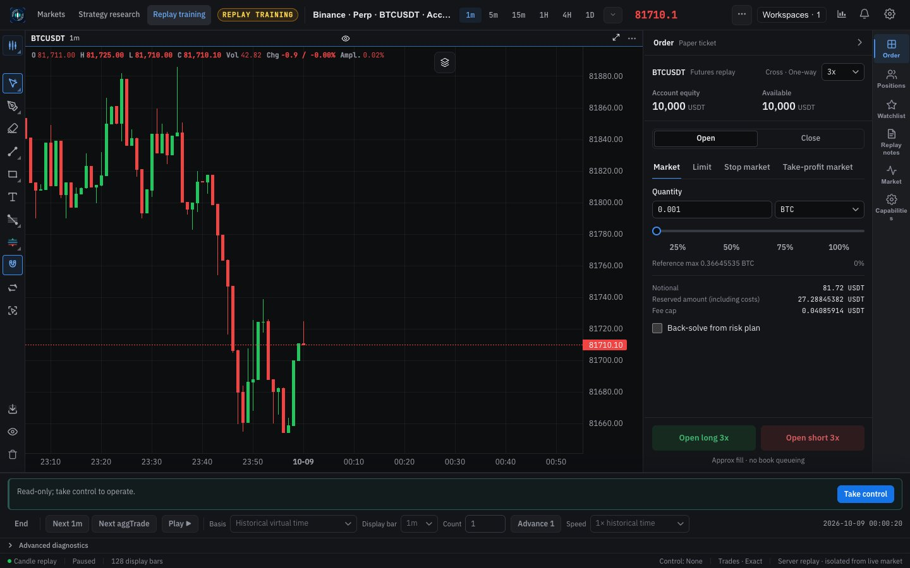
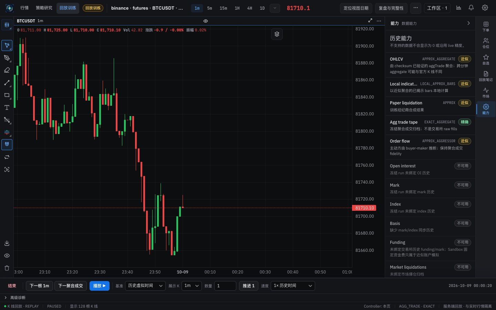
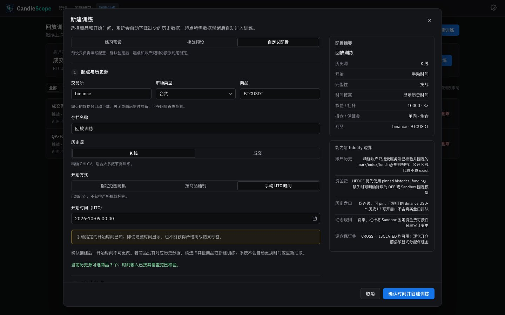
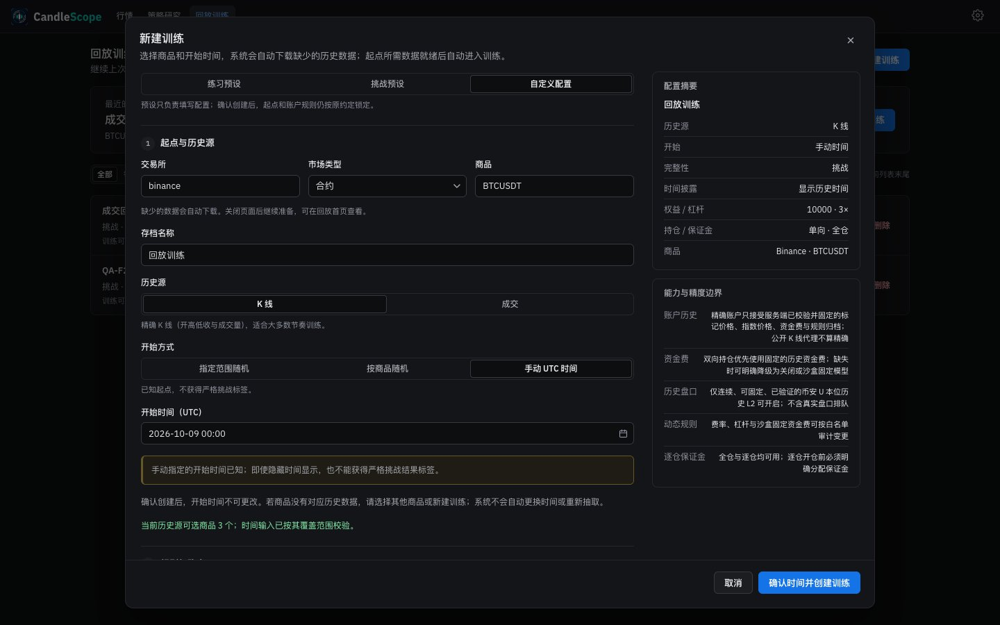
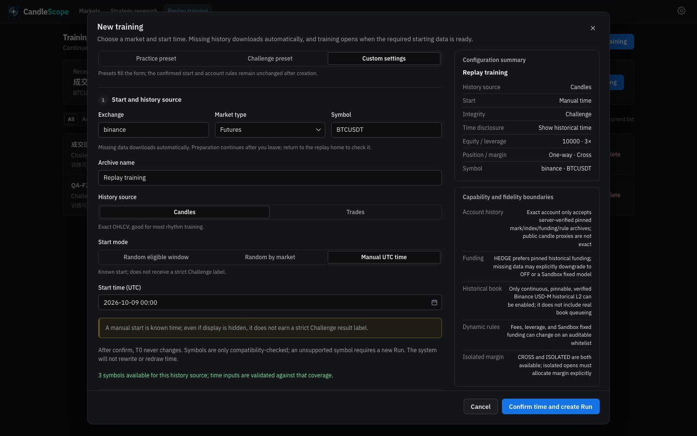

# Frontend design refactor: Phase 6b QA (replay copy)

- Date: 2026-11-15
- Branch: `design/phase-6b-replay-copy`, based on `design/phase-6-copy` (PR #434)
- Plan: [`frontend/FRONTEND_DESIGN_REFACTOR_PLAN.md`](../frontend/FRONTEND_DESIGN_REFACTOR_PLAN.md), Phase 6. Guidelines: [`frontend/COPY_GUIDELINES.md`](../frontend/COPY_GUIDELINES.md)
- **Intended visible change:** replay's default views name things instead of showing codes — the session header and status bar, the capability view, the create dialog's options and hints — and replay's messages no longer use internal terms. Layout is unchanged.

The row was split when it started (my call, as before): replay has about 190 messages with English words or codes, and its technical panels render more codes straight from data. **6b** clears replay from the internal-terms baseline and fixes the session's default views and the create dialog; **6b2** takes the technical panels (integrity and review drawer, liquidation timeline, storage governance, raw-trade retention) and the remaining replay messages with English words.

## What changed

| Area | Change |
|---|---|
| Baseline | Every replay message is off `scripts/i18n-internal-terms-baseline.json`: zh-CN 171 → 114, en 225 → 168. |
| Codes in labels | Option labels lose their codes in all 30 languages: time disclosure (相对日期, was 相对日期（HIDE_DAY）), position mode (单向净持仓, 多空双向持仓), account data, order-book and funding modes (was `APPROX_PROXY · …`, `SANDBOX_FIXED · …`), and the L2 line's "queue exact: false". The status line "K 线回放 · REPLAY" reads "K 线回放". |
| Review mode | `ReviewMode` is named in each language (复盘模式, review mode, レビューモード, Review-Modus…) in its 8 messages; "VERIFIED" reads as a word (已校验, verified, 検証済み…). |
| Rewritten sentences | 20 messages rewritten in all 30 catalogs, where the sentence itself changed: the end dialog (positions close at the last revealed mark price and are recorded as a session-end close, was `SESSION_END_MARK_CLOSE`), the hedge and order-book hints (was `HEDGE_HYBRID`, `TOUCH_OR_TAPE_V2`, `BOOK_ASSISTED`), review-mode states, the equity hint (was `Decimal`, `VirtualTime`), and storage cleanup (清理预演 / cleanup preview, was "GC dry-run", "plan hash", "checksum", "重新水化"). |
| Terms | Chinese messages lose English jargon (exact → 精确, pinned → 固定, overlay → 你设的杠杆上限, fidelity → 精度, Run → 训练, Fork → 分叉, Controller → 控制权); English loses revision, receipt, hash, flags, raw trades and fidelity. Other languages already used their own words there. |
| Session view | The header reads "Binance · 永续 · BTCUSDT" (was "binance · futures · BTCUSDT"); the status bar "已暂停", "控制权：本页", "成交 · 精确" (was "PAUSED", "Controller: 本页", "AGG_TRADE · EXACT"), and a review "复盘 · 已暂停" (new message in all 30 catalogs); the derivative chips show 标记价格 / 指数价格 / 基差 with a level (不可用), not `UNSUPPORTED_NO_HISTORY`. The replay watchlist and the create dialog's summary name the exchange and market. |
| Capability view | The 14 capability names are translated (K 线, 本地指标, 聚合成交, 订单流, 未平仓量…; new `replay.capName.*` in all 30 catalogs, also used by the header chips); the value codes (`APPROX_AGGREGATE`, `KLINE_TAKER_PROXY`…) moved from a visible chip to the row's tooltip and `data-capability-value`; the Chinese explanations lose "raw fills", "run", "OI", "bars", "provider". |
| Create dialog | The capability and accuracy limits read in plain Chinese (双向持仓, 固定, 沙盒, 全仓与逐仓, was HEDGE, pinned, Sandbox, CROSS 与 ISOLATED); the bar source hint reads 精确 K 线 (was 精确 OHLCV); the order-book and hedge hints are rewritten as above. |
| Helpers | `replayStateLabel`, `replayQualityLabel` and `replayCapabilityStateLabel` in `trainingHubLabels.ts`; the capability surface and the session shell use them. |
| Guidelines | Glossary rows for Run → 训练 / run and fork → 分叉 / fork; the catalog rule says when a term-only change can leave other languages as they are. |

## Screens

The base build (Phase 6a, `99dc0a6f7`) and this branch, 1440 × 900, `zh-CN` unless marked, on the local run "成交回放验收 2026-10-11" (BTCUSDT perpetual, aggregated trades). Opening a run in the capture let through only what viewing needs — building its lookup index, taking the viewing lease, and the ticket's capacity and order previews; every other write (play, step, orders, notes, drawings, the view-action log) was refused. Taking the lease is recorded by the run (its revision count went up once per capture, as in the Phase 5 replay captures); nothing else changed.

| | Before | After |
|---|---|---|
| Session: header and status bar |  |  |
| Session, English |  |  |
| Capability view |  |  |
| New run dialog |  |  |
| New run dialog, English |  |  |

## Verification

**In the running app** (headless): the capture scripts read the text back. Header "binance · futures · BTCUSDT" → "Binance · 永续 · BTCUSDT"; status bar "K 线回放 · REPLAY | PAUSED | Controller: 本页 | AGG_TRADE · EXACT" → "K 线回放 | 已暂停 | 控制权：本页 | 成交 · 精确"; English "Candle replay · REPLAY | PAUSED | Controller: None | AGG_TRADE · EXACT" → "Candle replay | Paused | Control: None | Trades · Exact"; capability rows "OHLCV APPROX_AGGREGATE 近似 由 checksum 已验证的 aggTrade 聚合" → "K 线 近似 由已校验的聚合成交汇总".

**Tests:** the replay, replay-launcher, i18n, script, kit and app tests pass. 15 assertions quoted the old wording or codes and now check the new text (for example that the hedge message no longer contains `HEDGE_HYBRID` in zh, fr, es, ja and ko, and that the capability row has no visible code); the pt-BR catalog test (no English words in Portuguese) caught one wording, fixed.

**Full check:** `npm run check` passes: 5,171 frontend tests, 137 desktop tests, lint (one existing warning), the i18n (with the internal-terms rule), style, CSS layer and architecture checks, both typechecks and the build. Three Chinese wordings in the create dialog (沙盒, 全仓与逐仓, 精确 K 线) were fixed after it and re-checked with the i18n check and the replay, i18n and script tests (1,436).

## Known gaps

- **6b2:** the integrity and review drawer, liquidation timeline, storage governance and raw-trade retention still render codes from data (states, reasons, kinds), and about 100 replay messages still carry English words outside the check's term list (Sandbox, CROSS/ISOLATED, mark/index, live, snapshot, checkpoint, MiB…).
- **The diagnostics disclosure** (高级诊断) keeps its codes on purpose: it is the technical-details view.
- **Other languages** follow the new English where sentences changed; not reviewed by native speakers.
- **Desktop app:** not tested.
