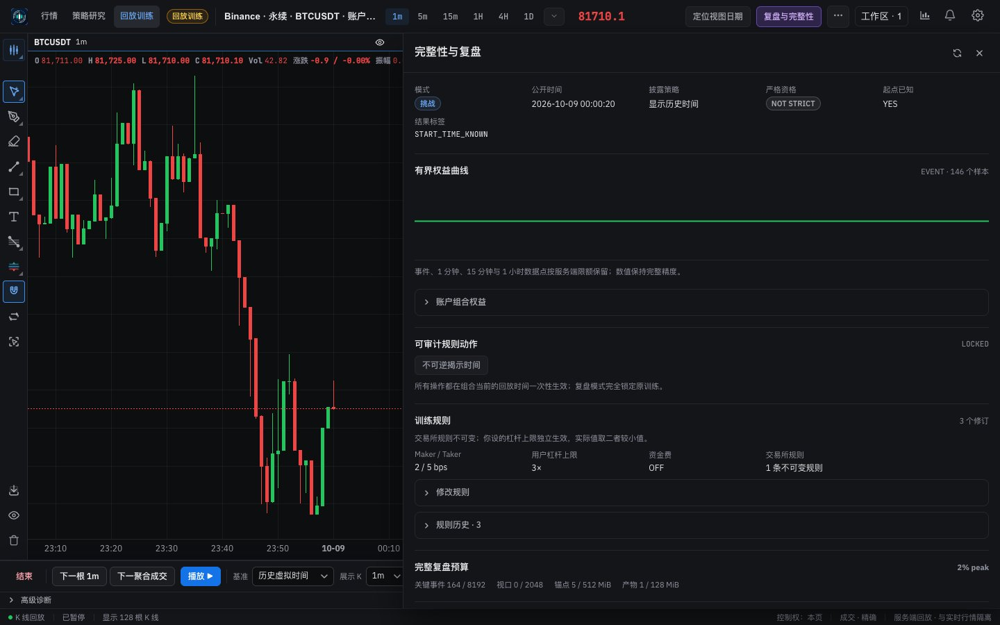
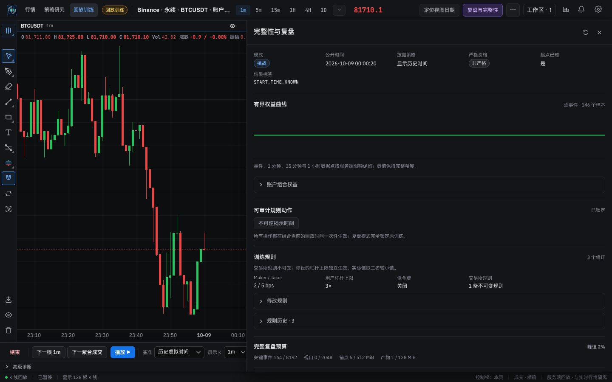
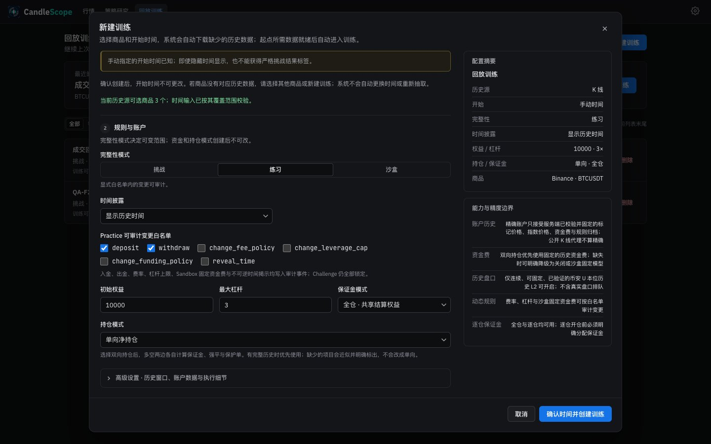
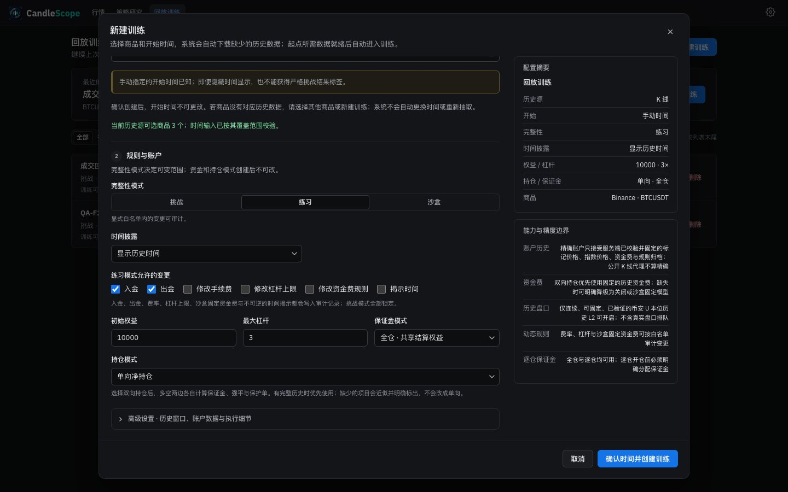
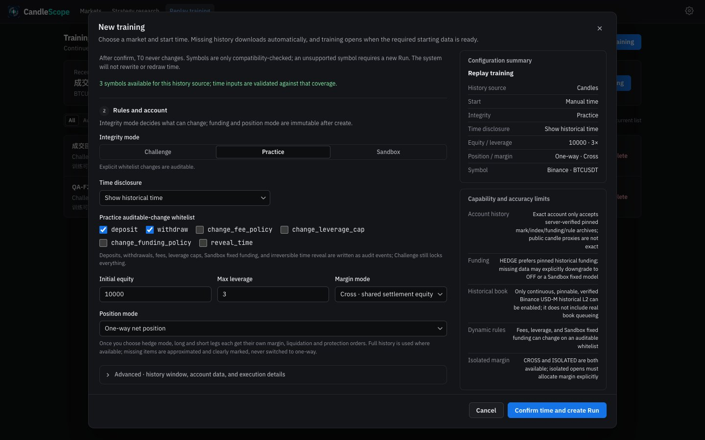
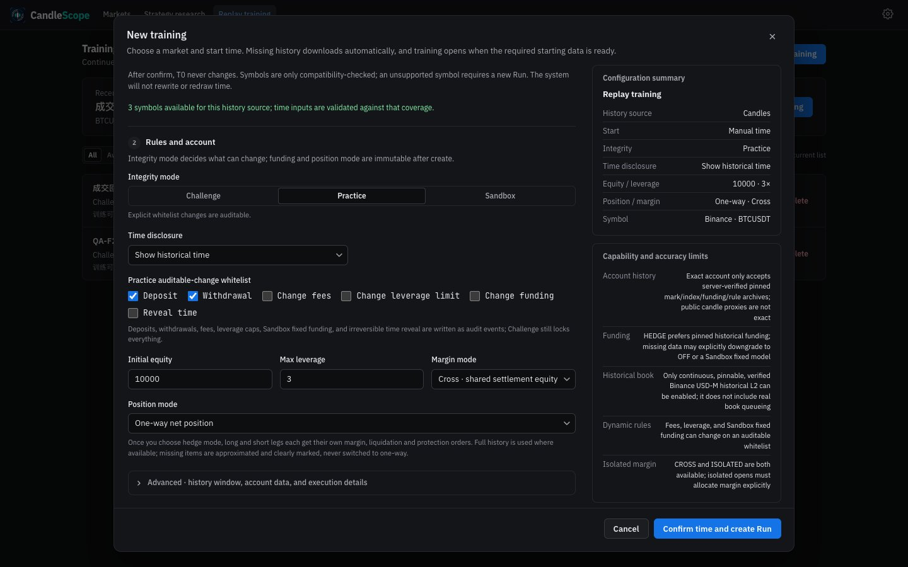
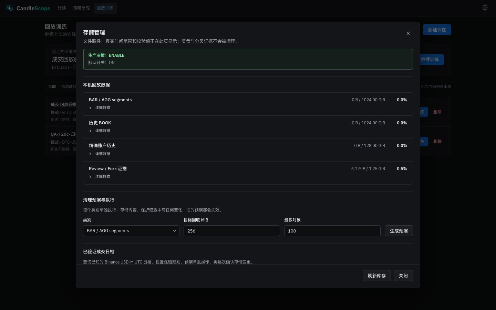
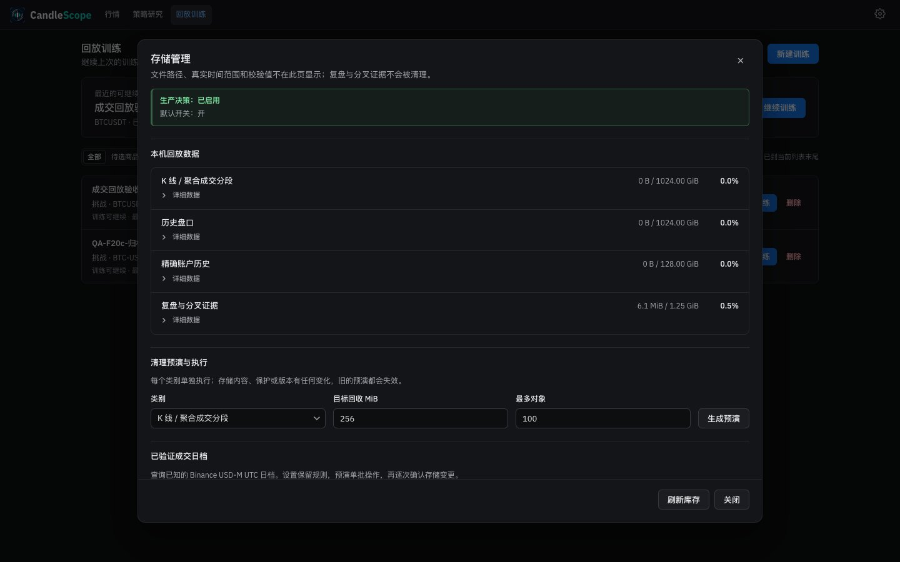

# Frontend design refactor: Phase 6b2 QA (replay's technical panels)

- Date: 2026-11-15
- Branch: `design/phase-6b2-replay-panels`, based on `design/phase-6b-replay-copy` (PR #435)
- Plan: [`frontend/FRONTEND_DESIGN_REFACTOR_PLAN.md`](../frontend/FRONTEND_DESIGN_REFACTOR_PLAN.md), Phase 6. Guidelines: [`frontend/COPY_GUIDELINES.md`](../frontend/COPY_GUIDELINES.md)
- **Intended visible change:** replay's review drawer, liquidation timeline, storage panel and the create dialog's practice settings show named states instead of codes, and replay's remaining Chinese messages no longer mix in English words. Layout is unchanged.

## What changed

| Area | Change |
|---|---|
| Practice settings | The allowed changes in the create dialog read 入金, 出金, 修改手续费, 修改杠杆上限, 修改资金费规则, 揭示时间 (was `deposit`, `change_fee_policy`…); the heading reads 练习模式允许的变更 (was "Practice 可审计变更白名单"). |
| Review drawer | Strictness reads 符合严格标准 / 非严格 (was ELIGIBLE / NOT STRICT), start time known 是 / 否 (was YES / NO), no allowed changes 已锁定 (was LOCKED) and allowed changes by name; rule revisions show their kind (手续费, 杠杆上限, 资金费规则, was `FEE_POLICY`); the account inputs, audit results (通过 / 未通过 / 未运行), market-liquidation accuracy, funding mode (关闭, was OFF), the equity curve's 逐事件 (was EVENT) and the budget's 峰值 2% (was "2% peak") are labelled. |
| Liquidation timeline | Case, step, leg, order and auto-deleveraging states are named (全部强平, 撤销委托, 已平仓, 部分成交, 无法确认，已停止…, was `FULL_LIQUIDATION`, `CANCEL_ORDERS`, `FAILED_CLOSED`…), sides and orders read 多 / 空 and 买入 市价 (was LONG, BUY MARKET). The state codes stay in `data-liquidation-*` attributes. |
| Storage panel | The release decision reads 已启用 / 暂缓 (was ENABLE / HOLD), default switches 开 / 关 (was ON / OFF), alerts are titled by level (提示 / 警告 / 严重) with their code after the message, object rows name the exchange and market (Binance · 永续, was binance · futures) and their health (就绪, was READY). Protection reasons and object ids stay as codes: this is the maintenance view. |
| Market picker | A failed market choice goes through `describeError` (a translated summary plus the message) instead of `CODE: message`. |
| Chinese copy | 73 replay messages lose their English words in zh-CN and the four Traditional Chinese catalogs (Sandbox → 沙盒, Practice / Challenge → 练习 / 挑战, snapshot → 快照, checkpoint → 检查点, command_id → 命令编号, controller lease → 控制权, live / mock → 实时 / 模拟, bars → K 线, mark → 标记价格, Run / Review / Fork → 训练 / 复盘 / 分叉…). Other languages already used their own words there. |
| English copy | 8 English messages lose code names (`command_id`, `ViewerState`, `MarketTrack`, "controller lease", "fails closed"). |
| Catalogs | 47 new messages in all 30 catalogs: the practice changes, revision kinds, audit results, liquidation states, storage decision and alert levels, yes / no and on / off (`common.*`), per event and the budget peak. |
| Helpers | Label functions for mutations, revision kinds, audit results, account inputs, liquidation accuracy and states, sides and orders, and alert levels in `trainingHubLabels.ts`. |

## Screens

The base build (Phase 6b, `2eb7c9a9b`) and this branch, 1440 × 900, `zh-CN` unless marked. The drawer is opened on the local run "成交回放验收 2026-10-11"; as in 6b, only the run's index build, the viewing lease (recorded by the run) and the ticket previews were let through, and every other write was refused. The local run has no liquidation case, so the timeline's labels are covered by the tests (Phase 7 fixture) rather than a screenshot.

| | Before | After |
|---|---|---|
| Review drawer |  |  |
| Practice settings |  |  |
| Practice settings, English |  |  |
| Storage panel |  |  |

## Verification

**In the running app** (headless): the capture scripts read the text back. Practice settings "Practice 可审计变更白名单 deposit withdraw change_fee_policy…" → "练习模式允许的变更 入金 出金 修改手续费 修改杠杆上限 修改资金费规则 揭示时间"; English "deposit withdraw change_fee_policy…" → "Deposit Withdrawal Change fees…"; storage "生产决策：ENABLE 默认开关：ON … BAR / AGG segments … binance · futures · BTCUSDT · 1m READY" → "生产决策：已启用 默认开关：开 … K 线 / 聚合成交分段 … Binance · 永续 · BTCUSDT · 1m 就绪".

**Tests:** the replay, replay-launcher, i18n, script and app tests pass (1,501). Ten assertions quoted the old wording or codes and now check the labels (for example the hub's practice heading, that `change_fee_policy` no longer shows as text, the liquidation fixture's "Full liquidation" and "ADL · Completed", the historical mark line's 历史标记价格).

**Full check:** `npm run check` passes: 5,171 frontend tests, 137 desktop tests, lint (one existing warning), the i18n (with the internal-terms rule), style, CSS layer and architecture checks, both typechecks and the build.

## Known gaps

- **Kept as codes on purpose:** the review drawer's result label (`START_TIME_KNOWN`) and its event log (category / event type), the storage panel's protection and reason codes and object ids, the diagnostics disclosure. These are the technical views the guidelines allow.
- **Liquidation reasons** come from the engine as text and are shown as sent.
- **Other languages** keep their own wording where only Chinese mixed in English; the new labels were not reviewed by native speakers.
- **Desktop app:** not tested.
