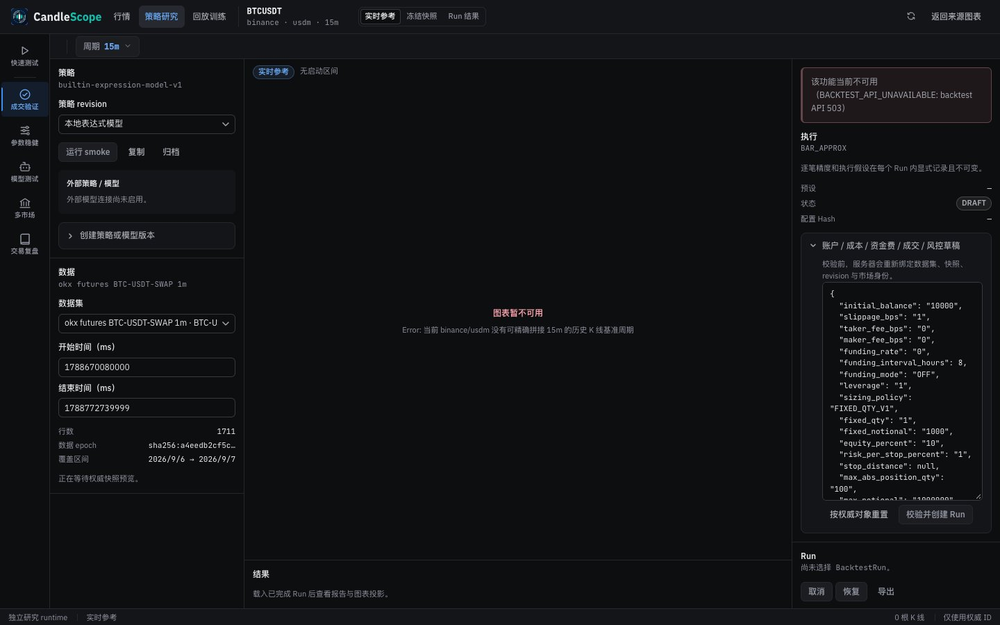
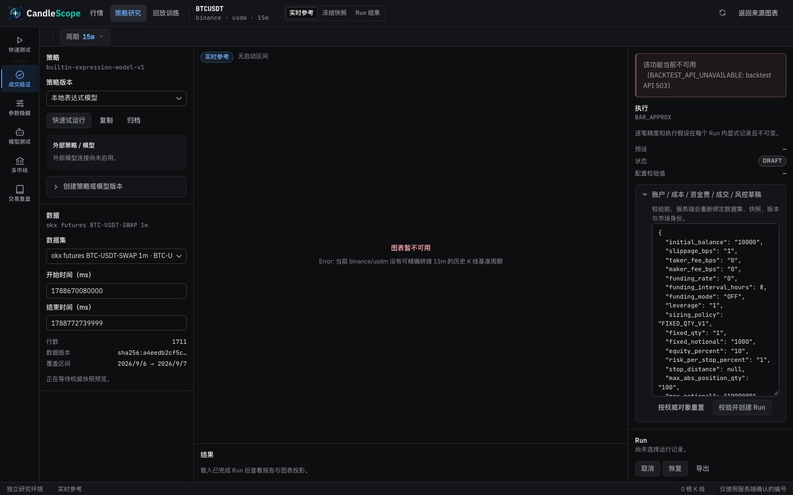
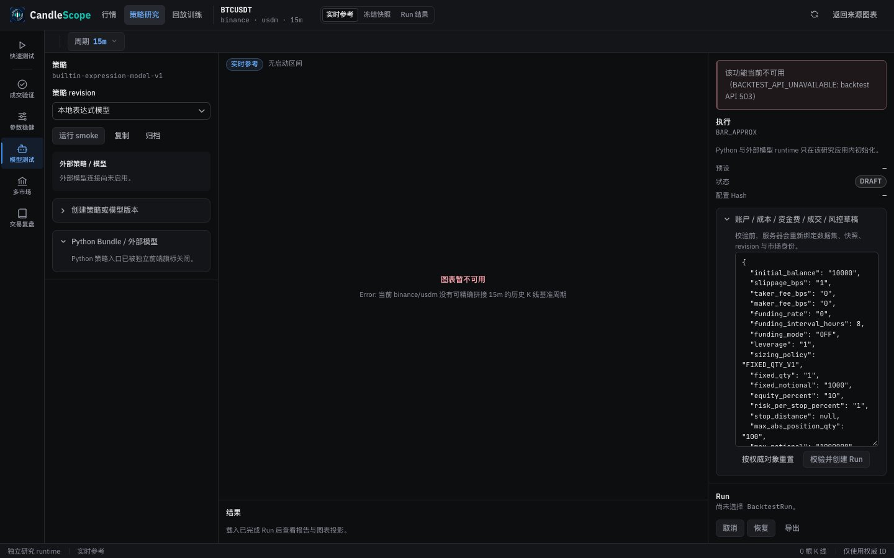
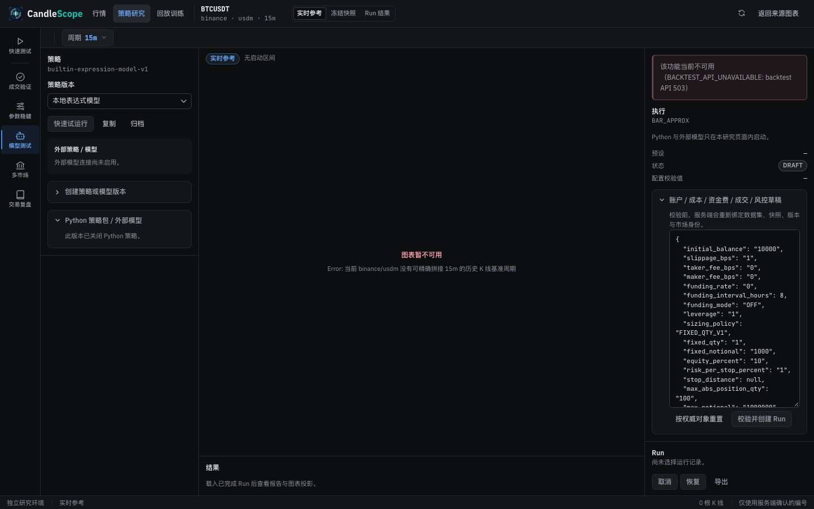
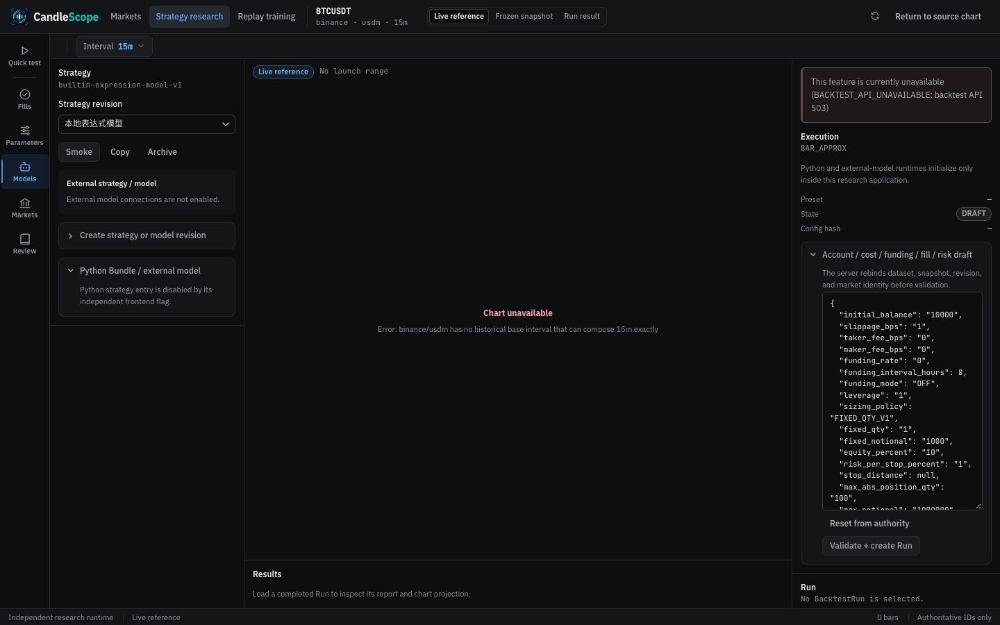
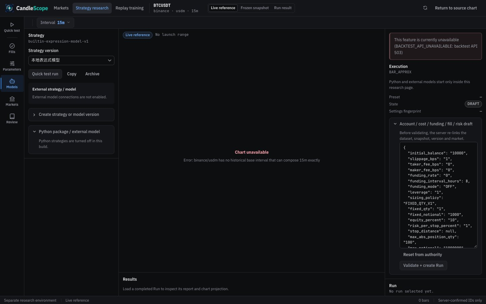
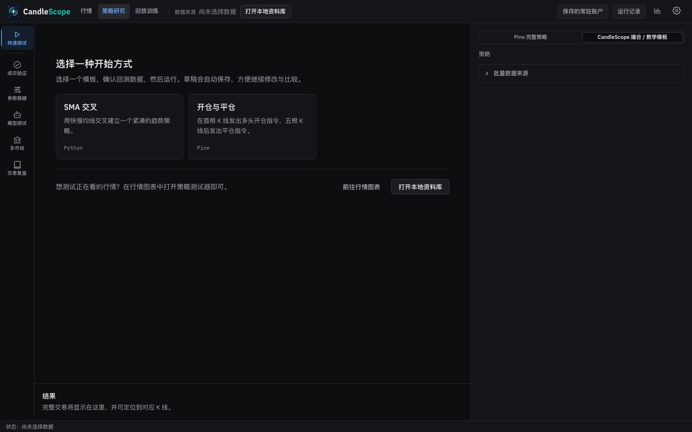

# Frontend design refactor: Phase 6c QA (strategy research copy)

- Date: 2026-11-16
- Branch: `design/phase-6c-research-copy`, based on `design/phase-6b2-replay-panels` (PR #437)
- Plan: [`frontend/FRONTEND_DESIGN_REFACTOR_PLAN.md`](../frontend/FRONTEND_DESIGN_REFACTOR_PLAN.md), Phase 6. Guidelines: [`frontend/COPY_GUIDELINES.md`](../frontend/COPY_GUIDELINES.md)
- **Intended visible change:** the strategy page's status bar, data and execution panels, mode rail, Python tools and the strategy tester's messages no longer use internal terms (runtime, receipt, bundle, smoke, revision, hash, epoch, backend, project phases, status codes). Layout is unchanged.

The row was split when it started (my call, as for replay): besides the 113 messages the check lists, the research pages show codes straight from data and about 150 messages with English words outside the term list. **6c** clears strategy research from the internal-terms baseline; **6c2** takes the codes from data, epoch-millisecond times and the remaining English words.

## What changed

| Area | Change |
|---|---|
| Baseline | Every strategy research message is off `scripts/i18n-internal-terms-baseline.json`: zh-CN 114 → 42, en 168 → 60. What remains is 6d (settings, plugins, data workbench). |
| Unused messages | 36 messages nothing uses any more are deleted from all 30 catalogs: the retired backtest workbench's (aggTrade disclaimers, "StrategyRevision V2", "Study V2", walk-forward contract codes, metric hashes…) and two placeholders of the strategy tester. |
| Status bar | "独立研究 runtime" → 独立研究环境, "仅使用权威 ID" → 仅使用服务端确认的编号 (English "Separate research environment", "Server-confirmed IDs only"). |
| Panels | 数据 epoch → 数据版本, Hash → 校验值, 配置 Hash → 配置校验值 (Data version, Fingerprint, Settings fingerprint); strategy revision → 策略版本 / Strategy version, compile and available versions, "创建策略或模型版本" (in 28 of the 30 languages it read "/Pine revision" or similar — a leftover of an earlier automated rename, now fixed); "运行 smoke" → 快速试运行; "尚未选择 BacktestRun" → 尚未选择运行记录; the read-only and offline notices without "Phase 10" or `LOCAL_OFFLINE`. |
| Mode rail | The Python mode's detail names the package, trust settings, model inputs and outputs and run records (was "Bundle、信任门… runtime receipt"); the robustness and replay details lose "fold", "holdout" and "Run". |
| Python tools | Run modes read 沙箱运行 / 本机直接运行 with what each needs (was `SANDBOXED_LOCAL` / `TRUSTED_LOCAL`), the confirmation "我已阅读以上权限说明…", next steps without codes, templates "输出目标仓位" (was `TARGET_POSITION`), notices about packages, versions and quick test runs. |
| Strategy tester and continuous runs | "Backend" becomes the local service (capacity, busy, progress, observing a continuous run, run state); "fidelity" becomes accuracy in English. |
| Identifiers | Values a person must type stay exact and outside the sentence: the trusted-run setting `BACKTEST_PYTHON_TRUSTED_LOCAL_ENABLED=1` and the account import format's fields (`time_ms, role, payload`, `INSTRUMENT_RULES`, `MARK_INDEX`, `FUNDING`) are passed as placeholders. The guidelines now say so. |
| Catalogs | 45 messages rewritten in all 30 catalogs; vocabulary-only fixes in the catalogs that showed the term (English accuracy and version; Chinese, Traditional Chinese and Korean version); the continuous-run and import messages in their feature catalogs' five or four languages. |
| Guidelines | Glossary rows for quick test run, parameter study and the two Python run modes; the identifier rule. |

## Screens

The base build (Phase 6b2, `3439c0fca`) and this branch, 1440 × 900, `zh-CN` unless marked, on the strategy page. Writes were refused in the capture and none was attempted. The mode rail's details are tooltips, read back from the page rather than shown.

| | Before | After |
|---|---|---|
| 成交验证 (precise mode) |  |  |
| 模型测试 (Python mode) |  |  |
| Python mode, English |  |  |
| Quick test (mode rail) |  |  |

## Verification

**In the running app** (headless): the capture scripts read the text back. Precise mode, before → after: "数据 epoch · 配置 Hash · 独立研究 runtime · 仅使用权威 ID" → "数据版本 · 配置校验值 · 独立研究环境 · 仅使用服务端确认的编号"; English "Config hash · Independent research runtime · Authoritative IDs only" → "Settings fingerprint · Separate research environment · Server-confirmed IDs only"; mode rail "检查 Bundle、信任门、模型输入输出与 runtime receipt" → "检查策略包、信任设置、模型输入输出与运行记录", "fold、样本外、holdout" → "分段验证、样本外区间、留出数据", "打开 Run" → "打开一次运行".

**Tests:** the backtest, strategy-research, research-data, local-data, i18n, script, app and chart-workspace tests pass. Two Python studio assertions now check the new wording (the sandbox next step says 直接运行 and no longer contains `TRUSTED_LOCAL`; the confirmation says 权限说明 and the facts carry the setting name).

**Full check:** `npm run check` passes: 5,171 frontend tests, 137 desktop tests, lint (one existing warning), the i18n (with the internal-terms rule), style, CSS layer and architecture checks, both typechecks and the build.

## Known gaps

- **6c2:** the research pages still show codes from data (`BAR_APPROX`, `DRAFT`, model ids such as `builtin-expression-model-v1`), start and end times as epoch milliseconds, error summaries with their code (`BACKTEST_API_UNAVAILABLE`), and about 150 messages with English words outside the term list ("Run 结果", "校验并创建 Run", "按权威对象重置", "等待权威快照预览"…).
- **"Hash" in other languages:** the fingerprint labels were rewritten in all 30 catalogs, but other messages in some languages keep their own loanword for hash or revision; the check covers only zh-CN and en.
- **Other languages** follow the new English where sentences changed; not reviewed by native speakers.
- **Desktop app:** not tested.
