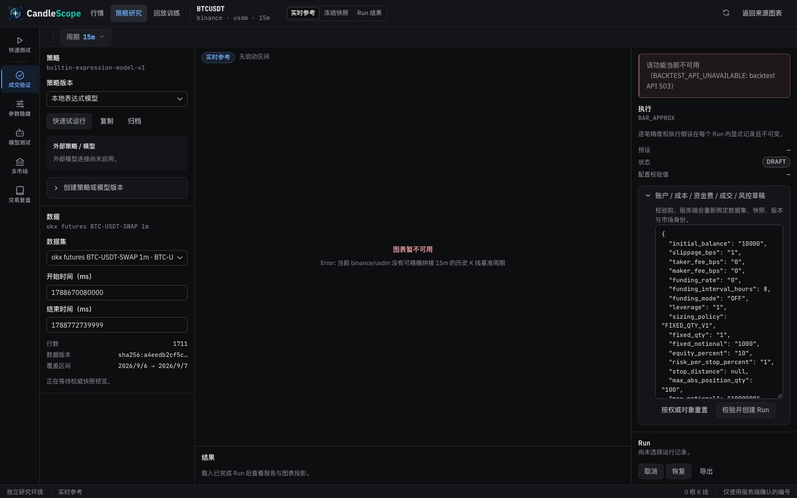
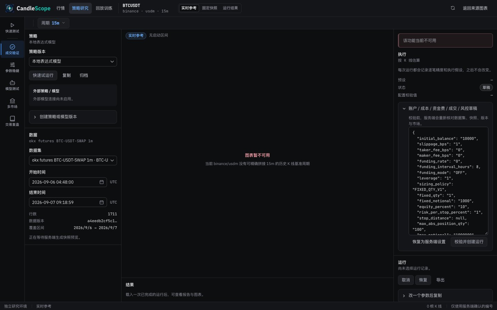
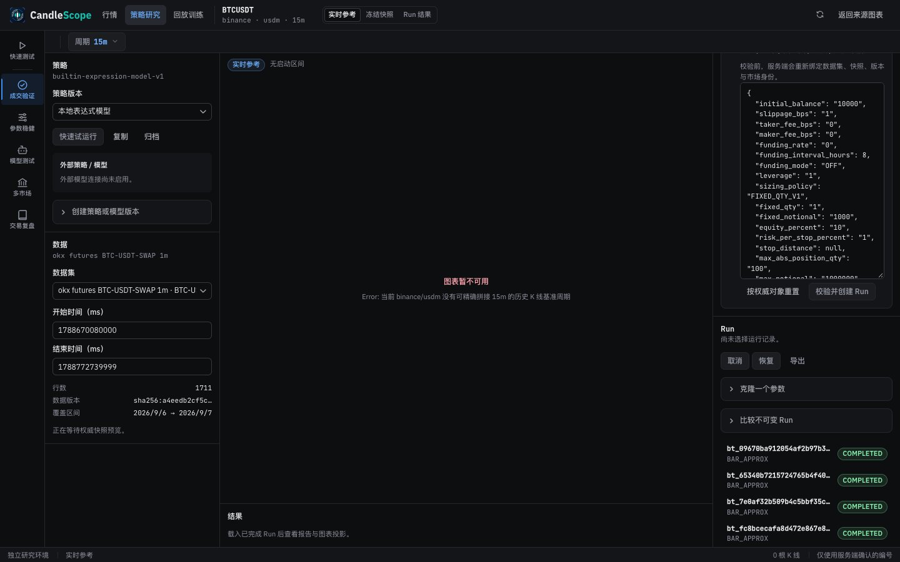
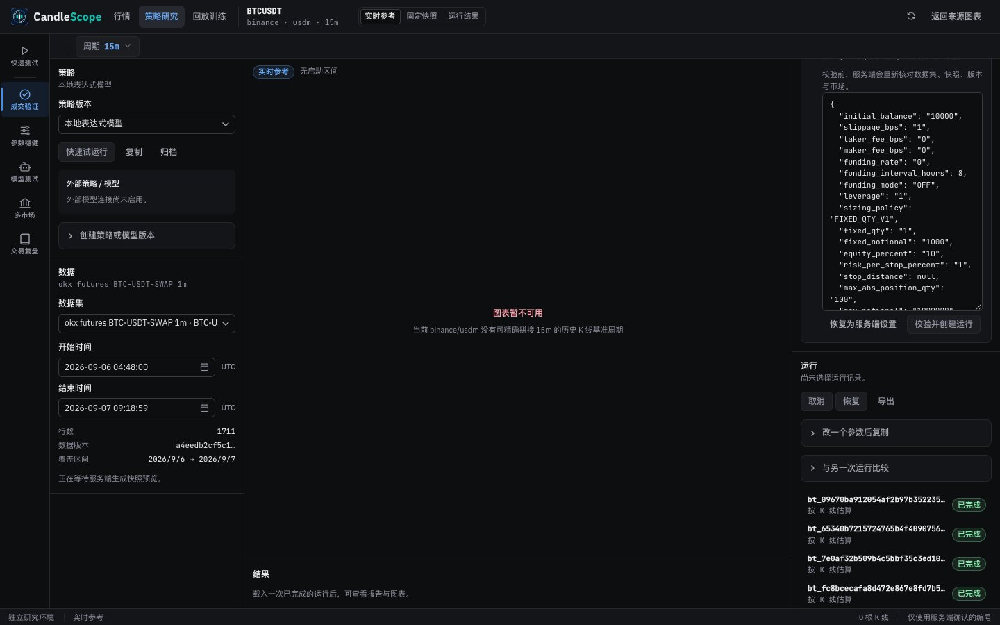
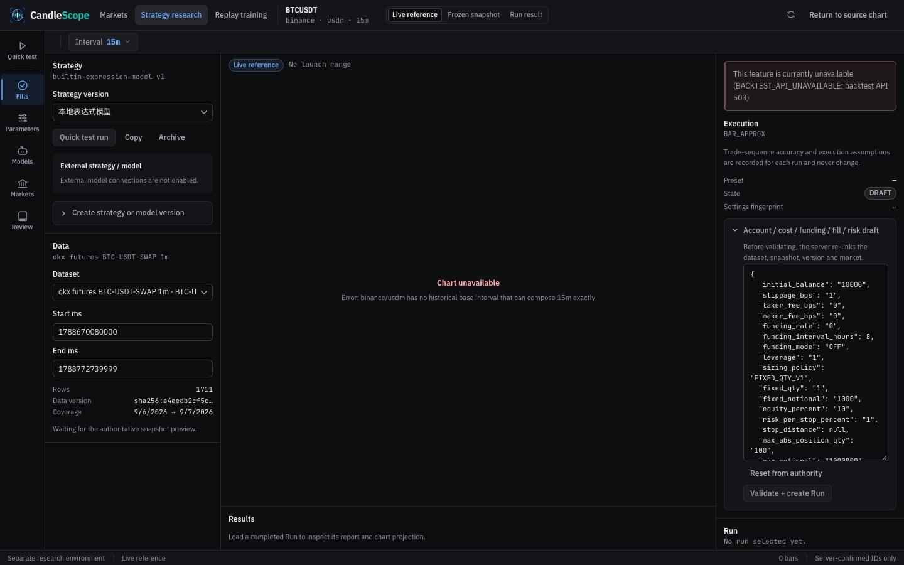
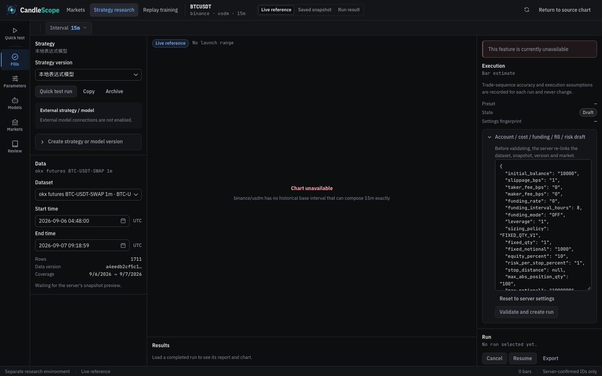
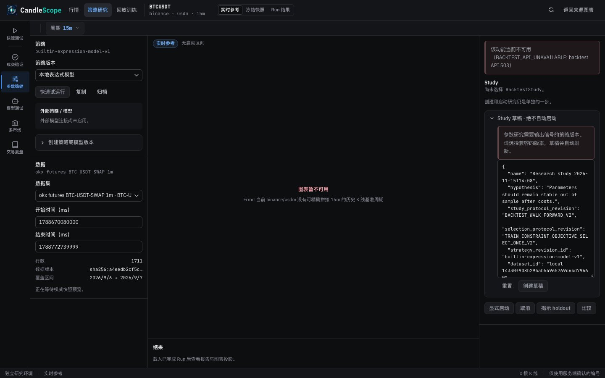
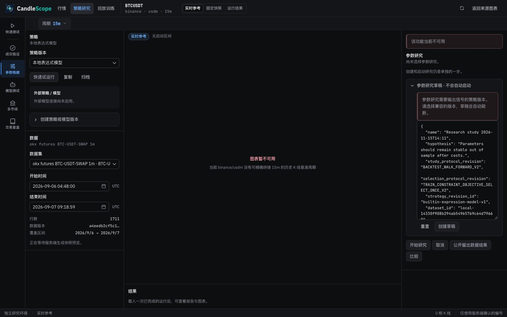
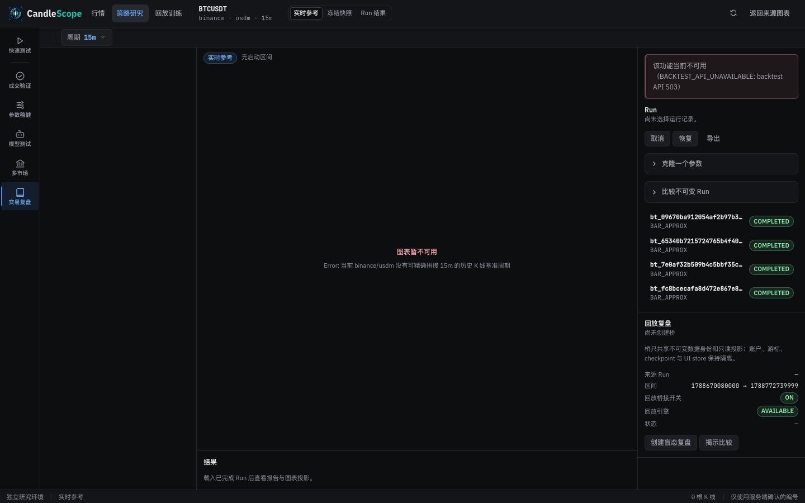
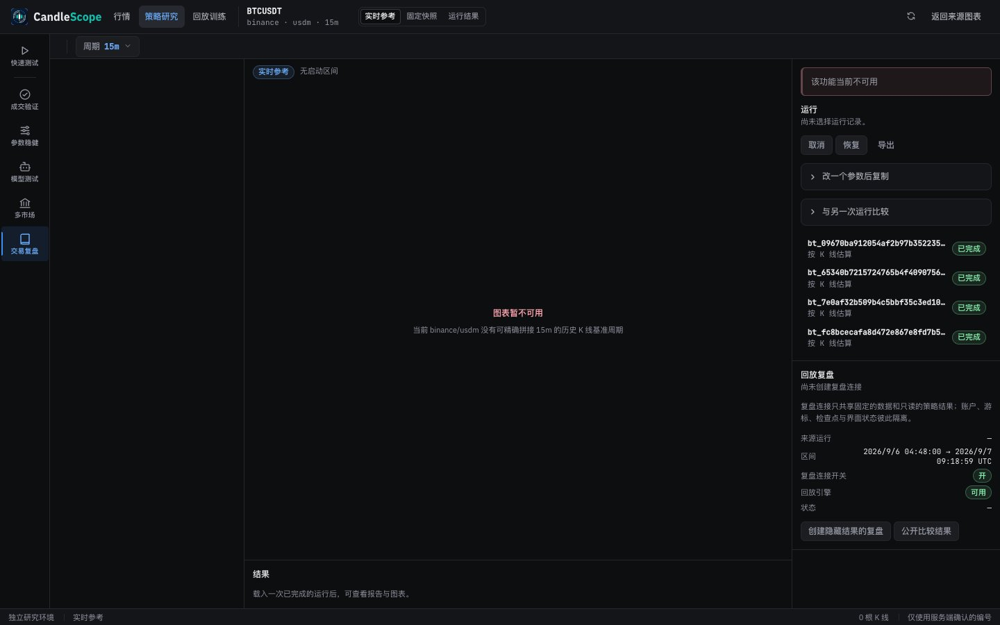

# Frontend design refactor: Phase 6c2 QA (strategy research: codes, times and remaining copy)

- Date: 2026-11-16
- Branch: `design/phase-6c2-research-panels`, based on `design/phase-6c-research-copy` (PR #438)
- Plan: [`frontend/FRONTEND_DESIGN_REFACTOR_PLAN.md`](../frontend/FRONTEND_DESIGN_REFACTOR_PLAN.md), Phase 6. Guidelines: [`frontend/COPY_GUIDELINES.md`](../frontend/COPY_GUIDELINES.md)
- **Intended visible change:** the strategy page names run, study and review states and accuracy tiers instead of showing their codes, takes and shows times as dates instead of epoch milliseconds, shows error summaries without codes, and its Chinese and English copy loses the English jargon and engineering terms the check did not list ("Run", "Study", "Host", "holdout", "trace", 权威, 冻结, 桥…). Layout is unchanged apart from the two date fields.

## What changed

| Area | Change |
|---|---|
| Codes from data | New `researchLabels.ts`: `researchStateLabel` (21 run, study, review and order states), `researchFidelityLabel` (8 accuracy codes, 7 names: 按 K 线估算 / Bar estimate, 逐笔成交, 聚合逐笔成交, 成交加盘口, 完整盘口深度, 采样盘口, 订单级排队), `chartContextStatusLabel` (why the chart's data can't be used). Used by the run list and active run, execution panel, study list, review panel, strategy run history, the native run history, comparison and replay, the tester's trade explanation and the result replay's orders. A code without a name is shown as sent. |
| Review panel | The switch and engine read 开 / 可用 (were `ON` / `AVAILABLE`); the range reads "2026/9/6 04:48:00 → 2026/9/7 09:18:59 UTC" (was `1788670080000 → 1788772739999`) and wraps instead of being cut off. |
| Times | The data panel's start and end are `DateTimeInput` fields in UTC with seconds (were number fields labelled "开始时间（ms）"); an end at .999 keeps its last millisecond. The native comparison shows start and end as UTC dates (labels lose "UTC ms"). |
| Other values | The data version and snapshot fingerprint drop their `sha256:` prefix (`a4eedb2cf5c1…`); the strategy panel's title is the version's name, not its id (`builtin-expression-model-v1` → 本地表达式模型); the draft's language reads Pine / Python; the default name of a new version is translated. |
| Errors | `describeError` drops a leading `CODE:` from a message and adds no detail when it is only an HTTP status, so the backtest service's uncoded failure reads 该功能当前不可用 (was "该功能当前不可用（BACKTEST_API_UNAVAILABLE: backtest API 503）"). The chart's error loses its "Error:" prefix. |
| Unused messages | 305 messages nothing uses are deleted from all 30 catalogs (9,150 lines): the rest of the retired backtest workbench (`backtest.*`) and a few research placeholders. |
| New messages | 29 labels in all 30 catalogs; the start and end labels rewritten in all 30. |
| Chinese and English | 111 research messages reworded in zh-CN (and the Traditional catalogs where they have the message) and in English where it used the jargon: 运行 for Run, 参数研究 for Study, CandleScope or 撮合 for Host/宿主, 服务端 for 权威, 固定 for 冻结, 复盘连接 for 桥, 留出数据 for holdout, 记录 for trace, K 线 for BAR, 标准账户 / 历史永续账户 for the V1 / V2 account models, 模式 for profile. |
| Japanese | 94 messages of the strategy page that were still English (report, comparison, run history, strategy list, data preparation, tester results) are translated. Deleting the unused messages had lowered the share of translated Japanese below the test's 90 %. |
| Check | The internal-terms check now rejects Run, Study, trace, manifest, warm-up, provider, snapshot, tick and 权威 in Chinese, and "holdout" in both languages; none is left, so the baseline is unchanged (42 zh-CN, 60 en, all 6d). |
| Guidelines | Glossary rows for the terms above; times a person enters use `DateTimeInput`. |

## Screens

The base build (Phase 6c, `bfd97bd9c`) and this branch, 1440 × 900, `zh-CN` unless marked, on the strategy page. Writes were refused in the capture and none was attempted; the backtest service answered 503 in both, so the error summary shows in both.

| | Before | After |
|---|---|---|
| 成交验证 (precise mode) |  |  |
| Run list (scrolled) |  |  |
| Precise mode, English |  |  |
| 参数稳健 (study panel) |  |  |
| 交易复盘 (review panel) |  |  |

## Verification

**In the running app** (headless), the capture scripts read the text back. Precise mode, before → after: "开始时间（ms）1788670080000" → "开始时间 2026-09-06 04:48:00 UTC"; "sha256:a4eedb2cf5c…" → "a4eedb2cf5c1…"; "正在等待权威快照预览" → "正在等待服务端生成快照预览"; execution "BAR_APPROX … 状态 DRAFT" → "按 K 线估算 … 状态 草稿"; "按权威对象重置 / 校验并创建 Run" → "恢复为服务端设置 / 校验并创建运行"; each run "BAR_APPROX COMPLETED" → "按 K 线估算 已完成". English: "Start ms … State DRAFT … Load a completed Run to inspect its report and chart projection" → "Start time … State Draft … Load a completed run to see its report and chart". Study panel: "Study 草稿 · 绝不自动启动 … 显式启动 … 揭示 holdout" → "参数研究草稿 · 不会自动启动 … 开始研究 … 公开留出数据结果". Review panel: "来源 Run … 1788670080000 → 1788772739999 … 回放桥接开关 ON … 回放引擎 AVAILABLE" → "来源运行 … 2026/9/6 04:48:00 → 2026/9/7 09:18:59 UTC … 复盘连接开关 开 … 回放引擎 可用".

**Tests:** new `researchLabels.test.ts` (names, aliases, unknown codes, UTC ranges, fingerprints) and a `describeError` case for code-prefixed messages and bare HTTP statuses; the internal-terms test covers the new terms. Assertions that expected codes or the old wording now expect the name and reject the code (`FILLED`, `PAUSED`, `BOOK_SAMPLED`, "Host").

**Full check:** `npm run check` passes: 5,174 frontend tests, 137 desktop tests, lint (one existing warning), the i18n (with the internal-terms rule), style, CSS layer and architecture checks, both typechecks and the build.

## Known gaps

- **Advanced JSON editors:** the run configuration and study draft are raw JSON with field names and English default values (the study's name and hypothesis). They are advanced-only editors; turning them into forms is not copy work.
- **Run and study ids** (`bt_…`) still title the run list; there is no name or creation time in the record to show instead.
- **Other languages:** the reworded messages changed in Chinese and English only (and Japanese for the strategy page's untranslated copy). Where another language kept "Run", "Study" or "Host" as a loanword, it keeps it; the check covers zh-CN and en.
- **Signal kinds** in the result replay's signal log are shown as sent; they are strategy-defined.
- **Host and 宿主 elsewhere** (18 plugin messages), and 投影 / 不可变 / 显式 in replay and settings, are not in the check yet; plugins are 6d.
- **Desktop app:** not tested.
