# Frontend design refactor: Phase 6d QA (data management, support, extensions; the check becomes a rule)

- Date: 2026-11-16
- Branch: `design/phase-6d-data-plugins`, based on `design/phase-6c2-research-panels` (PR #439)
- Plan: [`frontend/FRONTEND_DESIGN_REFACTOR_PLAN.md`](../frontend/FRONTEND_DESIGN_REFACTOR_PLAN.md), Phase 6. Guidelines: [`frontend/COPY_GUIDELINES.md`](../frontend/COPY_GUIDELINES.md)
- **Intended visible change:** Settings → 数据管理 (storage and maintenance), 关于与支持, the data workbench, data repair, maintenance errors and the plugin live control no longer say backend, GC, VACUUM, SQLite, WAL, DB, receipt, epoch, bundle or revision; cache entries read as markets instead of keys; the extension manager speaks all 30 languages (it showed only Chinese or English). Layout is unchanged.

The row was split when it started (my call, as for replay and research): besides the 42 zh-CN / 60 en messages on the list, the plugin center and Settings show about 110 more messages with English words outside the term list ("Host" / 宿主, Live and Paper, timezone names, chart-type footers). **6d** empties the list and makes the check a plain rule; **6d2** takes the plugin center's and live control's remaining copy, Settings appearance, network and AI MCP, and extends the check with the Chinese terms still in use (宿主, 载荷, 投影, 不可变, 显式, 前端).

## What changed

| Area | Change |
|---|---|
| Check | Every message is off the internal-terms list, so `scripts/i18n-internal-terms-baseline.json` and `--write-internal-terms-baseline` are gone: any `zh-CN` or `en` message that uses a listed term now fails `check:i18n`. The guidelines say so; names that must appear as they are go in through placeholders. |
| Storage and maintenance | 后端内存 → 本地服务内存, 数据库 GC → 数据库清理, VACUUM → 压缩数据库, SQLite (DB + WAL) → 本地数据库 (数据库文件, 日志文件), "Checkpoint 已执行" → 日志已写回数据库, 前端缓存 → 浏览器缓存; the Chinese units lose "series", "entry", "miss", "bars" and "Cache" (序列, 条目, 未命中, K 线, 缓存). The 25 short labels and errors among them are rewritten in every language that has them (most showed VACUUM, WAL, SQLite or "Backend" too). |
| Cache lists | Entries read "币安 · 现货 · BTCUSDT · 1h" instead of keys like `2␀binance-spot-BTCUSDT-1m` or `chart:1:binance-spot-BTCUSDT-1h` (new `cacheEntryLabel`; the key stays in the tooltip). |
| About and support | 后端版本 → 本地服务版本; the diagnostics notes speak of the local service and the app; the credits pass the library names in as a placeholder, formatted as a list in each language ("基于 React、Lightweight Charts、FastAPI 和 SQLite 构建。"). |
| Data workbench | The "LIVE" badge reads 实时 / Live in every language; "SQLite 快照", "正在向后端读取快照" and "DB + WAL" → 数据库快照, 正在从本地服务读取快照, 数据库与日志文件; "移除 GC 保护" → 移除清理保护; the gap log without "ledger"; download jobs and targets name their state (was "任务 RUNNING"). |
| Repair | "revision" → change (自动修补之后的历史变更, 变更点, 变更范围). |
| Plugin live control | Receipts become one-time confirmations (单次确认), "策略 epoch · 控制 generation" → 权限策略版本 · 控制代次, "失败关闭" → 已停止所有操作, 影子引用 → 预备引用; plugin bundle → package, revision → version, runtime → 运行环境. |
| Extension manager | Its 49 messages moved from Chinese/English pairs in the component (`useExtensionText`, now removed) into the catalogs as `extensions.*`, in all 30 languages; the realms in an approval read by name (was `frontend, backend`); "后端" → 本地服务, "宿主" → CandleScope. The labels the desktop qualification clicks keep their Chinese and English wording. |
| Unused messages | 33 deleted from all 30 catalogs: old About rows, plugin center placeholders and workbench columns. |
| Shared names | The run-state names from 6c2 are now `common.state.*` (used by research and the data workbench). |
| Catalogs | 51 new messages in all 30 catalogs (extension manager, workbench badge and file hint); 80 messages reworded in Chinese and English; 25 short labels in every language. |
| Guidelines | Glossary rows for frontend, receipt, policy epoch, WAL / checkpoint and the Chinese cache units; the check section describes the plain rule. |

## Screens

The base build (Phase 6c2, `2ab2f39f3`) and this branch, 1440 × 900, `zh-CN` unless marked. Writes were refused in the capture and none was attempted. The plugin live control needs a desktop management connection and is covered by its component tests, not captured.

| | Before | After |
|---|---|---|
| 存储与维护 (browser cache, local service memory) | 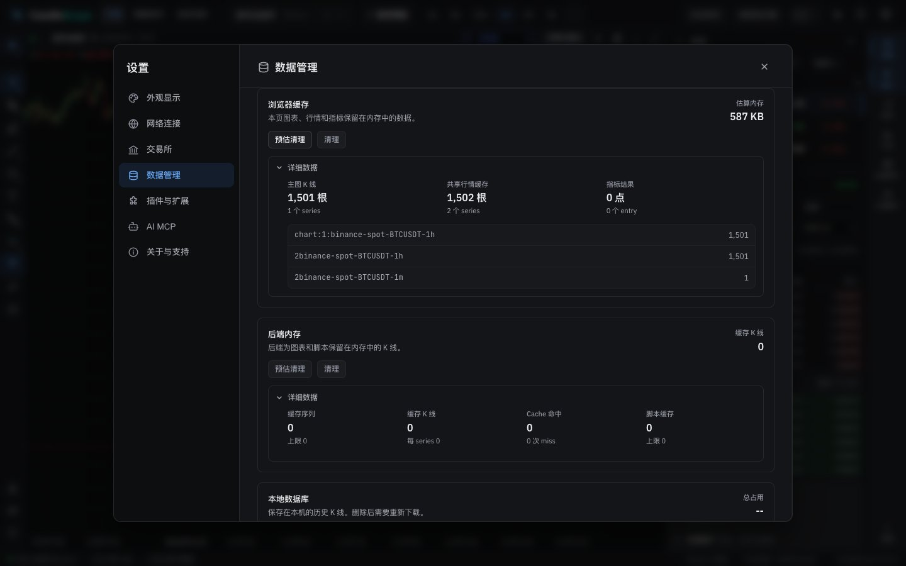 | 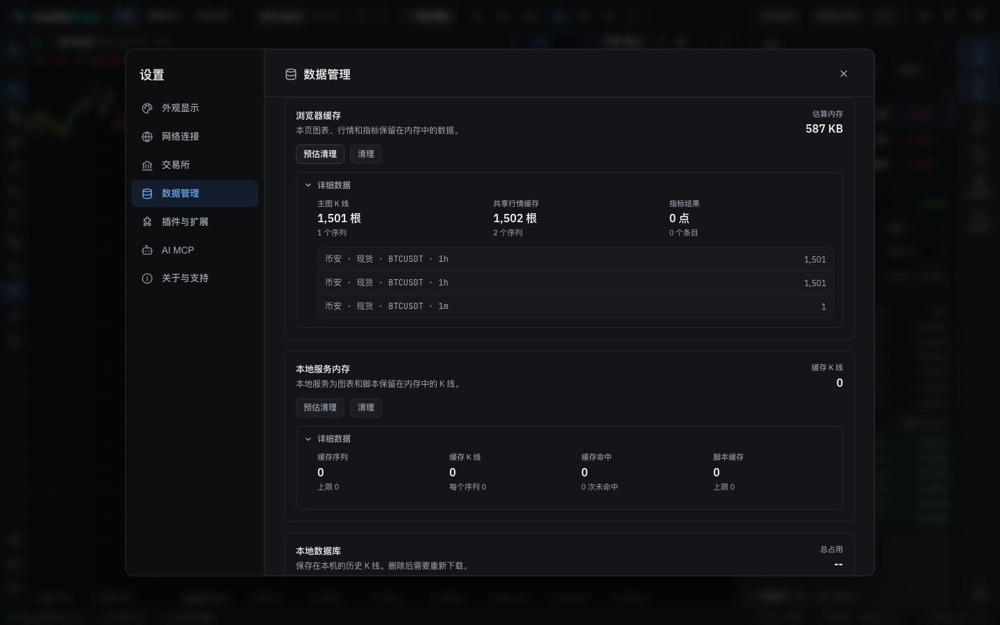 |
| 存储与维护 (local database) | 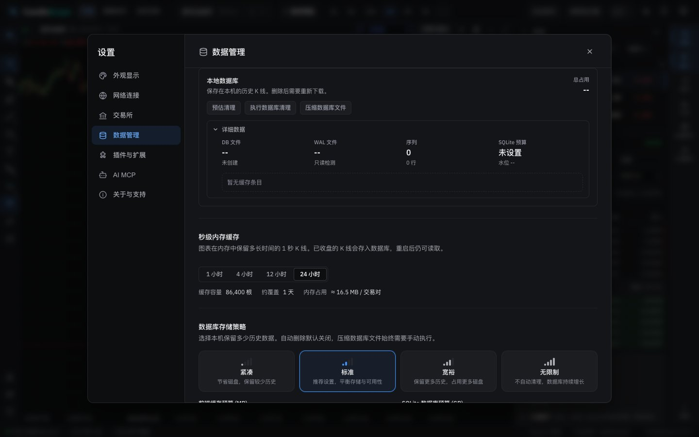 | 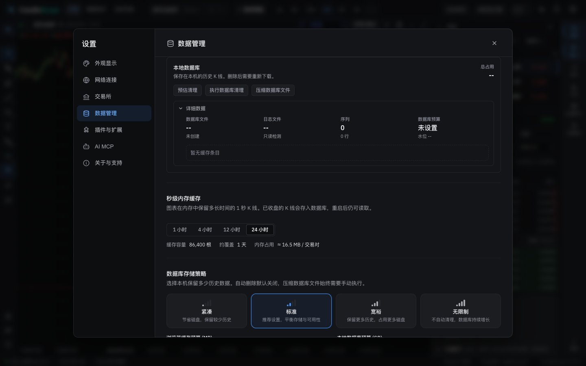 |
| Storage, English | 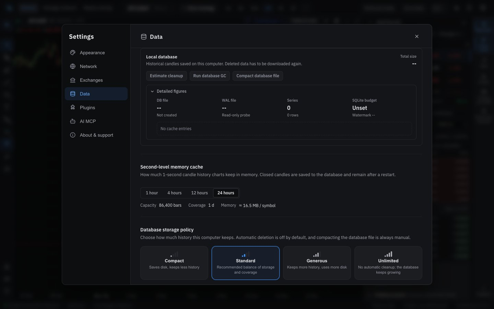 | 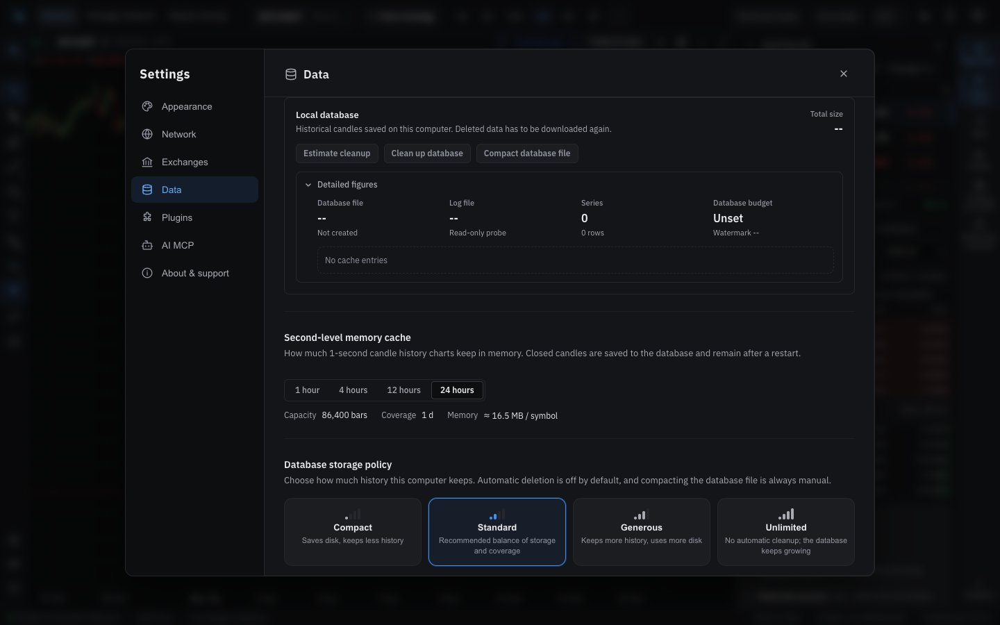 |
| 关于与支持 | 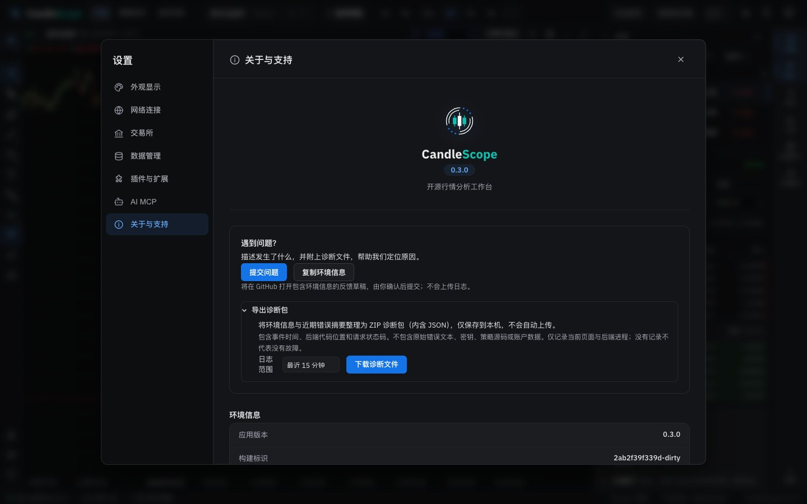 | 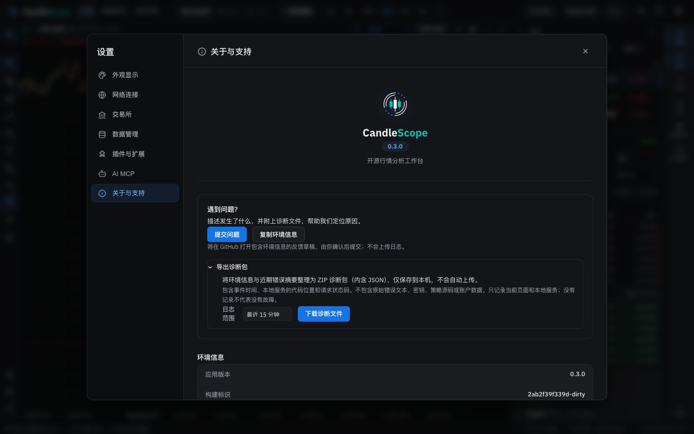 |
| Trusted extensions, German | 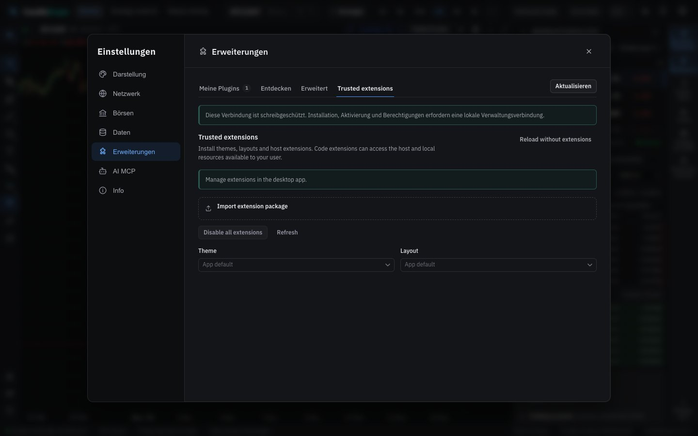 | 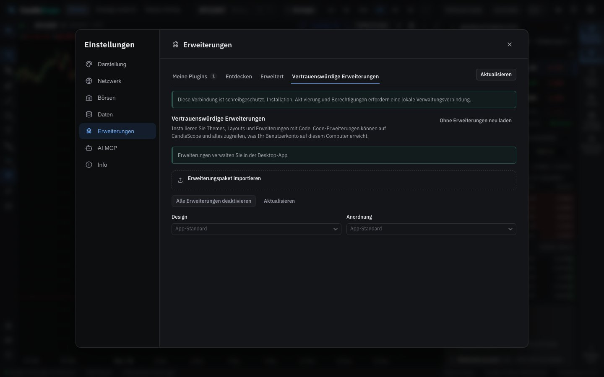 |
| 数据工作台 | 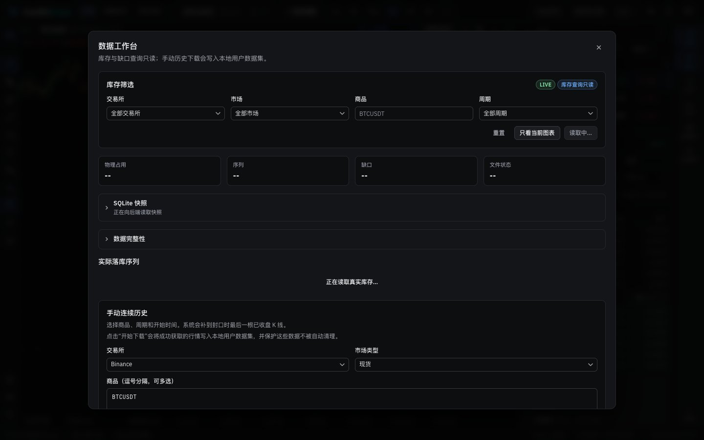 | 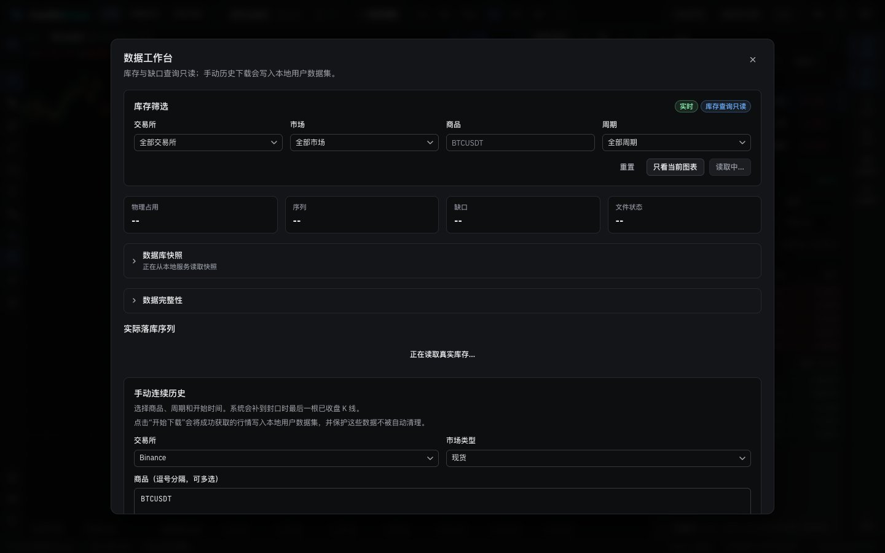 |

## Verification

**In the running app** (headless), the capture scripts read the text back. Storage, before → after: "1 个 series … 0 个 entry … chart:1:binance-spot-BTCUSDT-1h … 2binance-spot-BTCUSDT-1m" → "1 个序列 … 0 个条目 … 币安 · 现货 · BTCUSDT · 1h … 币安 · 现货 · BTCUSDT · 1m"; "后端内存 · 后端为图表和脚本保留…" → "本地服务内存 · 本地服务为图表和脚本保留…"; "每 series 0 · Cache 命中 · 0 次 miss" → "每个序列 0 · 缓存命中 · 0 次未命中"; "DB 文件 · WAL 文件 · SQLite 预算" → "数据库文件 · 日志文件 · 数据库预算". English: "Backend memory · Candles the backend keeps…" → "Local service memory · Candles the local service keeps…". German extensions: "Trusted extensions · Install themes, layouts and host extensions… · Import extension package" → "Vertrauenswürdige Erweiterungen · Installieren Sie Themes, Layouts und Erweiterungen mit Code… · Erweiterungspaket importieren". Workbench: "LIVE … SQLite 快照 · 正在向后端读取快照" → "实时 … 数据库快照 · 正在从本地服务读取快照".

**Tests:** new `cacheEntryLabel.test.ts`; the recovery-notice test reads the catalogs and renders the manager in German; the internal-terms test checks the plain rule. Assertions on the old wording now expect the new one (proxy traffic, live control banners and policy version).

**Full check:** `npm run check` passes: 5,177 frontend tests, 137 desktop tests, lint (one existing warning), the i18n check (now reporting no internal terms), style, CSS layer and architecture checks, both typechecks and the build.

## Known gaps

- **6d2:** the plugin center and live control still say "Host" / 宿主, Live, Paper and LIVE AUTHORITY · ARMED (mode codes); Settings appearance has English timezone and chart-type names; network and AI MCP copy has English words. The check does not list 宿主, 载荷, 投影, 不可变, 显式 or 前端 yet.
- **Long sentences in other languages:** the storage hints, the support notes and the live-control sentences changed in Chinese and English; other languages keep their wording (several still say "backend", "SQLite" or "receipt" in their own words). The check covers zh-CN and en.
- **Cache rows:** a chart's own copy and the shared cache of the same series now read the same; the key is in the tooltip.
- **Data workbench inventory** did not finish loading within the capture in either build, so the loaded inventory (sizes, series, gaps) was not seen in this pass; its wording changed only in the labels above.
- **Desktop app:** not tested; the desktop qualification's labels were kept.
