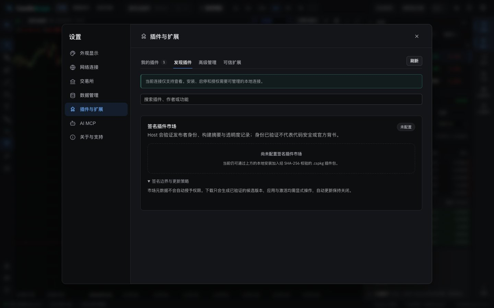
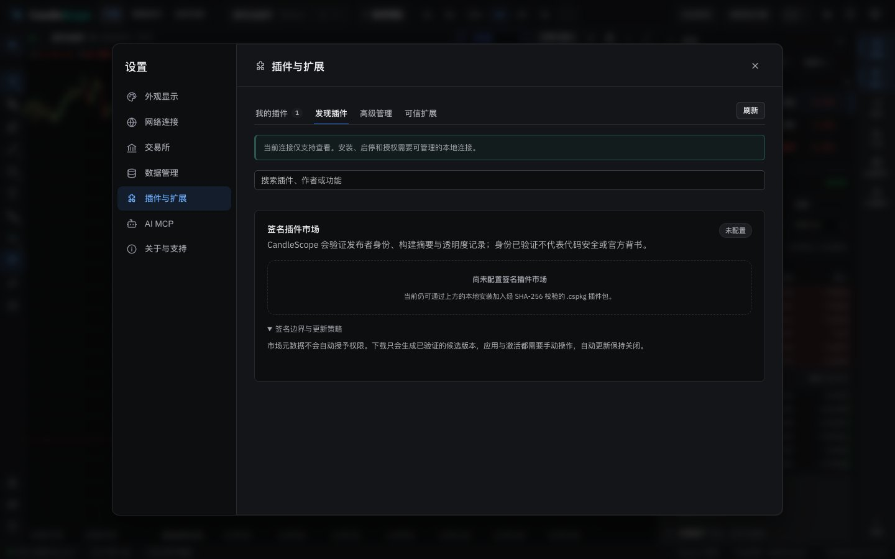
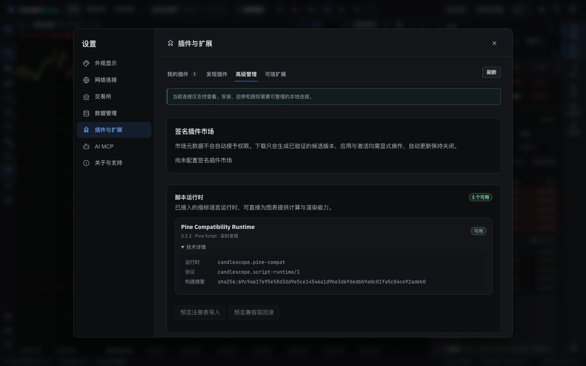
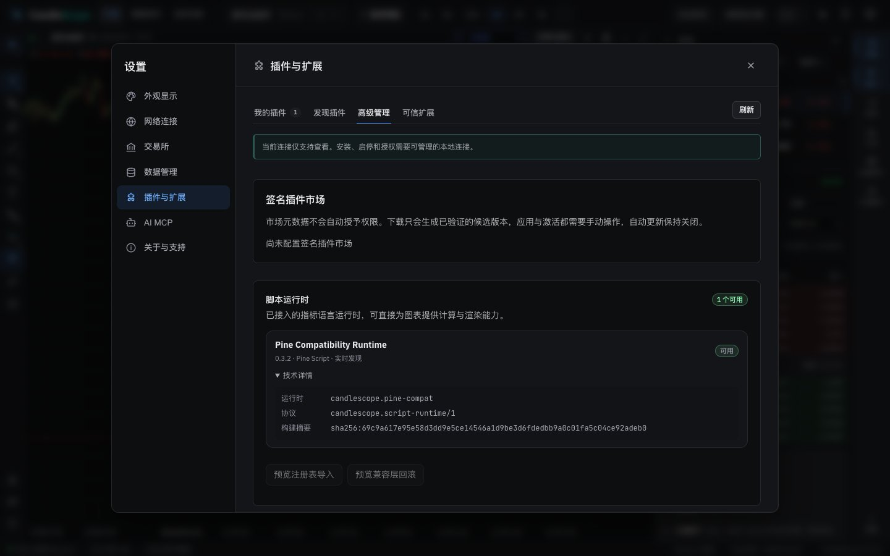
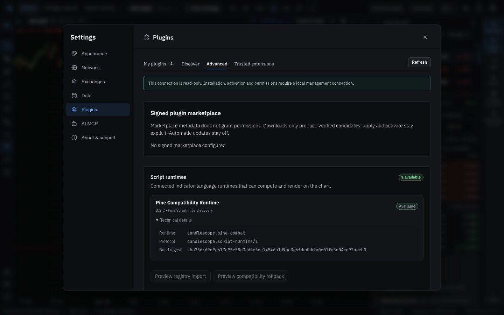
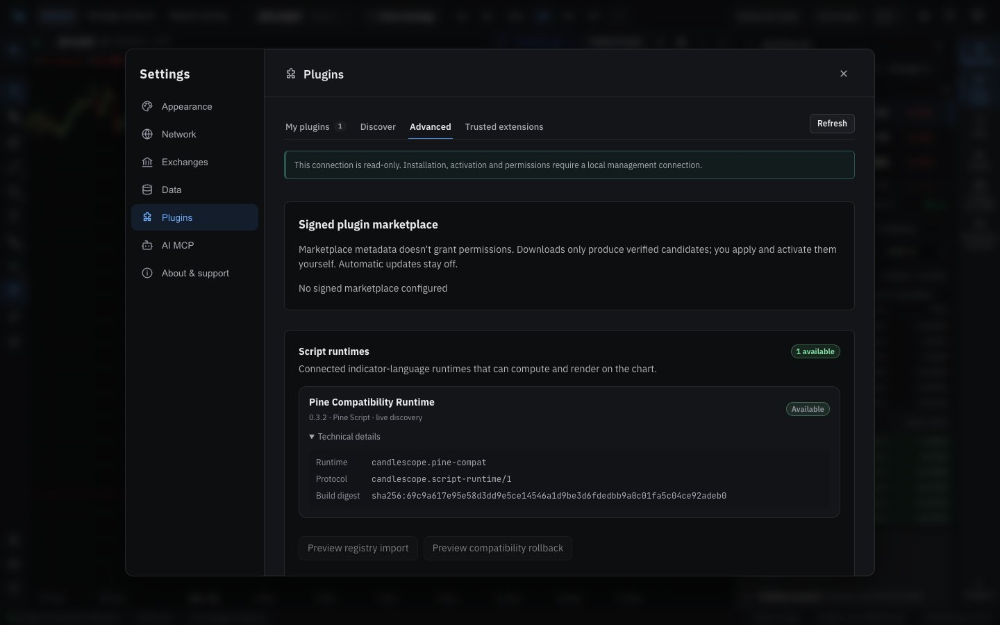

# Frontend design refactor: Phase 6d2 QA (plugin center, live control, Settings copy; the check's last terms)

- Date: 2026-11-16
- Branch: `design/phase-6d2-plugin-copy`, based on `design/phase-6d-data-plugins` (PR #440)
- Plan: [`frontend/FRONTEND_DESIGN_REFACTOR_PLAN.md`](../frontend/FRONTEND_DESIGN_REFACTOR_PLAN.md), Phase 6. Guidelines: [`frontend/COPY_GUIDELINES.md`](../frontend/COPY_GUIDELINES.md)
- **Intended visible change:** the plugin center and the live control say CandleScope instead of "Host" / 宿主, 实盘 and 模拟 instead of Live and Paper, and name the codes they showed (live mode `ARMED`, release channels, permission decisions, runtime verification, sandbox status, trust modes); Settings appearance drops the English in parentheses; replay and indicator messages lose 投影, 不可变, 显式 and 前端. Layout is unchanged.

With this row Phase 6 is complete: the internal-terms check also rejects "Host", and in Chinese 宿主, 回执, 载荷, 投影, 不可变, 显式, 前端, Live and Paper, and none of them is left.

## What changed

| Area | Change |
|---|---|
| Codes from data | New `pluginLabels.ts`: live-control modes (已启用 / On, 已停用 / Off, 已熔断 / Emergency stop, 不可用), release channels (内部 → 本机试用 → 预览 → 稳定), permission kinds and decisions, runtime verification, sandbox status and trust modes (本机信任, 插件市场 · 沙箱运行…). Used by the live-control banner, panel and toolbar (were "LIVE AUTHORITY · ARMED", "LIVE ARMED"), the permission list, the runtime registry, the trust review and the installed plugin's trust summary. An unknown code is shown as sent. |
| Placeholders | The release channel message takes the channel order as `{order}` (12 catalogs listed `internal → opted-in local → preview → stable` in English); the proxy help passes the default exit group `shared` as `{group}` (a value a person types). Both in all 30 catalogs. |
| Plugin center | "Host" / 宿主 → CandleScope (hash checks, marketplace verification, compatibility, health check, runtimes managed by CandleScope); 显式 → 手动; 产物 / 不可变工件 → 缓存的文件 / 已保存的安装文件; 冻结 → 固定; generation → 运行代次; diff → 差异; trusted-local → 本机信任; "Sandbox bridge" → 沙箱连接; "kind/id" → 类型/标识. |
| Live control | LIVE / Live → 实盘 (实盘权限 · 已启用, 启用实盘控制, 执行全局实盘熔断); Paper → 模拟 (恢复模拟订单, 仅限模拟交易); the internal project code "WP-D" is gone from the review hint. |
| Settings | Appearance: 点数图, 新价线 and the timezone names without English in parentheses; the point-and-figure and Kagi notes without "V1", "High/Low", "Percentage", "One Step Back", "Yang/Yin", "Close"; "UTC（世界协调时间）" with full-width parentheses. Exchanges: 能力声明已校验. Support: GitHub issue in words. |
| Replay and indicators | 投影 → 视图 or the value (预估强平价), 不可变 → 永久 / 固定, 显式 → 允许清单 / 分别, 前端 → 界面 (22 messages, Chinese and English). |
| Catalogs | 27 new messages in all 30 catalogs; 80 messages reworded in Chinese (and the Traditional catalogs where they have them) and English. |
| Check and guidelines | New terms in `scripts/i18nInternalTerms.mts` with tests; glossary rows for Host, Live / Paper, projection, immutable, explicit, generation and diff. |

What is left on these surfaces is names and standards: timezone abbreviations (EST, GMT), IP, the `.cspkg` file type, `spot` / `futures` and `BINANCE:ETHUSDT` that a person types into a field, the ta4j library.

## Screens

The base build (Phase 6d, `04eb2bb75`) and this branch, 1440 × 900, `zh-CN` unless marked, in Settings → 插件与扩展 (browser mode, read-only connection). Writes were refused in the capture and none was attempted. The live control needs a desktop management connection and is covered by its component tests, not captured; appearance and network changes are in select options and hints, read back as text.

| | Before | After |
|---|---|---|
| 发现插件 |  |  |
| 高级管理 |  |  |
| Advanced, English |  |  |

## Verification

**In the running app** (headless), the capture scripts read the text back. Plugin center, before → after: "Host 会验证发布者身份…" → "CandleScope 会验证发布者身份…"; "应用与激活均需显式操作" → "应用与激活都需要手动操作"; English "apply and activate stay explicit" → "you apply and activate them yourself". Appearance timezone options: "纽约 (New York - EST/EDT) · 伦敦 (London - GMT/BST) · 新加坡 (Singapore)" → "纽约（EST/EDT） · 伦敦（GMT/BST） · 新加坡".

**Tests:** new `pluginLabels.test.ts` (modes, channel order, decisions, verification, sandbox, trust modes, unknown codes); the internal-terms test covers "Host" (not "localhost"), 宿主, Paper and 不可变; the runtime-registry assertion expects "CandleScope 管理的运行环境".

**Full check:** `npm run check` passes: 5,178 frontend tests, 137 desktop tests, lint (one existing warning), the i18n check (no internal terms), style, CSS layer and architecture checks, both typechecks and the build.

## Known gaps

- **Other languages:** the reworded messages changed in Chinese and English; other languages keep their wording, and several still say "Host", "Live" or "Paper" in their own words. The check covers zh-CN and en.
- **Live control** was not seen in the app (needs a desktop management connection); its banner, panel and toolbar are checked by component tests.
- **Technical details** keep their identifiers: runtime ids, protocols, build digests, OS / architecture, migration policy codes and the sandbox profile line.
- **Desktop app:** not tested.
