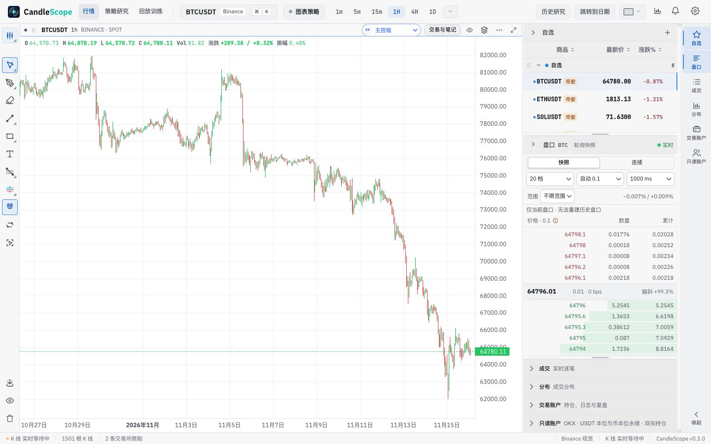
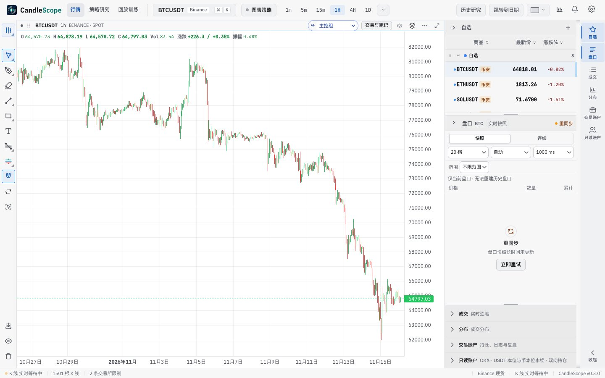
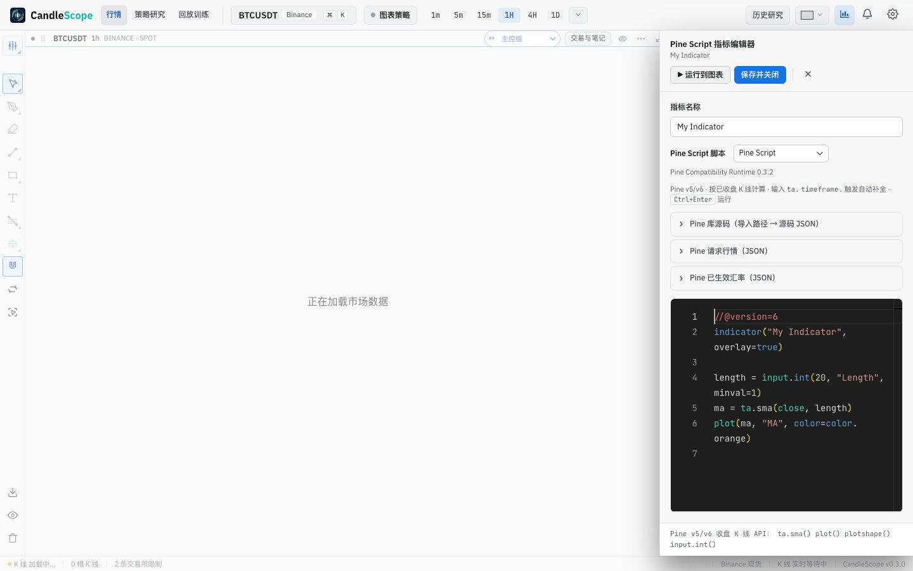
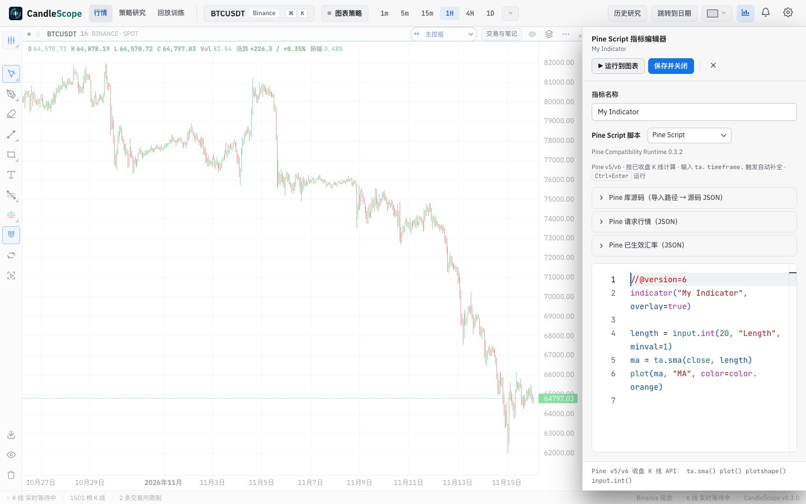

# Frontend design refactor: Phase 7a QA (contrast and the light theme)

- Date: 2026-11-16
- Branch: `design/phase-7a-contrast`, based on `design/phase-6d2-plugin-copy` (PR #441)
- Plan: [`frontend/FRONTEND_DESIGN_REFACTOR_PLAN.md`](../frontend/FRONTEND_DESIGN_REFACTOR_PLAN.md), Phase 7
- **Intended visible change:** in the light theme, the chart legend's prices, the "Scope" half of the logo and the chart link-group label read at WCAG AA; the code editors follow the app theme (they stayed dark in the light theme); in the dark theme, the code editor's line numbers are readable. Nothing else changes.

Phase 7 was split when it started (my call): **7a** contrast and the light theme, **7b** keyboard and reduced motion, **7c** widths and long languages.

## What changed

| Area | Change |
|---|---|
| Contrast audit | New `scripts/design-contrast.mjs` (`npm run design:contrast`) opens every design state (the 22 states of `design-snapshots.mjs`) in both themes and measures each piece of visible text against the background it is drawn on: its colour and opacity composited over its own and its ancestors' backgrounds, against WCAG AA (4.5:1, 3:1 for large text). Disabled controls, canvases and SVG are skipped, input placeholders are included. Failures are grouped by colour pair and component; the report goes to `output/design-contrast/<label>/report.json`. Both design tools now refuse every write to the local service, so opening a panel cannot start a run. |
| Chart legend | The chart wrote its raw candle colours into the legend (`--text-up` / `--text-down`), so prices on a white chart were 2.3:1 (green) and 3.8:1 (red). New `legibleOn` keeps a candle colour that already reads on the chart's own background and otherwise blends it toward black or white just far enough to reach 4.5:1 — for the light theme, custom backgrounds and custom candle colours alike (`#22c55e` → `#16803d` on white). |
| Logo | "Scope" was a hard-coded teal (2.2:1 on the light header); it is now a token, `--brand-scope`, darker in the light theme. |
| Link groups | A chart's link-group label used the group's raw colour (3.7:1 in light); groups A–D now use the readable text colours, and in the light theme a group's own colour is mixed toward the text colour wherever it is text. |
| Code editors | A light script-editor theme (light surfaces and syntax colours that keep AA on white) and one hook, `useScriptEditorTheme`, that both the indicator editor and the strategy editor follow; the indicator editor was dark in the light theme. The dark theme's line numbers were 1.3:1 and now read at about 5:1. |
| Ratchet | The limits on hard-coded colours in CSS drop from 30 / 99 to the real 16 hex / 49 rgb() (two hex colours left this change). |

## Results

| | Dark | Light |
|---|---|---|
| Before (`6d2`) | 8 text elements below AA in 1 state (the strategy editor's line numbers) | 100 in 13 states (legend prices, logo, link group) |
| After | 0 in all 22 states | 0 in all 22 states |

## Screens

The base build (Phase 6d2, `50f8b23cb`) and this branch, 1440 × 900, `zh-CN`, light theme. Writes were refused in the capture.

| | Before | After |
|---|---|---|
| Market page (legend, logo, link group) |  |  |
| Indicator editor |  |  |

**Light-theme pass:** every design state in the light theme on this branch, reviewed as contact sheets: [1](assets/frontend-design-phase-7a/light-states-1.jpg), [2](assets/frontend-design-phase-7a/light-states-2.jpg), [3](assets/frontend-design-phase-7a/light-states-3.jpg), [4](assets/frontend-design-phase-7a/light-states-4.jpg). No surface keeps dark leftovers or unreadable areas beyond the contrast fixes above; symbol search shows its "search failed" notice in the capture because the capture refuses writes and search posts its query.

## Verification

**In the running app** (headless): the capture scripts read the colours back. Legend prices on the light market page `rgb(34, 197, 94)` → `rgb(22, 128, 61)`; indicator editor background `rgb(30, 30, 30)` → `rgb(255, 255, 255)`.

**Tests:** new `legibleColor.test.ts` (kept when readable, darkened on white, lightened on dark custom backgrounds, unreadable inputs left alone) and `design-contrast.test.mjs` (parsing, compositing, WCAG thresholds, grouping); the chart palette test states the new rule; the token ratchet uses the real counts.

**Full check:** `npm run check` passes: 5,185 frontend tests, 137 desktop tests, lint (one existing warning), i18n, style, CSS layer and architecture checks, both typechecks and the build.

## Known gaps

- **Non-text contrast** (borders, focus rings, icons; WCAG 1.4.11, 3:1) is not measured by the audit; 7b covers focus rings.
- **States the design tools reach:** the audit covers the 22 named states' default views; menus, hovers and states behind fixtures (live control, trade explanation, liquidation timeline) are not audited.
- **Chart canvas text** (axes, price labels) is drawn by the chart library, outside the DOM; its colours come from the chart theme and were not measured.
- **Desktop app:** not tested.
