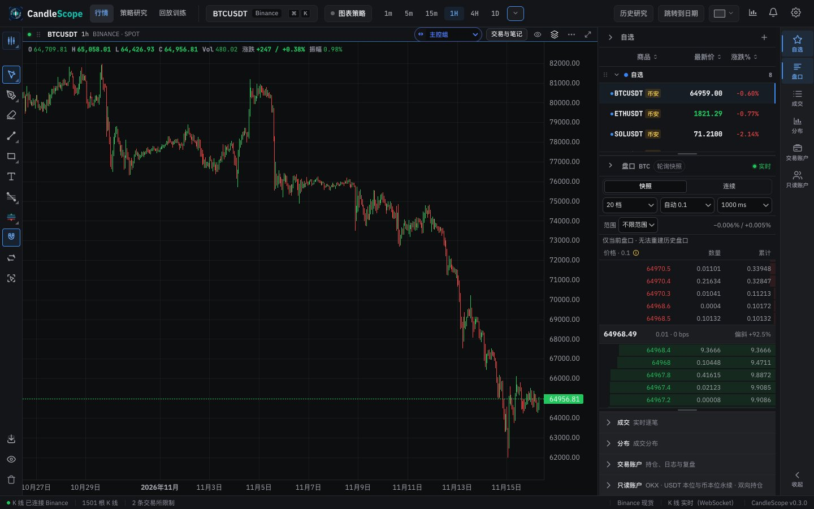
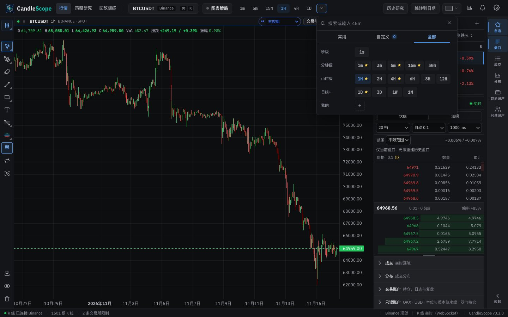
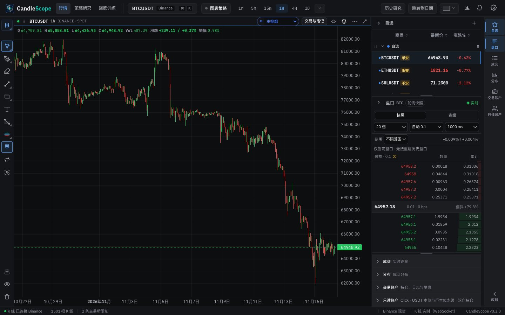
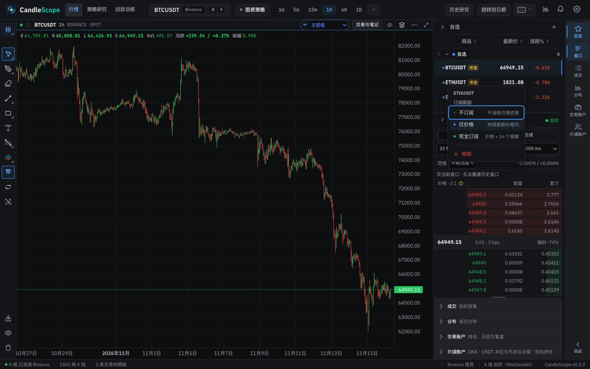
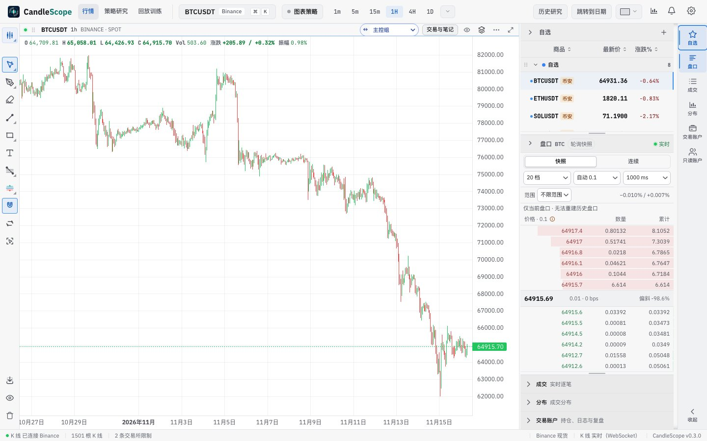
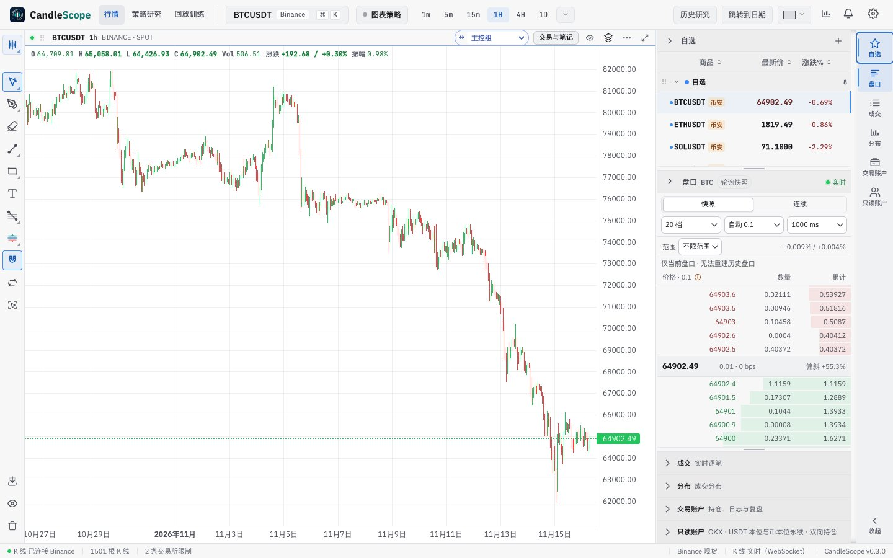

# Frontend design refactor: Phase 7b QA (keyboard and reduced motion)

- Date: 2026-11-16
- Branch: `design/phase-7b-keyboard`, based on `design/phase-7a-contrast` (PR #442)
- Plan: [`frontend/FRONTEND_DESIGN_REFACTOR_PLAN.md`](../frontend/FRONTEND_DESIGN_REFACTOR_PLAN.md), Phase 7
- **Intended visible change:** keyboard focus shows on every control it reaches; the interval picker opens where it can be seen; a "跳到图表" control appears on the first Tab of the market and replay pages; watchlist rows and the drawing tools' variants work from the keyboard; with reduced motion asked for, nothing slides, fades or pulses (spinners turn, slower). Mouse use looks and works as before.

## What changed

| Area | Change |
|---|---|
| Keyboard audit | New `scripts/design-keyboard.mjs` (`npm run design:keyboard`) opens every design state and uses it with the keyboard only. It presses Tab through the page and checks every stop is on screen, not covered, and changes how it looks with 3:1 against what is around it; presses Enter on every control that opens a popup and checks it opens, takes focus, moves with the arrow keys (menus and lists), closes on Escape and gives focus back; lists controls a pointer can use that Tab never reaches; and, with reduced motion asked for, lists what still moves. Writes are refused. Report: `output/design-keyboard/<label>/report.json`. |
| Interval picker | **It could not be seen.** Since Phase 4a the header clips what overflows it (so it can compact), and that clipped the picker below its own row: the button turned active, focus moved into an invisible panel. The panel is now fixed-positioned under its button, which the clip does not reach. |
| Popups on the stack | New kit hook `useAnchoredPopup`: a popup a page draws in place joins the overlay stack as a popover — Escape closes it before anything under it, focus moves in when it opens and back to what opened it when it closes, and it closes when focus moves on to the page (it no longer stays open over the control that has focus). Used by the interval picker, the layout picker, a chart's appearance and layout menu, the strategy switcher, the watchlist menus, the drawing tools' variant menus and the Fibonacci and position settings (these two had no Escape at all). Their own Escape and focus code is gone. |
| Menus | New kit helper `moveMenuFocus` (arrow keys, Home, End, skipping what cannot be chosen); the kit `Menu`, the strategy switcher, the watchlist menus and the drawing tools' variant menus use it. Tab closes a menu and returns to its trigger. Variant and tier items are `menuitemradio` with `aria-checked`. |
| Watchlist | Rows could only be clicked. Each row now has a button over its ticker and prices (Enter opens the market, as a click does), the delete button shows while the row has focus (it was focused while invisible), and Shift+F10 or the menu key opens the row's menu (the list's menu from its collapse button) under it. The collapsed view's icons are buttons. |
| Drawing tools | Variants (cursor, pen, line, shape, position) and the Fibonacci settings opened only by right-click or double-click; → (the menu opens to the right), Shift+F10 or the menu key open them too. The chart-type button is a menu button (`aria-haspopup`). |
| Focus return | Jump to date (a native dialog) and the replay launcher captured the element to return to in an effect that StrictMode runs twice, the second time from inside the dialog, so focus went to the page. The dialog captures it once; the launcher leaves it to its overlay layer. |
| Focus rings | A `--focus-ring` token: the accent blue in the dark theme, a darker blue in the light theme, where the accent blue was 2.6–2.9:1 on the rail and watchlist (focus needs 3:1, WCAG 1.4.11); the kit's and 45 feature focus styles use it. The app-wide focus ring also covers text fields and selects outside the kit: older rules removed the outline from 13 of them, and three (the interval search, the link-group selects) had nothing in its place, one only a faint halo. The symbol search field, which fills the search header, marks the header's edge and icon instead. |
| Skip to chart | First Tab stop on the market and replay pages, shown only while focused: moves focus past the header and the drawing toolbar (33 stops) to the active chart, where the arrow keys move between charts. |
| Reduced motion | One rule in `reset.css`: with `prefers-reduced-motion: reduce`, animations and transitions finish at once and scrolling jumps. Spinners keep turning, slower (they set `--motion-reduced-duration`). Replaces three partial rules (overlays, the replay pages, the chart controls). The right rail's scroll-into-view and the code editors' smooth scrolling and caret follow it from script. |
| Shortcuts | Settings → 关于 lists Shift+F10, → on a drawing tool, and the code editor's own Tab switch (Ctrl+M; Ctrl+Shift+M on macOS) — the editor keeps Tab for indenting. 4 messages in all 30 languages. |
| Contrast audit | `design-contrast.mjs` read only `rgb()` colours; `color-mix()` results come back as `color(srgb …)` and were skipped. It reads both now; the 7a result holds (0 text elements below AA in 22 states × 2 themes). |

## Results

`npm run design:keyboard` over the 22 design states, in both themes, on the base build (Phase 7a, `34808c10c`) and this branch. Under load two states did not reach their surface in the full run (the history study and the chart tester), so those two were run again on their own on each build and their rows replace the full run's.

| | Before (dark / light) | After (dark / light) |
|---|---|---|
| Tab stops walked | 1,270 | 1,359 (the watchlist rows and the skip control are new stops) |
| Stops with no focus indicator | 1 / 1 (the symbol search field) | 0 / 0 |
| Stops whose ring is under 3:1 | 0 / 57 (the accent blue on the light rail, watchlist and chart) | 0 / 0 |
| Stops focused while invisible | 40 / 40 (the watchlist's delete buttons) | 0 / 0 |
| Stops covered by something else | 41 / 41 (the invisible interval picker; the layout picker left open over the watchlist) | 0 / 0 |
| Popup checks failed | 16 / 17 of 71: interval picker and jump to date (focus not given back), a chart's appearance and layout menu (focus stays outside), the strategy switcher (focus stays outside, arrows do nothing); the trades and notes menu needed a second Escape in 2 of 13 checks | 0 / 0 of 85 |
| Controls only a pointer can use | 72 / 72 (the 8 watchlist rows in 9 states) | 0 / 0 |
| Elements still moving with reduced motion | 1,838 in 22 states | 0 |

States with a problem: 11 of 22 in each theme before, none after. The walk stops in the strategy editor on purpose (it keeps Tab; see Known gaps).

## Screens

1440 × 900, `zh-CN`; the base build (Phase 7a) and this branch. Writes were refused in the capture; keyboard states were reached with real key presses.

| | Before | After |
|---|---|---|
| Interval picker open |  |  |
| Watchlist from the keyboard (before: focus on an invisible delete button; after: Shift+F10 on a row) |  |  |
| Focus ring in the light theme (the rail's 自选 tab) |  |  |

After only: the cursor tool's variants opened with → ([screen](assets/frontend-design-phase-7b/tool-variants--after--dark.jpg)) and "跳到图表" on the first Tab ([screen](assets/frontend-design-phase-7b/skip-to-chart--after--dark.jpg); the chart was still loading).

## Verification

**In the running app:** with real key presses in the browser pane, jump to date gives focus back to its button after Escape; a watchlist row opens its menu with Shift+F10, ↓ moves, Escape closes and focus is back on the row; → on the cursor tool opens its variants on the chosen one, ↓ and Enter pick the next and focus goes back to the tool; the first Tab shows "跳到图表" and Enter focuses the chart. The interval panel is hit-tested inside its own bounds now (before: the chart and watchlist under it). Read back in the captures: the light theme's focus ring is `rgb(42, 116, 217)` (was `rgb(61, 142, 240)`).

**Tests:** overlay tests for `focusLeavesPopup` (page, trigger, a confirmation it opened, the window) and `moveMenuFocus` / `isContextMenuKey`; `design-keyboard.test.mjs` (indicator verdicts, walk ends, popup problems, defaults) and the contrast parser's `color(srgb …)` case; the replay tests state the one reduced-motion rule and the slower spinner; the replay launcher test expects focus return through its overlay layer.

**Full check:** `npm run check` passes: 5,191 frontend tests, 137 desktop tests, lint (one existing warning), i18n (pt-BR reworded once for the mixed-language rule), style, CSS layer and architecture checks, both typechecks and the build.

## Known gaps

- **The chart itself** (pan, zoom, crosshair, drawing) is used with the pointer; from the keyboard the chart takes focus and the arrow keys move between charts.
- **The code editor keeps Tab** for indenting; Ctrl+M (Ctrl+Shift+M on macOS) switches Tab to moving focus. The walk stops there.
- **States the design tools reach:** the walk covers the default view of 22 states and the popups opened from them; menus opened by right-click are covered by component checks and the captures here, not the audit.
- **Extension recovery:** in the headless runs the walk finds no stop in this state, before and after (the first Tab leaves the page); in the browser pane, Tab moves through the dialog and stays in it.
- **Non-text contrast** other than focus rings (borders, icons) is not measured.
- **Desktop app:** not tested.
