# Frontend design refactor: Phase 7c QA (widths and languages)

- Date: 2026-11-17
- Branch: `design/phase-7c-widths`, based on `design/phase-7b-keyboard` (PR #443)
- Plan: [`frontend/FRONTEND_DESIGN_REFACTOR_PLAN.md`](../frontend/FRONTEND_DESIGN_REFACTOR_PLAN.md), Phase 7
- **Intended visible change:** at 1024, 1366, 1440 and 1920 px and in Chinese, English, German and Russian, the labels the app writes itself are shown whole: the chart header's link group, the watchlist's column headings, the order book's and the tape's controls and headers, the tape's columns at 1024 px, the right rail's labels, the strategy page's source bar, the chart tester's strategy name and the alerts' options. Long names, ids and messages (a dataset, a run id, an account, an error) may still be shortened where room is short; their full text is one hover away. Nothing changes at a width where it already fit.

## What changed

| Area | Change |
|---|---|
| Layout audit | New `scripts/design-layout.mjs` (`npm run design:layout`) opens the 23 design states at 1024 × 768, 1366 × 768, 1440 × 900 and 1920 × 1080 in Chinese, English, German and Russian (368 visits) and lists what does not fit, as rendered: text an element cuts off (an ellipsis or a clip, a line clamp), a select whose chosen option is wider than its room, text an ancestor cuts off sideways, text that runs out of its own box over its neighbour, and controls on top of each other (measured on what is shown, so a scrolled strip's hidden chips, a closed menu's contents and a picker drawn inside a field's padding are not counted; a native select keeps Chrome's 16 px for its arrow). A finding whose whole text is its title or accessible name is marked "on hover". Every visit is captured. Writes are refused. Report: `output/design-layout/<label>/report.json`. |
| Chart header | The link-group select was 130 px wide at most: "Controller gro", "Controller-Gru", "Группа контр". It is as wide as the group's name now, up to a third of the header. |
| Watchlist headings | English "Change %" ran into "Last" at every width, and the Russian headings ran into each other. The number columns show short names ("Last · Chg · Chg %", "Letzter · Änd. · Änd. %", "Посл. · Изм. · Изм. %", "Тикер"); the full name stays the button's title and accessible name. 4 messages in all 30 languages; a language whose full names fit keeps them. |
| Watchlist rows | In a 1024 px window a ticker had 50 px ("DOGEUS…", "LINKUS…"). The delete button, shown on hover or focus, is drawn over the row's end there instead of keeping a 20 px column of its own: nine-character tickers fit, and a longer one has its name as its title. |
| Order book controls | Three selects in equal columns cut "Stufen: 20", "Automatisch 0.1", "20 уровней", and the range select "Ohne Bereichslimit" and "Без ограничения" (110 px cap). Each select is as wide as its value now and the row wraps when they do not fit. |
| Order book, tape and profile headers | In Russian "BTC" was squeezed and "Снимок по опросу" cut; at 1024 px the tape's "Strikt" / "Строгий" and its status ("No trades for 60s", "Переподключение") were cut. The status and the data mode share the header's right side: the status shows whole, and the mode (now a pill in the tape too, as in the order book) gives way whole when both do not fit. Where even the status does not fit (Russian "Ресинхронизация" in a 1024 px window), its coloured dot stays and the label is read out and shown on hover. In the order book, the "snapshot is stale" message wraps beside its retry button instead of being cut. |
| Tape and profile at 1024 px | Five columns needed 318 px in a 250 px dock, so the time was cut off ("Zeit", "Время"). The base-asset size gives way there (the notional says how large each trade was); the profile keeps price, delta and the trade counts. The time column is 80 px at every width: the time has milliseconds ("23:57:29.441"). The side column has no heading any more ("Сторона" ran over the price heading); its B / S marks are coloured and each has a name. |
| Rail | Activity-bar labels take three lines ("Список наблю…" was cut). A short dock's empty row gives its detail two lines, and the tape's leaves its status (already in its header) to assistive technology. A collapsed panel's summary, shortened in a 1024 px window, has its whole text as its title. |
| Strategy page | At 1024 px in Russian the source bar's "Открыть локальную библиотеку" was cut at the header's edge: its buttons keep their labels and the source name is shortened instead (its title holds it). |
| Chart tester | The strategy name shrank with the tabs ("Strat…" beside German tabs at 1024 px). It keeps its width now and only the tabs scroll; their strip's end fades while more tabs are to the right. |
| Alerts | "Disable when the limit is reached" did not fit its half-width select in 9 languages ("Deaktivieren, wenn das Limit erreicht ist"). They use a shorter phrase now ("Bei Limit deaktivieren", "Отключить по лимиту", …). |
| Backtest | The dataset select and run ids, shortened by nature, have their full text as their title; the coverage range wraps. |
| Replay | Seen in passing: when a training cannot be opened, its page showed an unstyled retry button and a bare link; they are kit buttons now. |
| Design states | New state `replay-create`: the training hub's New training view, whose summary cards (§2.8) no state opened; opening it only reads. The tape and accounts states expand their panel only when it is closed (wider windows open both at start). A step looks for its control for up to 8 s and skips disabled ones: the accounts panel joins the rail only once the history-study state has loaded. |

## Results

`npm run design:layout` on the base build (Phase 7b, `264dcc717`) and this branch: 23 states × 4 widths × 4 languages = 368 visits each, dark theme, writes refused. Every visit reached its state. The accounts state ran again with a 25 s page-load wait (`--load-wait 25000`): the local service answered slowly that night, and the accounts panel joins the rail only after the history-study state loads. The network settings state ran again alone after a missed step, and `replay-create` was added after the first run; their visits replace the first run's in both reports.

| What does not fit | Base (Phase 7b) | This branch |
|---|---|---|
| Text cut off (an ellipsis, a clip or a line clamp) | 199 (84 with the full text on hover) | 46 (all on hover) |
| Select narrower than its chosen option | 246 (111) | 16 (all on hover) |
| Text running over its neighbour | 180 (none) | 0 |
| Text an ancestor cuts off sideways | 4 (none) | 1 (on hover) |
| Controls on top of each other | 0 | 0 |
| **All** | **629 in 137 visits (195 on hover)** | **63 in 54 visits (all on hover)** |

Without its full text on hover, the base had 434 findings in 132 visits across 13 states: Russian 232, German 132, English 59, Chinese 11; 147 at 1024 px, 87 at 1366, 93 at 1440, 107 at 1920. This branch has none.

The 63 left are data and messages, each with its whole text as its title:

- A collapsed rail panel's summary: the trading accounts' "Positions, journal and review" (17, English, German and Russian at 1024 px), the read-only account's "OKX · USDT and coin-margined perpetuals · Hedge mode" (15, and 2 in Chinese), the tape's "Сделки в реальном времени" (7, Russian at 1024 px).
- The backtest page's dataset select, "okx futures BTC-USDT-SWAP 1m · BTC-USDT-SWAP · 1m" (16): a dataset's name.
- The strategy page's source name at 1024 px (4) and a run id in the backtest list (1).
- The order book's status in Russian at 1024 px with the chart tester open (1): "Ресинхронизация" shows as its dot.

The training hub's New training view (`replay-create`, the summary cards in §2.8) fits in both builds: each field keeps its row, so "完整性" no longer wraps alone.

## Screens

1024 × 768 unless noted, dark theme; the base build (Phase 7b) and this branch. Writes were refused. Live data differs between the two captures (prices, connection states).

| | Before | After |
|---|---|---|
| Chart header, English: the link group | 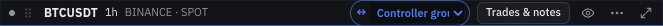 | 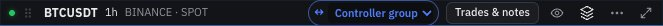 |
| Rail, Russian: activity-bar labels, watchlist headings, order book selects and range | 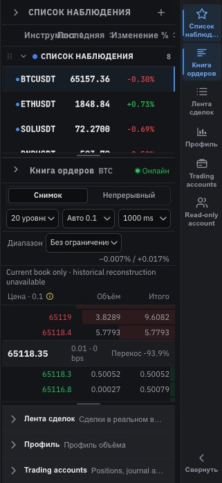 | 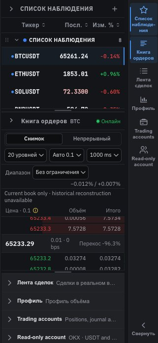 |
| Rail, English: "Change %" ran into "Last" | 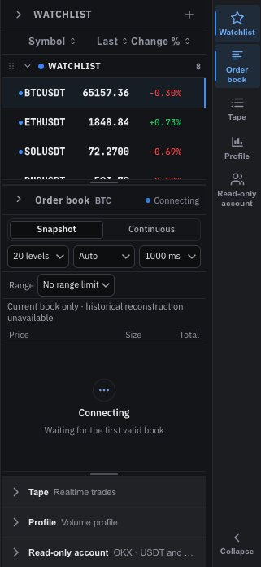 | 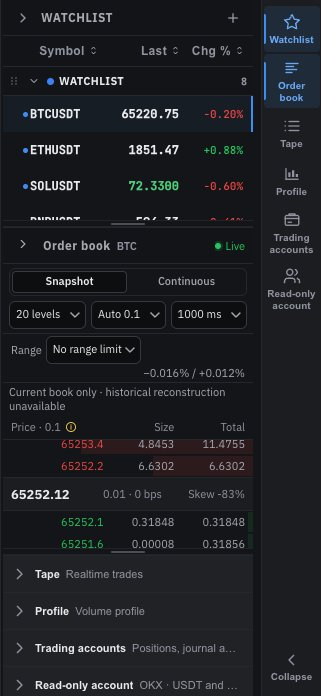 |
| Tape, German: the mode, the status and the time (with milliseconds) | 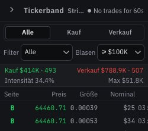 | 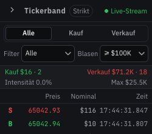 |
| Chart tester's bar, German: the strategy name | 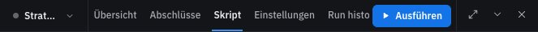 | 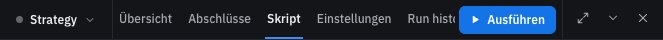 |
| Strategy page's source bar, Russian | 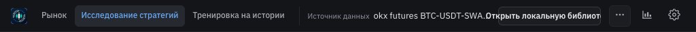 | 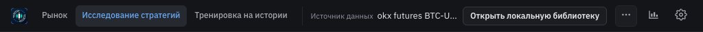 |
| Alerts at 1440 × 900, German: "Nach dem Auslösen" | 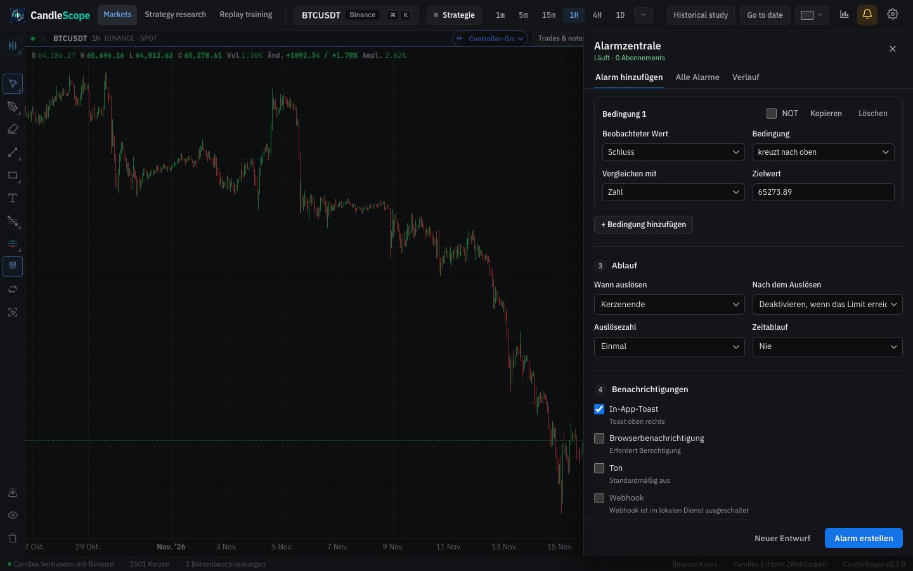 | 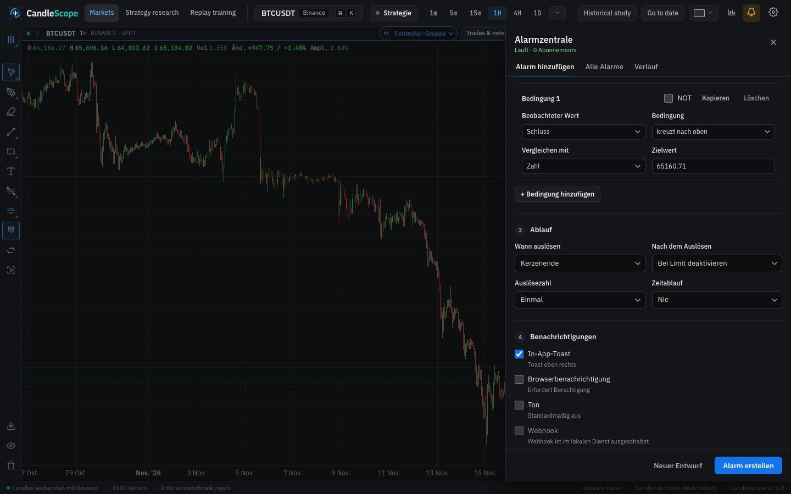 |

## Verification

- `npm run check` passed: architecture, plugin platform, i18n (30 locales, 5,430 keys, no internal terms), style metrics, cascade layers, types, lint (one warning, in `SingleChartPanes.tsx`, which this branch does not touch), 5,196 + 1 tests, 137 desktop tests and the build.
- `scripts/design-layout.test.mjs`: the overflow and overlap thresholds, grouping, what counts as "on hover", and the default widths and languages. `OrderBookDock.test.tsx` follows the header's new order (status, then mode).
- `npm run design:layout` on both builds, as in Results: 368 visits each, every step reached, captures in `output/design-layout/7c-before|7c-after/`.
- The longest statuses were set by hand in the order book's header in a 1024 px window: "Онлайн" shows whole; "Ресинхронизация" leaves its dot at the header's end, centred on the row, and its label to the title and assistive technology.
- Screens above, taken with writes refused.

## Known gaps

- **Messages still in English.** German has 206 messages of two or more words still in English, Russian 115 (French 131, Italian 213, Polish 208, Ukrainian 124, Spanish 121, Japanese 72), and the feature catalogs fall back to English: the top navigation, "Go to date", "Historical study", "Trades & notes", "Trading accounts", "Run history" and the replay hub's "Recent resumable training" show in English in German, and several of these in Russian. Translated, German and Russian get longer. This is Phase 7c2 (translate them, then audit German and Russian again).
- **The replay session** is not audited: opening a training writes to the local service, and the audit refuses writes (the hub and its New training view are audited). Its 13-control header was compacted in Phase 4b.
- **Long data is shortened, not wrapped**, where a row has one line: dataset and account names, run ids, the source name, error messages. Each has its full text as its title. In a short dock the empty row's message takes two lines before it is shortened: the German tape's "Echtzeitdaten konnten nicht abonniert werden" beside "Neu synchronisieren" at 1024 px shows as "Echtzeitdaten / konnten nicht…".
- **Connection states** were audited as they came: the audit saw the tape and order book online, connecting or resynchronising, not every state in every language. The longest statuses were measured on their own ("Ресинхронизация", "Переподключение", "Erneute Verbindung", "Neu synchronisieren" in the 1024 px header).
- **Vertical clipping** is not measured, except line clamps; the audit checks sideways overflow and overlaps.
- **Light theme:** not run (layout does not change with the theme).
- **Desktop app:** not tested. `field-sizing` (the content-sized selects) is in Electron 43's Chromium.
