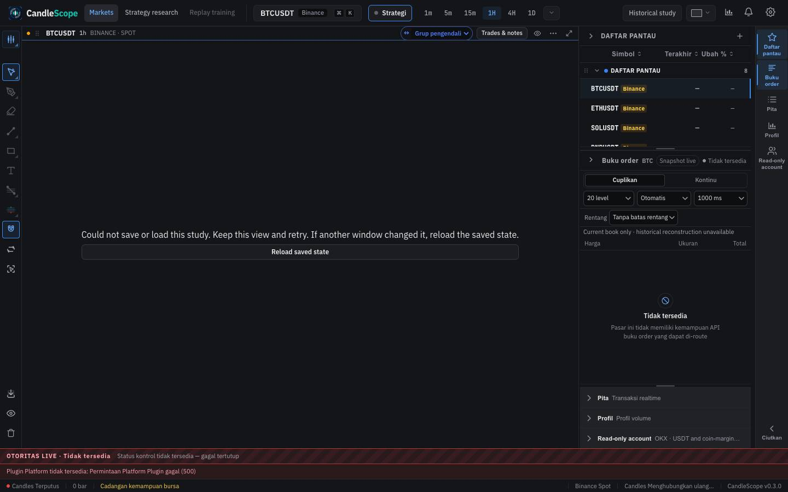
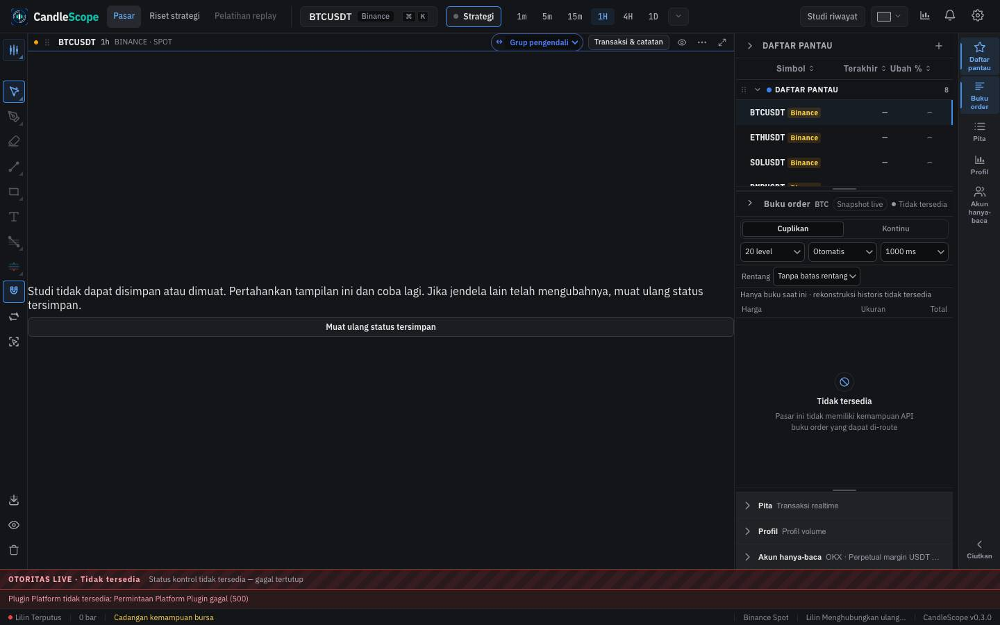
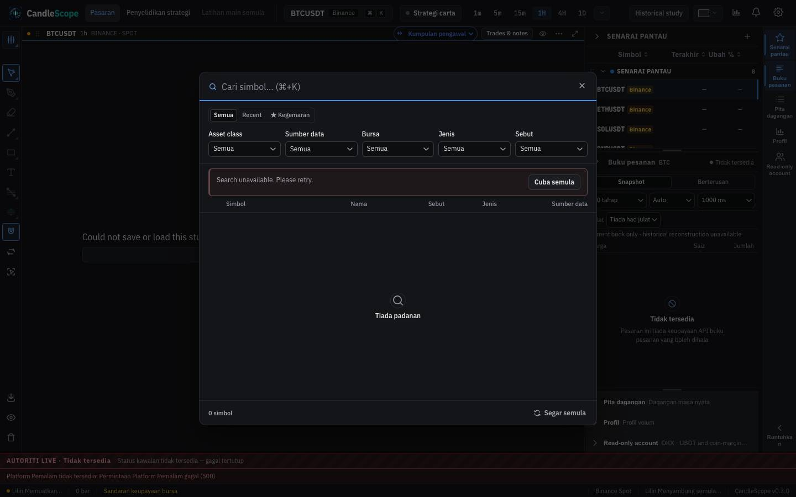
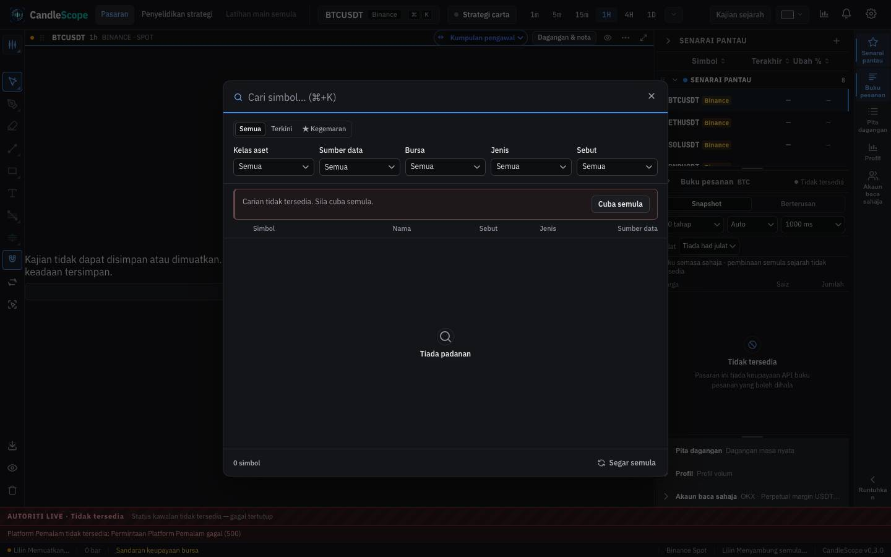
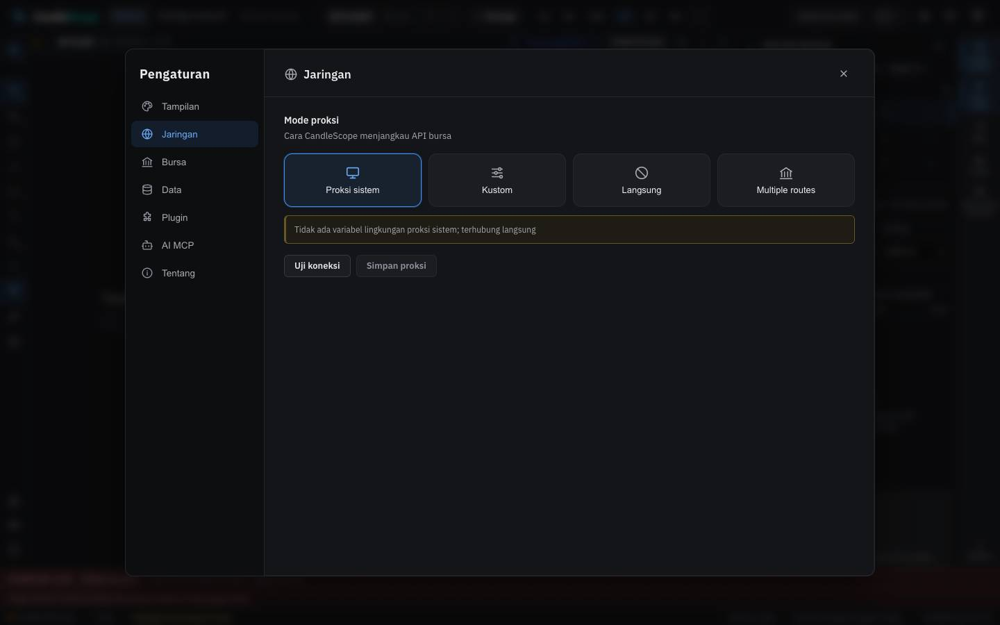
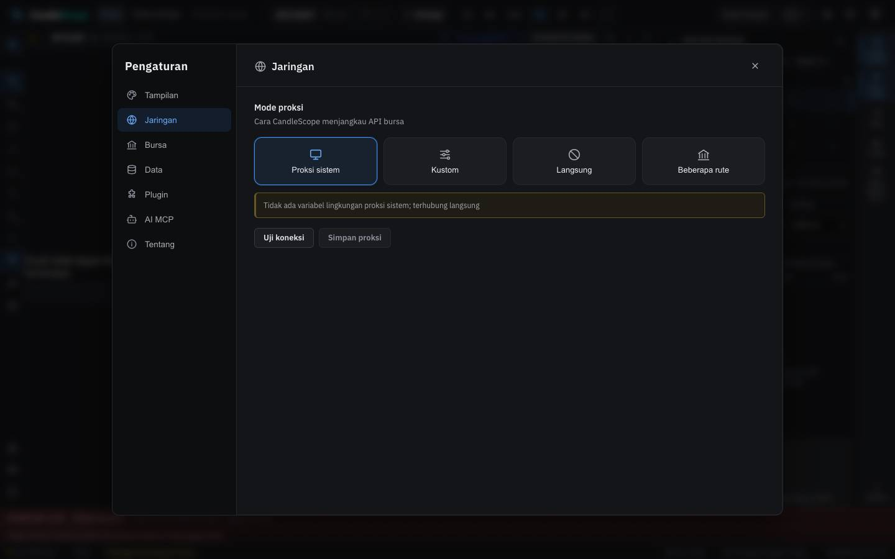
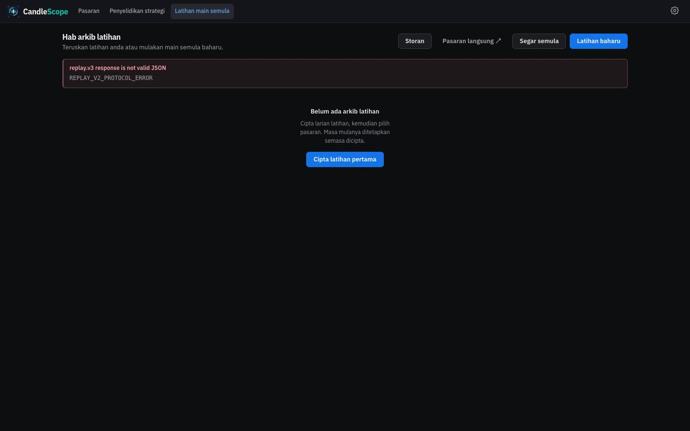

# Frontend design refactor: Phase 7c10 QA (Indonesian and Malay)

- Date: 2026-11-20
- Branch: `design/phase-7c10-id-ms`, based on `design/phase-7c9-sv-tr` (PR #506)
- Plan: [`frontend/FRONTEND_DESIGN_REFACTOR_PLAN.md`](../frontend/FRONTEND_DESIGN_REFACTOR_PLAN.md), Phase 7 (row 7c4)
- **Intended visible change:** in Indonesian and Malay, the parts that still showed English now show the language: continuous research runs and history repair, trade history, replay notes, the history study, the read-only account, trading accounts with their journal, quick replay and statistics, the native strategy backtest with its report, comparison and drawing objects, support settings and AI MCP, "Go to date", data preparation, the replay hub's welcome and random start, search, and the proxy settings. Indonesian also gets the strategy tester's workspace and CSV import, indicator names and parameters, keyboard shortcuts, the data engine's status and the data workbench's replay archive.

## What changed

| Area | Change |
|---|---|
| Indonesian feature file | New `catalogs/indonesianFeatureMessages.ts`: the seven feature blocks (continuous research with its return, batch, repair and reader parts; trade history; replay notes; history study; read-only account; trading accounts; native strategies), 1,218 messages translated from English, typed against the English blocks and imported only by `id.ts`. |
| Malay feature file | New `catalogs/malayFeatureMessages.ts`: the same seven blocks, 1,218 messages, imported only by `ms.ts`. |
| Inline English | 214 Indonesian and 134 Malay messages translated in place. The CSV import's volume option fits its select in both languages (it was cut in the eight languages from Phase 7c4 to 7c9), so it is left as it was. |
| Duplicates | 27 English duplicates of the native block (`aiControl.*`, `settings.category.ai`) that overrode it in `id.ts` / `ms.ts` are removed. |
| Terms | Each follows its catalog. Indonesian (Anda): akun, transaksi (trade), order, fill, run, ekuitas, funding, biaya, slippage, lilin, bar, buku order, set data, snapshot, replay, pelatihan (training), latihan (practice), jurnal, tinjauan (review), studi, leverage, bursa, PnL, Long / Short, Ambil untung / Henti rugi, Batas / Henti pasar (limit / stop market), hanya-baca. Malay (anda): akaun, dagangan, pesanan, isian (fill), larian (run), ekuiti, pembiayaan, yuran, gelinciran, lilin, bar, buku pesanan, set data, snapshot, main semula, latihan, jurnal, semakan (review), kajian (study), leveraj, bursa, PnL, Long / Short, Ambil untung / Henti rugi, Had / Henti pasaran, Kejatuhan (drawdown), baca sahaja. Neither language inflects a noun after a number, and each writes thousands its own way (Indonesian 5.000, Malay 5,000). |

## Results

Messages shown in English, counted on the resolved catalogs (every key of the English catalog whose value is the same English text with two or more words):

| | Base (Phase 7c9) | This branch |
|---|---|---|
| Indonesian | 1,206 | 24 |
| Malay | 1,125 | 20 |
| Other languages | unchanged | unchanged |

What is left reads the same in the language on purpose: names (Binance USD-M, Heikin Ashi, New York, London, Beijing/Shanghai, Tokyo, Hong Kong, in Malay also Python Studio and Line Break), MFE / MAE, AI MCP, the search example "BTC, ETH, SOL…"; in Indonesian the trading words the catalog already keeps (Slippage, Profit factor, Leverage (futures), API key, Secret key as OKX names them, Bollinger Bands, Volume, the MACD's and ATR's full names, Interval ms); in Malay ATR auto, Mini ticker, Import CSV, TP / SL, Maker / Taker, long / short.

`npm run design:layout` in Indonesian and Malay, on the 19 design states that open without the local service (as in Phases 7c5 to 7c9): 19 states × 4 widths × 2 languages = 152 visits per build, dark theme, the local service not running, so nothing could be written. Every visit reached its state.

| | Base (Phase 7c9) | This branch |
|---|---|---|
| Findings | 24, all with the full text on hover | 24, all with the full text on hover |
| Without the full text on hover | 0 | 0 |

- The only finding, on both builds, is the rail's accordion summary of the read-only account, cut with an ellipsis and its full text on hover: the English summary on the base, and now "OKX · Perpetual margin USDT dan koin · Mode hedge" / "OKX · Perpetual margin USDT dan syiling · Mod hedge".
- The audit of this branch ran with a shorter volume option in both languages; the base audit showed the original fits, so it was put back (see Verification).

## Screens

From the layout audit's own captures (the local service was not running, so panels that need data show their empty or error state). Dark theme, 1440 px; the base build (Phase 7c9) and this branch.

| | Before | After |
|---|---|---|
| Market page, Indonesian: the history study's error and its retry, "Studi riwayat", "Transaksi & catatan", the rail's "Akun hanya-baca" |  |  |
| Symbol search, Malay: scope, asset class, the search error; behind it "Kajian sejarah", "Dagangan & nota" and the rail's "Akaun baca sahaja" |  |  |
| Network settings, Indonesian: "Beberapa rute" (multiple routes) |  |  |
| The replay hub, Malay: the welcome line |  |  |

## Verification

- `npm run check` passed: architecture, plugin platform, i18n (30 locales, 5,434 keys, placeholders match in every catalog, no internal terms), style metrics, cascade layers, types (each new block lists every key of its English block), lint (one warning, in `SingleChartPanes.tsx`, which this branch does not touch), 5,199 + 1 tests, 137 desktop tests and the build. After the check and the audit, the volume option was put back to its original text in both languages; the i18n check passed again.
- The build puts the Indonesian text only in the `id` chunk (332.52 kB) and the Malay only in the `ms` chunk (335.51 kB). The main `index` chunk is 989.23 kB (989.24 kB in Phase 7c9).
- The translations were generated from tab-separated files (`output/i18n/7c10/`, not in the repository) by a script that refuses a missing or extra key, a changed placeholder or an empty message and keeps each block in its English key order. A scan of both found no stray English words.
- The rail's tab titles were measured at 1440 px: "Akun trading" and "Akaun dagangan" take two lines, "Akun hanya-baca" and "Akaun baca sahaja" three; none is cut.
- `npm run design:layout` in Indonesian and Malay, as in Results (`output/design-layout/7c10-before/`, `7c10-after/`).
- Screens above, from those audits.

## Known gaps

- **No native-speaker review** of the Indonesian or the Malay.
- **Audited without data, as in Phases 7c5 to 7c9.** The local service was not started, so the layout audit covers the 19 states that open without it; the market page with data, the rail's tape and trading accounts, and the history study were not audited. The rail's tab titles were measured on their own. The screens show empty or error states where a panel needs data.
- **The Malay rail's collapse label** ("Runtuhkan", already in the catalog) is wider than the 52 px rail and breaks as "Runtuhka / n" (visible in the symbol search screen). It is the same on the base, and the catalog uses "Runtuhkan" for every collapse control, so it is left for a separate change.
- **The other 5 languages** still spread the English feature blocks: Phase 7c11 onwards (Vietnamese and Thai next).
