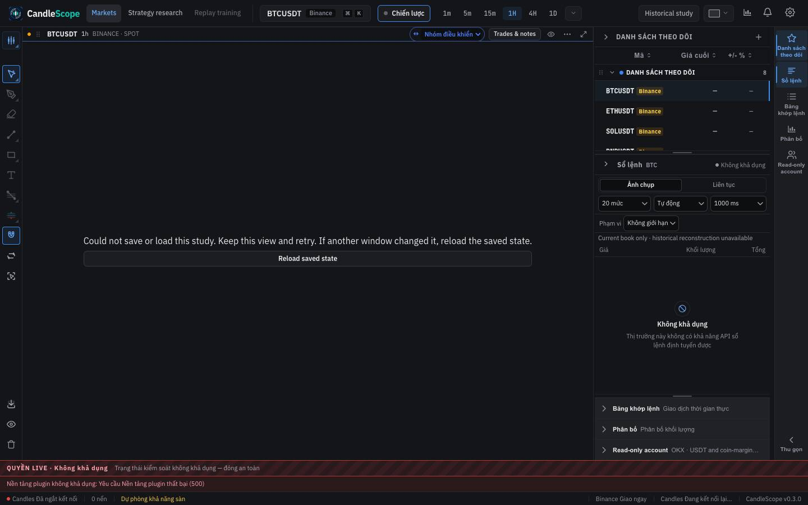
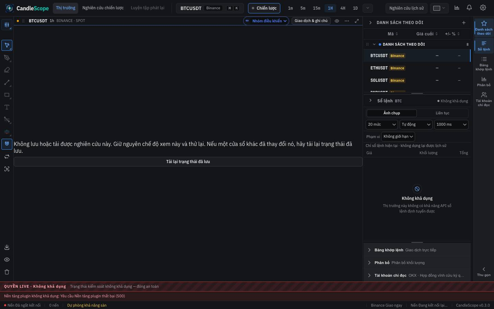
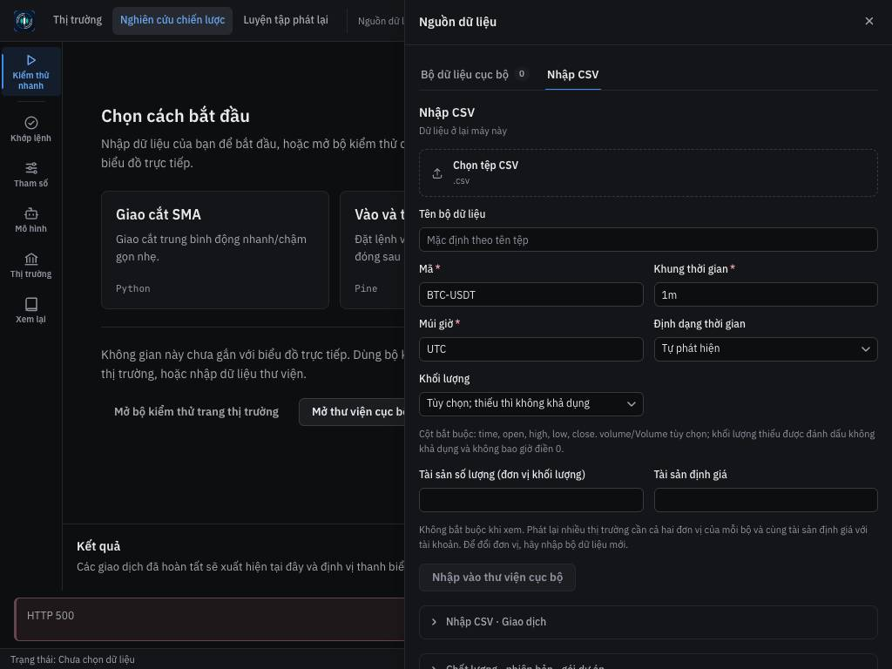
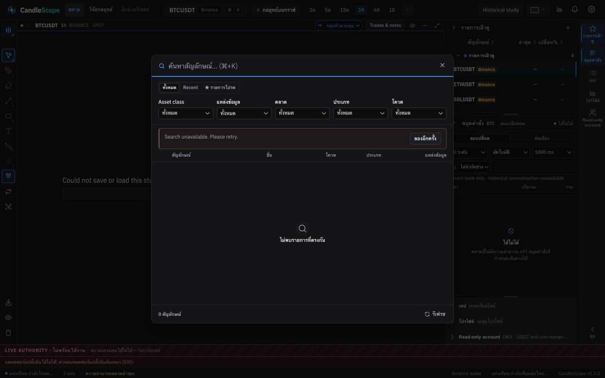
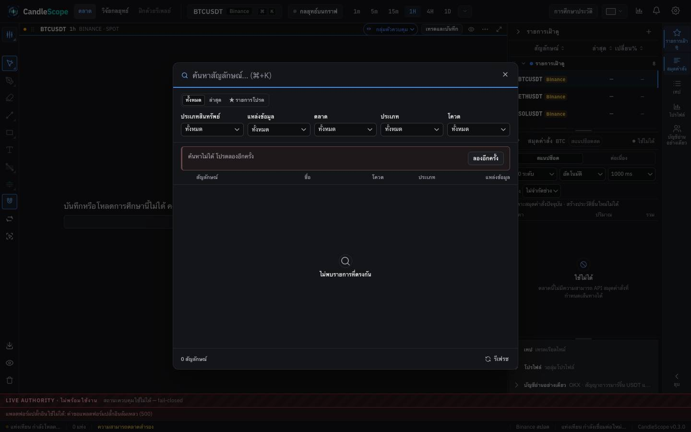
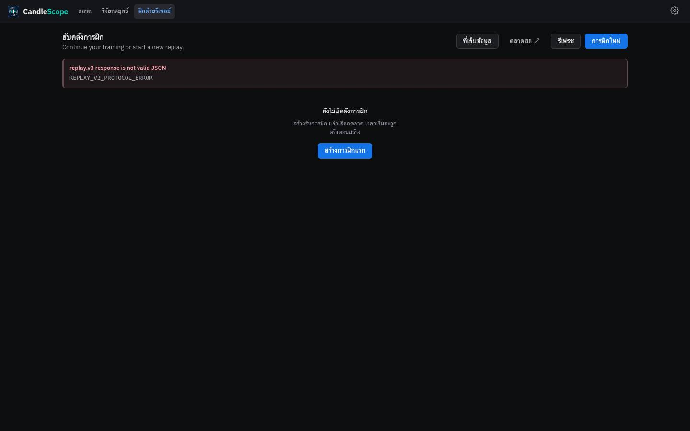
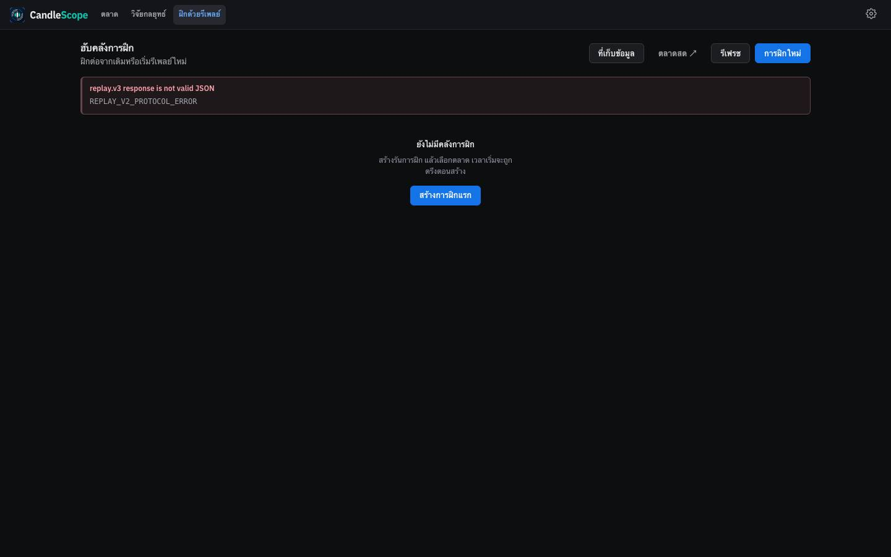

# Frontend design refactor: Phase 7c11 QA (Vietnamese and Thai)

- Date: 2026-11-21
- Branch: `design/phase-7c11-vi-th`, based on `design/phase-7c10-id-ms` (PR #507)
- Plan: [`frontend/FRONTEND_DESIGN_REFACTOR_PLAN.md`](../frontend/FRONTEND_DESIGN_REFACTOR_PLAN.md), Phase 7 (row 7c4)
- **Intended visible change:** in Vietnamese and Thai, the parts that still showed English now show the language: continuous research runs and history repair, trade history, replay notes, the history study, the read-only account, trading accounts with their journal, quick replay and statistics, the native strategy backtest with its report, comparison and drawing objects, support settings and AI MCP, "Go to date", data preparation, the replay hub's welcome and random start, search, and the proxy settings. Vietnamese also gets the header's page names, the strategy tester's workspace and CSV import, indicator names and parameters, keyboard shortcuts, the data engine's status and the data workbench's replay archive. Thai also gets the replay workbench's labels and kickers, the strategy templates and the alert conditions' "and" / "or". The CSV import's volume option is shorter in both languages, and the Vietnamese rail's tape summary is shorter.

## What changed

| Area | Change |
|---|---|
| Vietnamese feature file | New `catalogs/vietnameseFeatureMessages.ts`: the seven feature blocks (continuous research with its return, batch, repair and reader parts; trade history; replay notes; history study; read-only account; trading accounts; native strategies), 1,218 messages translated from English, typed against the English blocks and imported only by `vi.ts`. |
| Thai feature file | New `catalogs/thaiFeatureMessages.ts`: the same seven blocks, 1,218 messages, imported only by `th.ts`. |
| Inline English | 223 Vietnamese and 154 Thai messages translated in place. The CSV import's volume option, too long in both as in the eight languages from Phase 7c4 to 7c9, is shorter ("Tùy chọn; thiếu thì không khả dụng", "ไม่บังคับ หากไม่มีจะใช้ไม่ได้"). The Vietnamese rail's tape summary, cut at 1024 px, now reads "Giao dịch trực tiếp" (live trades) instead of "Giao dịch thời gian thực". |
| Duplicates | 27 English duplicates of the native block (`aiControl.*`, `settings.category.ai`) that overrode it in `vi.ts` / `th.ts` are removed. |
| Terms | Each follows its catalog. Vietnamese (mostly without a pronoun, "bạn" where one is needed, as the catalog): tài khoản, giao dịch (trade), lệnh (order), lệnh khớp (fill), lần chạy (run), vốn chủ (equity), funding, phí, trượt giá, nến (candle and bar), sổ lệnh, tập dữ liệu, ảnh chụp (snapshot), phát lại (replay), luyện tập (training and practice), nhật ký (journal), rà soát (review), nghiên cứu (study), đòn bẩy, sàn, Lãi/lỗ (P&L), Long / Short, Chốt lời / Cắt lỗ, Giới hạn / Stop thị trường, chỉ đọc, sụt giảm (drawdown); thousands are written 5.000. Thai (no sentence-final full stop and a space between clauses, as the catalog): บัญชี, เทรด, คำสั่ง (order), ฟิลล์ (fill), การรัน (run), อิควิตี้, funding, ค่าธรรมเนียม, สลิปเพจ, แท่งเทียน / แท่ง, สมุดคำสั่ง, ชุดข้อมูล, สแนปช็อต, รีเพลย์, การฝึก (training), ฝึกซ้อม (practice), บันทึกการเทรด (journal, kept apart from บันทึก, a note), รีวิว, การศึกษา (study), เลเวอเรจ, กำไรขาดทุน, LONG / SHORT, เทกโปรฟิต / สต็อปลอส, ลิมิต / สต็อปมาร์เก็ต, อ่านอย่างเดียว, ดรอดาวน์, คีย์; thousands are written 5,000. Neither language inflects a noun after a number. |

## Results

Messages shown in English, counted on the resolved catalogs (every key of the English catalog whose value is the same English text with two or more words):

| | Base (Phase 7c10) | This branch |
|---|---|---|
| Vietnamese | 1,204 | 12 |
| Thai | 1,140 | 21 |
| Other languages | unchanged | unchanged |

What is left reads the same in the language on purpose: names (Binance USD-M, Python Studio, Heikin Ashi, in Vietnamese also New York, London and Tokyo, in Thai Point & Figure and Line Break), API key, Secret key as OKX names them, MFE / MAE, AI MCP, the search example "BTC, ETH, SOL…"; in Thai also Profit factor, TP / SL and Maker / Taker with their bps fields, as the catalog writes them.

`npm run design:layout` in Vietnamese and Thai, on the 19 design states that open without the local service (as in Phases 7c5 to 7c10): 19 states × 4 widths × 2 languages = 152 visits per build, dark theme, the local service not running, so nothing could be written. Every visit reached its state.

| | Base (Phase 7c10) | This branch |
|---|---|---|
| Findings | 44, 30 with the full text on hover | 24, all with the full text on hover |
| Without the full text on hover | 14: the CSV import's volume option, Vietnamese and Thai, 7 each | 0 |

- **The CSV import's volume option** was wider than its select at every width in both languages; it is shorter now.
- **The Vietnamese rail's tape summary** ("Giao dịch thời gian thực") was cut at 1024 px, with its full text on hover; the shorter wording fits.
- The rail's accordion summary of the read-only account is cut with an ellipsis and its full text on hover at 1440 and 1920 px, as the English summary was on the base: "OKX · Hợp đồng vĩnh cửu ký quỹ USDT và coin · Chế độ phòng hộ", "OKX · สัญญาถาวรมาร์จิ้น USDT และเหรียญ · โหมด Hedge".

## Screens

From the layout audit's own captures (the local service was not running, so panels that need data show their empty or error state). Dark theme; the base build (Phase 7c10) and this branch.

| | Before | After |
|---|---|---|
| Market page, Vietnamese, 1440 px: the header's page names, the history study's error and its retry, "Nghiên cứu lịch sử", "Giao dịch & ghi chú", the rail's "Tài khoản chỉ đọc" and its tape summary |  |  |
| Strategy page, local source, Vietnamese, 1024 px: the CSV import's volume option |  |  |
| Symbol search, Thai, 1440 px: scope, asset class, the search error; behind it the rail's "บัญชีอ่านอย่างเดียว" and "เทรดและบันทึก" |  |  |
| The replay hub, Thai, 1440 px: the welcome line |  |  |

## Verification

- `npm run check` passed on the final catalogs: architecture, plugin platform, i18n (30 locales, 5,434 keys, placeholders match in every catalog, no internal terms), style metrics, cascade layers, types (each new block lists every key of its English block), lint (one warning, in `SingleChartPanes.tsx`, which this branch does not touch), 5,199 + 1 tests, 137 desktop tests and the build.
- The build puts the Vietnamese text only in the `vi` chunk (381.08 kB) and the Thai only in the `th` chunk (573.12 kB; Thai takes three bytes a letter). The main `index` chunk is unchanged (989.23 kB).
- The translations were generated from tab-separated files (`output/i18n/7c11/`, not in the repository) by a script that refuses a missing or extra key, a changed placeholder or an empty message and keeps each block in its English key order. A scan of the Thai found English words only where the catalog keeps them (names, units, codes, field names and trading terms); a lowercase "key" was changed to the catalog's คีย์.
- Fonts: Vietnamese letters (ơ, ư, ạ, ế, ộ…) come from IBM Plex Sans's vietnamese subset, which Phase 7c8's font change declares; on a Vietnamese page `document.fonts.check` finds them in IBM Plex Sans, and a Thai page does not load that subset. Thai is not in IBM Plex Sans (see Known gaps).
- The rail's tab titles were measured at 1440 px: "Tài khoản giao dịch" and "Tài khoản chỉ đọc" take two lines, "บัญชีเทรด" one and "บัญชีอ่านอย่างเดียว" two; none is cut.
- `npm run design:layout` in Vietnamese and Thai, as in Results (`output/design-layout/7c11-before/`, `7c11-after/`). The volume option and tape summary were shortened after the base audit and before this branch's audit.
- Screens above, from those audits.

## Known gaps

- **No native-speaker review** of the Vietnamese or the Thai.
- **Audited without data, as in Phases 7c5 to 7c10.** The local service was not started, so the layout audit covers the 19 states that open without it; the market page with data, the rail's tape and trading accounts, and the history study were not audited. The rail's tab titles were measured on their own. The screens show empty or error states where a panel needs data.
- **Thai uses the system's Thai font.** IBM Plex Sans has no Thai letters and the project has no Thai interface font, so Thai text falls back to the operating system's Thai face (on the base too). A matching face (IBM Plex Sans Thai) would be a separate font decision.
- **Older messages keep some English inside the text**, as the catalogs wrote them before this branch: in Thai the live-authority banner ("LIVE AUTHORITY", "fail-closed") and in both languages a few replay messages ("fail-closed", "Run"). They are not counted above because they are not the English text as a whole.
- **The other 3 languages** still spread the English feature blocks: Phase 7c12 onwards (Hindi, Arabic and Hebrew).
