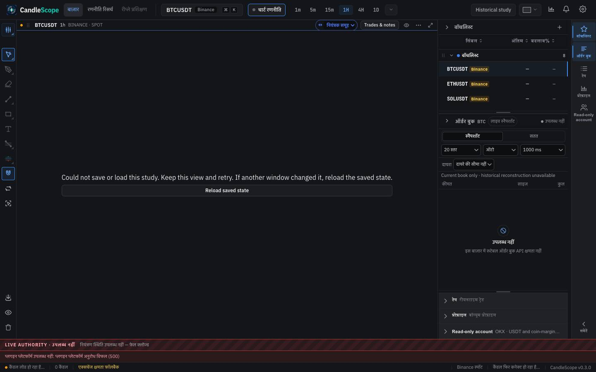
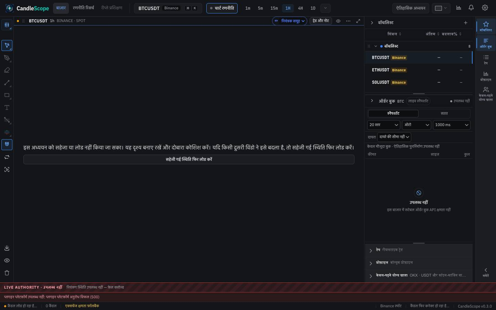
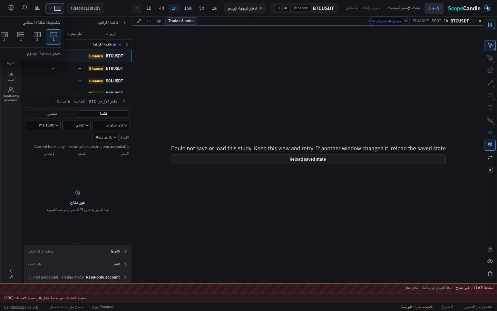
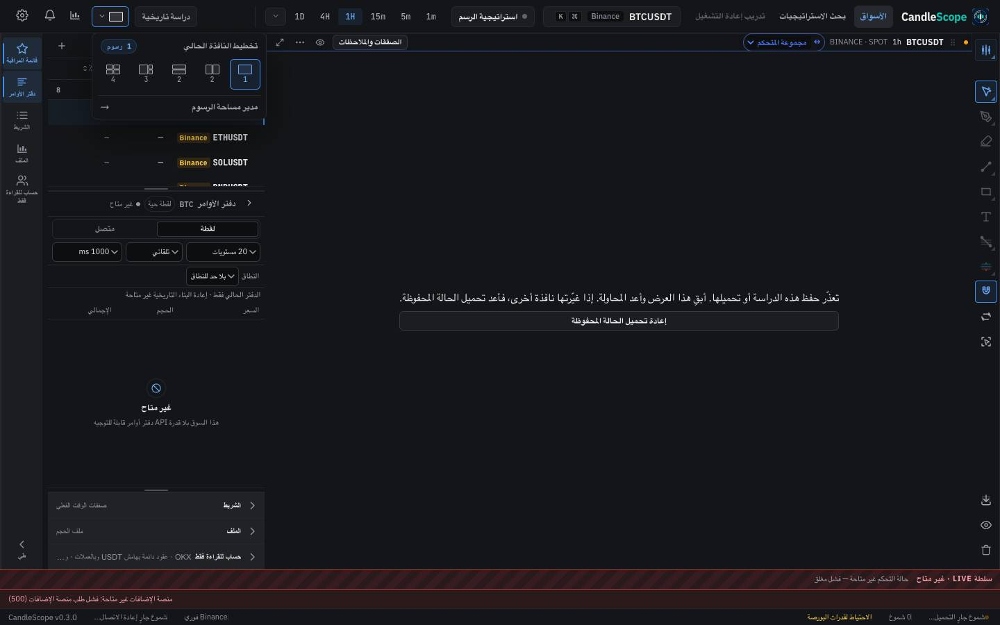
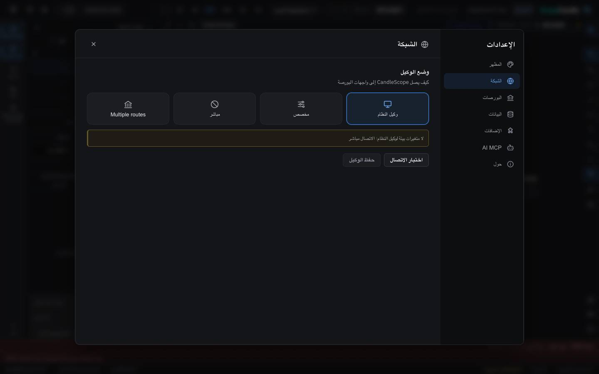
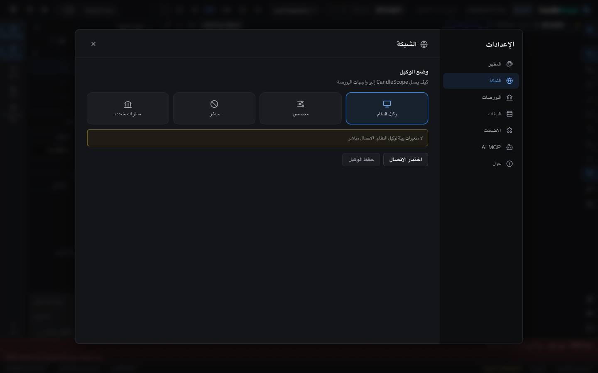
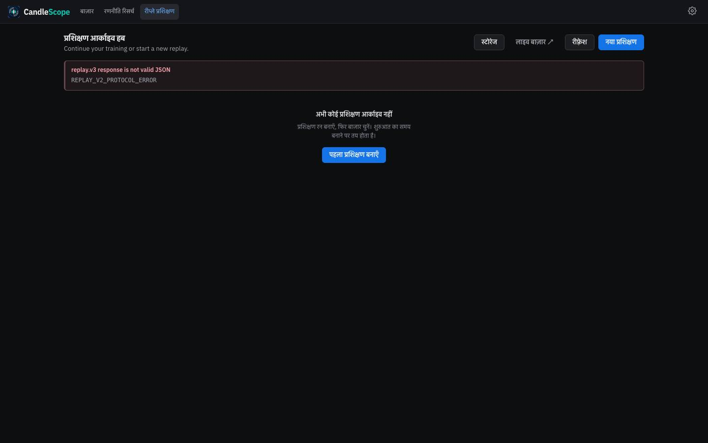
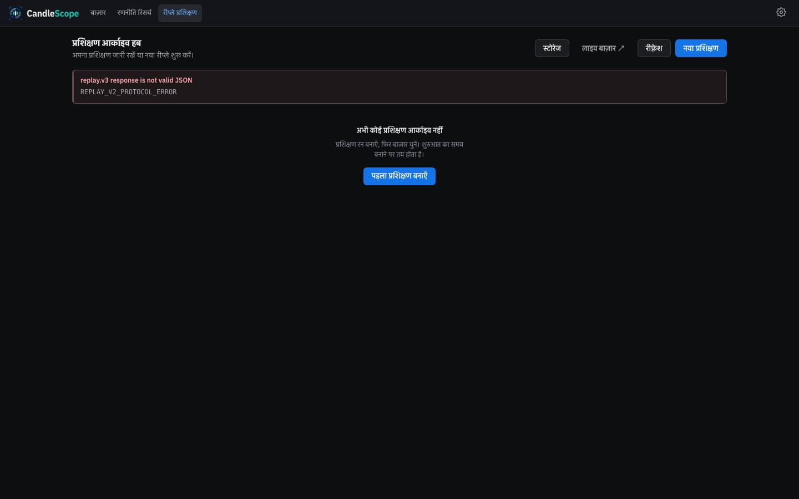

# Frontend design refactor: Phase 7c12 QA (Hindi and Arabic)

- Date: 2026-11-21
- Branch: `design/phase-7c12-hi-ar`, based on `design/phase-7c11-vi-th` (PR #510)
- Plan: [`frontend/FRONTEND_DESIGN_REFACTOR_PLAN.md`](../frontend/FRONTEND_DESIGN_REFACTOR_PLAN.md), Phase 7 (row 7c4)
- **Intended visible change:** in Hindi and Arabic, the parts that still showed English now show the language: continuous research runs and history repair, trade history, replay notes, the history study, the read-only account, trading accounts with their journal, quick replay and statistics, the native strategy backtest with its report, comparison and drawing objects, support settings and AI MCP, "Go to date", data preparation, the replay hub's welcome and random start, search, the proxy settings and drawing settings. Hindi also gets the replay hub's Challenge / Sandbox and the replay workbench's maker / taker labels. In right-to-left pages (Arabic, and Hebrew later), the layout menu opens inside the window and the wordmark reads "CandleScope".

## What changed

| Area | Change |
|---|---|
| Hindi feature file | New `catalogs/hindiFeatureMessages.ts`: the seven feature blocks (continuous research with its return, batch, repair and reader parts; trade history; replay notes; history study; read-only account; trading accounts; native strategies), 1,218 messages translated from English, typed against the English blocks and imported only by `hi.ts`. |
| Arabic feature file | New `catalogs/arabicFeatureMessages.ts`: the same seven blocks, 1,218 messages, imported only by `ar.ts`. |
| Inline English | 138 Hindi and 124 Arabic messages translated in place. The CSV import's volume option already fits its select in both, so it is unchanged. |
| Duplicates | 27 English duplicates of the native block (`aiControl.*`, `settings.category.ai`) that overrode it in `hi.ts` / `ar.ts` are removed. |
| Right-to-left layout | Two faults already on the base, found in Arabic. The layout menu's popover (`features/chart-workspace/chartWorkspace.css`) was placed with `right: 0`; in a right-to-left page the picker sits near the window's left edge, so the popover ran past it and cut off the fourth layout and the workspace manager button. It now uses `inset-inline-end: 0`, which is `right: 0` in left-to-right pages (unchanged there). The header's wordmark (`app/appShell.css`), two spans in an inline flex row, read "ScopeCandle"; it now keeps `direction: ltr`. |
| Terms | Each follows its catalog. Hindi (formal, imperatives in -ें, sentences end with ।): खाता, ट्रेड, ऑर्डर, फ़िल, रन, इक्विटी, फ़ंडिंग, शुल्क, स्लिपेज, कैंडल / बार, ऑर्डर बुक, डेटासेट, स्नैपशॉट, रीप्ले, प्रशिक्षण (training), अभ्यास (practice), जर्नल, समीक्षा (review), अध्ययन (study), लीवरेज, एक्सचेंज, P&L, लॉन्ग / शॉर्ट, टेक-प्रॉफ़िट / स्टॉप-लॉस, लिमिट / स्टॉप मार्केट, केवल-पढ़ने योग्य, ड्रॉडाउन, कुंजी (key). Arabic (formal imperatives): حساب، صفقة (trade)، أمر (order)، تنفيذ (fill)، تشغيل (run)، الحقوق (equity)، التمويل، الرسوم، الانزلاق، شمعة، دفتر الأوامر، مجموعة البيانات، لقطة، إعادة التشغيل (replay)، تدريب، تمرين، اليومية (journal)، مراجعة، دراسة، الرافعة، البورصة، الربح/الخسارة، شراء / بيع for long / short as the catalog writes them، جني الأرباح / وقف الخسارة، محدد / وقف سوق، للقراءة فقط، أقصى انخفاض، مفتاح. Both write thousands as 5,000. Where a count varies and the noun would change with it (Hindi सीमा / सीमाएँ; Arabic, whose noun takes the dual, a plural from 3 to 10 and a singular from 11), the message reads "label: {count}"; the fixed statistics periods are written out (7 दिन / 7 أيام، 30 يوماً، 90 يوماً). |

## Results

Messages shown in English, counted on the resolved catalogs (every key of the English catalog whose value is the same English text with two or more words):

| | Base (Phase 7c11) | This branch |
|---|---|---|
| Hindi | 1,121 | 14 |
| Arabic | 1,113 | 10 |
| Other languages | unchanged | unchanged |

What is left reads the same in the language on purpose: names (Binance USD-M, Python Studio, Heikin Ashi, Point & Figure, Line Break), MFE / MAE, AI MCP; in Hindi also API key and Secret key as OKX names them, TP / SL and the search example "BTC, ETH, SOL…".

`npm run design:layout` in Hindi and Arabic, on the 19 design states that open without the local service (as in Phases 7c5 to 7c11): 19 states × 4 widths × 2 languages = 152 visits per build, dark theme, the local service not running, so nothing could be written. Every visit reached its state.

| | Base (Phase 7c11) | This branch |
|---|---|---|
| Findings | 28, 24 with the full text on hover | 24, all with the full text on hover |
| Without the full text on hover | 4: the layout menu's workspace manager button, Arabic, cut by the window's edge at every width | 0 |

- **The layout menu in Arabic** opened past the window's left edge; it now opens toward the inside of the window and shows all four layouts and the workspace manager button.
- The rail's accordion summary of the read-only account is cut with an ellipsis and its full text on hover at 1440 and 1920 px, as the English summary was on the base: "OKX · USDT और कॉइन-मार्जिन वाले परपेचुअल · हेज मोड", "OKX · عقود دائمة بهامش USDT وبالعملات · وضع التحوط".
- The CSV import's volume option fits in both languages on the base, so it is unchanged.

## Screens

From the layout audit's own captures (the local service was not running, so panels that need data show their empty or error state). Dark theme, 1440 px; the base build (Phase 7c11) and this branch.

| | Before | After |
|---|---|---|
| Market page, Hindi: the history study's error and its retry, "ऐतिहासिक अध्ययन", "ट्रेड और नोट", the rail's "केवल-पढ़ने योग्य खाता" |  |  |
| Layout menu, Arabic: the popover inside the window, the wordmark, the history study's error |  |  |
| Network settings, Arabic: "مسارات متعددة" (multiple routes) |  |  |
| The replay hub, Hindi: the welcome line |  |  |

## Verification

- `npm run check` passed on the final state: architecture, plugin platform, i18n (30 locales, 5,434 keys, placeholders match in every catalog, no internal terms), style metrics, cascade layers, types (each new block lists every key of its English block), lint (one warning, in `SingleChartPanes.tsx`, which this branch does not touch), 5,199 + 1 tests, 137 desktop tests and the build.
- The build puts the Hindi text only in the `hi` chunk (564.35 kB; Devanagari takes three bytes a letter) and the Arabic only in the `ar` chunk (419.62 kB). The main `index` chunk is 989.18 kB (989.23 kB in Phase 7c11).
- The translations were generated from tab-separated files (`output/i18n/7c12/`, not in the repository) by a script that refuses a missing or extra key, a changed placeholder or an empty message and keeps each block in its English key order. A scan found English words only where the catalogs keep them (names, units, codes, field names and OKX's API key / Secret key); a lowercase "key" in Hindi was changed to the catalog's कुंजी.
- Fonts: IBM Plex Sans has latin, latin-ext, cyrillic, cyrillic-ext, greek and vietnamese subsets and no Devanagari or Arabic, so both scripts draw in the system's fonts (see Known gaps).
- The rail's tab titles were measured at 1440 px: "ट्रेडिंग खाते" and "حسابات التداول" take one line, "केवल-पढ़ने योग्य खाता" and "حساب للقراءة فقط" two; none is cut.
- `npm run design:layout` in Hindi and Arabic, as in Results (`output/design-layout/7c12-before/`, `7c12-after/`), the after run with the right-to-left fixes.
- Screens above, from those audits.

## Known gaps

- **No native-speaker review** of the Hindi or the Arabic.
- **Audited without data, as in Phases 7c5 to 7c11.** The local service was not started, so the layout audit covers the 19 states that open without it; the market page with data, the rail's tape and trading accounts, and the history study were not audited. The rail's tab titles were measured on their own. The screens show empty or error states where a panel needs data.
- **Devanagari and Arabic use system fonts.** The interface font has no Devanagari or Arabic letters, so both fall back to the operating system's faces (on the base too). Matching faces (IBM Plex Sans Devanagari, IBM Plex Sans Arabic) would be a separate font decision.
- **Right-to-left review covered the audited states only.** Arabic pages mirror as expected there, apart from the two faults fixed above. Direction icons are not mirrored: the layout menu's workspace manager arrow still points right in Arabic.
- **Older messages keep some English inside the text**, as the catalogs wrote them before this branch: the live-authority banner ("LIVE AUTHORITY" in Hindi, "LIVE" in Arabic) and, in Hindi, "Run" in replay messages. They are not counted above because they are not the English text as a whole.
- **Hebrew** still spreads the English feature blocks: Phase 7c13.
