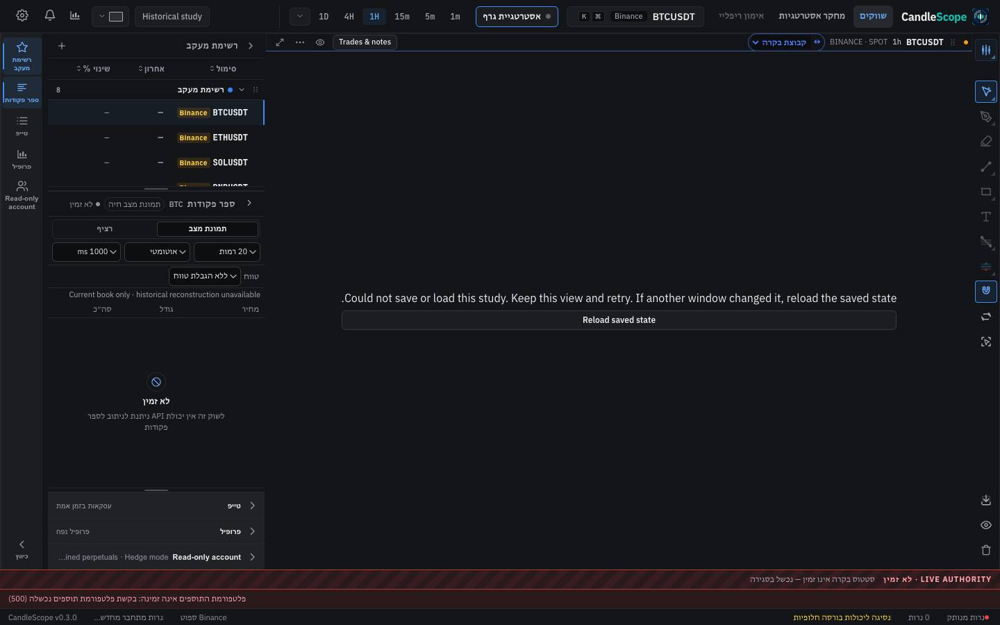
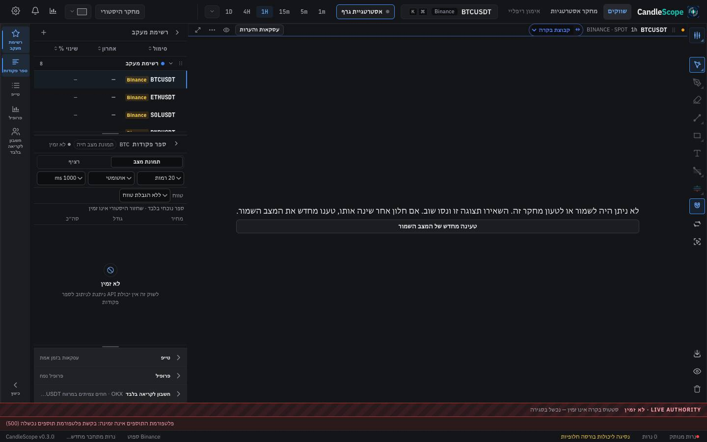
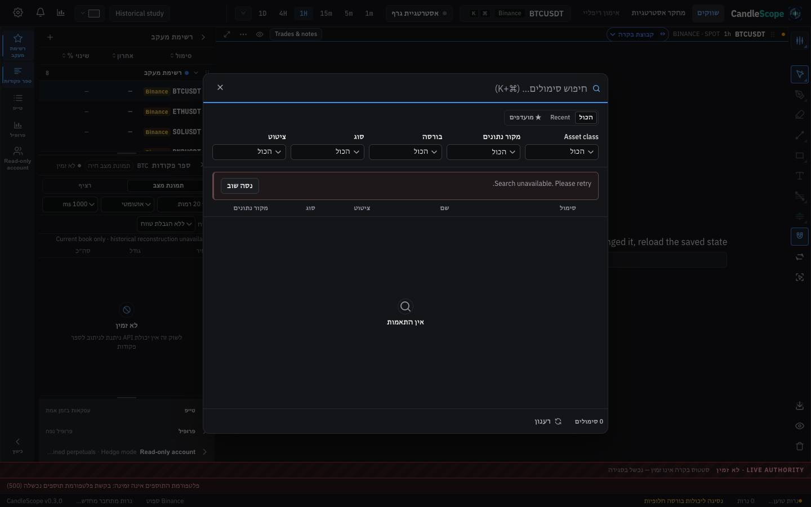
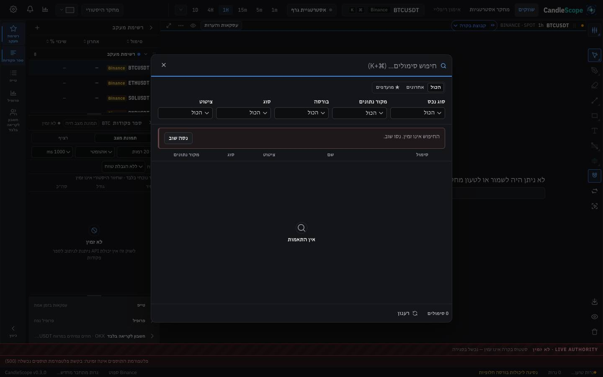
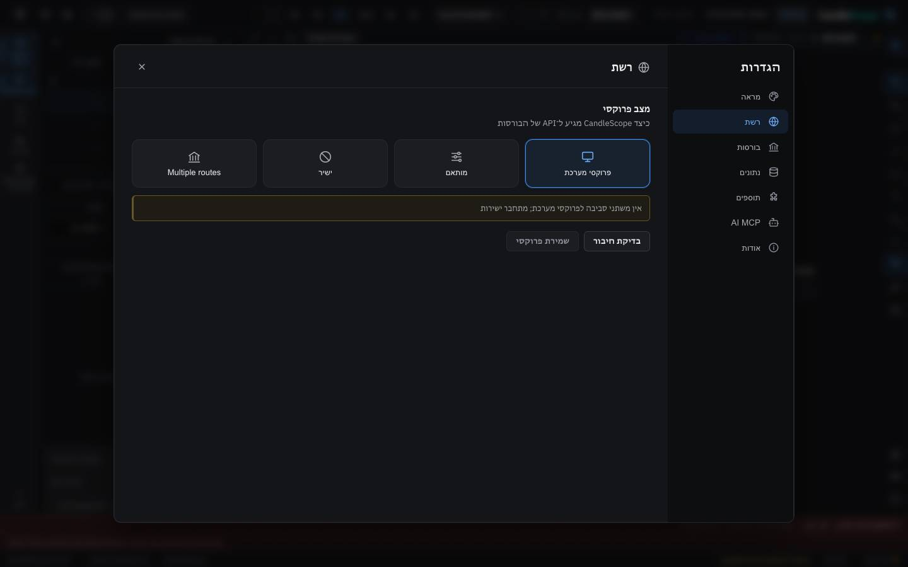
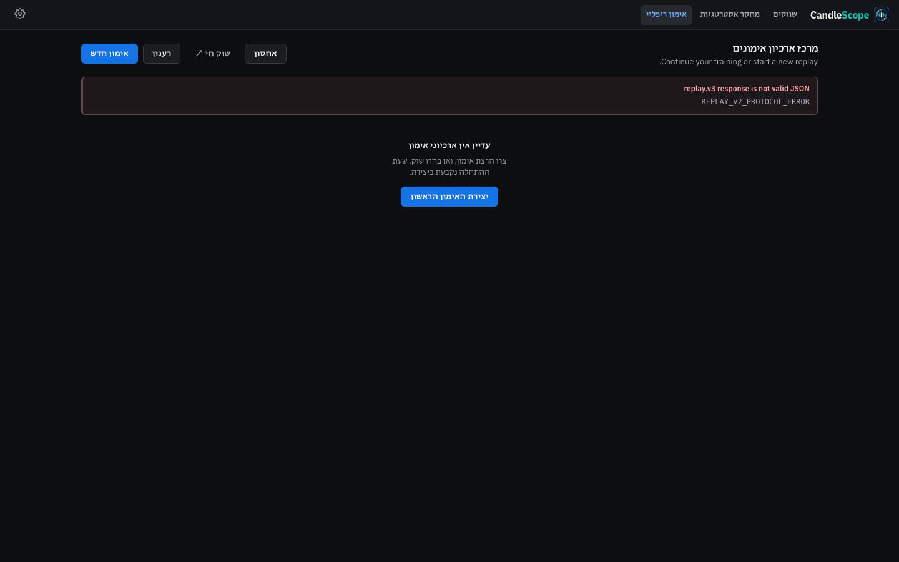

# Frontend design refactor: Phase 7c13 QA (Hebrew)

- Date: 2026-11-23
- Branch: `design/phase-7c13-he`, based on `design/phase-7c12-hi-ar` (PR #562)
- Plan: [`frontend/FRONTEND_DESIGN_REFACTOR_PLAN.md`](../frontend/FRONTEND_DESIGN_REFACTOR_PLAN.md), Phase 7 (row 7c4, its last language)
- **Intended visible change:** in Hebrew, the parts that still showed English now show Hebrew: continuous research runs and history repair, trade history, replay notes, the history study, the read-only account, trading accounts with their journal, quick replay and statistics, the native strategy backtest with its report, comparison and drawing objects, support settings and AI MCP, "Go to date", data preparation, the replay hub's welcome, sandbox and random start, search, the proxy settings, drawing settings, the replay workbench's kickers and storage states, the strategy tester's eyebrows and the alert conditions' "and" / "or".

## What changed

| Area | Change |
|---|---|
| Hebrew feature file | New `catalogs/hebrewFeatureMessages.ts`: the seven feature blocks (continuous research with its return, batch, repair and reader parts; trade history; replay notes; history study; read-only account; trading accounts; native strategies), 1,218 messages translated from English, typed against the English blocks and imported only by `he.ts`. |
| Inline English | 141 messages translated in place. The CSV import's volume option already fits its select, so it is unchanged. |
| Duplicates | 27 English duplicates of the native block (`aiControl.*`, `settings.category.ai`) that overrode it in `he.ts` are removed. |
| Terms | As the catalog: actions as nouns (פתיחת סקירה, הוספת חשבון), instructions in the plural imperative (בחרו, נסו שוב), a maqaf after a prefix before Latin text or a number (ב־OKX, מ־{time}). חשבון, עסקה (trade), פקודה (order), ביצוע (fill), הרצה (run), הון (equity), מימון, עמלה, החלקה, נר, ספר פקודות, מערך נתונים, תמונת מצב, ריפליי, אימון (training), תרגול (practice), יומן (journal), סקירה (review), מחקר (study), מינוף, בורסה, רווח והפסד, לונג / שורט, טייק-פרופיט / סטופ-לוס, לימיט / סטופ שוק, לקריאה בלבד, ירידה מקסימלית מהשיא, מפתח (key), פרוקסי. Thousands are written 5,000. Where a count varies and the noun would change between one and many, the message reads "label: {count}". |

## Results

Messages shown in English, counted on the resolved catalogs (every key of the English catalog whose value is the same English text with two or more words):

| | Base (Phase 7c12) | This branch |
|---|---|---|
| Hebrew | 1,123 | 12 |
| Other languages | unchanged | unchanged |

What is left reads the same in Hebrew on purpose: names (Binance USD-M, Python Studio, Heikin Ashi, Point & Figure, Line Break), MFE / MAE, AI MCP, TP / SL and the search example "BTC, ETH, SOL…".

`npm run design:layout` in Hebrew, on the 19 design states that open without the local service (as in Phases 7c5 to 7c12): 19 states × 4 widths = 76 visits per build, dark theme, the local service not running, so nothing could be written. Every visit reached its state.

| | Base (Phase 7c12) | This branch |
|---|---|---|
| Findings | 12, all with the full text on hover | 12, all with the full text on hover |
| Without the full text on hover | 0 | 0 |

- The only finding, on both builds, is the rail's accordion summary of the read-only account, cut with an ellipsis and its full text on hover at 1440 and 1920 px: the English summary on the base, and now "OKX · חוזים צמיתים במרווח USDT ובמטבעות · מצב גידור".
- Phase 7c12's right-to-left fixes hold in Hebrew: the layout menu opens inside the window and shows all four layouts and the workspace manager button, and the wordmark reads "CandleScope".

## Screens

From the layout audit's own captures (the local service was not running, so panels that need data show their empty or error state). Dark theme, 1440 px; the base build (Phase 7c12) and this branch.

| | Before | After |
|---|---|---|
| Market page: the history study's error and its retry, "מחקר היסטורי", "עסקאות והערות", the rail's "חשבון לקריאה בלבד" |  |  |
| Symbol search: scope, asset class, the search error |  |  |
| Network settings: "נתיבים מרובים" (multiple routes) |  |  |
| The replay hub: the welcome line |  |  |

## Verification

Targeted local checks, with the full check left to GitHub CI:

- `npm run check:i18n` passed: 30 locales, 5,434 keys, placeholders match in every catalog, no internal terms.
- `npm run typecheck` passed (both `tsconfig.json` and `tsconfig.node.json`; the new block lists every key of its English block).
- The i18n and shell language tests passed (`src/i18n/__tests__/*.test.ts`, `src/app/__tests__/shellI18n.test.tsx`: 72 tests).
- `npm run build` passed. The Hebrew text is only in the `he` chunk (398.50 kB); the main `index` chunk is 989.12 kB (989.18 kB in Phase 7c12).
- The translations were generated from tab-separated files (`output/i18n/7c13/`, not in the repository) by a script that refuses a missing or extra key, a changed placeholder or an empty message and keeps each block in its English key order. A scan found English words only where the catalog keeps them (names, units, codes, field names); "proxy" was changed to the catalog's פרוקסי.
- Fonts: IBM Plex Sans has no Hebrew letters (its subsets are latin, latin-ext, cyrillic, cyrillic-ext, greek and vietnamese), so Hebrew draws in the system's font (see Known gaps).
- The rail's tab titles were measured at 1440 px: "חשבונות מסחר" takes two lines and "חשבון לקריאה בלבד" three; none is cut.
- `npm run design:layout` in Hebrew, as in Results (`output/design-layout/7c13-before/`, `7c13-after/`).
- Screens above, from those audits.

## Known gaps

- **No native-speaker review** of the Hebrew.
- **Not run locally: the full `npm run check`** (lint, the other 5,000 tests, the desktop tests). This branch changes only catalogs; GitHub CI runs the full set on the PR.
- **Audited without data, as in Phases 7c5 to 7c12.** The local service was not started, so the layout audit covers the 19 states that open without it; the market page with data, the rail's tape and trading accounts, and the history study were not audited. The rail's tab titles were measured on their own. The screens show empty or error states where a panel needs data.
- **Hebrew uses a system font.** The interface font has no Hebrew letters, so Hebrew falls back to the operating system's face (on the base too). A matching face (IBM Plex Sans Hebrew) would be a separate font decision.
- **Right-to-left review covered the audited states only**, and direction icons are not mirrored (the layout menu's workspace manager arrow points right), as noted in Phase 7c12.
- **Older messages keep some English inside the text**, as the catalog wrote them before this branch (the live-authority banner's "LIVE AUTHORITY"). It is not counted above because it is not the English text as a whole.
