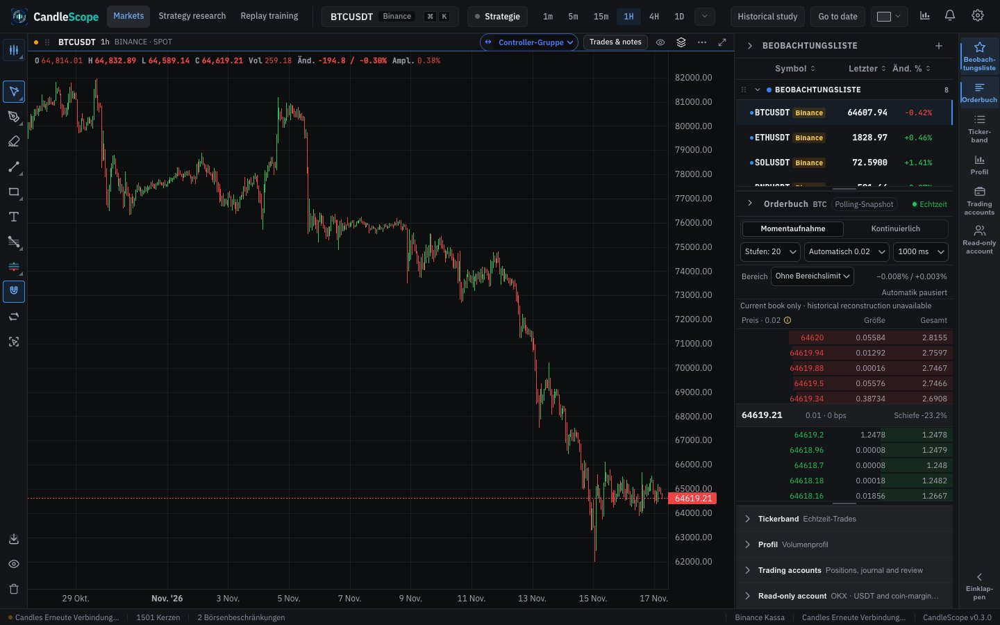
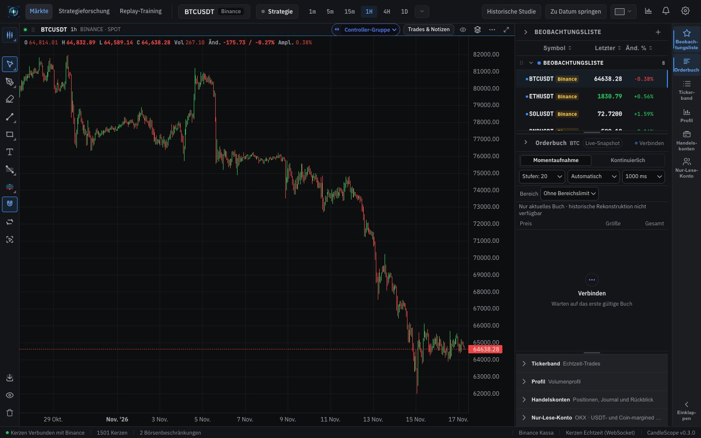
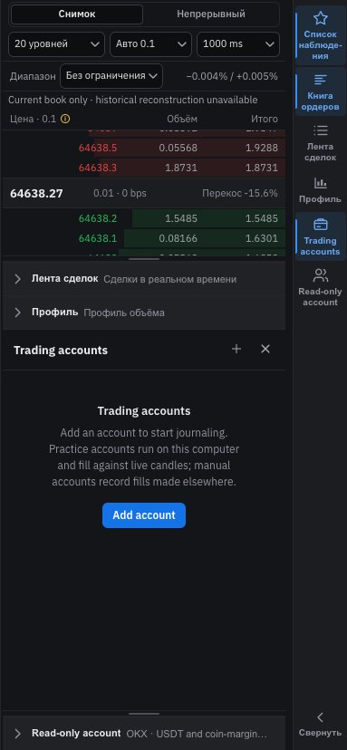
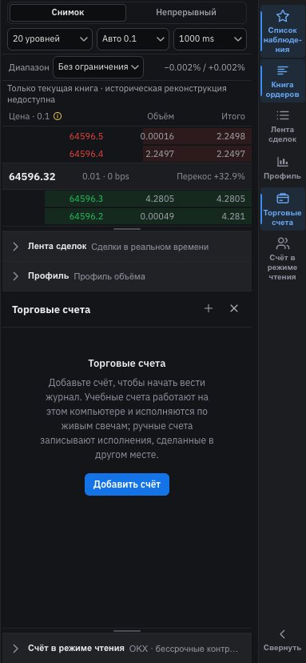
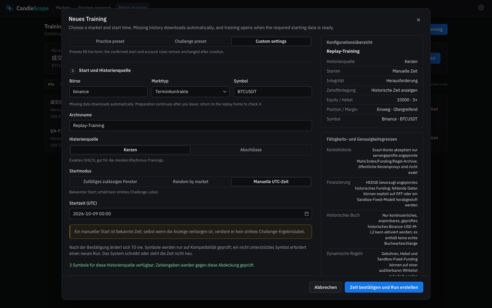
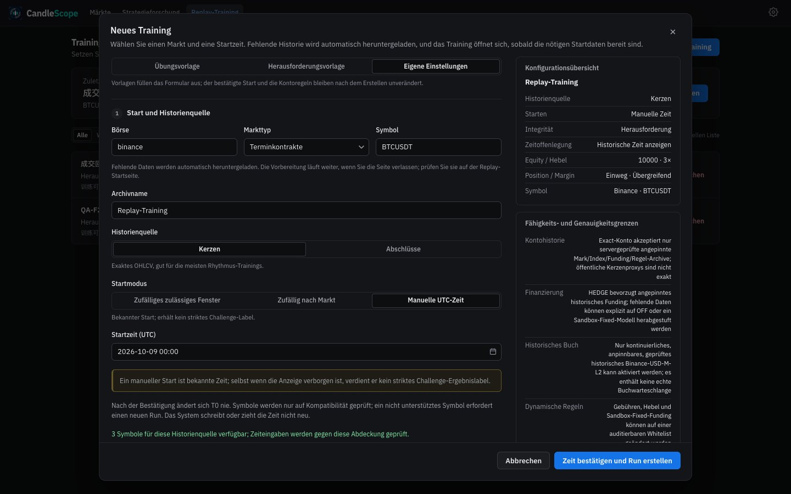
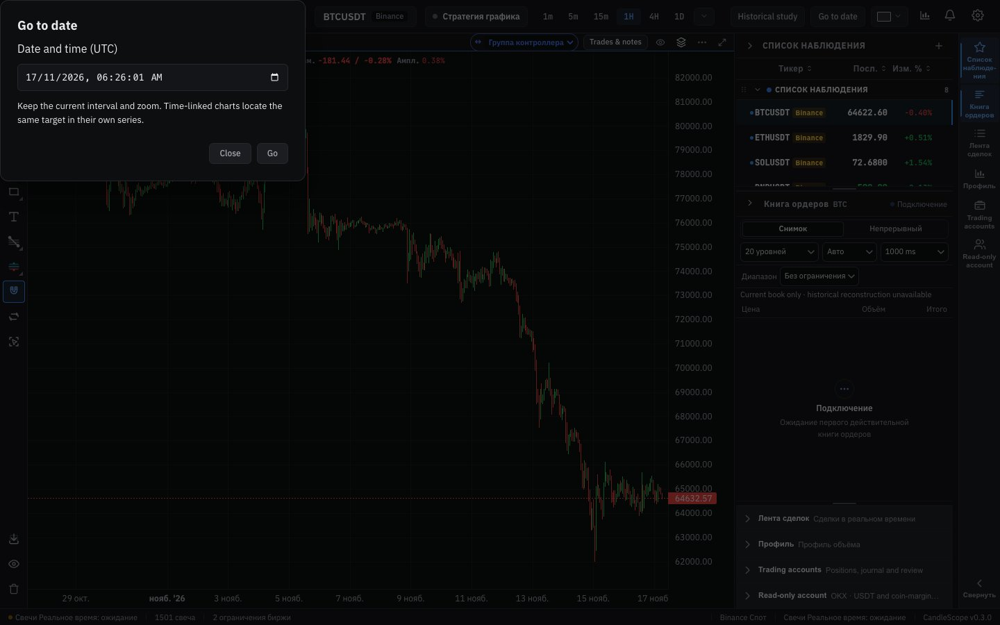
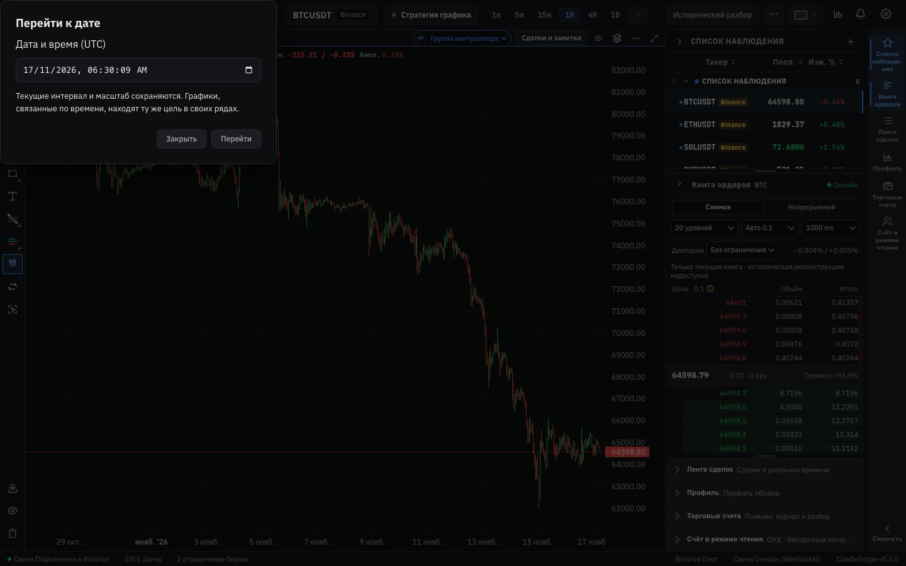

# Frontend design refactor: Phase 7c2 QA (German and Russian)

- Date: 2026-11-17
- Branch: `design/phase-7c2-translations`, based on `design/phase-7c-widths` (PR #468)
- Plan: [`frontend/FRONTEND_DESIGN_REFACTOR_PLAN.md`](../frontend/FRONTEND_DESIGN_REFACTOR_PLAN.md), Phase 7 (rows 7c2 and 7c3)
- **Intended visible change:** in German and Russian the app speaks the language throughout. Before, these showed in English: the top navigation, "Go to date", the historical study, "Trades & notes", trading and read-only accounts with their journal, statistics and quick replay, continuous research runs and history repair, the native strategy backtest and its report, strategy comparison, drawing objects and style templates, Support and AI MCP settings, data preparation, symbol search and the proxy settings. Other languages do not change.

## What changed

| Area | Change |
|---|---|
| Feature blocks | Seven message blocks (continuous research with its return, batch, repair and reader parts; trade history; replay notes; history study; read-only account; trading accounts; native strategies) had their own text only in Chinese, Japanese, Korean and Brazilian Portuguese; the other 23 languages spread the English block. German and Russian now have their own, in `catalogs/germanFeatureMessages.ts` and `catalogs/russianFeatureMessages.ts`: 1,218 messages each, every block typed against its English block (a missing key fails the type check), and imported only by `de.ts` / `ru.ts`, so they load with those languages' own lazy chunks instead of the English bundle. |
| Inline English | `de.ts` kept 224 messages in English and `ru.ts` 129 (go to date, data preparation, the replay hub's welcome and recent training, search and its source states, the proxy and WebSocket settings, indicator names and parameters, drawing settings, the workspace navigation, page titles). They are translated in place. |
| Duplicates | 27 English messages (`aiControl.*`, `settings.category.ai`) sat in `de.ts` and `ru.ts` after the native block and would have hidden its translation; they are removed. `study.loading` stays inline: English overrides it there as well ("Loading market data"). |
| Terms | The existing catalogs' terms are kept. German: Lauf, Kerzen, Fill, PnL, Replay, Funding, Warmup, Slippage, Long / Short, Notizen, Rückblick, Studie, Orderbuch, Handelskonten, Nur-Lese-Konto. Russian: запуск, свечи, исполнение, прибыль и убыток (результат in short labels), воспроизведение, тренировка на истории, ставка финансирования, прогрев, проскальзывание, лонг / шорт, заметки, разбор, книга ордеров, торговые счета, счёт в режиме чтения (the read-only account; "Счёт только для чтения" was cut in the rail's 52 px tab at every width in the first audit). The chart's B / S / N trade and note markers stay as letters, like the tape's B / S. |
| Rail tabs | A tab label hyphenates only words of eight letters or more (`hyphenate-limit-chars: 8 3 3`), so "режиме" moves whole to the next line while "Beobach-tungsliste" and "Handels-konten" still break. |
| Counts | Russian messages that put a count before a plural noun, where the count can be 1–4, read "noun: count" instead ("Покрытие R: сделок {count} из {total}", "Повторно использован прогресс, свечей: {count}"). The tape's resync message in German and Russian too: "Fehlende Trades: mindestens {count}", "Пропущено сделок: не менее {count}" (it read "1 сделок"; English still reads "At least 1 trades"). |
| Plan | 7c2 is narrowed to German and Russian in full; new row 7c3 for the other 19 languages, Traditional Chinese and Japanese. |

## Results

Messages shown in English, counted on the resolved catalogs (every key of the English catalog whose value is the same English text with two or more words):

| | Base (Phase 7c) | This branch |
|---|---|---|
| German | 1,203 | 18 |
| Russian | 1,106 | 6 |
| Other languages | unchanged (for example French 1,130, Spanish 1,113, Japanese 290) | unchanged |

The 18 and 6 left read the same in English on purpose: Binance USD-M, the MACD and ATR full names, Python Studio, TP / SL, MFE / MAE, Heikin Ashi, "BTC, ETH, SOL…", and in German "Slippage (bps)", "Minute (UTC)", "New York (EST/EDT)", "Maker / Taker bps".

`npm run design:layout` in German and Russian: 23 states × 4 widths = 184 visits per build, dark theme, writes refused, every visit reached its state.

| | Base (Phase 7c) | This branch |
|---|---|---|
| Findings | 41, all with the full text on hover | 45, all with the full text on hover |
| Without the full text on hover | 0 | 0 |

The first run on this branch found one label cut: the Russian rail tab "Счёт только для чтения" (37 visits, every width). The title became "Счёт в режиме чтения", the tab label stops hyphenating words under eight letters ("Счёт в / режиме / чтения" instead of "ре- / жиме"), and the Russian audit ran again in full. What remains is data or a message with its whole text as the title: collapsed panel summaries at 1024 px (now German and Russian: "Positionen, Journal und Rückblick", "Позиции, журнал и разбор"), the dataset select and source name, and the tape's resync message when its stream had gaps during a visit ("Fehlende Trades: mindestens 110; wird …").

## Screens

1440 × 900, dark theme; the base build (Phase 7c) and this branch. Writes were refused. Live data differs between the two captures.

| | Before | After |
|---|---|---|
| Market page, German, 1440 × 900: navigation, Historische Studie, Zu Datum springen, Trades & Notizen, the rail's tabs and panels |  |  |
| Trading accounts in the rail, Russian |  |  |
| New training, German (the replay hub's create view) |  |  |
| Go to date, Russian |  |  |

At 1440 px the German header now takes its first compaction steps (the wordmark and the ⌘K hint go) because its labels are longer; nothing in it is cut. In the German New training view, older messages keep some codes and English words inside German text ("Exact-Konto", "HEDGE bevorzugt …", "Challenge-Label"); see Known gaps.

## Verification

- `npm run check` passed: architecture, plugin platform, i18n (30 locales, 5,430 keys, placeholders match in every catalog, no internal terms), style metrics, cascade layers, types (each new block lists every key of its English block), lint (one warning, in `SingleChartPanes.tsx`, which this branch does not touch), 5,196 + 1 tests, 137 desktop tests and the build.
- The build puts the German text only in the `de` chunk (355 kB) and the Russian only in the `ru` chunk (499 kB); the main `index` chunk is 988.42 kB, as in Phase 7c.
- The translations were generated from tab-separated files (`output/i18n/7c2/`, not in the repository) by a script that refuses a missing or extra key, a changed placeholder or an empty message, and keeps each block in its English key order.
- `npm run design:layout` in German and Russian, as in Results (`output/design-layout/7c2-after/`), and the market page again in all four audited languages after the tab hyphenation change: no tab label cut.
- Screens above, taken with writes refused.

## Known gaps

- **Other languages** still spread the English feature blocks (about 1,100–1,200 messages each in 19 languages; about 620–720 in the Traditional Chinese variants; 290 in Japanese). That is Phase 7c3, through per-language feature files like the two added here.
- **No native-speaker review.** The German and Russian text was written for this phase and checked for placeholders, terms and fit, not read by a native speaker of either language.
- **Codes and English words inside older translations.** Messages translated before this phase keep some codes and English words inside German or Russian text: "Exact-Konto akzeptiert nur …", "HEDGE bevorzugt …", "striktes Challenge-Label", "Zeit bestätigen und Run erstellen", and the replay hub's integrity modes. The count does not see them; they belong with a glossary pass over replay messages.
- **The count finds whole messages in English.** A translated message that keeps an English word on purpose (a product name, Pine, PnL, Fill, Long / Short in German) is not counted; one that kept an English phrase by mistake would not be either.
