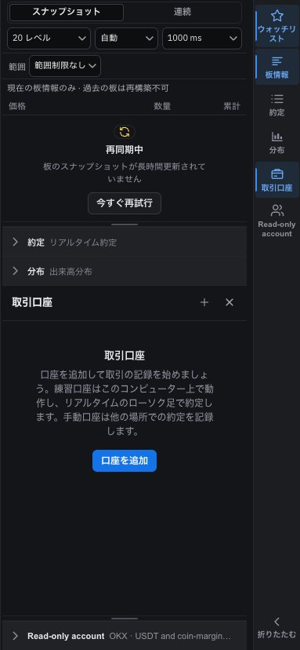
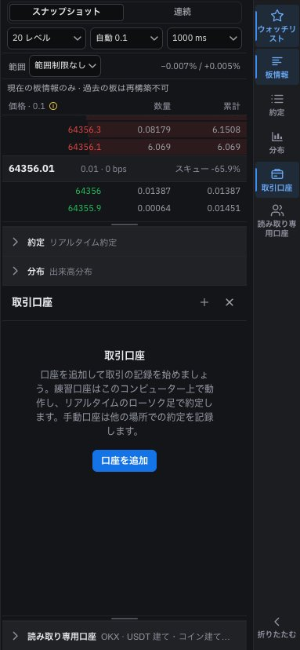
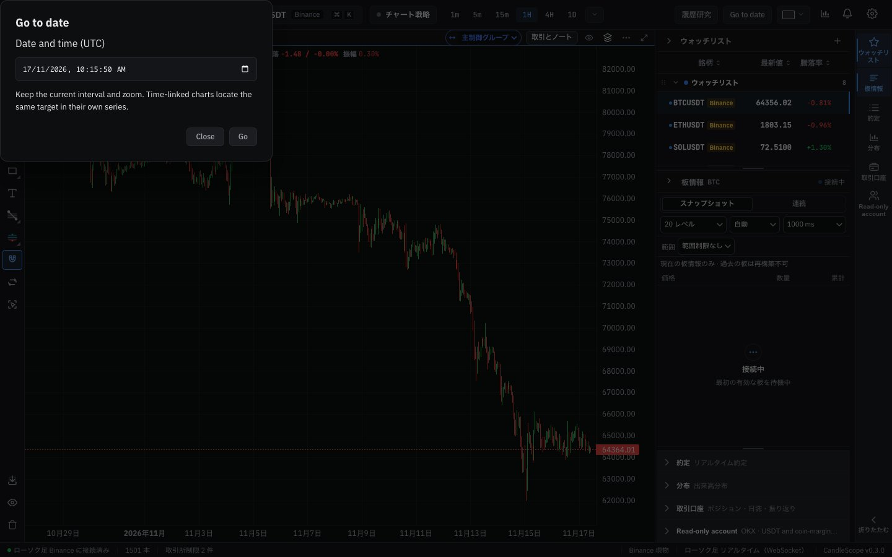
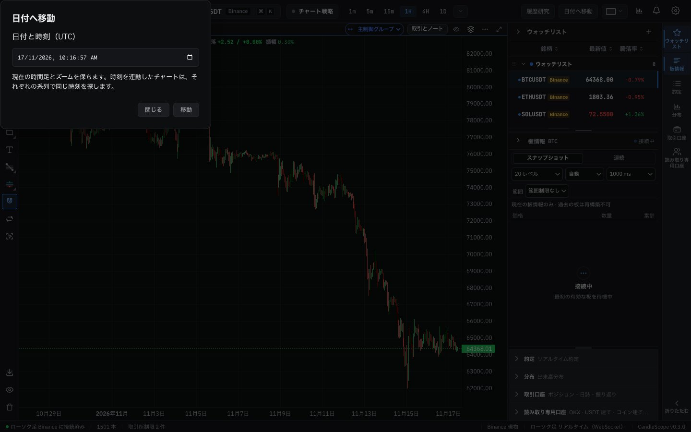
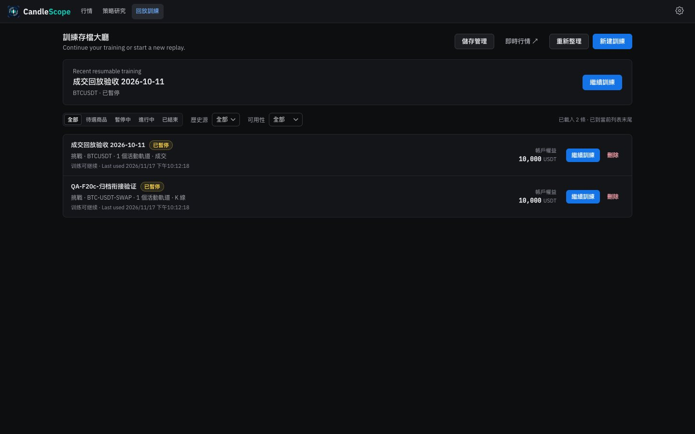
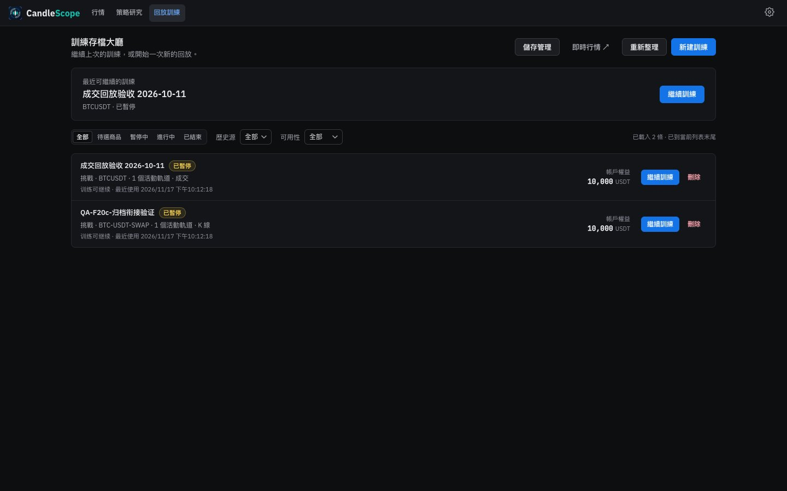
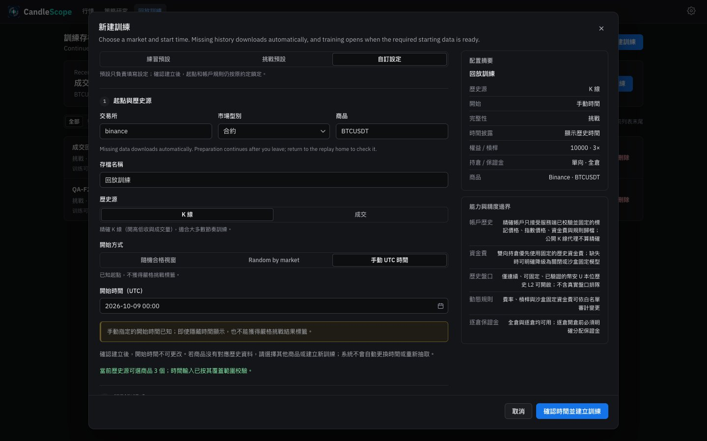
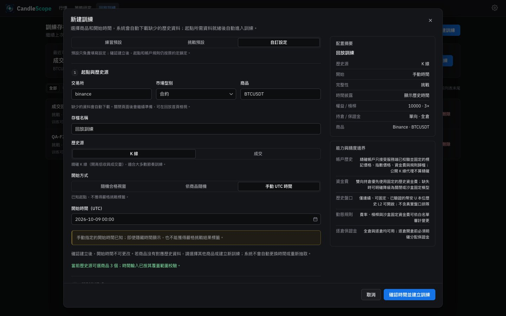

# Frontend design refactor: Phase 7c3 QA (Traditional Chinese and Japanese)

- Date: 2026-11-17
- Branch: `design/phase-7c3-cjk`, based on `design/phase-7c2-translations` (PR #470)
- Plan: [`frontend/FRONTEND_DESIGN_REFACTOR_PLAN.md`](../frontend/FRONTEND_DESIGN_REFACTOR_PLAN.md), Phase 7 (rows 7c3 and 7c4)
- **Intended visible change:** in Traditional Chinese (zh-Hant, zh-TW, zh-HK, zh-MO) and Japanese, the parts that still showed English now show the language: continuous research runs and history repair, the read-only account, the native strategy backtest with its report, comparison and drawing objects, data preparation, the replay hub's welcome and random start, and in Japanese also "Go to date", the proxy settings and AI MCP. Simplified Chinese gets the order-flow pane's descriptions, which were English. Other languages do not change.

## What changed

| Area | Change |
|---|---|
| Traditional feature file | New `catalogs/traditionalFeatureMessages.ts`: continuous research (165, with its return, batch, repair and reader parts), read-only account (151) and native strategies (432) in Traditional Chinese, 748 messages typed against the English blocks. The four Traditional catalogs share it, as they already share the Traditional trading-accounts block, and it loads only with them. It was written from the Simplified Chinese messages in Taiwan usage (資料, 儲存, 設定, 帳戶, 執行, 程式碼, 原始碼, 本機, 檢視, 重新整理, 支援, 預設, 檔案, 網路, 分組, 佔用); 82 native messages one of the catalogs already had in Traditional were reused. |
| Replay notes | zh-Hant, zh-HK and zh-MO spread the English replay notes although a Traditional block existed (zh-TW used it); all four use it now. |
| Traditional inline | 42 messages in each of the four catalogs (data preparation, the replay hub's welcome, recent training and random start). One English duplicate (`settings.category.ai`) is removed; the block provides it. |
| Japanese feature file | New `catalogs/japaneseFeatureMessages.ts`: read-only account (151), research batch (46; the Japanese continuous block spread these in English), the data workbench's account and cost messages (64; 41 new, the rest already Japanese) and the Pine host (11). `ja.ts` spreads them in place of the English blocks. |
| Japanese inline | 55 messages (go to date, the replay hub, the proxy and WebSocket settings, maker / taker labels) and the 26 `aiControl.*` messages, which `ja.ts` held in English as its only copy. |
| Order flow | "Taker buy base volume" was English in Simplified Chinese, Traditional Chinese and Japanese, and the sell description was half English ("Taker sell base volume（图中为负轴）"); both are translated in all six. |
| Terms | Japanese follows its catalog: 口座, 約定, ローソク足, 資金調達率, 実行, 板, 注文, ポジション, 損益, 照合, 下書き, メモ, リプレイ. |
| Plan | 7c3 is Traditional Chinese and Japanese; new row 7c4 for the other 19 languages, two per PR, and the replay hub's status messages. |

## Results

Messages shown in English, counted on the resolved catalogs (every key of the English catalog whose value is the same English text with two or more words):

| | Base (Phase 7c2) | This branch |
|---|---|---|
| Traditional Chinese (zh-Hant) | 711 | 6 |
| Traditional Chinese, Taiwan (zh-TW) | 625 | 6 |
| Traditional Chinese, Hong Kong (zh-HK) | 718 | 6 |
| Traditional Chinese, Macao (zh-MO) | 718 | 6 |
| Japanese | 290 | 5 |
| Simplified Chinese | 7 | 6 |
| Other languages | unchanged | unchanged |

What is left reads the same in English on purpose: Binance USD-M, MFE / MAE (twice), AI MCP, in Chinese "Maker / Taker" and "Maker / Taker bps", and in Japanese "Python Studio".

`npm run design:layout` in Japanese and Traditional Chinese (zh-TW): 23 states × 4 widths = 184 visits per build, dark theme, writes refused.

| | Base (Phase 7c2) | This branch |
|---|---|---|
| Findings | 62, all with the full text on hover | 51, all with the full text on hover |
| Without the full text on hover | 0 | 0 |

On the base, 16 visits (history study and trading accounts) did not reach their state because the history study loaded late; they ran again with a 25 s wait: 12 findings, all with the full text on hover. On this branch every visit reached its state, and the same 16 again with the longer wait gave 12, all with hover.

- The read-only account's summary in the rail ("OKX · USDT and coin-margined perpetuals · Hedge mode") was English and cut at every width up to 1920 px; in Japanese and Chinese it is shorter and is cut only at 1024 px, with its text on hover.
- "主制御グループ" (the chart's link-group select, 36 visits on this branch, 40 on the base) is shown in full: the select sizes to its text, and the audit allows 16 px for the arrow where Chrome draws about 14.5 px at 11 px type.
- The rest is data: the dataset select and source name, and a backtest ID.
- Rail tab labels in Japanese break between any two characters, as Japanese text does ("読み取り専 / 用口座", and on the base already "ウォッチリ / スト"); nothing is cut. `word-break: auto-phrase` was tried and does not help: it keeps each label as one phrase.

## Screens

1440 × 900, dark theme; the base build (Phase 7c2) and this branch. Writes were refused. Live data differs between the two captures.

| | Before | After |
|---|---|---|
| The rail in Japanese, with the trading accounts open: the read-only account's tab and its summary |  |  |
| Go to date, Japanese (the dialog and the header button) |  |  |
| The replay hub, Traditional Chinese (zh-TW): welcome, recent training, "last used" |  |  |
| New training, Traditional Chinese (zh-TW): the introduction, the preparation note, "依商品隨機" |  |  |

Each training row on the hub still ends its status line with "训练可继续" in Simplified Chinese: that is the server's own message, shown as sent in every language, English included (see Known gaps). The training names are the user's data.

## Verification

- `npm run check` passed: architecture, plugin platform, i18n (30 locales, 5,430 keys, placeholders match in every catalog, no internal terms, no Simplified characters or mainland terms in zh-TW), style metrics, cascade layers, types (each new block lists every key of its English block), lint (one warning, in `SingleChartPanes.tsx`, which this branch does not touch), 5,196 + 1 tests, 137 desktop tests and the build.
- The build puts the Traditional feature messages in their own chunk (`traditionalFeatureMessages`, 51 kB), which only the zh-Hant, zh-TW, zh-HK and zh-MO chunks load (the main chunk lists it only among their preload files), and the Japanese text only in the `ja` chunk (350 kB). The main `index` chunk is 988.50 kB (988.42 kB in Phase 7c2): Simplified Chinese ships in it, and its two order-flow descriptions are now Chinese.
- The translations were generated from tab-separated files (`output/i18n/7c3/`, not in the repository) by a script that refuses a missing or extra key, a changed placeholder or an empty message, keeps each block in its English key order, and, for keys a catalog already had in the language, reuses that translation.
- `npm run design:layout` in Japanese and zh-TW, as in Results (`output/design-layout/7c3-before/`, `7c3-before-study/`, `7c3-after/`, `7c3-after-study/`).
- Screens above, taken with writes refused.

## Known gaps

- **Hong Kong and Macao read Taiwan usage.** The shared Traditional file has to pass the zh-TW check, so zh-HK and zh-MO get Taiwan terms (資料, 程式碼, 檔案, 執行) where Hong Kong usage can differ (數據, 編碼); the trading-accounts block they already shared does the same.
- **No native-speaker review** of the Traditional Chinese or the Japanese.
- **The other 19 languages** still spread the English feature blocks: Phase 7c4.
- **The replay hub's run status comes from the server in Simplified Chinese** ("训练可继续", "回放已创建，请选择第一个商品。", "存档当前不可恢复…", "输入时间线需要恢复…"; `backend/app/replay/training/persistence/run_records.py`) and the hub shows it as sent unless the run has ended, so every language sees it. The four status codes get catalog messages in Phase 7c4 (recorded in its plan row).
