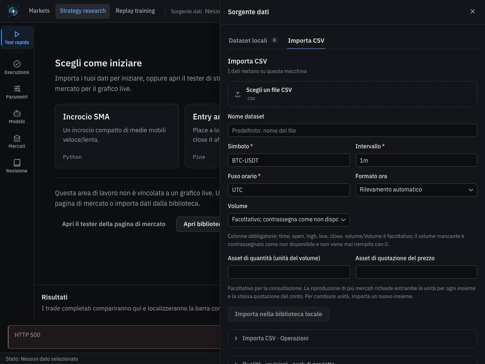
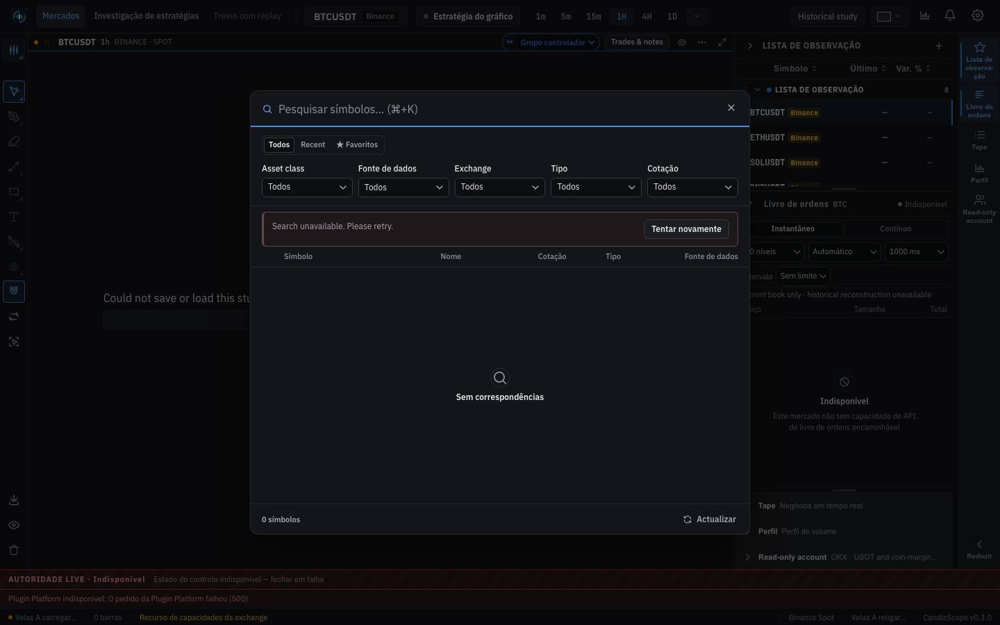
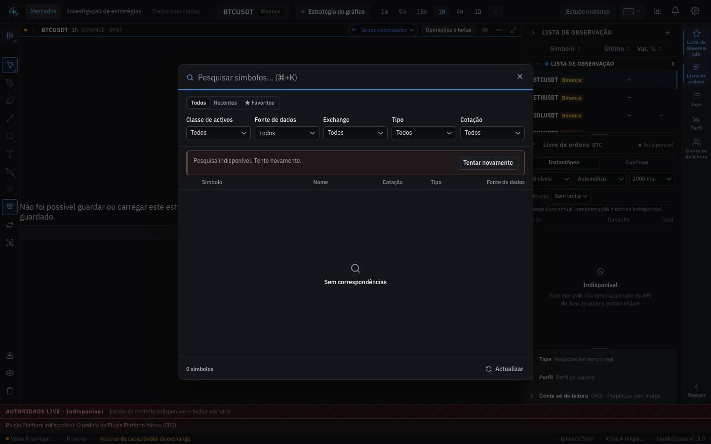
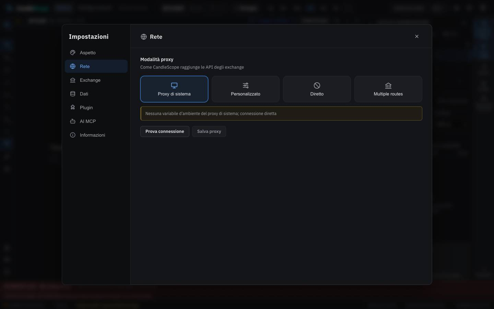
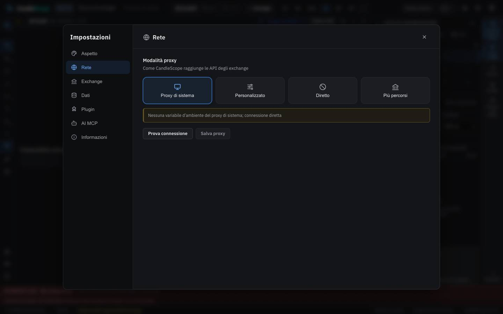
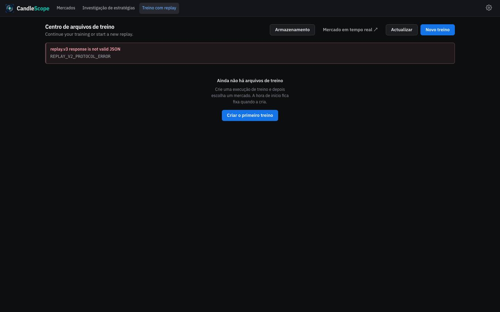

# Frontend design refactor: Phase 7c5 QA (Italian and Portuguese (Portugal))

- Date: 2026-11-18
- Branch: `design/phase-7c5-it-pt`, based on `design/phase-7c4-es-fr` (PR #488)
- Plan: [`frontend/FRONTEND_DESIGN_REFACTOR_PLAN.md`](../frontend/FRONTEND_DESIGN_REFACTOR_PLAN.md), Phase 7 (row 7c4)
- **Intended visible change:** in Italian and European Portuguese, the parts that still showed English now show the language: continuous research runs and history repair, trade history, replay notes, the history study, the read-only account, trading accounts with their journal, quick replay and statistics, the native strategy backtest with its report, comparison and drawing objects, support settings and AI MCP, "Go to date", data preparation, the replay hub's welcome and random start, search, and the proxy settings. Italian also gets the strategy tester's workspace and CSV import, indicator names and parameters, and the data workbench's replay archive.

## What changed

| Area | Change |
|---|---|
| Italian feature file | New `catalogs/italianFeatureMessages.ts`: the seven feature blocks (continuous research with its return, batch, repair and reader parts; trade history; replay notes; history study; read-only account; trading accounts; native strategies), 1,218 messages typed against the English blocks and imported only by `it.ts`. |
| Portuguese feature file | New `catalogs/europeanPortugueseFeatureMessages.ts`: the same seven blocks, 1,218 messages, imported only by `pt-PT.ts`. They start from the Brazilian Portuguese blocks (`pt-BR` has all seven), converted to Portugal's usage and reviewed line by line against the English; where the Brazilian text follows an older English wording, the Portuguese follows the current English. |
| Inline English | 215 Italian and 163 Portuguese messages translated in place: go to date, data preparation, the replay hub, search, the proxy and WebSocket settings, drawing settings; in Italian also the strategy tester's workspace, CSV import and presets, indicator names and parameters, keyboard shortcuts, the data engine status and the replay archive. Values that read the same in the language (Volume, Slippage, Scenario, Standard, Hedge, Sandbox…) are left as they are. |
| Duplicates | 27 English duplicates of the native block (`aiControl.*`, `settings.category.ai`) that overrode it in `it.ts` / `pt-PT.ts` are removed. |
| Terms | Italian (tu, as the catalog): conto, trade, fill, esecuzione (run), equity, funding, commissioni, slippage, candela, barra, libro ordini, dataset, snapshot, replay, training, diario, revisione, leva, Lungo / Corto as the catalog has them. Portuguese (Portugal, formal imperative, the pre-1990 spelling the catalog uses throughout: actual, activo, seleccione, exacto): conta, operação (trade), negócio (market trade), execução (fill and run), capital, comissão, derrapagem, vela, barra, livro de ordens, conjunto de dados, instantâneo, replay, treino, diário, revisão, Longa / Curta, ficheiro (file) and arquivo (archive). |

## Results

Messages shown in English, counted on the resolved catalogs (every key of the English catalog whose value is the same English text with two or more words):

| | Base (Phase 7c4) | This branch |
|---|---|---|
| Italian | 1,209 | 25 |
| Portuguese (Portugal) | 1,134 | 26 |
| Other languages | unchanged | unchanged |

What is left reads the same in the language on purpose: names (Binance USD-M, Python Studio, Heikin Ashi, Line Break, Hong Kong, in Italian New York and Tokyo), MFE / MAE, AI MCP, TP / SL, Maker / Taker, the search example "BTC, ETH, SOL…", and the trading words each language uses as they are (Italian: Slippage, Profit factor, Buy & hold, Open interest, Average True Range, "{value} per trade"; Portuguese: Take profit, Stop loss, Stop-loss, Take-profit, Maker / Taker bps).

`npm run design:layout` in Italian and Portuguese, on the 19 design states that open without the local service (settings, indicators, alerts, symbol search, export, the interval and layout menus, data workbench, chart tester, extension recovery, the replay hub and New training, the strategy page with its local source, backtest): 19 states × 4 widths × 2 languages = 152 visits per build, dark theme, the local service stopped, so nothing could be written. Every visit reached its state.

| | Base (Phase 7c4) | This branch |
|---|---|---|
| Findings | 38, 24 with the full text on hover | 24, all with the full text on hover |
| Without the full text on hover | 14: the CSV import's volume option, Italian and Portuguese, 7 each | 0 |

- **The CSV import's volume option** ("Optional; mark unavailable if missing"), in Italian and Portuguese, was wider than its select at 1024 and 1366 px (the strategy page's local source and the strategy page). It was already this way before this branch. It is now "Facoltativo; se manca, non disponibile" and "Opcional; indisponível se faltar".
- The read-only account's summary in the rail ("OKX · Perpetui con margine in USDT e in cripto · Modalità hedge", "OKX · Perpétuos com margem em USDT e em cripto · Modo de cobertura") is cut with an ellipsis and its full text on hover, as the English one was on the base.
- The rail's tab titles were measured separately (see Verification): every one fits its three lines.

## Screens

From the layout audit's own captures (the local service was stopped, so panels that need data show their empty or error state; see Known gaps). Dark theme; the base build (Phase 7c4) and this branch.

| | Before | After |
|---|---|---|
| Strategy page, local source, Italian, 1024 px: the header's tabs, the "Entry and exit" sample and the CSV volume option |  |  |
| Symbol search, Portuguese, 1440 px: scope, asset class, the search error; behind it the rail's "Conta só de leitura" and "Operações e notas" |  |  |
| Network settings, Italian, 1440 px: "Più percorsi" (multiple routes) |  |  |
| The replay hub, Portuguese, 1440 px: the welcome line |  |  |

## Verification

- `npm run check` passed: architecture, plugin platform, i18n (30 locales, 5,434 keys, placeholders match in every catalog, no internal terms), style metrics, cascade layers, types (each new block lists every key of its English block), lint (one warning, in `SingleChartPanes.tsx`, which this branch does not touch), 5,199 + 1 tests, 137 desktop tests and the build. After it, seven Italian messages changed to the catalog's "Lungo" / "Corto" and the CSV volume option was shortened in both languages; the i18n check passed again.
- The build puts the Italian text only in the `it` chunk (356.00 kB) and the Portuguese only in the `pt-PT` chunk (361.31 kB). The main `index` chunk is unchanged (989.26 kB).
- The translations were generated from tab-separated files (`output/i18n/7c5/`, not in the repository) by a script that refuses a missing or extra key, a changed placeholder or an empty message and keeps each block in its English key order. The Portuguese draft came from a script that converts the Brazilian text (vocabulary and spelling, never inside a placeholder); every line was then read against the English and about 570 were rewritten.
- The rail's tab titles were measured at 1440 px in both languages: "Conta só de leitura" / "Contas de negociação" and "Conto in sola lettura" / "Conti di trading" fit in the tab's three lines.
- `npm run design:layout` in Italian and Portuguese, as in Results (`output/design-layout/7c5-before/`, `7c5-after/`).
- Screens above, from those audits.

## Known gaps

- **No native-speaker review** of the Italian or the Portuguese.
- **Portuguese spelling.** `pt-PT.ts` uses the spelling from before the 1990 agreement almost everywhere (actual 163 times, atual 18), so the new messages do too. Moving the whole catalog to the current spelling is a separate change.
- **Audited without data, and screens without data.** The local service hung again a few minutes after each start (as in Phase 7c4), so this time the layout audit ran with it stopped, on the 19 states that open without it. The market page, the rail's tape and trading accounts, and the history study (4 states) were not audited; the rail's tab titles were measured on their own instead. The screens show empty or error states where a panel needs data.
- **An English protocol error.** With the local service stopped, the replay hub shows "replay response is not valid JSON" (`REPLAY_PROTOCOL_ERROR`, `replayApi.ts`) in every language: it is the client's own error text, not a catalog message. Not changed here.
- **The other 15 languages** still spread the English feature blocks: Phase 7c6 onwards (Dutch and Polish next).
- **Italian drawing labels** "Presa di profitto" / "Stop perdita" (existing, in the drawing tools) differ from the trading accounts' "Take profit" / "Stop loss" (new, as Italian traders write them); left as they are.
