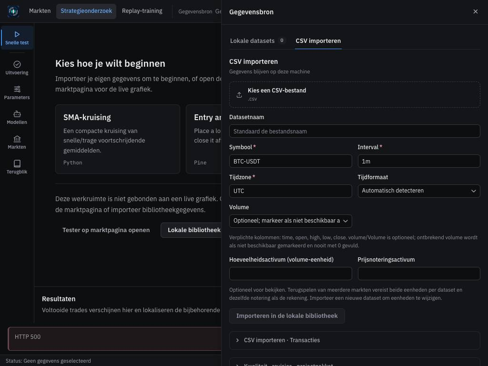
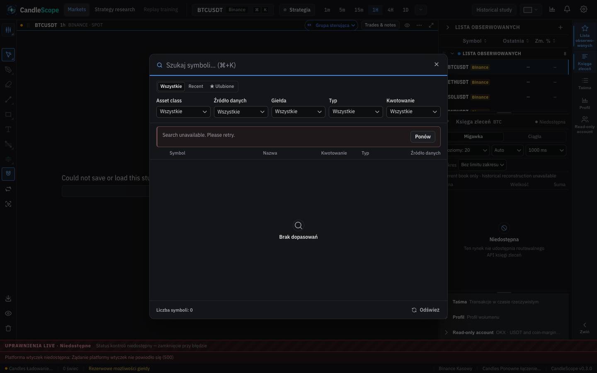
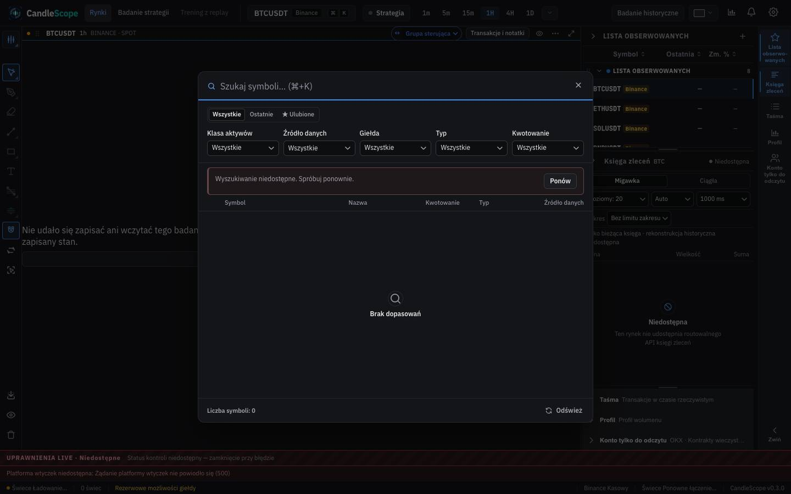
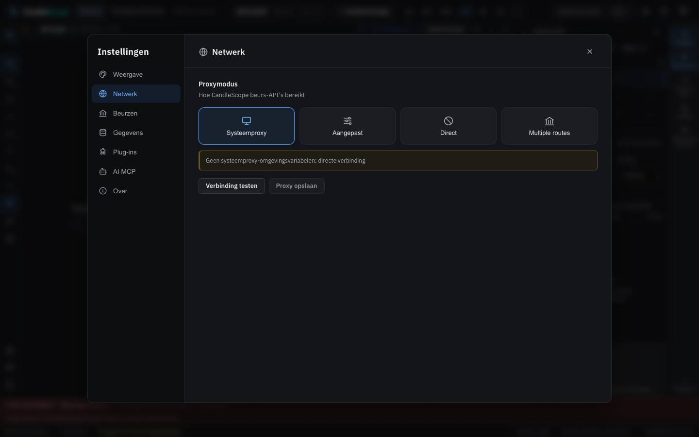
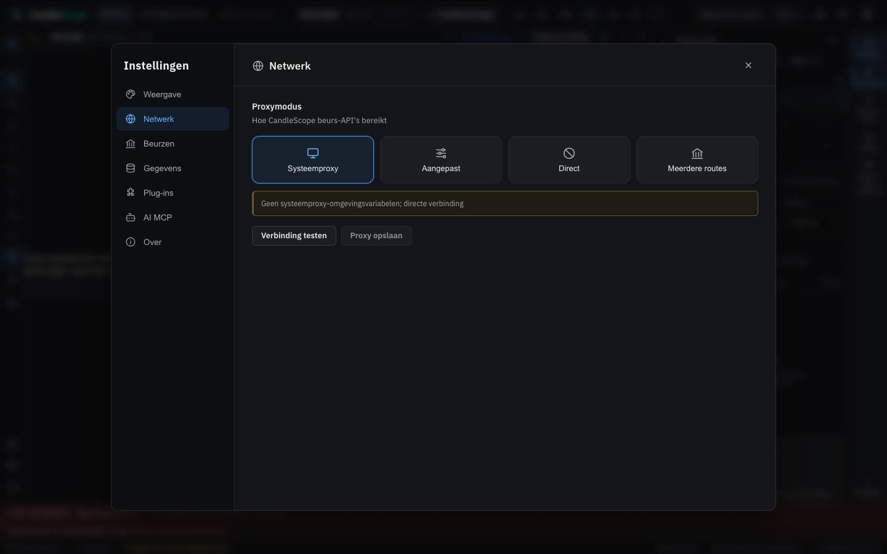
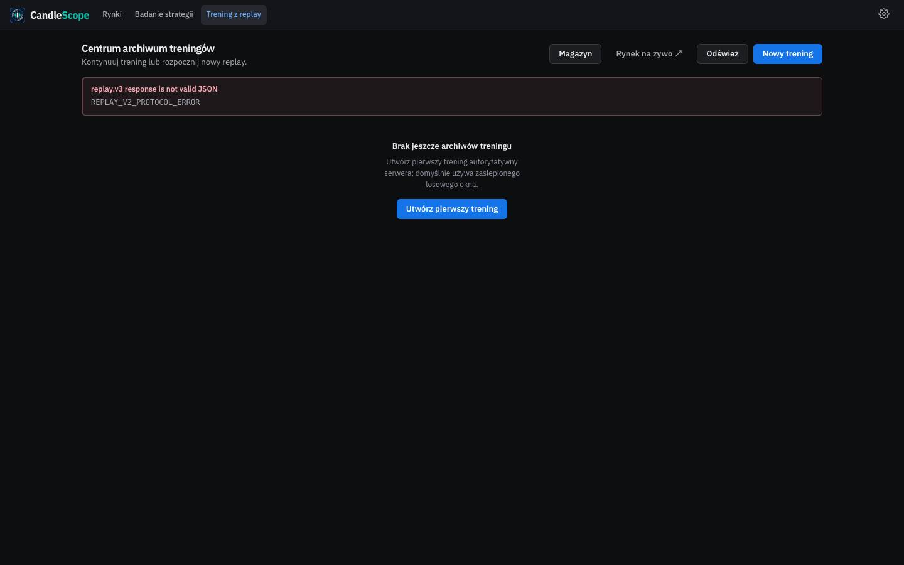

# Frontend design refactor: Phase 7c6 QA (Dutch and Polish)

- Date: 2026-11-19
- Branch: `design/phase-7c6-nl-pl`, based on `design/phase-7c5-it-pt` (PR #495)
- Plan: [`frontend/FRONTEND_DESIGN_REFACTOR_PLAN.md`](../frontend/FRONTEND_DESIGN_REFACTOR_PLAN.md), Phase 7 (row 7c4)
- **Intended visible change:** in Dutch and Polish, the parts that still showed English now show the language: continuous research runs and history repair, trade history, replay notes, the history study, the read-only account, trading accounts with their journal, quick replay and statistics, the native strategy backtest with its report, comparison and drawing objects, support settings and AI MCP, "Go to date", data preparation, the replay hub's welcome and random start, search, and the proxy settings. Polish also gets the strategy tester's workspace and CSV import, indicator names and parameters, keyboard shortcuts and the data workbench's replay archive; Dutch the order book, funding and replay workbench labels that were still English.

## What changed

| Area | Change |
|---|---|
| Dutch feature file | New `catalogs/dutchFeatureMessages.ts`: the seven feature blocks (continuous research with its return, batch, repair and reader parts; trade history; replay notes; history study; read-only account; trading accounts; native strategies), 1,218 messages typed against the English blocks and imported only by `nl.ts`. |
| Polish feature file | New `catalogs/polishFeatureMessages.ts`: the same seven blocks, 1,218 messages, imported only by `pl.ts`. |
| Inline English | 163 Dutch and 221 Polish messages translated in place, and the CSV import's volume option shortened in both (see Results). Values that read the same in the language are left as they are; Dutch keeps many (Filter, Interval, Trend, Status, Plan, Script, Trades, Dataset, Slippage…). |
| Duplicates | 27 English duplicates of the native block (`aiControl.*`, `settings.category.ai`) that overrode it in `nl.ts` / `pl.ts` are removed. |
| Terms | Dutch (je, as the catalog): account, trade, order, fill, run, eigen vermogen (equity), funding, kosten, slippage, kaars, bar, orderboek, dataset, snapshot, replay, training, journaal, review, hefboom, beurs (exchange), W&V, Long / Short. Polish (informal, as the catalog): konto, transakcja (trade), zlecenie (order), realizacja (fill), przebieg (run), kapitał (equity), finansowanie, opłata, poślizg, świeca, księga zleceń, zestaw danych, migawka, replay, trening, dziennik, przegląd, dźwignia, giełda, P&L, Długa / Krótka. Where a Polish count can be 1–4, the message reads "label: {count}" so the noun does not have to agree with the number. |

## Results

Messages shown in English, counted on the resolved catalogs (every key of the English catalog whose value is the same English text with two or more words):

| | Base (Phase 7c5) | This branch |
|---|---|---|
| Dutch | 1,157 | 44 |
| Polish | 1,203 | 13 |
| Other languages | unchanged | unchanged |

What is left reads the same in the language on purpose: names (Binance USD-M, Python Studio, Heikin Ashi, and in Dutch Line Break, Point & Figure, New York), MFE / MAE, AI MCP, TP / SL, Maker / Taker, Stop-loss / Take-profit, the search example "BTC, ETH, SOL…". Dutch keeps more trading words as traders write them: Slippage, Open orders, Orders / fills, Live snapshot, Hedge long/short, Perpetual futures, Bollinger Bands, Average True Range, the MACD's full name, "{value} per trade".

`npm run design:layout` in Dutch and Polish, on the 19 design states that open without the local service (as in Phase 7c5): 19 states × 4 widths × 2 languages = 152 visits per build, dark theme, the local service not running, so nothing could be written. Every visit reached its state.

| | Base (Phase 7c5) | This branch |
|---|---|---|
| Findings | 44, 30 with the full text on hover | 30, all with the full text on hover |
| Without the full text on hover | 14: the CSV import's volume option, Dutch and Polish, 7 each | 0 |

- **The CSV import's volume option** ("Optional; mark unavailable if missing") was wider than its select at 1024 and 1366 px in Dutch and Polish, as it was in Italian and Portuguese before Phase 7c5. It is now "Optioneel; anders niet beschikbaar" and "Opcjonalnie; jeśli brak, niedostępny". The full audit of this branch ran before the change; the strategy page and its local source were audited again after it in both languages (16 visits): nothing found.
- The rail's accordion summaries (the read-only account's "OKX · USDT- en coin-marged perpetuals · Hedgemodus" and "OKX · Kontrakty wieczyste z depozytem w USDT i kryptowalutach · …", and at 1024 px the Polish tape's "Transakcje w czasie rzeczywistym") are cut with an ellipsis and their full text on hover, as the English summary was on the base.

## Screens

From the layout audit's own captures (the local service was not running, so panels that need data show their empty or error state). Dark theme; the base build (Phase 7c5) and this branch.

| | Before | After |
|---|---|---|
| Strategy page, local source, Dutch, 1024 px: the header's tabs, the CSV volume option (after the change) |  |  |
| Symbol search, Polish, 1440 px: scope, asset class, the search error; behind it the rail's "Konto tylko do odczytu" and "Transakcje i notatki" |  |  |
| Network settings, Dutch, 1440 px: "Meerdere routes" (multiple routes) |  |  |
| The replay hub, Polish, 1440 px: the welcome line |  |  |

## Verification

- `npm run check` passed: architecture, plugin platform, i18n (30 locales, 5,434 keys, placeholders match in every catalog, no internal terms), style metrics, cascade layers, types (each new block lists every key of its English block), lint (one warning, in `SingleChartPanes.tsx`, which this branch does not touch), 5,199 + 1 tests, 137 desktop tests and the build.
- The build puts the Dutch text only in the `nl` chunk (346.81 kB) and the Polish only in the `pl` chunk (353.83 kB). The main `index` chunk is unchanged (989.26 kB).
- The translations were generated from tab-separated files (`output/i18n/7c6/`, not in the repository) by a script that refuses a missing or extra key, a changed placeholder or an empty message and keeps each block in its English key order.
- The rail's tab titles were measured at 1440 px: "Handelsaccounts" and "Konta handlowe" take two lines, "Alleen-lezen account" and "Konto tylko do odczytu" three; none is cut.
- `npm run design:layout` in Dutch and Polish, as in Results (`output/design-layout/7c6-before/`, `7c6-after/`, `7c6-after-csv/`). After the full check, only the two volume-option messages changed; the i18n check passed again.
- Screens above, from those audits.

## Known gaps

- **No native-speaker review** of the Dutch or the Polish.
- **Audited without data, as in Phase 7c5.** The local service was not started (it hung in Phases 7c4 and 7c5), so the layout audit covers the 19 states that open without it; the market page, the rail's tape and trading accounts, and the history study were not audited. The rail's tab titles were measured on their own. The screens show empty or error states where a panel needs data.
- **The other 13 languages** still spread the English feature blocks: Phase 7c7 onwards (Ukrainian and Czech next).
