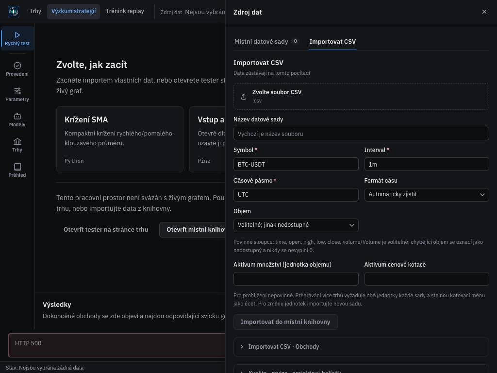
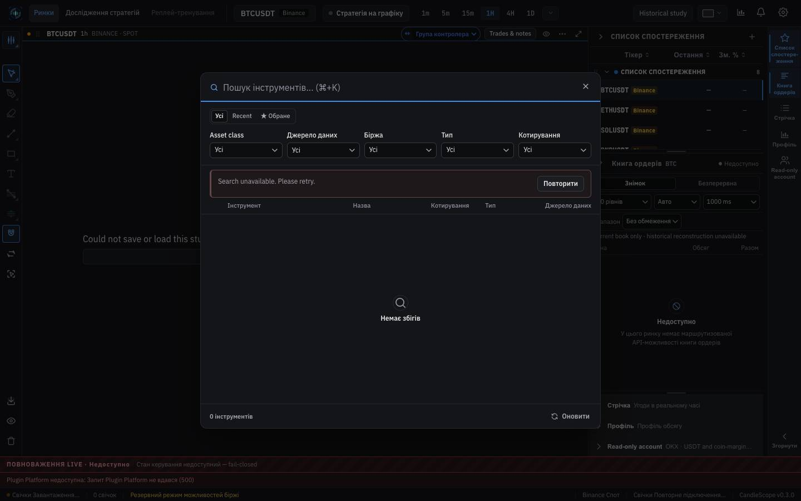
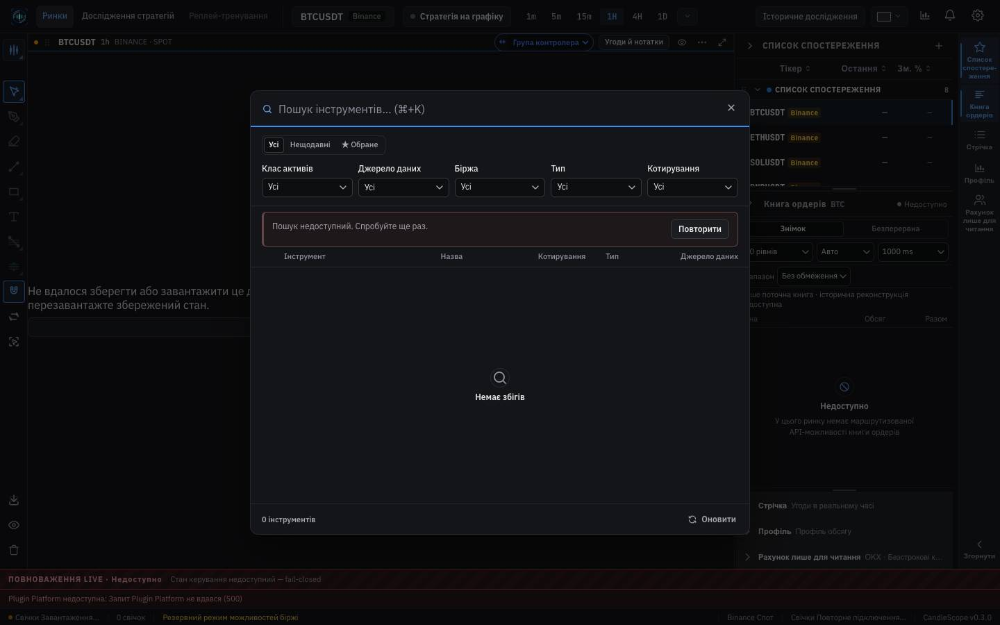
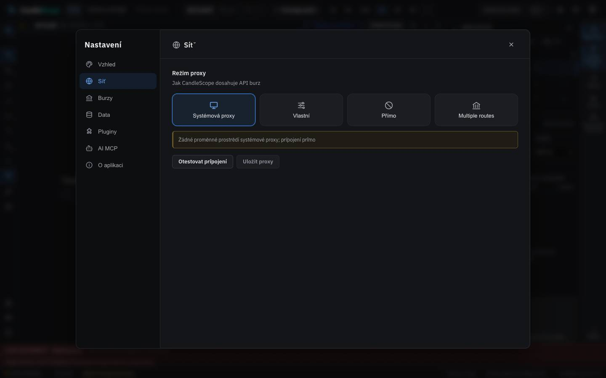
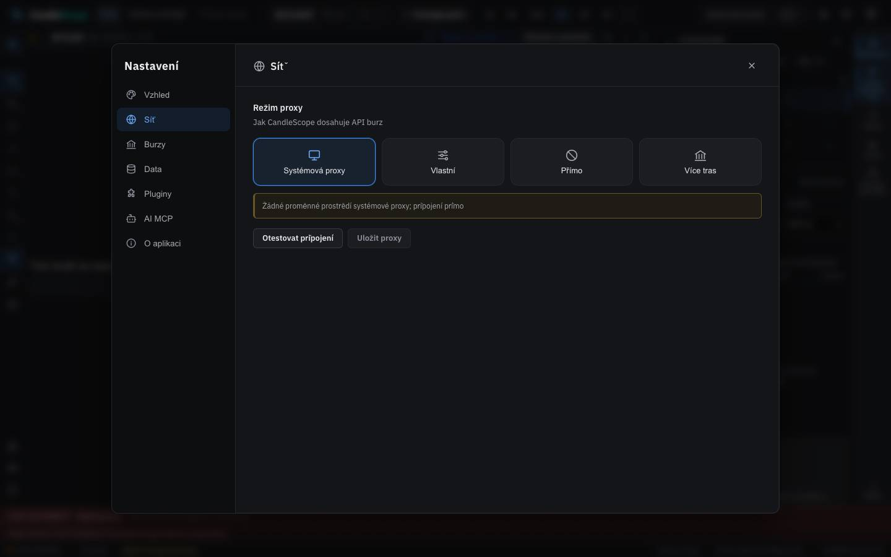
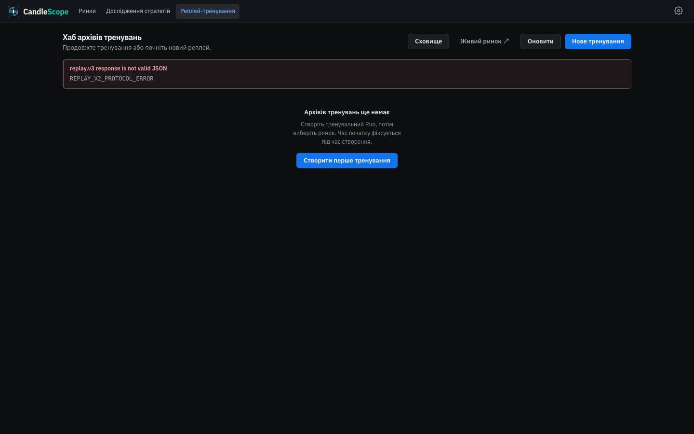

# Frontend design refactor: Phase 7c7 QA (Ukrainian and Czech)

- Date: 2026-11-20
- Branch: `design/phase-7c7-uk-cs`, based on `design/phase-7c6-nl-pl` (PR #502)
- Plan: [`frontend/FRONTEND_DESIGN_REFACTOR_PLAN.md`](../frontend/FRONTEND_DESIGN_REFACTOR_PLAN.md), Phase 7 (row 7c4)
- **Intended visible change:** in Ukrainian and Czech, the parts that still showed English now show the language: continuous research runs and history repair, trade history, replay notes, the history study, the read-only account, trading accounts with their journal, quick replay and statistics, the native strategy backtest with its report, comparison and drawing objects, support settings and AI MCP, "Go to date", data preparation, the replay hub's welcome and random start, search, and the proxy settings. Czech also gets the watchlist's name ("Sledované"), the replay workbench's order and margin labels, funding and open interest, and the chart types still in English.

## What changed

| Area | Change |
|---|---|
| Ukrainian feature file | New `catalogs/ukrainianFeatureMessages.ts`: the seven feature blocks (continuous research with its return, batch, repair and reader parts; trade history; replay notes; history study; read-only account; trading accounts; native strategies), 1,218 messages translated from English, typed against the English blocks and imported only by `uk.ts`. |
| Czech feature file | New `catalogs/czechFeatureMessages.ts`: the same seven blocks, 1,218 messages, imported only by `cs.ts`. |
| Inline English | 132 Ukrainian and 189 Czech messages translated in place. The CSV import's volume option, too long in both languages as it was in the four before, is shorter ("Необов’язково; інакше недоступно", "Volitelné; jinak nedostupné"). |
| Duplicates | 27 English duplicates of the native block (`aiControl.*`, `settings.category.ai`) that overrode it in `uk.ts` / `cs.ts` are removed. |
| Terms | Ukrainian (formal "ви", as the catalog): рахунок, угода (trade), ордер, виконання (fill), запуск (run), капітал, фінансування, комісія, прослизання, свічка, книга ордерів, набір даних, знімок, реплей, тренування, журнал, огляд, кредитне плече, біржа, P&L, Лонг / Шорт. Czech (formal, as the catalog): účet, obchod (trade), objednávka (order), plnění (fill), běh (run), kapitál, financování, poplatek, skluz, svíčka, kniha objednávek, datová sada, snímek, replay, trénink, deník, revize, páka, burza, P&L, Long / Short. In both languages, where a count can be 2–4, the message reads "label: {count}" so the noun does not have to agree with the number. |

## Results

Messages shown in English, counted on the resolved catalogs (every key of the English catalog whose value is the same English text with two or more words):

| | Base (Phase 7c6) | This branch |
|---|---|---|
| Ukrainian | 1,115 | 13 |
| Czech | 1,150 | 27 |
| Other languages | unchanged | unchanged |

What is left reads the same in the language on purpose: names (Binance USD-M, Python Studio, Heikin Ashi, and in Czech Line Break and New York), MFE / MAE, AI MCP, TP / SL, Maker / Taker and their bps fields, the search example "BTC, ETH, SOL…"; in Czech also the trading words Czech traders use as they are (Take profit, Stop loss, Stop-loss, Take-profit, Mini ticker, long / short, Interval ms).

`npm run design:layout` in Ukrainian and Czech, on the 19 design states that open without the local service (as in Phases 7c5 and 7c6): 19 states × 4 widths × 2 languages = 152 visits per build, dark theme, the local service not running, so nothing could be written. Every visit reached its state.

| | Base (Phase 7c6) | This branch |
|---|---|---|
| Findings | 38, 24 with the full text on hover | 24, all with the full text on hover |
| Without the full text on hover | 14: the CSV import's volume option, Ukrainian and Czech, 7 each | 0 |

- **The CSV import's volume option** was wider than its select at 1024 and 1366 px in both languages, as it was in the four languages of Phases 7c5 and 7c6; it is shorter now (see What changed).
- The rail's accordion summary of the read-only account ("OKX · Безстрокові контракти з маржею в USDT і криптовалюті · Режим хеджування", "OKX · Perpetuální kontrakty s maržou v USDT a v kryptoměnách · Režim zajištění") is cut with an ellipsis and its full text on hover, as the English summary was on the base.

## Screens

From the layout audit's own captures (the local service was not running, so panels that need data show their empty or error state). Dark theme; the base build (Phase 7c6) and this branch.

| | Before | After |
|---|---|---|
| Strategy page, local source, Czech, 1024 px: the header's tabs and the CSV volume option |  |  |
| Symbol search, Ukrainian, 1440 px: scope, asset class, the search error; behind it the rail's "Рахунок лише для читання" and "Угоди й нотатки" |  |  |
| Network settings, Czech, 1440 px: "Více tras" (multiple routes) |  |  |
| The replay hub, Ukrainian, 1440 px: the welcome line |  |  |

## Verification

- `npm run check` passed: architecture, plugin platform, i18n (30 locales, 5,434 keys, placeholders match in every catalog, no internal terms), style metrics, cascade layers, types (each new block lists every key of its English block), lint (one warning, in `SingleChartPanes.tsx`, which this branch does not touch), 5,199 + 1 tests, 137 desktop tests and the build.
- The build puts the Ukrainian text only in the `uk` chunk (490.46 kB; Cyrillic takes two bytes a letter) and the Czech only in the `cs` chunk (348.31 kB). The main `index` chunk is unchanged (989.25 kB).
- The translations were generated from tab-separated files (`output/i18n/7c7/`, not in the repository) by a script that refuses a missing or extra key, a changed placeholder or an empty message and keeps each block in its English key order.
- The rail's tab titles were measured at 1440 px: "Торгові рахунки" and "Obchodní účty" take two lines, "Рахунок лише для читання" three and "Účet jen pro čtení" two; none is cut.
- `npm run design:layout` in Ukrainian and Czech, as in Results (`output/design-layout/7c7-before/`, `7c7-after/`).
- Screens above, from those audits.

## Known gaps

- **No native-speaker review** of the Ukrainian or the Czech.
- **Audited without data, as in Phases 7c5 and 7c6.** The local service was not started, so the layout audit covers the 19 states that open without it; the market page, the rail's tape and trading accounts, and the history study were not audited. The rail's tab titles were measured on their own. The screens show empty or error states where a panel needs data.
- **The other 11 languages** still spread the English feature blocks: Phase 7c8 onwards (Hungarian and Romanian next).
