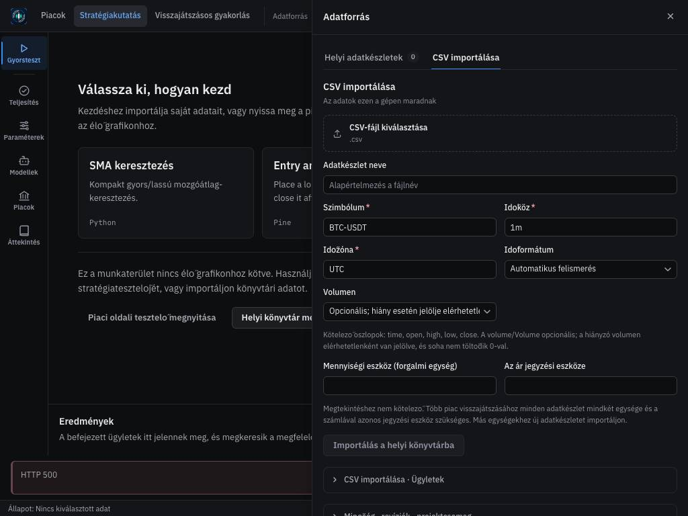
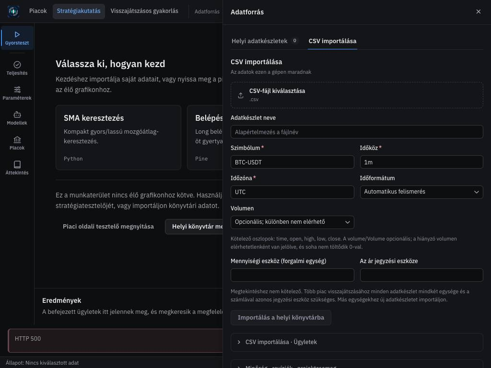
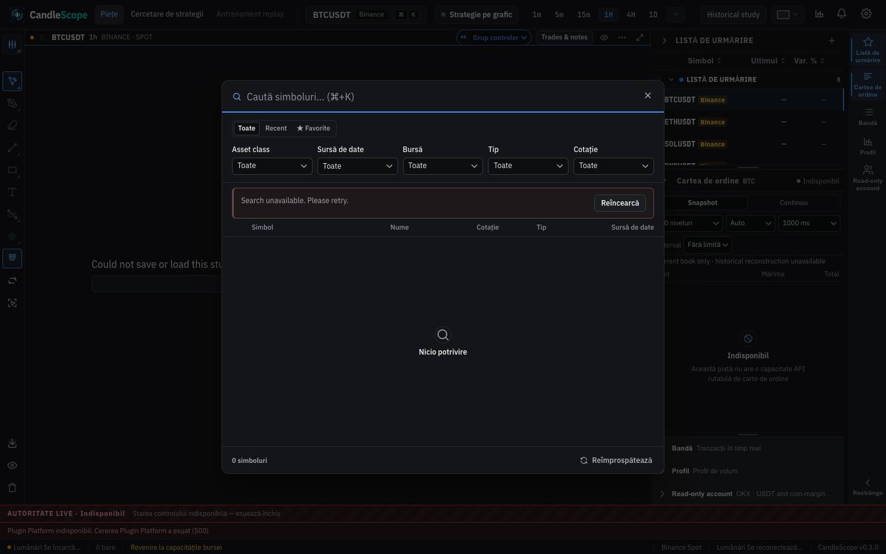
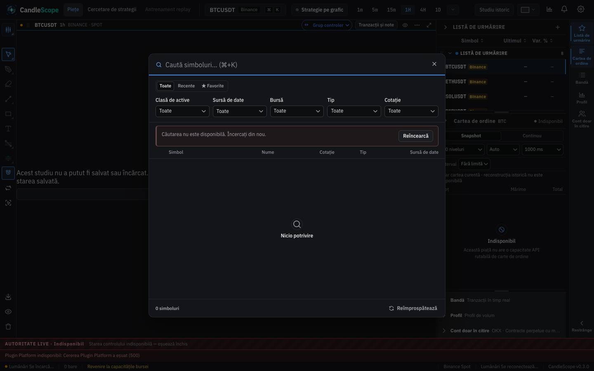
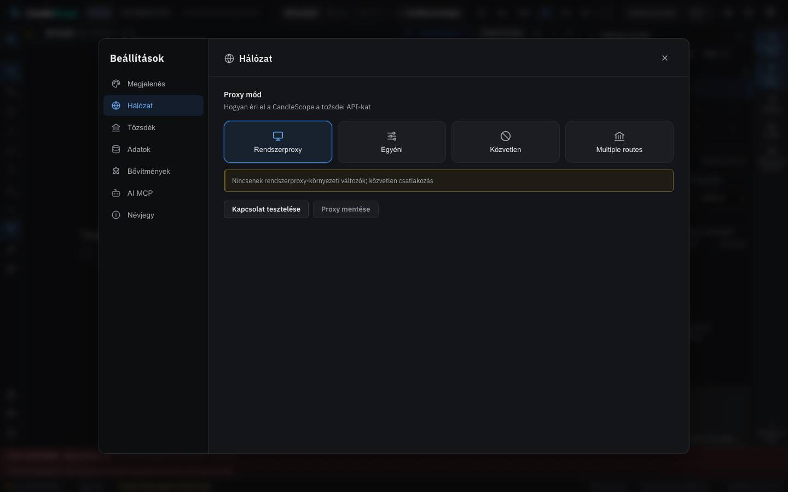
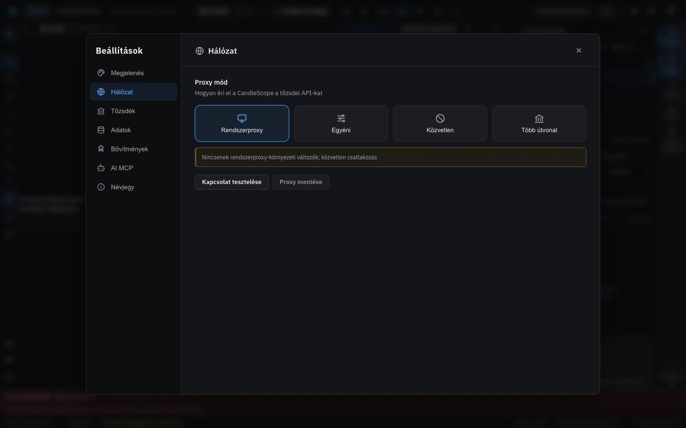
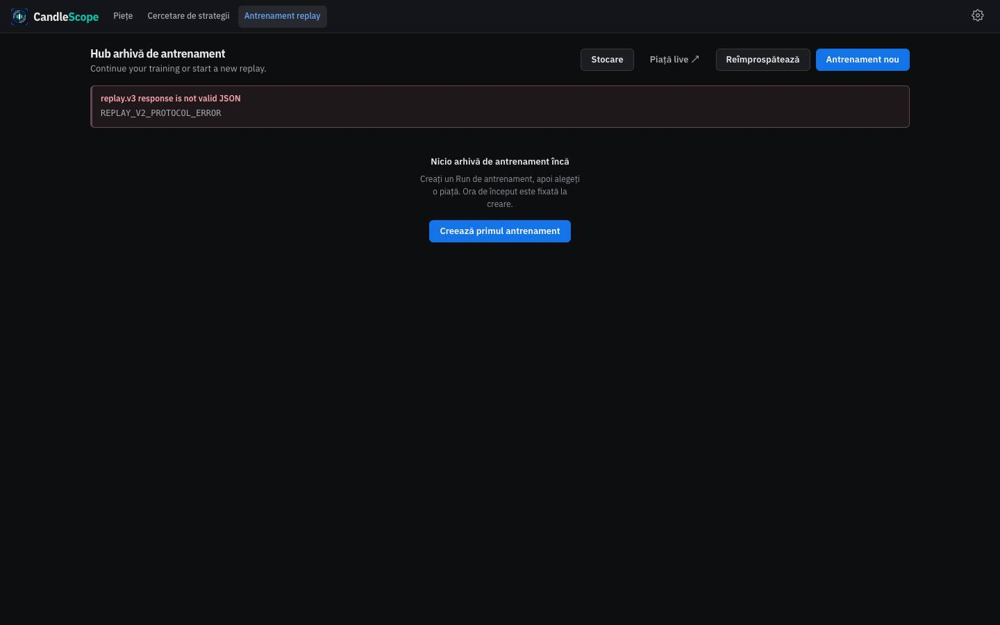
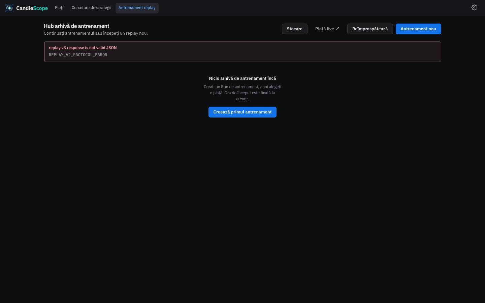

# Frontend design refactor: Phase 7c8 QA (Hungarian and Romanian)

- Date: 2026-11-20
- Branch: `design/phase-7c8-hu-ro`, based on `design/phase-7c7-uk-cs` (PR #503)
- Plan: [`frontend/FRONTEND_DESIGN_REFACTOR_PLAN.md`](../frontend/FRONTEND_DESIGN_REFACTOR_PLAN.md), Phase 7 (row 7c4)
- **Intended visible change:** in Hungarian, ő and ű draw correctly in the interface font (and Czech, Polish, Romanian and Hungarian letters with diacritics now come from the interface font rather than a fallback). In Hungarian and Romanian, the parts that still showed English now show the language: continuous research runs and history repair, trade history, replay notes, the history study, the read-only account, trading accounts with their journal, quick replay and statistics, the native strategy backtest with its report, comparison and drawing objects, support settings and AI MCP, "Go to date", data preparation, the replay hub's welcome and random start, search, and the proxy settings. Both also get the replay workbench's margin and order-type labels that were still English, and Romanian the order-flow pane's taker buy / sell and open interest.

## What changed

| Area | Change |
|---|---|
| Hungarian feature file | New `catalogs/hungarianFeatureMessages.ts`: the seven feature blocks (continuous research with its return, batch, repair and reader parts; trade history; replay notes; history study; read-only account; trading accounts; native strategies), 1,218 messages translated from English, typed against the English blocks and imported only by `hu.ts`. |
| Romanian feature file | New `catalogs/romanianFeatureMessages.ts`: the same seven blocks, 1,218 messages, imported only by `ro.ts`. |
| Inline English | 147 Hungarian and 162 Romanian messages translated in place. The CSV import's volume option, too long in both as it was in the six languages before, is shorter ("Opcionális; különben nem elérhető", "Opțional; altfel indisponibil"). |
| Interface font | `styles/fonts.ts` loaded IBM Plex Sans as its latin and cyrillic subset files, which carry no unicode-range. Letters outside them fell through to the CJK font: Hungarian ő and ű drew as an o or u with a detached accent ("Ido˝köz"), and the Czech, Polish, Romanian and Hungarian letters of Latin Extended-A came from another face. Already the case before this branch, in every language with those letters. The four weights now load from the package's per-weight files, which declare latin, latin-ext, cyrillic, cyrillic-ext, greek and vietnamese with their unicode-ranges, so a page fetches only the subsets its text uses (an English page still loads only latin). The shell's font test checks the new import. |
| Duplicates | 27 English duplicates of the native block (`aiControl.*`, `settings.category.ai`) that overrode it in `hu.ts` / `ro.ts` are removed. |
| Terms | Hungarian (formal, as the catalog): számla (account), ügylet (trade), megbízás (order), teljesítés (fill), futtatás (run), tőke, finanszírozás, díj, csúszás, gyertya, orderkönyv, adatkészlet, pillanatkép, visszajátszás, gyakorlás, napló, áttekintés, tőkeáttétel, tőzsde, eredmény (P&L), Long / Short; a noun after a number stays singular in Hungarian, so "{count} gyertya" is always right. Romanian (formal in sentences, short imperatives on buttons, as the catalog): cont, tranzacție (trade), ordin, execuție (fill), rulare (run), capital, finanțare, comision, slippage, lumânare, cartea de ordine, set de date, snapshot, replay, antrenament, jurnal, analiză (review), levier, bursă, P&L, Long / Short; where a count can be 1 or 20 and up ("de"), the message reads "label: {count}". |

## Results

Messages shown in English, counted on the resolved catalogs (every key of the English catalog whose value is the same English text with two or more words):

| | Base (Phase 7c7) | This branch |
|---|---|---|
| Hungarian | 1,136 | 27 |
| Romanian | 1,155 | 40 |
| Other languages | unchanged | unchanged |

What is left reads the same in the language on purpose: names (Binance USD-M, Python Studio, Heikin Ashi, Line Break, New York, London, and in Romanian Tokyo, Hong Kong, Beijing/Shanghai), MFE / MAE, AI MCP, TP / SL, Maker / Taker and their bps fields, the search example "BTC, ETH, SOL…", the trading words both use as traders write them (Take profit, Stop loss, Stop-loss, Take-profit, Mini ticker, long / short), and in Romanian also Slippage, Average True Range, Hedge long/short, Live (WebSocket), Transparent (PNG / WebP) and the fee summary line.

`npm run design:layout` in Hungarian and Romanian, on the 19 design states that open without the local service (as in Phases 7c5 to 7c7): 19 states × 4 widths × 2 languages = 152 visits per build, dark theme, the local service not running, so nothing could be written. Every visit reached its state. This branch was audited twice: before and after the font change.

| | Base (Phase 7c7) | This branch | This branch, with the font change |
|---|---|---|---|
| Findings | 38, 24 with the full text on hover | 24, all with the full text on hover | 24, all with the full text on hover |
| Without the full text on hover | 14: the CSV import's volume option, Hungarian and Romanian, 7 each | 0 | 0 |

- **The CSV import's volume option** was wider than its select at 1024 and 1366 px in both languages, as in the six languages before; it is shorter now.
- The rail's accordion summary of the read-only account ("OKX · USDT- és kriptofedezetű örökös kontraktusok · Fedezeti mód", "OKX · Contracte perpetue cu marjă în USDT și cripto · Mod hedge") is cut with an ellipsis and its full text on hover, as the English summary was on the base.
- **Fonts:** Hungarian ő and ű (in "Időköz", "elérhető", "tőzsdei"…) drew with a detached accent on the base and on this branch before the font change; with it they draw in IBM Plex Sans (screens below). Czech and Polish, whose letters with diacritics now also come from IBM Plex Sans, were audited again with the change (76 visits each): 12 and 18 findings, all with the full text on hover, as in Phases 7c7 and 7c6.

## Screens

From the layout audit's own captures (the local service was not running, so panels that need data show their empty or error state). Dark theme; the base build (Phase 7c7) and this branch with the font change.

| | Before | After |
|---|---|---|
| Strategy page, local source, Hungarian, 1024 px: ő in "Időköz", "Időzóna", "élő", "tesztelő" and the CSV volume option |  |  |
| Symbol search, Romanian, 1440 px: scope, asset class, the search error; behind it the rail's "Cont doar în citire" and "Tranzacții și note" |  |  |
| Network settings, Hungarian, 1440 px: "Több útvonal" (multiple routes) and "tőzsdei" |  |  |
| The replay hub, Romanian, 1440 px: the welcome line |  |  |

## Verification

- `npm run check` passed, after the font change: architecture, plugin platform, i18n (30 locales, 5,434 keys, placeholders match in every catalog, no internal terms), style metrics, cascade layers, types (each new block lists every key of its English block), lint (one warning, in `SingleChartPanes.tsx`, which this branch does not touch), 5,199 + 1 tests, 137 desktop tests and the build.
- The build puts the Hungarian text only in the `hu` chunk (369.20 kB) and the Romanian only in the `ro` chunk (358.64 kB). The main `index` chunk is unchanged (989.25 kB).
- The translations were generated from tab-separated files (`output/i18n/7c8/`, not in the repository) by a script that refuses a missing or extra key, a changed placeholder or an empty message and keeps each block in its English key order.
- Fonts: on the strategy page's local source at 1024 px, `document.fonts.check` finds IBM Plex Sans for "őű" in Hungarian, and an English page has not loaded that subset. The latin-ext face is 15.98 kB (woff2) per weight; the build carries the other subsets' files, fetched only when a page's text needs them.
- The rail's tab titles were measured at 1440 px: "Kereskedési számlák" and "Csak olvasható számla" take three lines, "Conturi de tranzacționare" three and "Cont doar în citire" two; none is cut.
- `npm run design:layout` in Hungarian and Romanian, as in Results (`output/design-layout/7c8-before/`, `7c8-after/`, and `7c8-after-fonts-hu/`, `-ro/`, `-cs/`, `-pl/` with the font change).
- Screens above, from those audits.

## Known gaps

- **No native-speaker review** of the Hungarian or the Romanian.
- **Audited without data, as in Phases 7c5 to 7c7.** The local service was not started, so the layout audit covers the 19 states that open without it; the market page, the rail's tape and trading accounts, and the history study were not audited. The rail's tab titles were measured on their own. The screens show empty or error states where a panel needs data.
- **Chart text drawings** still use Inter in its latin and cyrillic subsets only (kept for saved drawings, see `fonts.ts`), so a drawing's text with ő or ű falls back the same way. Changing the drawing font is a separate decision.
- **The other 9 languages** still spread the English feature blocks: Phase 7c9 onwards (Swedish and Turkish next).
