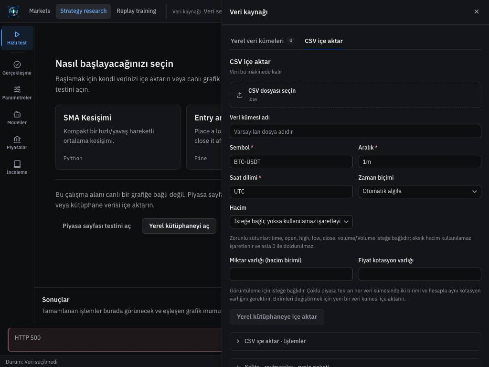
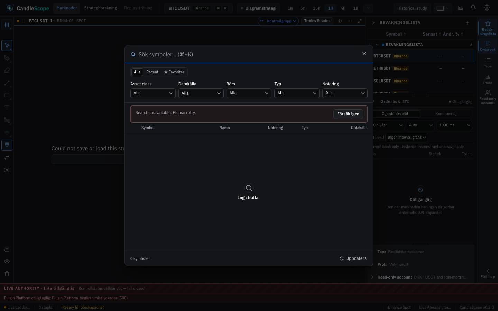
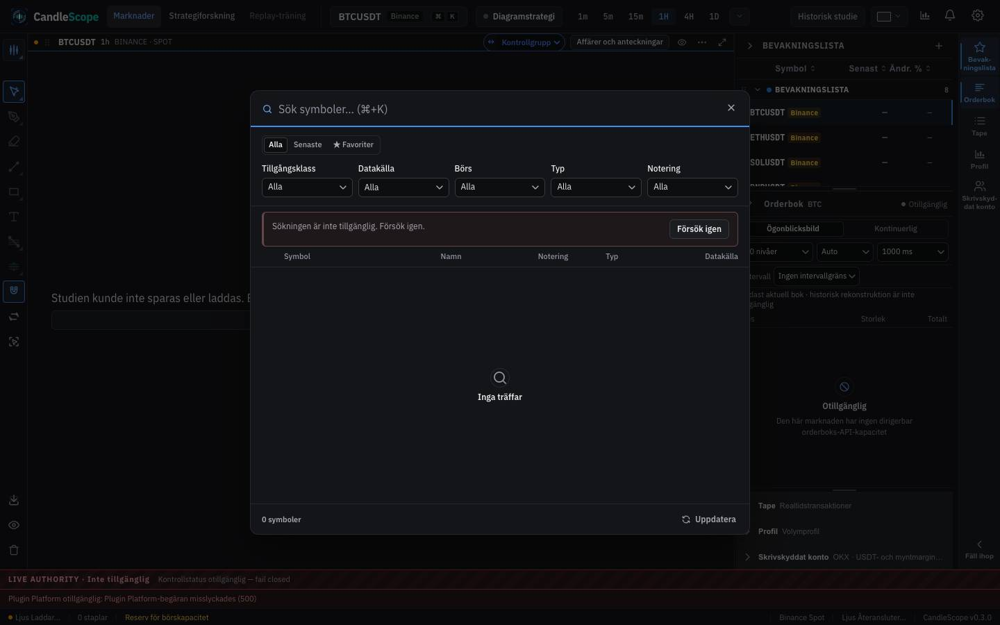
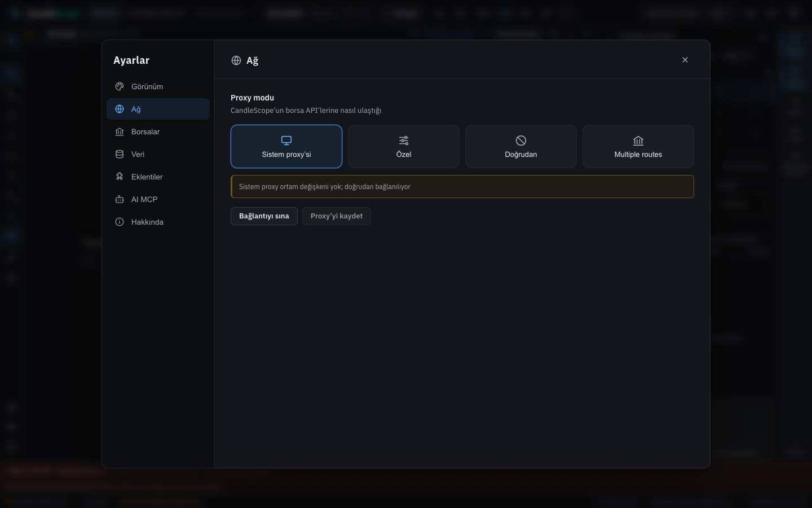
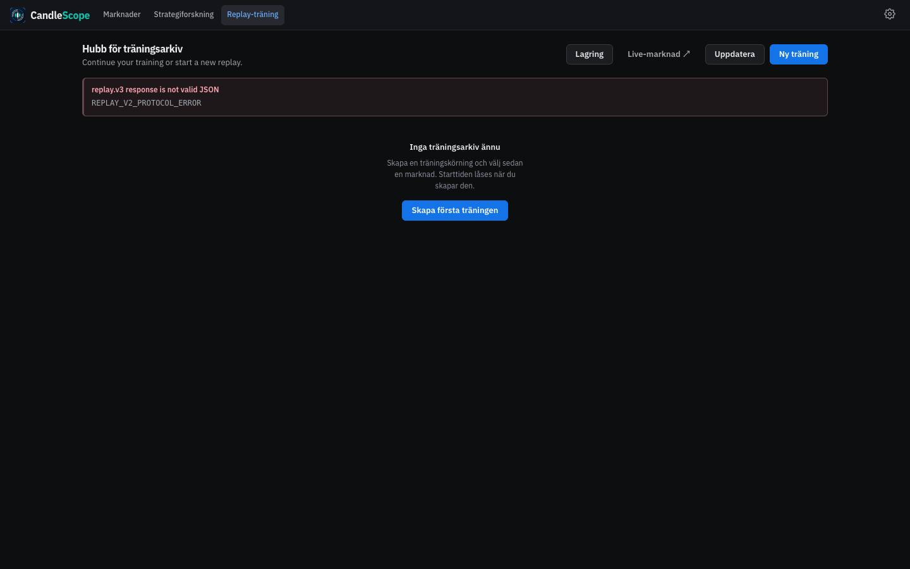
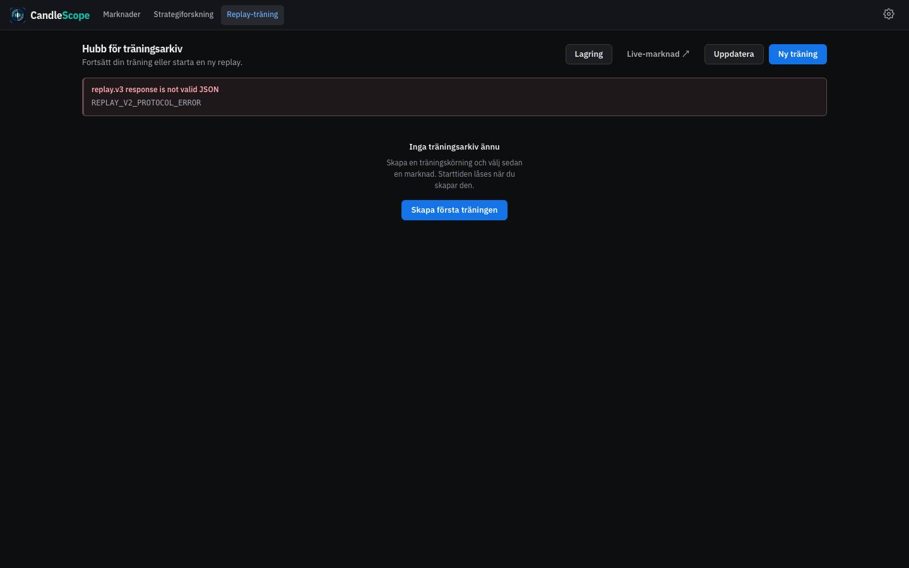

# Frontend design refactor: Phase 7c9 QA (Swedish and Turkish)

- Date: 2026-11-20
- Branch: `design/phase-7c9-sv-tr`, based on `design/phase-7c8-hu-ro` (PR #504)
- Plan: [`frontend/FRONTEND_DESIGN_REFACTOR_PLAN.md`](../frontend/FRONTEND_DESIGN_REFACTOR_PLAN.md), Phase 7 (row 7c4)
- **Intended visible change:** in Swedish and Turkish, the parts that still showed English now show the language: continuous research runs and history repair, trade history, replay notes, the history study, the read-only account, trading accounts with their journal, quick replay and statistics, the native strategy backtest with its report, comparison and drawing objects, support settings and AI MCP, "Go to date", data preparation, the replay hub's welcome and random start, search, and the proxy settings. Swedish also gets the replay workbench's labels and kickers that were still English and the indicator names; Turkish the strategy tester's workspace and CSV import, indicator names and parameters, and the data workbench's replay archive.

## What changed

| Area | Change |
|---|---|
| Swedish feature file | New `catalogs/swedishFeatureMessages.ts`: the seven feature blocks (continuous research with its return, batch, repair and reader parts; trade history; replay notes; history study; read-only account; trading accounts; native strategies), 1,218 messages translated from English, typed against the English blocks and imported only by `sv.ts`. |
| Turkish feature file | New `catalogs/turkishFeatureMessages.ts`: the same seven blocks, 1,218 messages, imported only by `tr.ts`. |
| Inline English | 188 Swedish and 223 Turkish messages translated in place. The CSV import's volume option, too long in Turkish as it was in the eight languages before, is shorter ("İsteğe bağlı; yoksa kullanılamaz"); the Swedish one fit, and now uses the same shorter wording ("Valfri; annars otillgänglig"). |
| Duplicates | 27 English duplicates of the native block (`aiControl.*`, `settings.category.ai`) that overrode it in `sv.ts` / `tr.ts` are removed. |
| Terms | Swedish (du, as the catalog): konto, affär (trade), order / ordrar, fyllnad (fill), körning (run), eget kapital (equity), funding, avgift, glidning (slippage, as the catalog writes it), ljus (candle), stapel, orderbok, dataset, ögonblicksbild, replay, träning, journal, granskning (review), hävstång, börs, P&L, Long / Short, Stop-loss and Vinsthemtagning as in the drawing tools. Turkish (formal sentences, short imperatives on buttons, as the catalog): hesap, işlem (trade), emir, gerçekleşme (fill), çalıştırma (run), özkaynak (equity), fonlama, komisyon, kayma, mum, çubuk, emir defteri, veri kümesi, anlık görüntü, yeniden oynatma (replay), eğitim (training), alıştırma (practice), günlük (journal), inceleme (review), çalışma for the history study (kept apart from review), kaldıraç, borsa, kâr/zarar spelled out as the catalog does, Uzun / Kısa, Kâr al / Zarar durdur. A Turkish noun stays singular after a number, and no suffix is attached to a placeholder (its vowel harmony would depend on the value), so a value comes after a colon or before its noun. In Swedish, where a count can be 1, the message reads "label: {count}". |

## Results

Messages shown in English, counted on the resolved catalogs (every key of the English catalog whose value is the same English text with two or more words):

| | Base (Phase 7c8) | This branch |
|---|---|---|
| Swedish | 1,166 | 32 |
| Turkish | 1,204 | 12 |
| Other languages | unchanged | unchanged |

What is left reads the same in the language on purpose: names (Binance USD-M, Python Studio, Heikin Ashi, New York, Tokyo, in Swedish also Line Break and London, in Turkish Hong Kong), the MACD's full name, Average True Range, MFE / MAE, AI MCP, the search example "BTC, ETH, SOL…"; in Turkish also Mini ticker; in Swedish the trading words Swedish traders use as they are (Stop-loss, Open interest, Hedge long/short, Maker / Taker and their bps fields, TP / SL, long / short, Live (WebSocket), ATR auto, Start (UTC)).

`npm run design:layout` in Swedish and Turkish, on the 19 design states that open without the local service (as in Phases 7c5 to 7c8): 19 states × 4 widths × 2 languages = 152 visits per build, dark theme, the local service not running, so nothing could be written. Every visit reached its state.

| | Base (Phase 7c8) | This branch |
|---|---|---|
| Findings | 34, 27 with the full text on hover | 24, all with the full text on hover |
| Without the full text on hover | 7: the CSV import's volume option, Turkish | 0 |

- **The CSV import's volume option** ("İsteğe bağlı; yoksa kullanılamaz işaretleyin") was wider than its select from 1024 px up in Turkish, as in the eight languages before; it is shorter now.
- The rail's accordion summary of the read-only account ("OKX · USDT- och myntmarginalerade perpetualer · Hedgeläge", "OKX · USDT ve coin teminatlı sürekli sözleşmeler · Hedge modu") is cut with an ellipsis and its full text on hover, as the English summary was on the base. The base's English "Positions, journal and review", cut at 1024 px in Swedish, now reads "Positioner, journal och granskning" and fits.

## Screens

From the layout audit's own captures (the local service was not running, so panels that need data show their empty or error state). Dark theme; the base build (Phase 7c8) and this branch.

| | Before | After |
|---|---|---|
| Strategy page, local source, Turkish, 1024 px: the CSV volume option, and ğ, ı, ş, İ in the interface font |  |  |
| Symbol search, Swedish, 1440 px: scope, asset class, the search error; behind it the rail's "Skrivskyddat konto" and "Affärer och anteckningar" |  |  |
| Network settings, Turkish, 1440 px: "Birden çok rota" (multiple routes) |  |  |
| The replay hub, Swedish, 1440 px: the welcome line |  |  |

## Verification

- `npm run check` passed: architecture, plugin platform, i18n (30 locales, 5,434 keys, placeholders match in every catalog, no internal terms), style metrics, cascade layers, types (each new block lists every key of its English block), lint (one warning, in `SingleChartPanes.tsx`, which this branch does not touch), 5,199 + 1 tests, 137 desktop tests and the build. After it and the layout audit, one Swedish message changed (the search's source coverage, so that no noun follows a count); the i18n check and the type check passed again.
- The build puts the Swedish text only in the `sv` chunk (340.97 kB) and the Turkish only in the `tr` chunk (350.02 kB). The main `index` chunk is 989.24 kB (989.25 kB in Phase 7c8).
- The translations were generated from tab-separated files (`output/i18n/7c9/`, not in the repository) by a script that refuses a missing or extra key, a changed placeholder or an empty message and keeps each block in its English key order.
- Fonts: Turkish ğ, ı, ş and İ are in Latin Extended-A, which Phase 7c8's font change covers. On a Turkish page, `document.fonts.check` finds IBM Plex Sans for them. Swedish å, ä, ö are in the latin subset.
- The rail's tab titles were measured at 1440 px: "Handelskonton", "Skrivskyddat konto" and "İşlem hesapları" take two lines, "Salt okunur hesap" three; none is cut.
- `npm run design:layout` in Swedish and Turkish, as in Results (`output/design-layout/7c9-before/`, `7c9-after/`).
- Screens above, from those audits.

## Known gaps

- **No native-speaker review** of the Swedish or the Turkish.
- **Audited without data, as in Phases 7c5 to 7c8.** The local service was not started, so the layout audit covers the 19 states that open without it; the market page, the rail's tape and trading accounts, and the history study were not audited. The rail's tab titles were measured on their own. The screens show empty or error states where a panel needs data.
- **Chart text drawings** still use Inter in its latin and cyrillic subsets only (see Phase 7c8), so a drawing's text with Turkish ğ, ı or ş falls back to another face.
- **The other 7 languages** still spread the English feature blocks: Phase 7c10 onwards (Indonesian and Malay next).
