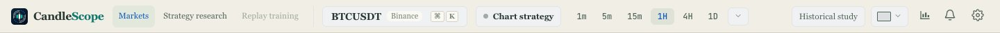
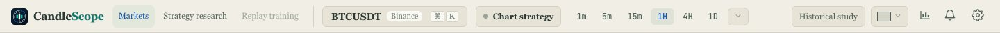
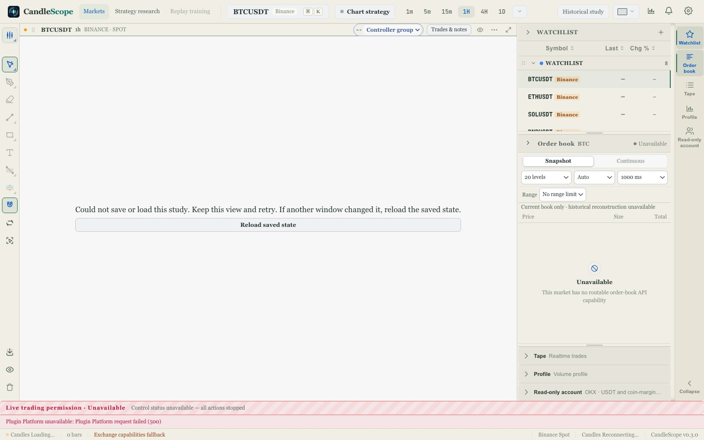
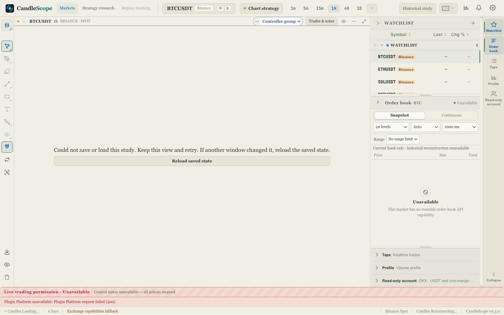

# Frontend design refactor: Phase 8a QA (colour tokens)

- Date: 2026-11-23
- Branch: `design/phase-8-cleanup`, built on a local merge of the design (#564) and strategy (#565) integration PRs into main (`ce3577f28`); both have merged, and main is merged into the branch, so the PR targets main
- Plan: [`frontend/FRONTEND_DESIGN_REFACTOR_PLAN.md`](../frontend/FRONTEND_DESIGN_REFACTOR_PLAN.md), Phase 8 (part 8a)
- **Intended visible change:** none in the app's own themes. With a theme extension selected, the theme now colours every surface and border, where before part of the app kept its own whites and greys. In a chart with its own appearance, the loading spinner's track takes the chart's background.

## What changed

| Area | Change |
|---|---|
| Stylesheets | 416 uses of `--bg-primary`, `--bg-secondary`, `--bg-tertiary`, `--bg-hover` and `--border-color` in 31 stylesheets (and `ChartLoadError.tsx`) now use `--surface-0`, `--surface-1`, `--surface-2`, `--surface-hover` and `--border-subtle`. The aliases are removed from `styles/tokens.css`. |
| Theme extensions | The old names are the colour names of the theme contract (`candlescope.theme/1`; `backend/app/plugin_lifecycle/appearance.py` accepts exactly these, and the Paper and Terminal examples use them). The contract is unchanged: `features/extensions/state.ts` (`THEME_CONTRACT_TOKENS`, `extensionThemeDeclarations`) writes each contract name as the token it stands for, so `bg-primary` sets `--surface-0`, `border-color` sets `--border-subtle`, and so on. Readers of the theme data (chart background, Monaco) keep reading the contract keys. |
| Chart panes | `chartPaneCssVariables` (charts with their own appearance) sets `--border-subtle` instead of `--border-color` and no longer sets `--bg-primary` / `--bg-secondary`; it already set `--surface-0` to `--surface-3`. |
| Guardrail | `scripts/check-style-metrics.mjs` counts the old names in stylesheets and components (test files and the contract's own keys excluded) and fails `npm run check` on any, without waiting for strict mode. |

## Results

**App themes.** `output/css-split/live-diff.mjs` (Phase 2a's computed-style comparison: the old stylesheets swapped onto the same page) against `ce3577f28`, on the 19 design states that open without the local service, dark and light, 1440 px, with a plain pass and a pass with hover, focus and active forced on every element: 38 captures, no differing computed value.

**Theme extensions.** The Paper example theme (`examples/unified-plugins/paper/theme.json`) applied through the app's own extension runtime on the market page:

| | Base | This branch |
|---|---|---|
| App theme while Paper is selected | light | light |
| Visible elements still on the app's own surfaces (`#ffffff`, `#f0f1f3`, `#f7f7f8`) | 15 | 0 |
| Header controls (symbol, chart strategy, historical study, layout) | app greys | Paper's surfaces |

**Charts with their own appearance.** A custom background (`#2b1d0e`) applied with `chartPaneCssVariables`' own-appearance output to a market chart pane, then every element inside read back: 43 elements, one changed: the loading spinner's track (app `surface-2` → the chart's background). The pane already followed the chart for `--surface-0` to `--surface-2` and for the legacy border; `--bg-tertiary` and `--border-subtle` were the two names that did not, and after the rename they are the same names.

## Screens

The Paper theme applied on the market page, dark app theme underneath, 1440 px; the base (`ce3577f28`) and this branch. The local service was not running, so the chart shows the history study's error.

| | Before | After |
|---|---|---|
| Header: symbol, chart strategy, historical study and layout controls take Paper's surfaces |  |  |
| Market page |  |  |

## Verification

Targeted local checks; the full check runs in CI:

- `npm run typecheck` (both tsconfigs), `npm run check:i18n`, `npm run check:css-layers`, `node scripts/check-style-metrics.mjs` (legacy names: 0), ESLint on the changed scripts and modules, `npm run build`.
- Tests: the extension, chart adapter, settings and app tests (`src/features/extensions/__tests__`, `src/chart-adapter/__tests__`, `src/features/settings/**`, `src/app/__tests__`: 318) and the style metrics and token tests (11). New: theme contract colours are written as the design tokens; the metric counts old names in stylesheets and components and not the contract's keys.
- The computed-style comparison, the Paper comparison and the own-appearance pane comparison as in Results (`output/css-split/live-diff-8a.log`, `output/design-8/`).

## Known gaps

- **Not run locally: the full `npm run check`** (lint over the whole tree, the other tests, the desktop tests). GitHub CI runs it on the PR.
- **Electron not checked.** The plan asks for a desktop check after Phase 8; no Electron build is available here. `reportDesktopAppearance` already read `--surface-0`, so the window background is unaffected.
- **Theme extensions were checked by applying the Paper theme through the app's extension runtime in the dev page**, not by installing the package through the plugin review. The Terminal example uses the same contract names.
- **Charts with their own appearance were checked on a chart without data** (43 elements: legend, pane controls, loading overlay). With data, legends and indicator chips inside such a chart may also take the chart's colours where they used `--bg-tertiary` or `--border-subtle`.
