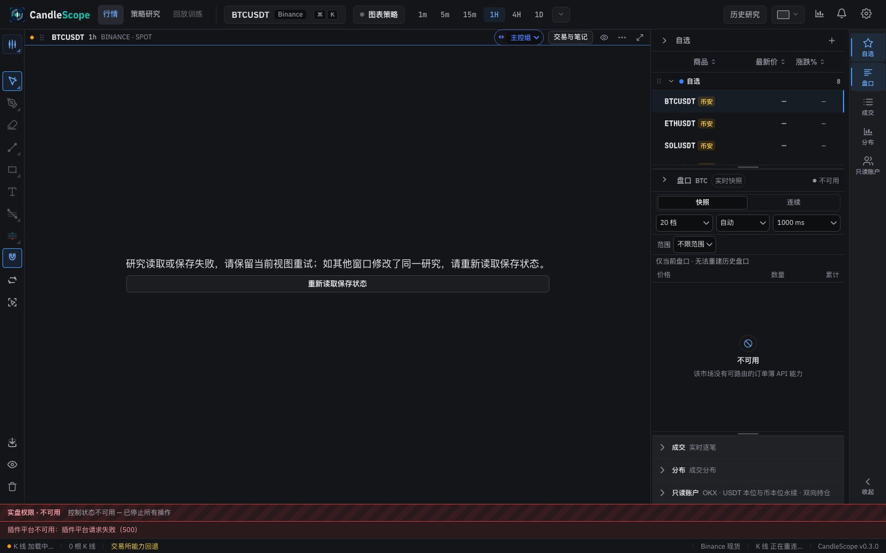
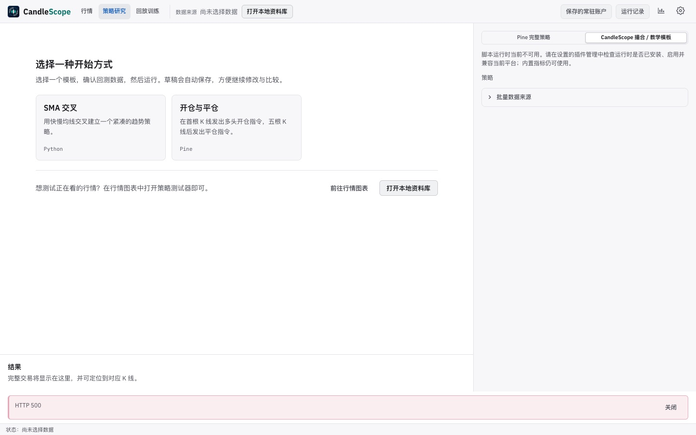

# Frontend design refactor: Phase 8b QA (dead CSS, `!important`, strict guardrails)

- Date: 2026-11-23
- Branch: `design/phase-8b-cleanup`, on Phase 8a (`design/phase-8-cleanup`, PR #567)
- Plan: [`frontend/FRONTEND_DESIGN_REFACTOR_PLAN.md`](../frontend/FRONTEND_DESIGN_REFACTOR_PLAN.md), Phase 8 (part 8b)
- **Intended visible change:** two small ones. The practice account's rules under the forward-run settings read as a note (secondary colour, small type) instead of body text. In Chinese, Japanese and Korean the script editor's code keeps the editor's own 0.3 px letter spacing, as in other languages. Everything else computes exactly as before.

## What changed

| Area | Change |
|---|---|
| Dead CSS | 211 rules whose selectors need a class no component applies are removed, and 34 selector lists lose the selectors that do. They belonged to surfaces that have since been rebuilt or removed: the old workspace switcher and link popover, the plugin manager and settings pages, the PPT-style text format bar, the pane resizer, the watchlist sidebar, the market dock tabs, the extension manager's old facts and choices, the research page's own top bar. 103 class names in all. Two rules in `trainingHub.css` that a Phase 5f2 edit had left with unbalanced brackets are removed too: browsers dropped them whole, and every control they were meant for is a kit button now. Stylesheets: 16,948 → 15,777 lines. |
| Unstyled class names | 5 → 0. `run-result-views` (three result views) and `strategy-research-saved` were second names for elements already found by their `data-testid`; `tf-header` lost its only rule with the dead CSS. They are dropped. The practice account's rules (`continuous-account-rules`) get the strategy tester's note style. |
| `!important` | 31 → 6, and those six are the `prefers-reduced-motion` block in `reset.css`. Rules that must win over every container (the CJK letter-spacing reset, the keyboard focus ring, `.sr-only`, the live control button's tone, the drawing toolbar's position readout, a drawing coordinate's invalid border) move to a new `styles/overrides.css` in the `overrides` cascade layer, which outranks feature CSS whatever the specificity. The rest won already, or now win by specificity: the trade tape's side cell, a collapsed watchlist list, the watchlist's price flash. |
| Inline styles the old `!important` was beating | The rail's view resizer had an inline `height: 5px` that its `height: 7px !important` overrode; the inline style and its unused constant are removed, so the stylesheet's 7 px stands alone. The drawing text editor had an inline `outline: none` that the focus ring overrode; it is removed, so the ring still shows. |
| Guardrails | `npm run check` runs the style metrics with `--strict`. Zero targets fail the check: class names with no rule, `!important` outside reduced motion, native dialogs, legacy colour names, and (new) selectors with unbalanced `( )` or `[ ]`. Metrics still on their way down have ratchets that fail the check if they rise: raw `<button>` 266, inline `style={{}}` 94, `*-btn` class families 25 (30 before the dead CSS went). |

## Results

**Computed styles.** `output/css-split/live-diff.mjs` against 8a (`72e4243e6`): the old stylesheets swapped onto the same page, the 23 design states that open without the local service, dark and light, 1440 px, a plain pass and a pass with hover, focus and active forced on every element. Fixtures add the elements whose rules changed but that these states do not render without the local service (`output/design-8/fixtures-8b.js`): the live control button in each mode in every top bar, the position readout in every drawing toolbar and in the strategy and replay shells, invalid drawing coordinates, a text editor field, trade tape rows, a collapsed watchlist list and flashing prices, the order book's screen-reader label, the rail's view resizer and the practice rules note.

| | Captures | Differing computed values |
|---|---|---|
| 20 states that do not load the forward-run panel's stylesheet | 40 (each with a plain and a forced pass) | 0 |
| Strategy, strategy with a local source, backtest | 6 | 398, all on the practice rules note fixture and its container: text colour (primary → secondary), 16 → 12 px, line height, a 10 px bottom margin, and the container's height |

Two states did not reach their panel (the history study button and the accounts rail entry were not found without the local service), so those captures read the market page with the fixtures.

Before the live control button's tone moved into the overrides layer, this comparison caught one regression: on the strategy page the shell's own button hover rule (`.strategy-research-shell button:not(.ui-control)…:hover`, specificity 0,4,1) outranked the specificity fix and turned the button's border blue on hover. Because that button, the drawing position readout and the coordinate inputs appear in several pages' toolbars and shells, their rules went to `overrides.css` instead of chasing each container's specificity.

**Script editor in Chinese.** A fixture shaped like Monaco's text layer (inline `letter-spacing: 0.3px`, from `editor/scriptTheme.ts`) on the market page in zh-CN: the only differing value is that layer's `letter-spacing`, `normal` → `0.3px`. The reset in `overrides.css` no longer beats inline styles, and Monaco sets its spacing inline, so the editor draws code with the spacing it measures with, as in other languages.

**Dead CSS.** `output/design-8/dead-css.mjs` reads every string and template literal in the non-test source with the TypeScript parser, plus the entry HTML. A selector is dead when a class it requires (outside `:not()`) appears nowhere. Classes a class-building template could produce (`ob-status-${state}`, `live-control-${mode}`, `tf-${side}`, …) are left for review, not removed: 49 such rules remain and are live. The 103 removed class names appear nowhere outside stylesheets except in three places that already expect them gone: the drawing performance scripts fall back to `.chart-pane[data-pane-id="single-chart"]`, the strategy research tests assert `strategy-research-advanced` is absent, and the multi-chart rollback script reads the old layout controls (an empty list today).

## Screens

The market page (dark) and the strategy page (light) at 1440 px, local service not running, captured from 8a and this branch with `scripts/design-snapshots.mjs`. Pixel comparison: the strategy page and the replay hub (both themes) are byte-identical; the market page differs only in a 6 × 6 px spot, the status bar's pulsing connection dot, which differs the same way between two captures of the same build.

| | Before (8a) | After |
|---|---|---|
| Market, dark |  |  |
| Strategy, light |  |  |

## Verification

Targeted local checks; the full check runs in CI:

- `npm run check:styles` (strict, all zero targets at 0), `npm run check:css-layers`, `npm run check:architecture`, `npm run check:i18n`, `npm run typecheck` (both tsconfigs), ESLint on the changed modules and scripts, `npm run build` (no CSS syntax warnings; 8a had two, from the malformed replay hub rules).
- The computed-style comparison, the Monaco fixture and the screens as above (`output/design-8/live-diff-8b.log`, `output/design-8/snapshots/`).
- Tests: every test that reads the app's stylesheets, and the tests of each changed surface (app shell and rail, watchlist, trade flow, order book, plugins, extensions, chart workspace, settings, strategy research, backtest, drawings, components, replay launcher): 1,303, plus the style metric tests (8; 1,311 in all): `!important` counts skip comments and reduced-motion blocks; strict mode fails on a zero target or a ratchet; malformed selectors are reported by line.

## Known gaps

- **Not run locally: the full `npm run check`** (lint over the whole tree, the other tests, the desktop tests). GitHub CI runs it on the PR.
- **The practice rules note and the script editor were not seen in the running app**: both need the local service. They were checked with fixtures as described.
- **The extension theme runtime still writes its colour tokens with `!important`** (`features/extensions/state.ts`). It is a stylesheet built at runtime, which the metric does not read, and the extension contract tests pin it.
- **Not added: a guardrail for dead CSS.** The finder needs the TypeScript parser and leaves dynamic classes for review, so it stays a QA tool (`output/design-8/dead-css.mjs`) rather than a check that could fail on a false positive.
- **Not added: the §5 guardrails for hex and `rgb()` literals outside `tokens.css` and for new `*-overlay` families.** The live control button's two hex colours moved as they were.
- **Electron not checked.**
