# Frontend design refactor: Phase 8c2 QA (drawing surfaces on the kit)

- Date: 2026-11-23
- Branch: `design/phase-8c2-drawing`, on Phase 8c1 (`design/phase-8c-kit`, PR #580)
- Plan: [`frontend/FRONTEND_DESIGN_REFACTOR_PLAN.md`](../frontend/FRONTEND_DESIGN_REFACTOR_PLAN.md), Phase 8 (part 8c2)
- **Intended visible change:** the drawing surfaces' buttons take the kit's look. A chosen tool or toggle is tinted instead of outlined in accent; the chart type button is a neutral bordered button instead of an accent-tinted one; close buttons show the kit's × icon instead of a letter x; the editors' footers are the kit's ghost, secondary and primary buttons; the properties tabs are the kit's tabs; line style and the Fibonacci 0/1 choice are segmented controls; Fibonacci and position presets, filters and "none" toggles are small kit buttons. Layout, positions and behaviour stay.

## What changed

| Surface | Change |
|---|---|
| Drawing toolbar | Every tool, toggle and action is a kit `IconButton` (`.drawing-tool-btn` stays as the scripts' hook and the short-window size). Tools report `aria-pressed`; the chart type opens its menu and reports `aria-expanded` only. Clear is the `danger` variant. Bold and italic for the text tool are small icon buttons showing their letter; the position size readout is a small ghost `Button`. |
| Kit | `IconButton` gains a `danger` variant (red on hover, for delete and remove) and an `indicator` slot for a corner mark; the tools' "has variants" triangle moved into it. Both are in the gallery and the kit tests. |
| Fibonacci and position panels | Close → `IconButton`; first-click 0/1 → `SegmentedControl`; remove level → danger `IconButton` (still shown on the row's hover or focus); add level → `IconButton`; size presets → small `Button`s with `aria-pressed`. The Fibonacci panel's height cap grows from 420 to 444 px so the default levels still fit with the taller controls. |
| Selected drawing's style bar and text bar | Drag handle, lock, more, delete and close → `IconButton` (delete `danger`); bold, italic, underline and alignment → pressed `IconButton`s; "none" → small pressed `Button`; the colour trigger → ghost `Button`; line style → `SegmentedControl` (radios); the properties tabs → kit `Tabs` (the panel ids already followed the kit's scheme); reset, cancel and save → ghost, secondary and primary `Button`. Style templates → small `Button`s (delete is `danger`). |
| Object list and history bar | Trigger, row actions, close, reset and filters → kit buttons (the trigger is secondary over the chart, ghost and small in a chart header; filters are small ghost toggles); choosing a drawing is a ghost `Button` laid out as the row's label. Undo and redo → small `IconButton`s, keeping the shortcut in their tooltip. |
| CSS | The surfaces' own button styling is gone (`.drawing-tool-btn` look, `.chart-type-tool-btn`, `.fib-*` buttons, `.position-size-preset`, the style bar's and object list's generic `button` rules, the history bar's, the tabs', the footer's). What stays is layout and the colour swatches, which remain raw buttons (the button is the colour). Two dynamic inline styles (the text toggles' glyph, the line style sample) became classes. |
| Guardrails | Raw `<button>` ratchet 263 → 208; `*-btn` families 25 → 19; `chart-type-tool-btn` is a declared hook. |

What stays raw in the drawing surfaces (3, for 8c5's documented exceptions): the variant menu's radio items (`ToolFlyout`: a right-hand menu with two-line items, which the kit `Menu` does not offer) and the two colour swatch grids.

## Results

The drawing tools need chart data, which needs the local service, so the surfaces were rendered by their own components with fixed props in the app page (`output/design-8/drawing-shots-8c2.mjs`): the same props on 8c1 (`c01e6644a`) and this branch, 1440 × 900, zh-CN, dark and light. Six scenes: toolbars (default, text tool with bold on, position tool), the variant menu and the Fibonacci and position panels open, the style bar, text bar and history bar, the style bar's properties, the text bar's properties, the object list with three drawings (one hidden).

Two problems found in the first captures and fixed: the object rows' labels took the ghost button's grey and bold type (names grey, ids bold), and the Fibonacci list was cut by the panel's height cap.

## Screens

Dark, 8c1 → this branch:

| | Before | After |
|---|---|---|
| Toolbars: default, text tool, position tool |  |  |
| Variant menu, Fibonacci panel, position panel | 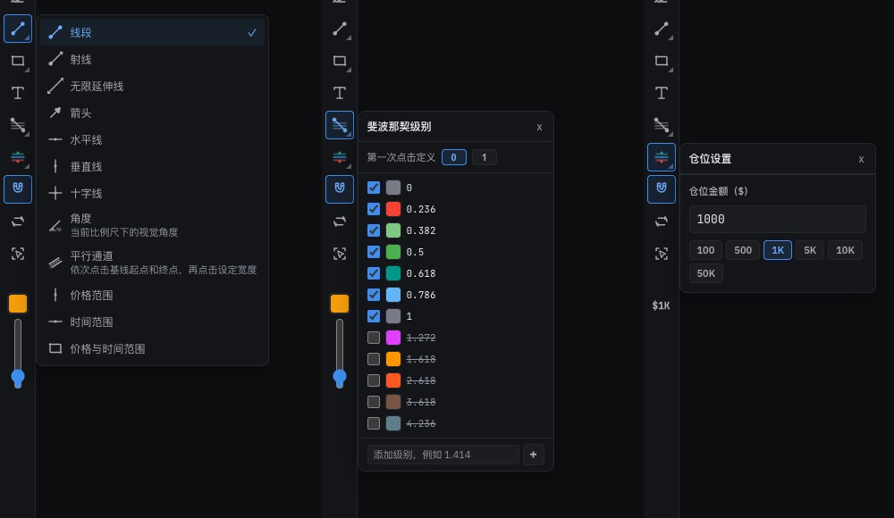 | 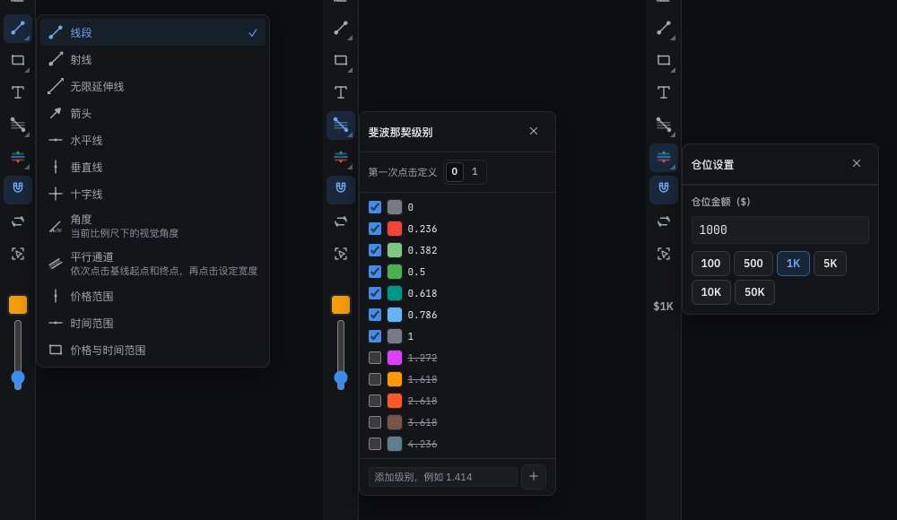 |
| Style bar, text bar, history bar | 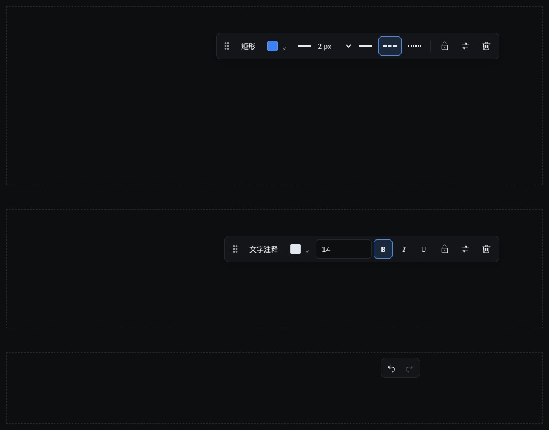 | 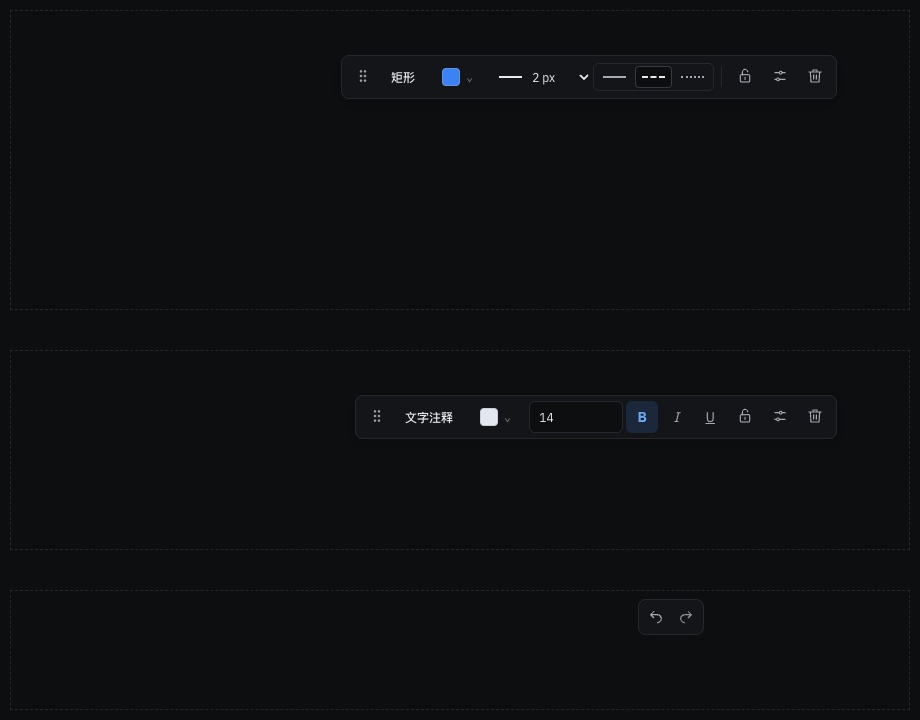 |
| Style bar properties | 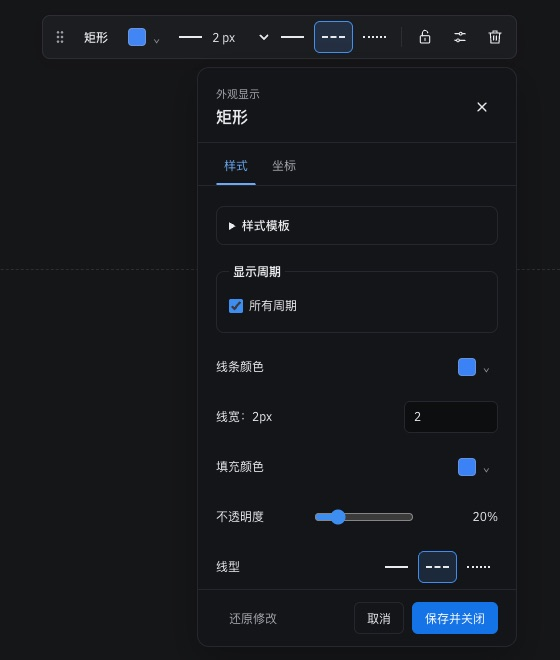 | 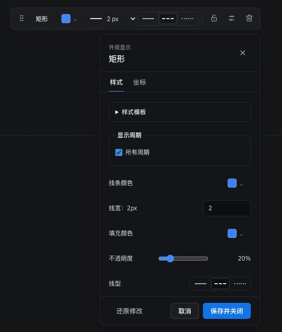 |
| Text bar properties | 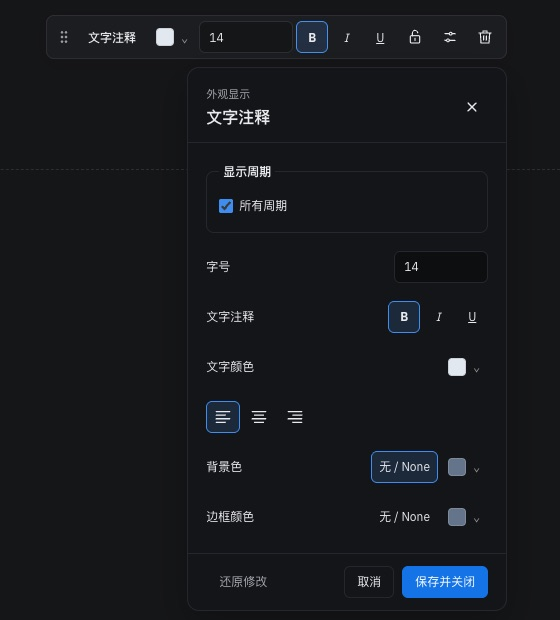 | 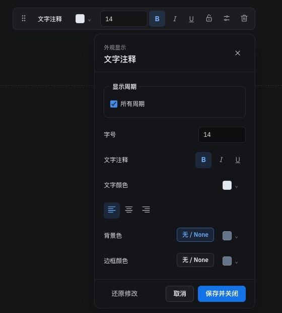 |
| Object list | 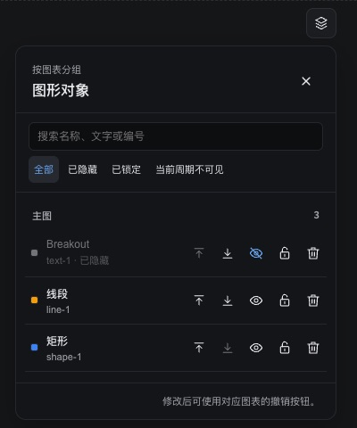 | 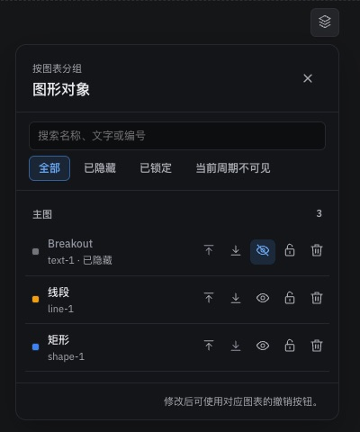 |

Light:

| | Before | After |
|---|---|---|
| Toolbars |  |  |
| Style bar, text bar, history bar | 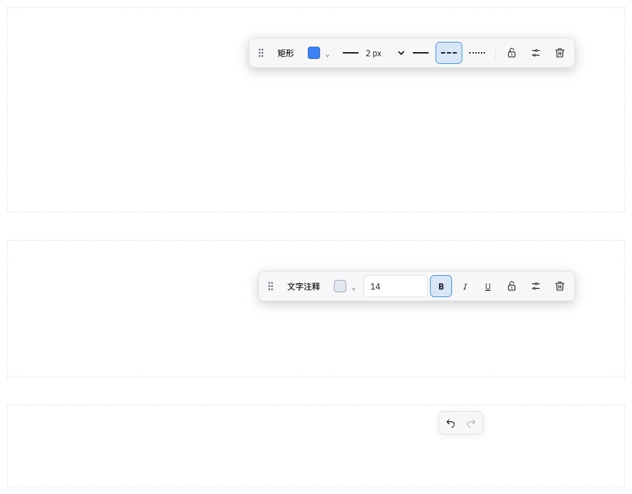 | 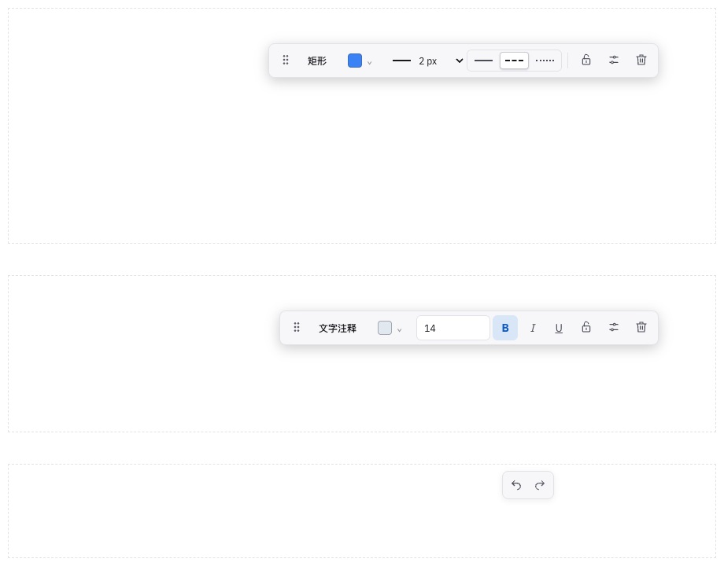 |

## Verification

Targeted local checks; the full check runs in CI:

- `npm run check:styles` (strict: raw `<button>` 208 at its ratchet, families 19), `npm run check:css-layers`, `npm run typecheck` (both tsconfigs), ESLint on the changed modules, `npm run build` (no warnings).
- Tests: drawings, components (kit included), app, replay, strategy research, chart workspace, every test that reads the app's stylesheets, style metrics: 2,005. Updated: the toolbar tests read `aria-pressed` instead of the `active` class; the style bar test reads the line style as a checked radio. New: kit tests for `IconButton`'s `danger` variant and indicator.
- The smoke, chart-type and rollback scripts select `.drawing-tool-btn` and `.chart-type-tool-btn`; both classes stay on the buttons.

## Known gaps

- **Not run locally: the full `npm run check`.** GitHub CI runs it on the PR.
- **Not seen in the running app with drawings on a chart**: the local service did not finish starting (its startup history scan kept retrying the exchange), so the surfaces were rendered by their components with fixed props in the app page, on both builds. Drawing on a chart, dragging the bars and the keyboard paths were not exercised by hand; the drawing tests cover the components.
- **The variant menu and the colour swatches stay raw buttons** until 8c5 documents them as exceptions.
- **The chart type button no longer shows an open state of its own** (the old accent outline while its menu was open); the open menu sits next to it.
