# Frontend design refactor: Phase 8c3 QA (chart chrome on the kit, new primitives)

- Date: 2026-11-23
- Branch: `design/phase-8c3-chrome`, on Phase 8c2 (`design/phase-8c2-drawing`, PR #581)
- Plan: [`frontend/FRONTEND_DESIGN_REFACTOR_PLAN.md`](../frontend/FRONTEND_DESIGN_REFACTOR_PLAN.md), Phase 8 (part 8c3)
- **Decision (user, 2026-11-23):** the composite buttons the kit had no primitive for (cards, option rows, activity items, accordion rows, context menus with checks) get kit primitives rather than becoming exceptions, so §7's raw-button target can be met. 8c3 adds them; 8c3b (the workspace panel and layout menus) uses them next.
- **Intended visible change:** the interval buttons, the interval panel's chips, tabs and composer, the pane controls, the chart cell header and its menu, and "return to latest" take the kit's look; the price scale menu is the kit menu; the market rail's activity items and collapsed rows keep their layout on the kit's row option. Disabled icon buttons fade (everywhere), so they read as off.

## What changed

| Area | Change |
|---|---|
| Kit: new primitives | `ControlButton` — the toolbar pill (`.ui-control`), with `active` and an icon slot; it was a class used on raw buttons. `OptionButton` — a block-level choice, `card` (bordered tile) or `row` (list row), reporting `selected` as `aria-pressed` (or `aria-selected` for an option or tab); the primitive owns box, colour and states, the feature lays out what is inside. |
| Kit: menus | `Menu` items can be `checked` (a check mark; `menuitemcheckbox`), `checked` + `radio` (`menuitemradio`) and start a group with `separatorBefore`. `Menu` and `Popover` take an `anchorPoint` (a viewport position) instead of an `anchorRef`, for context menus. `menuItemRole` helper. |
| Kit: icon buttons | A disabled `IconButton` fades to half opacity as well as turning muted: at rest icon buttons use the secondary text colour, and muted alone barely differed (found on the pane controls; the history bar of 8c2 had the same). |
| Interval selector | Bar intervals → small ghost `Button`s with `aria-pressed` (`.interval-btn`, `.active`, `#interval-…` stay as the scripts' hooks; a custom interval keeps its dot). Picker → `ControlButton`. Panel: close → `IconButton`; the three tabs → kit `Tabs` (the custom count as the tab's badge; the panel body is their tab panel); chips → small `Button`s with `aria-pressed` (mono type for interval codes, the arrow-key highlight kept); pin and remove → compact `IconButton`s; add → `IconButton`; clear all, restore → small `Button`s; composer: units → `SegmentedControl`, amount → kit `Input`, create → primary `Button`, laid out as a row instead of one joined strip. |
| Chart panes | Pane controls → compact `IconButton`s (collapse and maximise pressed, delete danger). The price scale's context menu → kit `Menu` at the pointer (checks for auto scale and invert, radios for the scale mode, the alert's price as a hint); it gains the kit menu's keyboard and focus handling, and closes on Escape or a click outside through the overlay stack (its own document listeners are gone). New message `scale.menu` ("Price scale") names it, in all 30 languages. "Return to latest" → small primary `Button`. |
| Chart cell header and menu | Strategy entry → `ControlButton`; drag handle, drawing visibility, maximise, the cell menu trigger and the "own appearance" marker → compact `IconButton`s; the cell menu's split, swap and close → small `Button`s (close is `danger`). |
| Market rail | Activity bar items and a collapsed view's header → `row` `OptionButton`s with the rail's own layout (the active side marker, the phone sheet's states and the bar's quiet resting colour stay). |
| Guardrails | Raw `<button>` ratchet 208 → 171; `*-btn` families 19 → 18; `custom-interval-btn` is a declared hook. |

Raw buttons left in this area: the page navigation's replay entry (`WorkspaceNavigation`, 2 in source), which must match the navigation's links; documented as an exception in 8c5.

## Results

Before/after on 8c2 (`2382db553`) and this branch, 1440 × 900, zh-CN, local service not running (`output/design-8/chrome-shots-8c3.mjs`): the market page; the interval panel; the custom interval composer; the chart cell menu; and, rendered by their components because they need a chart with data, two pane control bars (one with three disabled controls), the price scale menu with every kind of item and "return to latest". Dark and light; the market page also at 1024 px, where the top bar keeps the same overflow.

Found and fixed while capturing: the disabled pane controls were hard to tell from enabled ones (kit fix above).

## Screens

Dark, 8c2 → this branch:

| | Before | After |
|---|---|---|
| Top bar, chart header, rail | 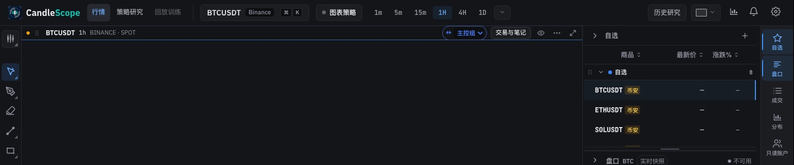 | 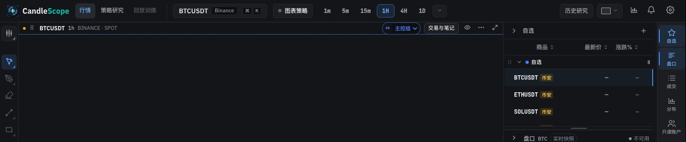 |
| Top bar at 1024 px | 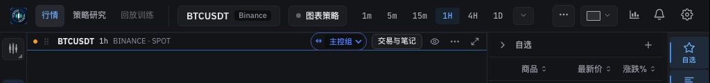 | 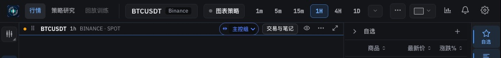 |
| Interval panel | 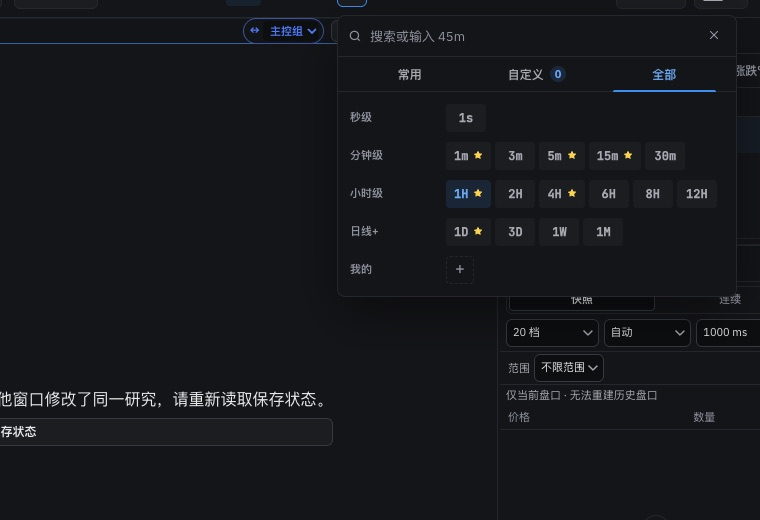 | 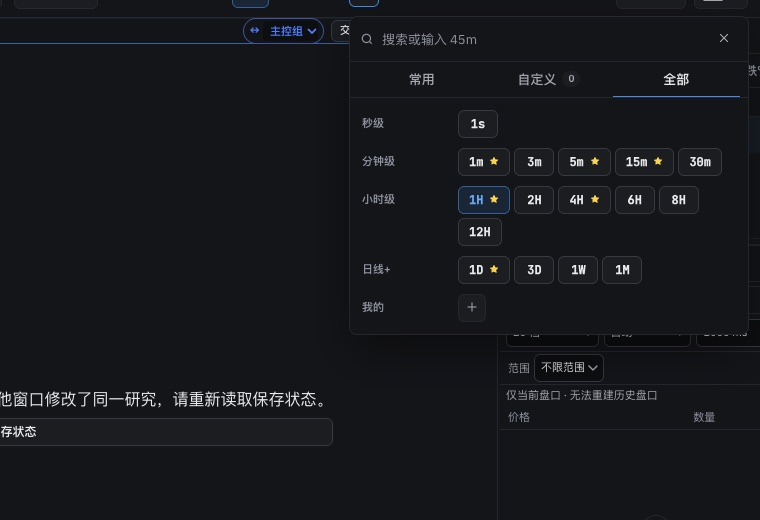 |
| Custom interval composer | 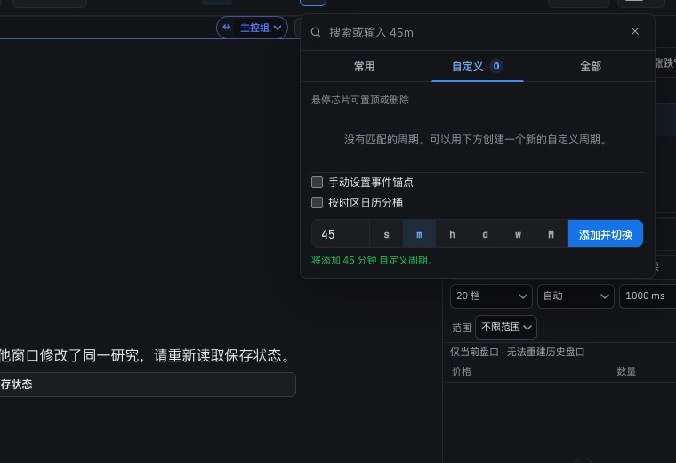 | 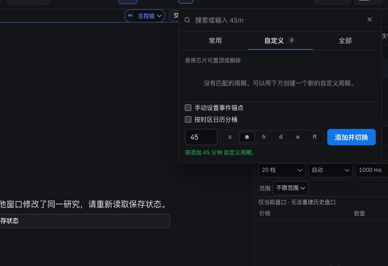 |
| Chart cell menu | 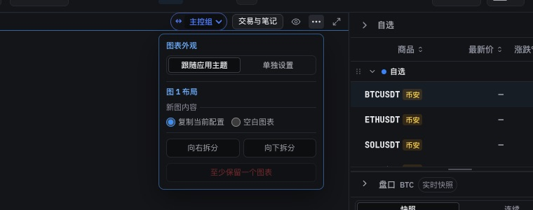 | 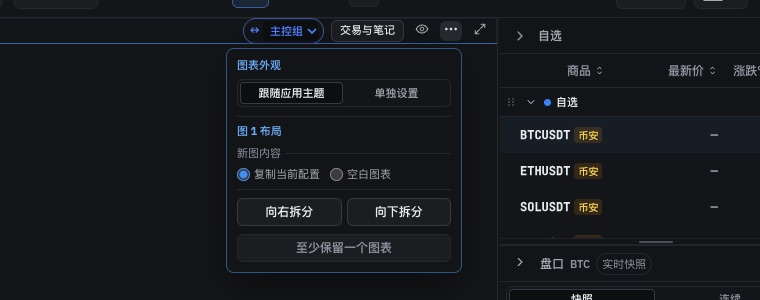 |
| Pane controls, price scale menu, return to latest | 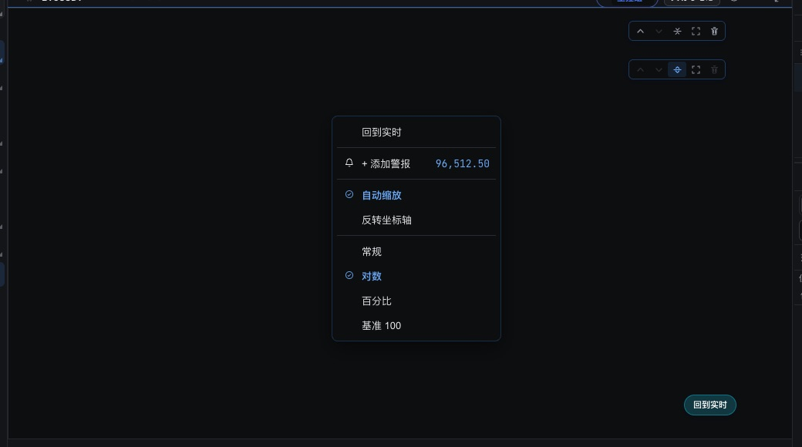 | 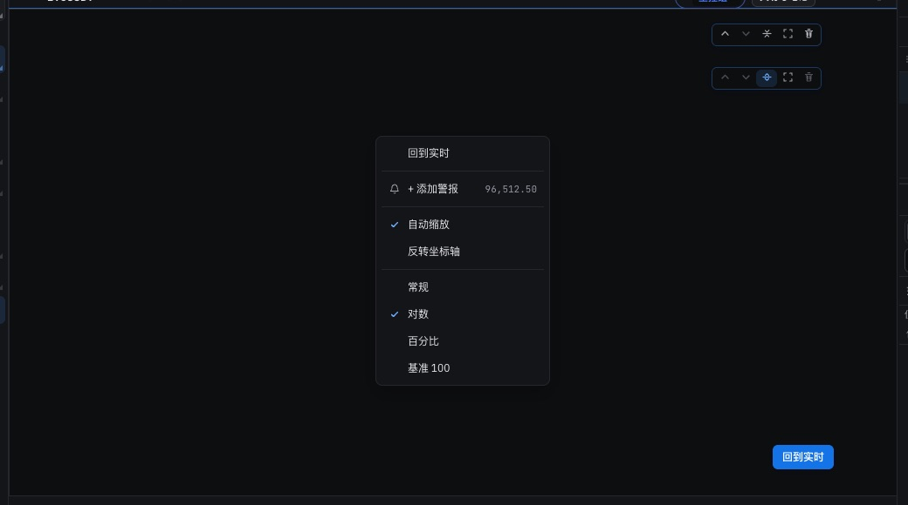 |

Light:

| | Before | After |
|---|---|---|
| Top bar, chart header, rail | 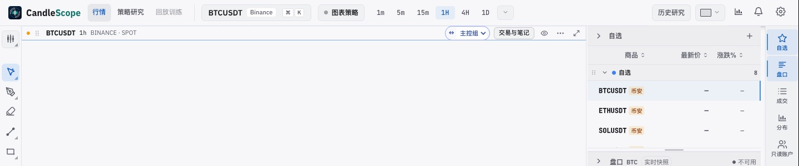 | 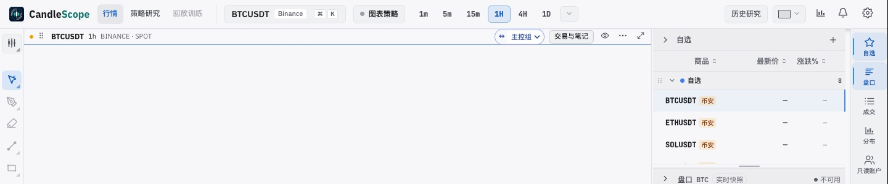 |
| Interval panel | 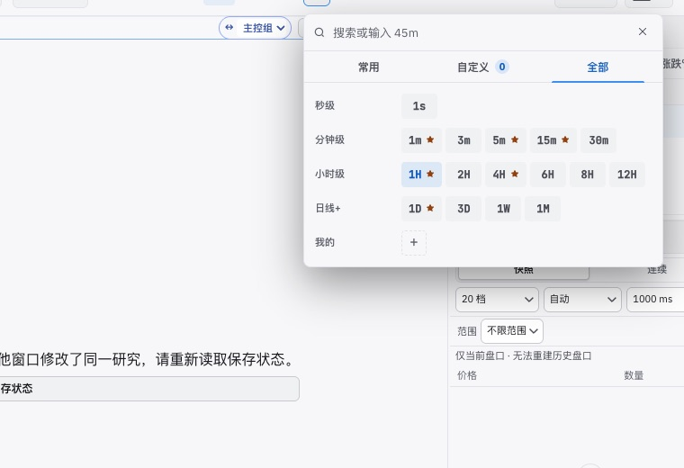 | 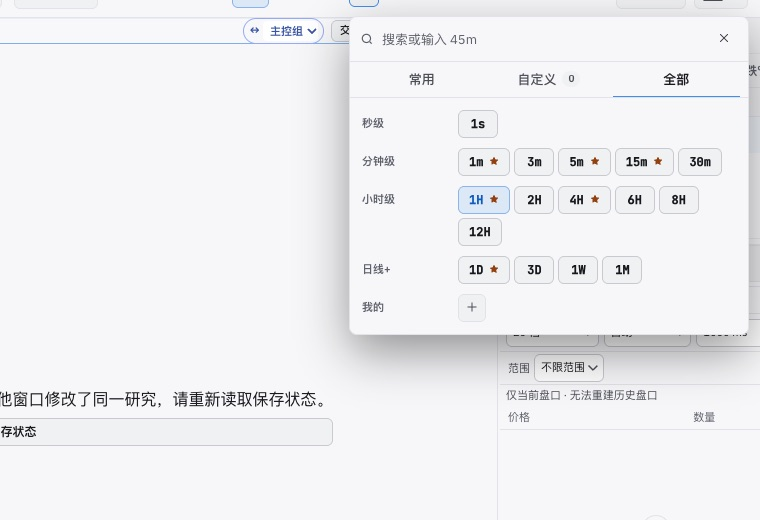 |

## Verification

Targeted local checks; the full check runs in CI:

- `npm run check:styles` (strict: raw `<button>` 171 at its ratchet), `npm run check:i18n` (30 locales), `npm run check:css-layers`, `npm run typecheck` (both tsconfigs), ESLint on the changed modules (one warning, in `SingleChartPanes.tsx` line 3001, was already there), `npm run build` (no warnings).
- Tests 2,447: components (kit included), app, chart workspace, replay, export, drawings, strategy research, backtest, i18n, every test that reads the app's stylesheets, style metrics. Updated for the kit's markup: the interval selector (classes, `aria-pressed`, the custom tab as a kit tab), the phone rail (row option classes), the cell menu's marker. New kit tests: `ControlButton`, `OptionButton`, menu item roles, a popover anchored to a point.
- The smoke, perf, replay soak and rollback scripts select `.interval-btn(.active)`, `#interval-…`, `[data-interval-chip]`, `.interval-more-btn` and `.multi-chart-cell-drag-handle`; all stay.

## Known gaps

- **Not run locally: the full `npm run check`.** GitHub CI runs it on the PR.
- **The pane controls, the price scale menu and "return to latest" were checked rendered by their components**, not on a chart with data (the local service was not running); the price scale menu's keyboard and outside-click behaviour come from the kit menu and its tests.
- **The interval panel's tabs now move with the arrow keys as kit tabs**; the chips keep their own arrow-key highlight from the search field.
- **Two raw buttons stay in the page navigation** until 8c5's exceptions.
