# Frontend design refactor: Phase 8c3b QA (workspace panel and layout picker on the kit)

- Date: 2026-11-23
- Branch: `design/phase-8c3b-workspace`, on Phase 8c3 (`design/phase-8c3-chrome`, PR #582)
- Plan: [`frontend/FRONTEND_DESIGN_REFACTOR_PLAN.md`](../frontend/FRONTEND_DESIGN_REFACTOR_PLAN.md), Phase 8 (part 8c3b)
- **Intended visible change:** the chart workspace panel and the layout picker take the kit's look: kit tabs (underlined) instead of a pill row, option cards and rows from the kit (a chosen one is tinted; a card keeps an accent border), kit buttons for rename, duplicate, delete, windows and groups, and a segmented control for the shared drawing layers. Disabled option buttons fade (everywhere), so they read as off. Layout and behaviour stay.

## What changed

| Area | Change |
|---|---|
| Workspace panel | Close → secondary `IconButton`; the three tabs → kit `Tabs` (the content area is their tab panel); saved workspaces → `row` `OptionButton`s with `role="option"`; new-workspace templates, layout templates, the layout action grid (undo, redo, keep current, lock) and the link policy toggles → `card` `OptionButton`s, with the panel's own grid, glyph, name and description inside (the policies' "synced" label now keys on `aria-pressed`); the link-group tree → `row` `OptionButton`s (the indent stays inline); rename, duplicate, delete, OK and cancel, new and close window, add root and child group, delete group → small `Button`s (deletes and close window are `danger`; delete's confirm step reports `aria-pressed`); the shared drawing layers → `SegmentedControl`. |
| Layout picker | Trigger → `ControlButton`; the five layouts → `row` `OptionButton`s (thumbnail over chart count; the current one tinted); "Manage" → small ghost `Button`, under a separator. |
| Kit | A disabled `OptionButton` fades to half opacity as well as turning muted (the disabled undo and redo cards looked enabled in the dark theme), as disabled `IconButton`s do since 8c3. |
| CSS | The panel's and picker's own button styling is gone (box, colours, hover, active and disabled states, the pill tabs, the shared action-button rules, `.workspace-panel button:disabled`); layout and content type stay. |
| Guardrails | Raw `<button>` ratchet 171 → 145. |

The workspace panel and layout picker have no raw buttons left.

## Results

Before/after on 8c3 (`09bf5c0af`) and this branch, 1440 × 900, zh-CN, local service not running (`output/design-8/workspace-shots-8c3b.mjs`): the layout picker open, and the workspace panel on each of its three tabs (workspaces, layout and windows, links). Dark and light.

Found and fixed while capturing: the disabled undo and redo cards looked enabled (kit fix above); the layout picker's five layouts as bordered cards were busier than the old grid, so they are row options with the current one tinted.

## Screens

Dark, 8c3 → this branch:

| | Before | After |
|---|---|---|
| Workspaces tab | 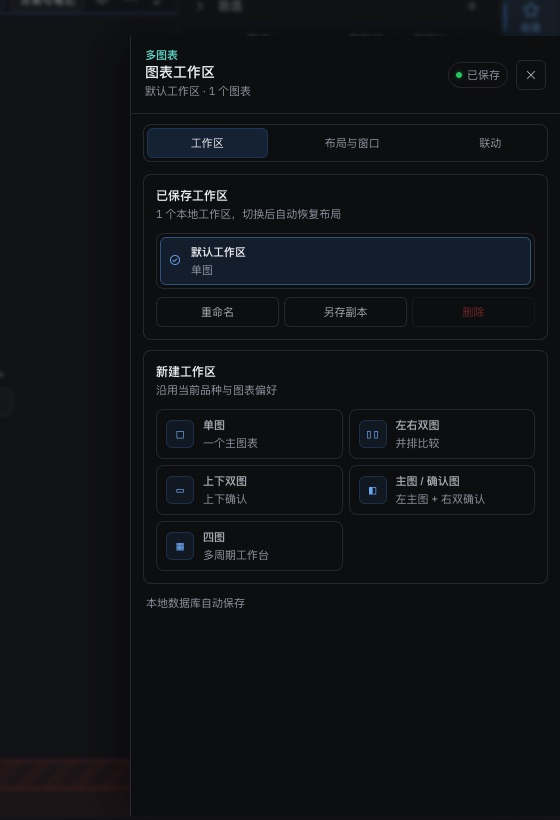 | 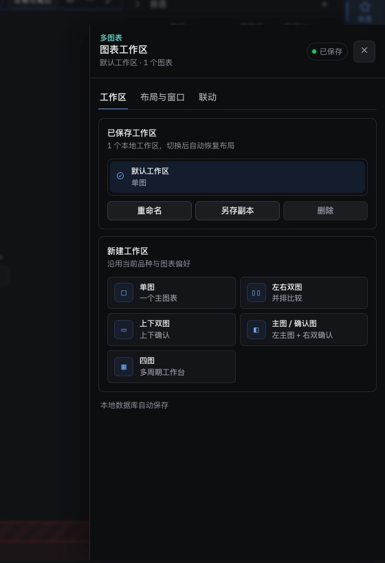 |
| Layout and windows tab | 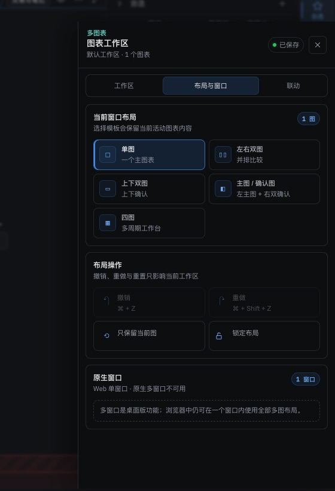 | 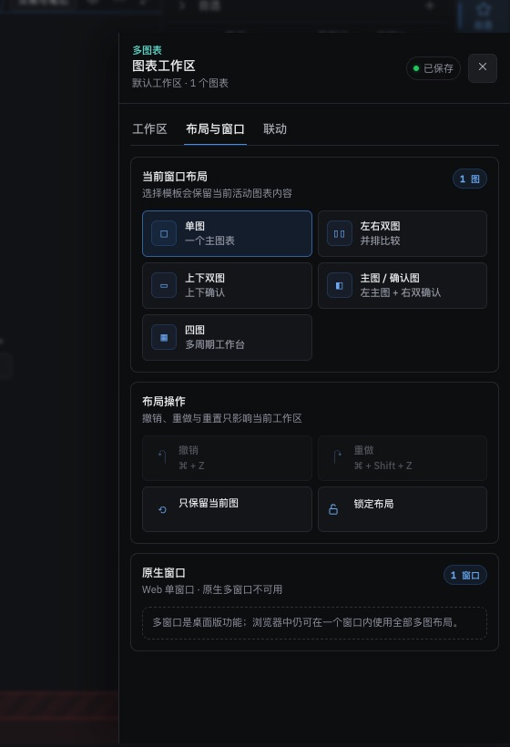 |
| Links tab | 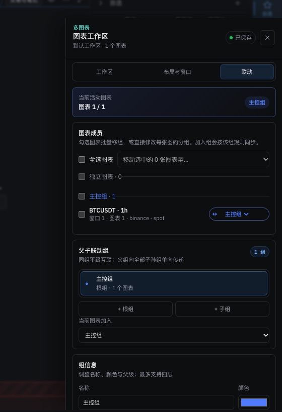 | 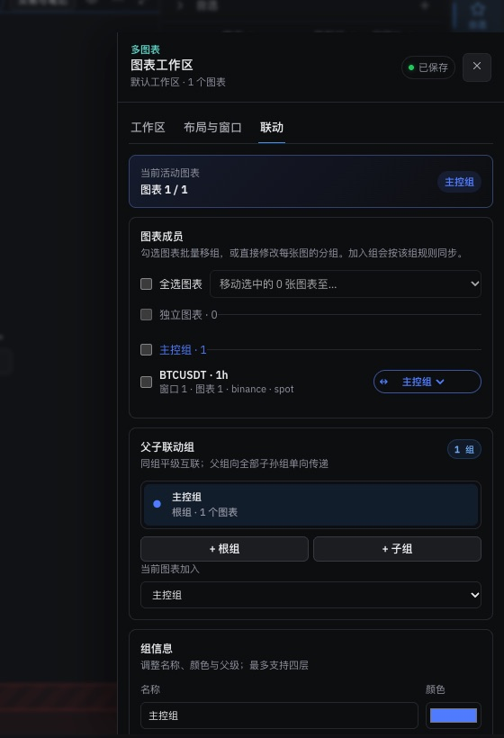 |
| Layout picker | 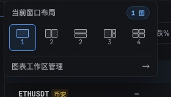 | 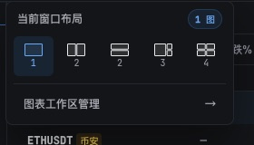 |

Light:

| | Before | After |
|---|---|---|
| Layout and windows tab | 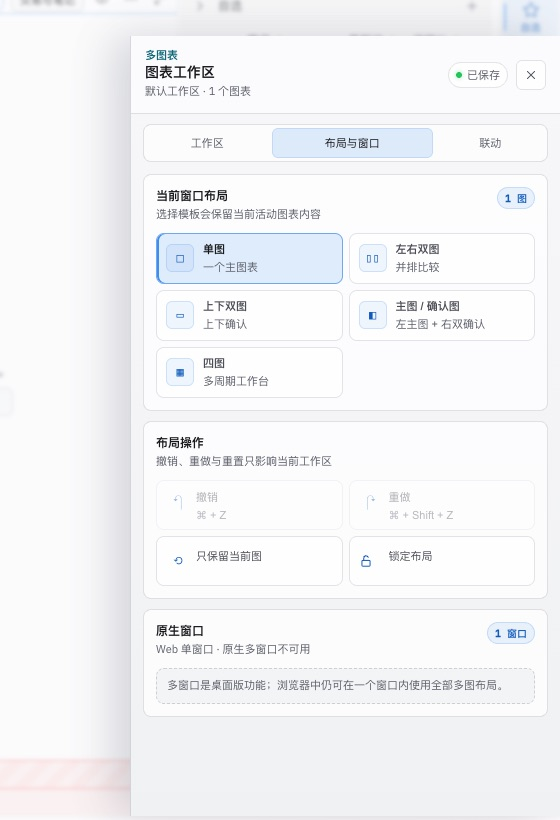 | 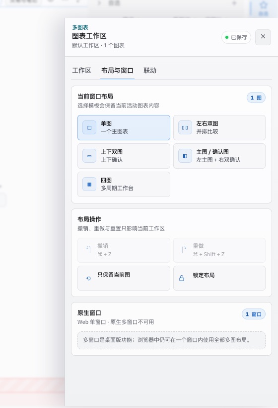 |
| Layout picker | 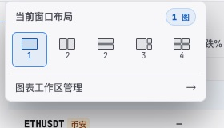 | 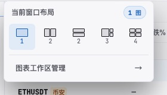 |

## Verification

Targeted local checks; the full check runs in CI:

- `npm run check:styles` (strict: raw `<button>` 145 at its ratchet), `npm run check:css-layers`, `npm run typecheck` (both tsconfigs), ESLint on the changed modules, `npm run build` (no warnings).
- Tests 2,419: components (kit), app, chart workspace, replay, drawings, strategy research, backtest, i18n, every test that reads the app's stylesheets, style metrics. None needed changing.

## Known gaps

- **Not run locally: the full `npm run check`.** GitHub CI runs it on the PR.
- **The panel's tabs now move with the arrow keys as kit tabs** (roving focus), where the old tab row took one Tab stop per tab.
- **Native window actions** (new and close window) were not seen: the browser build shows the desktop-only hint instead.
