# Frontend design refactor: Phase 8c5b QA (replay on the kit)

- Date: 2026-11-24
- Branch: `design/phase-8c5b-replay`, on Phase 8c5a (`design/phase-8c5a-market`, PR #587)
- Plan: [`frontend/FRONTEND_DESIGN_REFACTOR_PLAN.md`](../frontend/FRONTEND_DESIGN_REFACTOR_PLAN.md), Phase 8 (part 8c5b)
- **Intended visible change:** layout, type and behaviour stay, apart from these:
  - The run identity in the header uses the app's font (it had used the browser's Arial).
  - The workspace trigger is the header's kit control, like the header actions beside it.
  - Retries are kit buttons. The history error's retry is primary and sits under the message, as in the chart load error.
  - The chart cells' drawings and maximise toggles are the kit's compact icon buttons, as in a live cell. A cell without a market offers its markets as small buttons.
  - The watchlist's collapse is the market watchlist's chevron.
  - **Three layout bugs fixed** (see Results): the drawings toggle's place, the review rail, and the screenshot viewer's place.

## What changed

| Area | Change |
|---|---|
| Training page shell | **Header:** the run identity → ghost `Button` that reads as a label: no box or hover tint, the help cursor and tooltip stay, and the text ends in an ellipsis. **History error:** retry → primary `Button` in `.error-overlay-actions`. **Review rail:** retry → small `Button`. **Status bar:** the error and its retry form one item; retry → small ghost `Button` sized to the bar. **History notice:** dismiss → `IconButton` sized to the notice's line. |
| Chart workspace | **Cell header:** the drawings toggle → pressed `IconButton`; it still stops the pointer and focus from reaching the cell. Maximise → `IconButton` (`multi-chart-cell-maximize`) that says maximise or restore and shows the matching icon; before, it was labelled "layout". **Elsewhere:** the workspace trigger → `ControlButton`; a cell without a market → its markets as small `Button`s in a laid-out row. |
| Right rail | **Order ticket:** buy and sell → `Button`s in the trade colours (`.replay-submit-order`, `data-side` and `data-replay-action` stay). **Watchlist:** a market's row and a search result → `row` `OptionButton`s laid out as before. The current market's row stays at full strength; tracked and unavailable results keep their own colours without fading. Collapse → `IconButton` (`wl-collapse-btn` stays for the soak script). |
| Integrity review | The timeline's events → `MenuItemButton`, the same markup as before (checked in the browser). |
| Note screenshot viewer | `margin: auto` on the native dialog: the reset's `margin: 0` had put it at the top left. |
| CSS | **Removed:** the replay cell header's `> button` rules, `.workspace-toolbar-trigger`, the history notice's `button` rule, and the order buttons' box, font and focus rules (the kit's). **Kept:** layout and trade colours. |
| Guardrails | Raw `<button>` ratchet 57 → 42. Replay has no raw buttons left. |

## Results

Before/after compare 8c5a (`bbc8b3a36`) with this branch, at 1440 × 900 in zh-CN, with the local service not running (`output/design-8/replay-shots-8c5b.mjs`). The script itself is not in the repository. Replay needs a run, so every scene is drawn over the market page:
- **Real components with fake runtimes:** the replay watchlist (its catalog answered in the page), the order ticket, the note screenshot viewer, and the app header and status bar.
- **The shell's and chart workspace's own markup, copied into the harness:** each build's source as it stands, raw buttons on 8c5a and kit buttons here. This covers the header identity and workspace trigger, the cell headers, the history notice, the status bar item, the review rail and the history error.

All scenes were captured in dark; four were also captured in light.

**Found and fixed while capturing:**
- **Cell header (bug on 8c5a):** the drawings toggle sat mid-header. Both toggles had `margin-left: auto`, which split the free space. It now sits with maximise and the menu at the end, as in a live cell.
- **Review rail (bug on 8c5a):** the rail stacked its items as columns side by side, and the 42 px rail cut off all but the first two. The drawing revision, loading and error notes and the retry were never visible. The items now stack down the rail.
- **Screenshot viewer (bug on 8c5a):** it sat at the top left; it is centred now.
- **Header identity:** the kit's padding and border had moved it 7 px to the right; it keeps its place.
- **History notice:** the kit icon button had made the notice 8 px taller; it keeps its height.

## Screens

Dark, 8c5a → this branch:

| | Before | After |
|---|---|---|
| Header: run identity and workspace trigger | 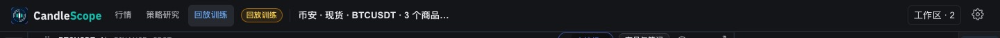 | 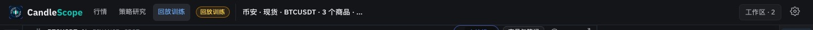 |
| Chart cells (drawings toggle pointed at; a cell without a market) | 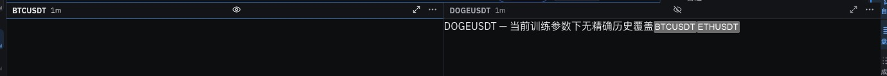 | 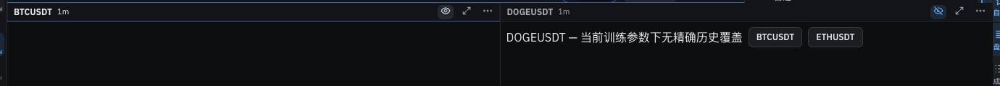 |
| Watchlist: search results and rows (ETHUSDT pointed at) | 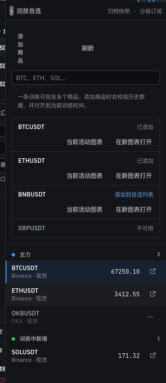 | 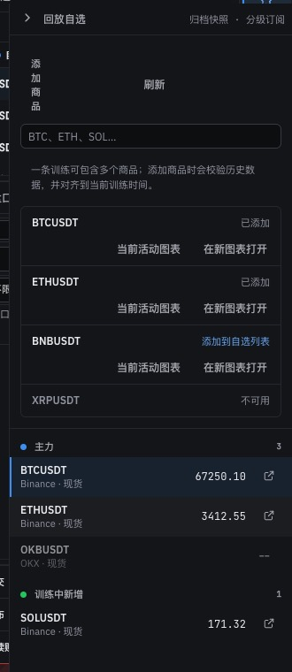 |
| Order ticket (buy pointed at; the two images are identical) |  | 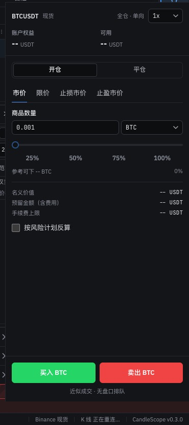 |
| Review rail, history error, notice, status bar | 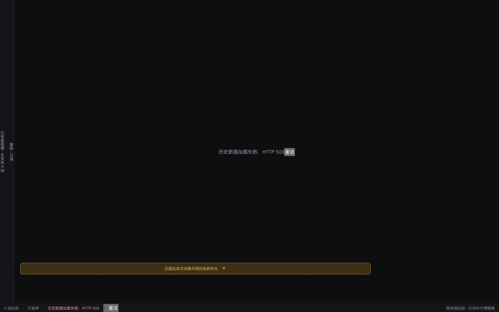 | 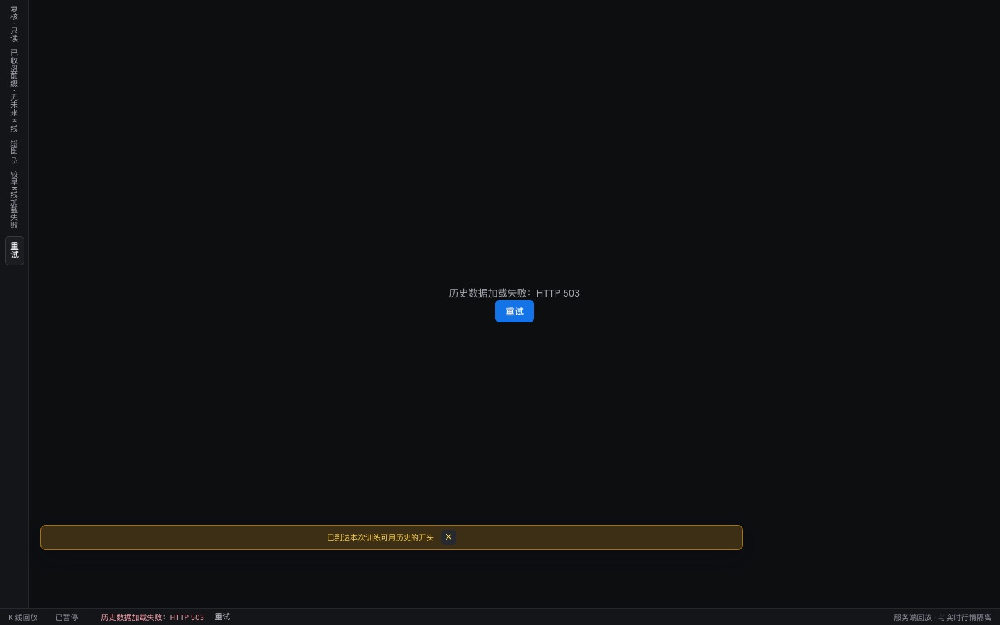 |
| Note screenshot viewer | 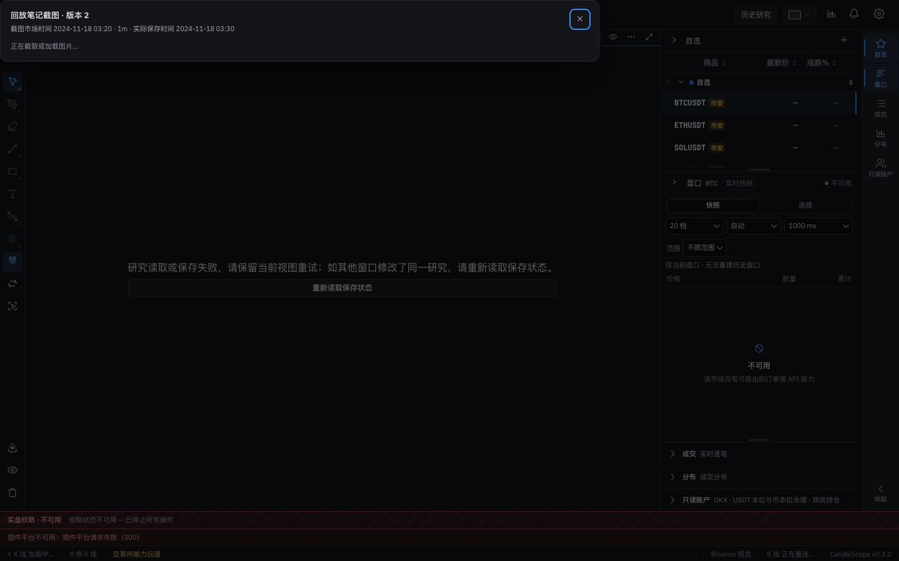 | 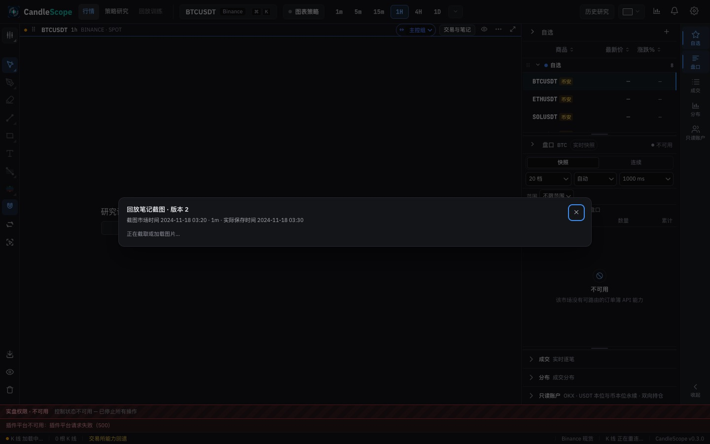 |

Light:

| | Before | After |
|---|---|---|
| Header |  | 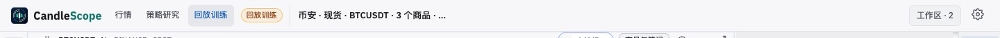 |
| Chart cells | 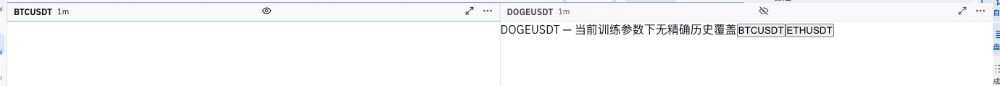 | 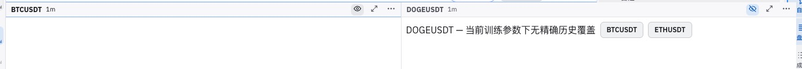 |
| Watchlist | 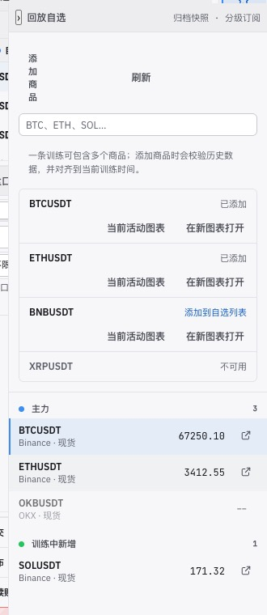 | 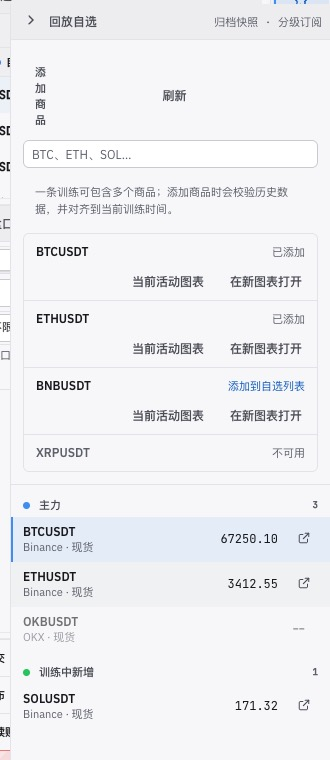 |
| Review rail, history error, notice, status bar | 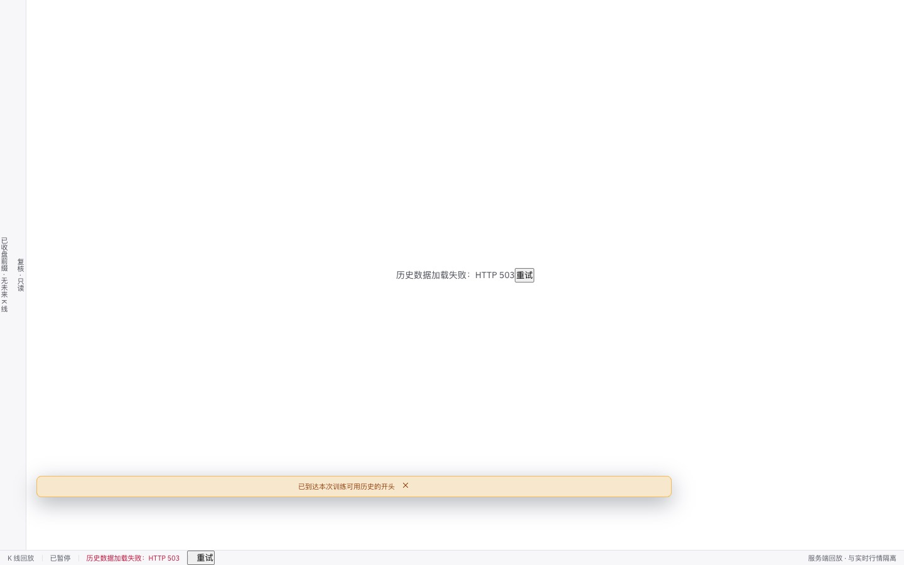 | 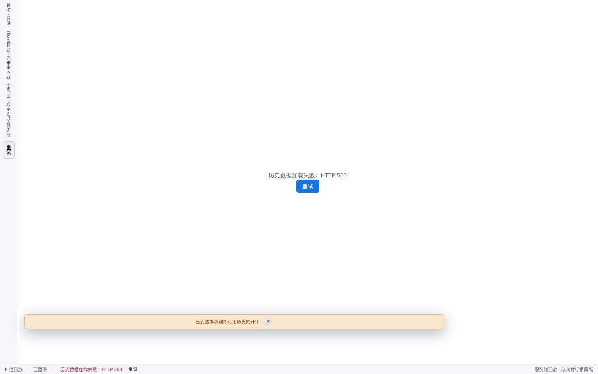 |

## Verification

These are targeted local checks; CI runs the full check.

- `npm run check:styles` passes in strict mode: raw `<button>` is at its ratchet of 42, families at 13, and no class name lacks a rule.
- `npm run check:css-layers`, `npm run typecheck` (both tsconfigs) and ESLint on the changed modules pass.
- 1,907 tests pass, covering:
  - replay (the training workspace's source and style assertions included), the replay launcher;
  - app, components (the kit included), chart workspace, watchlist;
  - i18n;
  - every test that reads the app's stylesheets;
  - the scripts' tests, style metrics included.
- No existing test needed changing.
- `npm run build` passes. Its one warning is the size of the code editor's bundle, and 8c5a gives the same warning.
- The scripts' hooks stay: `.wl-collapse-btn`, `button.replay-watchlist-market`, `.replay-market-search-results button` with its `<strong>` symbol, `.replay-watchlist-row.active`, `.replay-submit-order[data-side]` and `data-replay-action="place-order"`.

## Known gaps

- **Not run locally: the full `npm run check`.** GitHub CI runs it on the PR.
- **No replay run was open:** the local service was not running, and opening a run writes to it. Every scene is drawn with fake runtimes or with the source's markup copied into the harness. Placing an order, switching markets, maximising a cell, retrying history and dismissing the notice were not exercised by hand; the replay tests cover the components.
- **Not seen:** the integrity review's timeline (it renders the same markup as before, checked in the browser) and the order ticket's disabled sides (their rules are unchanged).
- **The review rail is only seen in the harness:** review mode starts with a write, so its new stacking was not seen in a real review.
