# Frontend design refactor: Phase 8c5c QA (strategy, backtest and data on the kit; raw buttons at zero)

- Date: 2026-11-24
- Branch: `design/phase-8c5c-strategy`, on Phase 8c5b (`design/phase-8c5b-replay`, PR #591)
- Plan: [`frontend/FRONTEND_DESIGN_REFACTOR_PLAN.md`](../frontend/FRONTEND_DESIGN_REFACTOR_PLAN.md), Phase 8 (part 8c5c)
- **Intended visible change:** layout, type and behaviour stay, apart from these:
  - **Cards.** The strategy templates, the data source cards and the local datasets are kit option cards. They have the kit's radius and hover. The chosen card has the kit's light accent tint and accent border; a dataset had used an accent left edge.
  - **Buttons.** Data preparation's and the continuous run panels' buttons are small kit buttons, where they had been the browser's grey buttons. Data preparation's "open replay" and "view result" links look like the buttons beside them.
  - **Strategy switcher.** Its rows use the kit menu's type, like the app's other menus, so the strategy names are a size smaller than before.
- Raw `<button>` outside `components/ui` reaches **0**, apart from **4 documented exceptions** in two files. The style check now fails on any other raw button.

## What changed

| Area | Change |
|---|---|
| Strategy dock (chart tester) | **Switcher:** the trigger is a ghost `Button`. A strategy is a `MenuItemButton` with `menuitemradio`: its status dot is the icon, and a check is the hint. The switcher's actions are `menuitem`s. **Result summary:** a ghost `Button` that opens the overview. **Start rows:** `row` `OptionButton`s, keeping the accent edge on hover and focus. **Trade lists** (the tester's and the run result's): each trade is a `row` `OptionButton` with `role="row"` and `aria-selected`, drawn as before. |
| Native strategy panel | **Result summary:** a ghost `Button`. **Engine choice:** two card `OptionButton`s with `role="radio"`. **History rows:** `row` `OptionButton`s, where the run on show keeps its `aria-current` edge. |
| Continuous runs | Repair, auto-repair, the run actions and saved accounts use small `Button`s. Start or recalculate, and confirm repair, are primary. |
| Data preparation | Job actions and the prepared run's actions use small `Button`s. The two result links use `buttonClassName({ size: "sm" })`. |
| Strategy research and data | **Cards:** the template cards (the Pine entry included) and the data source cards are card `OptionButton`s. **Rows:** the local datasets are `OptionButton`s; `data-active` and `aria-current` stay. A local analysis event is a `row` `OptionButton`. |
| Drawing variant menus | The tool variant flyout (line tools, cursors, chart types) uses `MenuItemButton` with `menuitemradio`. Its icon, two-line label and check are the kit's icon, label and hint, and it looks as before. In 8c2 it had been set aside as an exception. |
| Kit | `OptionButton`'s `selected` accepts `undefined`, which reports no state. The data source cards need this before a source is picked. |
| CSS | **Removed:** generic `button` rules that also reached kit controls. They were the strategy research shell's box, hover and disabled rules, the cell layout popover's button box, the training hub's disabled rule, and the strategy dock's and tester panel's raw-button focus rules. Before, they also restyled kit option, control, menu and switch buttons inside those areas. **Also removed:** the box, hover and focus rules of each converted control, the variant menu's own icon, label and check rules, and data preparation's action sizing. **Kept:** layout, the trade and history rows' look, and the selected and running colours. |
| Guardrails | **Exceptions:** `RAW_BUTTON_EXCEPTIONS` in `scripts/check-style-metrics.mjs` lists each raw button that stays, by file, with its reason. **Zero target:** raw `<button>` beyond the list is a zero target, and `--strict` names any file that adds one. An entry that lists more than its file keeps also fails, so the list cannot go stale. **Ratchet:** families stay at 13. Every remaining `*-btn` / `*-button` family is now a class on a kit primitive. **Docs:** `frontend/README.md`'s design checks describe the exceptions. |

### The documented exceptions

| File | Buttons | Why it stays a raw button |
|---|---|---|
| `app/WorkspaceNavigation.tsx` | 2 | The training entry is one of the page navigation's links. It is a button only where training opens in place or is unavailable, and it must look exactly like the links beside it. |
| `features/drawings/DrawingStyleInputs.tsx` | 2 | Colour swatches. Each button is its colour, a background that comes from data, with no label or box. |

Plan §7 allowed up to 20. The kit primitives added in 8c3 (the user's decision of 2026-11-23) brought the composites onto the kit, so 4 remain.

## Results

The before and after shots compare 8c5b (`62323115d`) with this branch. They are 1440 × 900 in zh-CN, with the local service not running (`output/design-8/strategy-shots-8c5c.mjs`; the script is not in the repository).
- **Live pages:** the strategy page's first open and its data source drawer, and the market page's chart type and cursor variant menus.
- **Real components in a harness:** the dataset rows, the strategy switcher, both trade lists, data preparation (its jobs answered in the page), and the continuous repair panels (a fake manager whose auto-repair setting fails to load).

Every scene was captured in dark; four were also captured in light.

**Seen:**
- **Unchanged:** the trade lists match pixel for pixel, and the cursor variant menu matches apart from the chart's status dot. The chart type menu differs by under 100 pixels.
- **Found and fixed while capturing:** the switcher's rows had the kit menu's 0 × 10 px padding, which cramped a name above its details. They keep their 7 × 8 px padding.
- **Generic rules no longer leak:** the deleted generic `button` rules no longer reach kit controls inside those areas.

## Screens

Dark, 8c5b → this branch:

| | Before | After |
|---|---|---|
| Strategy page first open (the Pine card pointed at) | 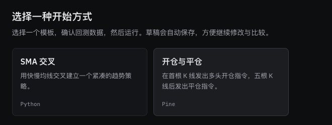 | 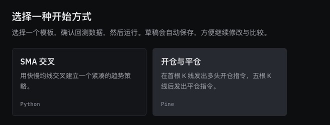 |
| Data source drawer (local library chosen) | 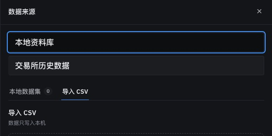 | 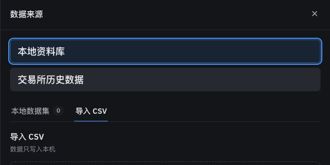 |
| Local datasets (the first chosen, the second pointed at) | 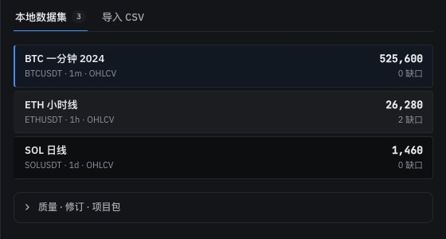 | 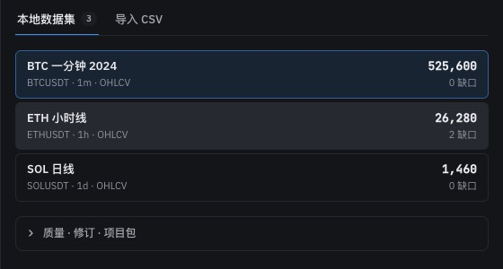 |
| Strategy switcher (the second strategy pointed at) | 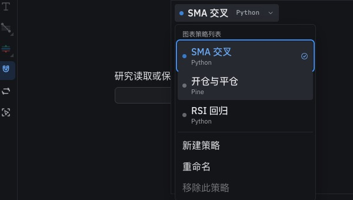 | 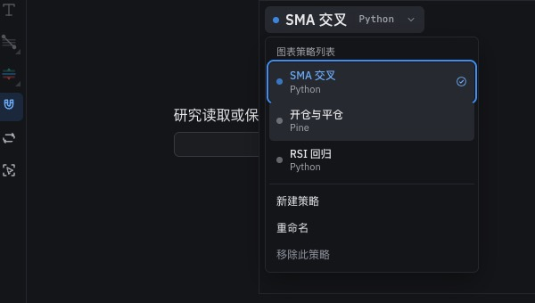 |
| Trade lists, tester and run result (T2 chosen, T4 pointed at; identical) |  | 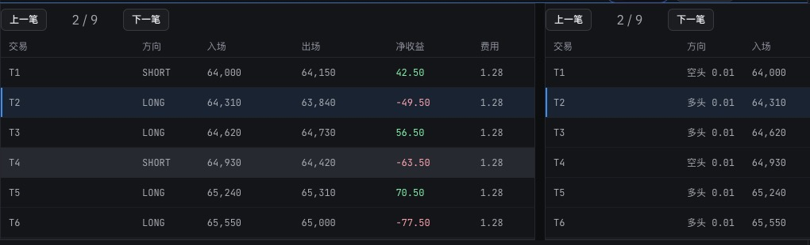 |
| Data preparation jobs | 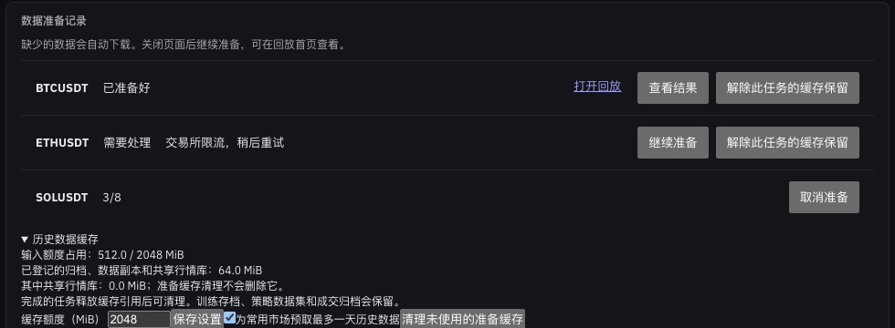 | 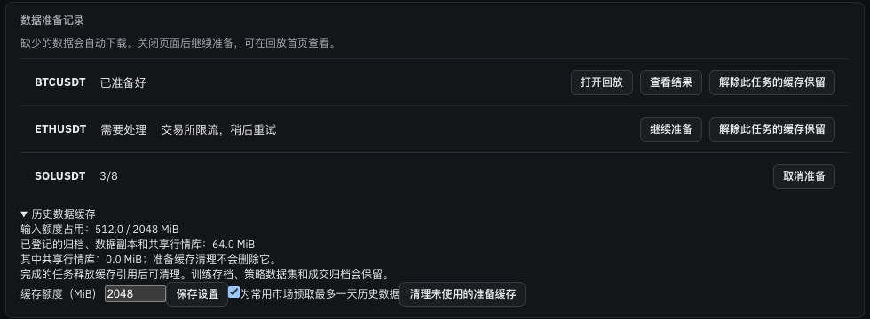 |
| Continuous repair and auto-repair | 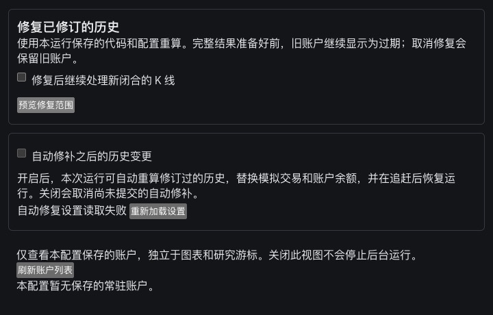 | 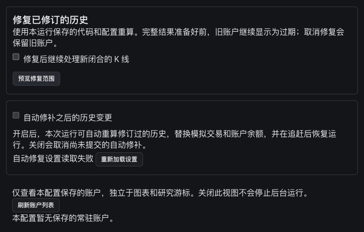 |
| Chart type menu (variant flyout) |  | 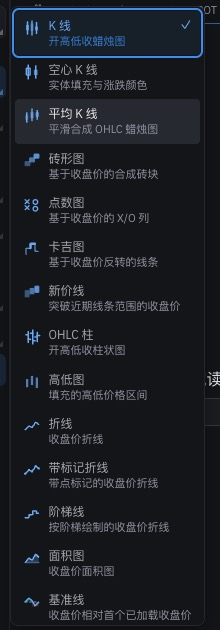 |
| Cursor variant menu |  | 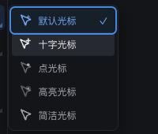 |

Light:

| | Before | After |
|---|---|---|
| Strategy page first open | 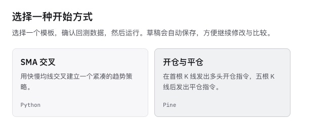 | 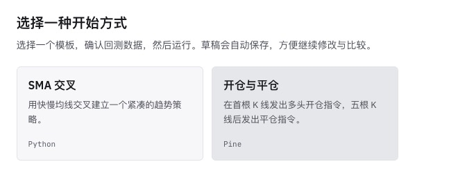 |
| Data source drawer | 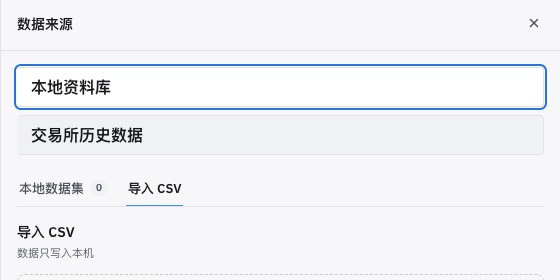 | 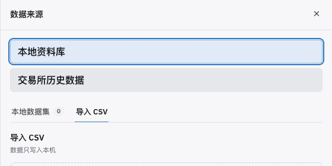 |
| Strategy switcher | 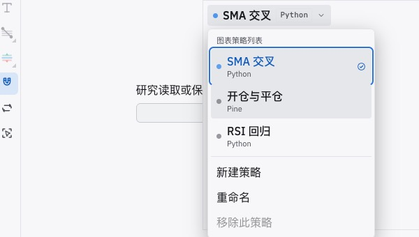 | 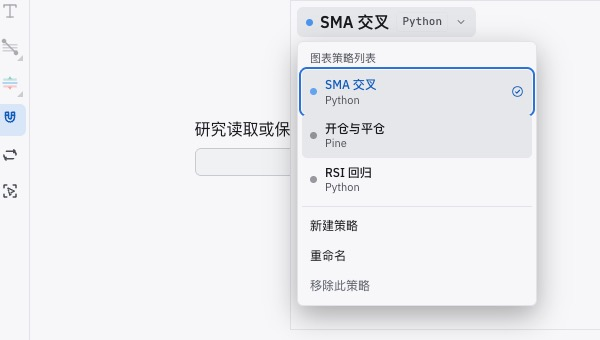 |
| Data preparation jobs | 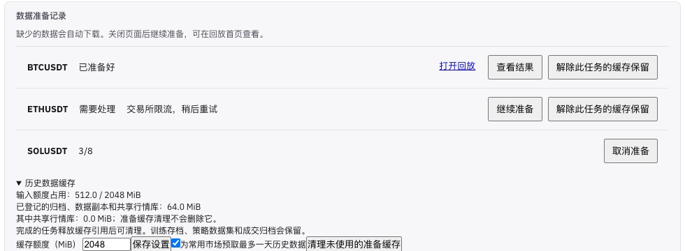 | 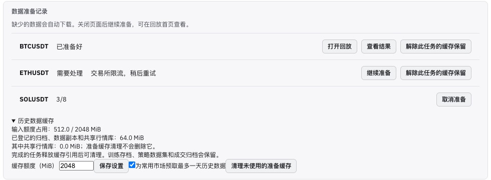 |

## Verification

These are targeted local checks; CI runs the full check.

- `npm run check:styles` passes in strict mode:
  - raw `<button>` is 0 outside the 4 documented exceptions;
  - families are at their ratchet of 13;
  - no class name lacks a rule.
- The style metrics tests (11) cover the exceptions:
  - an exception's buttons are not counted;
  - a raw button beyond them fails;
  - a stale entry fails.
- `npm run check:css-layers`, `npm run typecheck` (both tsconfigs) and ESLint on the changed modules pass.
- 2,340 tests pass, covering:
  - backtest (chart tester, native, continuous, run results), strategy research, research data, data preparation and local data;
  - drawings, chart workspace and replay;
  - components, the kit included;
  - the scripts' tests.
- Only the style metrics test changed. The research tests' `data-active` / `aria-current` assertion on dataset rows still holds.
- `npm run build` passes. Its one warning is about the size of the code editor's bundle, and 8c5b gives the same warning.

## Known gaps

- **Not run locally: the full `npm run check`.** GitHub CI runs it on the PR.
- **Not seen: most of the strategy dock.** With the local service down, the market page's workspace fails to load and hides the dock. As a result, these were not captured:
  - the chart tester's start rows and result summary;
  - the native panel's engine choice and history;
  - the local analysis events.
  Their rules were checked against the kit in the source, and the backtest and local data tests cover their markup.
- **The continuous panels are only seen in a harness.** Starting a run, repairing and refreshing write to the local service, so none of them was exercised by hand.
- **The switcher is only seen in a harness.** Renaming and removing a strategy were not exercised by hand.
