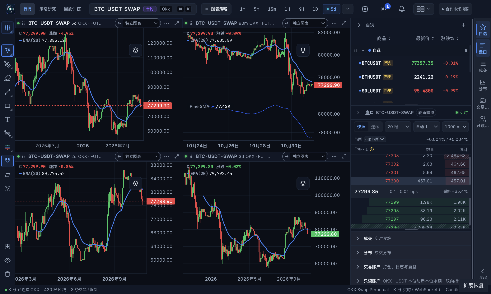

# #138 / #148 / #144：追加主线集成验收（2026-10-31）

首轮验收完成期间，main 合入 #168，新增共享缓存健康状态、行情版本和重连租约。
本轮追加验收基线为 `bab267477c2c834fd98c1cd77e5d774a4d69b6ea`。
首轮修复、失败现场、升级恢复和完整通过记录保留在
[首轮报告](PR138_144_148_INTEGRATION_20261031.md)，不改写为新基线的结果。

## 代码身份与阶段范围

联合代码为 `71849b3db0a372ff5f1b7d768b3618c089aa94e6`；产品代码与已验收的 `01e062cc` / `696b1640` 相同。

| PR | Issue / 当前阶段 | head / 基础分支 |
| --- | --- | --- |
| #138 | #126：D126 只读快照、持久修订和当前共同预算接线 | `6143c67cb1d0ea602623984e9a3db7d9cbae4204` / main |
| #148 | #112：订阅隔离、缺口恢复和失败边界 | `21ba546148965b3668c02963056bb055bf9042c0` / #138 |
| #144 | #127：单基础流式历史和分阶段准备 | `e662cd1ce1738b5490907f851aae3e5daa878a12` / #138 |

三条分支均包含新 main；联合分支保留组合时的 D126 采用校验和订阅恢复实现。
合并顺序（保留祖先的 merge commit）：先 #138，再 #148/#144（后两条先后均可）。#148 已带回共享存储的联合修订解法；
直接对两条 head 执行 merge-tree 无冲突，四个产品根目录与已验收联合树完全相同，
见 [merge-proof.json](backend-joint-main-bab-20261031/merge-proof.json)。
Pyne 保持移除。原工作区的未提交修改、用户数据库和已安装应用未改动。

## 追加解决的问题

1. 合并浏览器验收脚本时，同时保留 #144 的历史分阶段模式及 #168 的缓存健康模式。
   文档就绪后只启动一次 fixture，防止初始页面替换破坏执行上下文。
2. #144 的 `query_materialized` 原来没有行情版本，新主线会把该结果保留为临时数据，
   无法授予健康复用证明。现在在只读物化查询前后采样同一行情时钟，保留起始版本；
   跨过收线等关键事件，或包含 forming 行时跨过更新，均标记不稳定。
   `_materialized_only=True` 和 `auto_backfill=False` 保持不变。
   四个场景修复前全部失败，修复后整个版本模块 12 项通过。
3. 将已经复现的双图帧测试时钟修复同步至三条分支。只改变模拟测试时钟，
   生产 8 ms 帧预算和超预算跨帧回归保持不变。

4. 新包的自动数据验收通过后，视觉复查发现 5d 视口偏到未来，右偏移为 67。
   实际图表组件稳定复现：切换数据集后，存储先收到历史，图表尚未完成绘制，
   旧显示范围及辅助时间轴的延后写入覆盖了恢复结果。现在验证绘制所属的数据集和版本，
   等待该轮绘制后再恢复，且只有成功才记录恢复完成。已恢复或用户接管的视口不逐 tick 排队。
   同一 fixture 修复前失败，修复后空／单根／128 根缓存 × 有／无保存视口共六组通过；
   128→500 根保持尾部，手动导航后扩到 1500 根保持时间位置。原生验收也新增视口断言。
   [修复前截图](backend-joint-main-bab-20261031/native-before-viewport-fix.png)及
   [同一浏览器场景的失败记录](backend-joint-main-bab-20261031/viewport-before.json)均保留。

首轮已经解决的 OKX nullable 字段、UTC 2d/3d、历史来源确认和 owner、
补洞后的自然收线、部分修复再次修订/删除，以及重连扩大首屏历史请求等修复均保留。

## 新基线验证

- 合并新 main 后首次联合后端回归：1837 项通过，无失败。
  此结果尚不包含随后补充的四个物化版本场景。
- 完整前端检查：4633 项前端测试、123 项桌面宿主测试通过，无跳过项；
  包含架构、插件、30 语言、TypeScript、lint 和生产构建。
- 最终联合后端：1841 项通过，0 失败、0 跳过（112 个模块）；视口修复后后端树未改变。
- 浏览器历史准备、缓存健康复用/关键缺口恢复，以及新增真实图表分阶段视口 fixture 通过。
- 另补跑现有合成图表/语义时间轴 2 项及回放历史导航 10 项真实 Chromium 检查，全部通过。
  这些 fixture 使用 development React act，单独记录，不冒充生产 React 或原生证据。
- 真实 OKX 1m 断流跨过两根收线，恢复数据与两次独立 REST 查询一致；随后自然收线继续交付。
  默认 strict 和 gap-aware 没有错误，0.75 秒 strict 单独按预期失败；持久交付待处理/恢复/失败/拒绝计数及预算预留、超额均为 0。
- 视口修复后重新跑完整前端检查通过；新增代码没有增加 lint 警告（原有 1 条保留）。
- 重新制作并深度签名核验 macOS arm64 原生包，900 个后端文件与受测源代码逐字节一致。
  全新隔离 profile、真实 OKX 四图冷加载 30.540 秒；4d 4.743 秒、5d 1.724 秒就绪。
  4d/5d 的视口右偏移分别为 5/4，第二次重启后 5d 为 3；EMA、本地 Pine、四图和新鲜盘口恢复。
  三次主流程退出及额外盘口检查退出都确认所有自有进程终止，renderer exception 为 0。
  已人工复查冷启动和最终截图；失败旧包的数据自动通过没有被当作视觉通过。
- #148 更新为 #138 的子分支，解决独立合并时的共享存储冲突；新 head 的 947 项合同回归通过，
  0 失败、0 跳过；新 head 的云端 CI 也已通过。
- 三条 PR 当前 head 的 6 个工作流、9 个作业全部通过，均为 Ready、mergeable、clean，尚未合并。
  #138 x64 首次打包的 Electron 下载曾报 `EHOSTUNREACH`；只重试该作业后通过，源代码未变。
  原失败日志及成功重试均保留；详细状态见 [ci.json](backend-joint-main-bab-20261031/ci.json) 和
  [pr-state.json](backend-joint-main-bab-20261031/pr-state.json)。

| PR | 后端 CI | macOS arm64 / x64 |
| --- | --- | --- |
| #138 | [通过](https://github.com/helenananaa/CandleScope/actions/runs/41183637641) | [均通过（x64 第 2 次尝试）](https://github.com/helenananaa/CandleScope/actions/runs/41183637651) |
| #148 | [通过](https://github.com/helenananaa/CandleScope/actions/runs/41187882439) | [均通过](https://github.com/helenananaa/CandleScope/actions/runs/41187882429) |
| #144 | [通过](https://github.com/helenananaa/CandleScope/actions/runs/41186077288) | [均通过](https://github.com/helenananaa/CandleScope/actions/runs/41186077290) |

准确代码身份见 [source-identity.json](backend-joint-main-bab-20261031/source-identity.json)。
原始记录位于独立联合 worktree 的 `output/backend-joint-main-bab-20261031/`。

## 证据边界

本轮仍按三个 issue 已明确允许的阶段交付。K130/B130、完整版本化 H127/R129、
普通成交/清算 strict 资格、全交易所和长时稳定性保持后续范围；不关闭整个 issue，
也不代表 157 项总体验收通过。首轮微基准及 RSS 仅作为当时的观测保留，
不据此宣称新基线端到端提速、内存硬上限或长期无泄漏。
