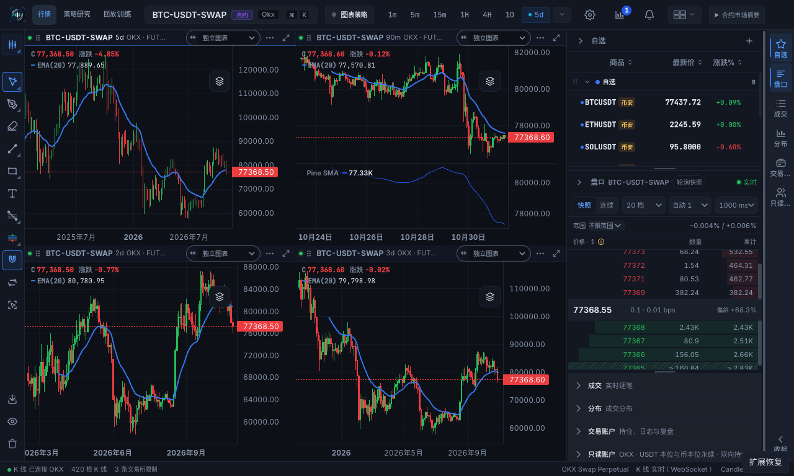

# #173：K130 公共聚合语义核心阶段验收

产品源码：`323061a655fa4f7ebdd18fcdde660a5e3043ca13`。
基础主线：`128b493246756c6f422138cd03ce7bb312e089ab`。
范围是 #130 的 130-A 组成/摘要契约及 130-B K130 与现有路径最小接入；
不是 B130 公共块管理器、H127/R129 或整个 #130 的完成声明。

## 主线合并

#138、#148、#144 已依次以 merge commit 合入 main。#148/#144 在 #138 合入后改以
main 为 base，保留祖先和验收解法。合并后所有非 `docs/qa/` 文件与此前联合验收的
`71849b3d` 完全相同，见 [合并回执与树比较](k130-20261031/merge-proof.json)。
原工作区未提交修改、用户数据库和 `/Applications/CandleScope.app` 均未替换。
合并后 main 的 [后端 CI](https://github.com/helenananaa/CandleScope/actions/runs/41193597012)
及 [macOS 双架构 CI](https://github.com/helenananaa/CandleScope/actions/runs/41193597019)
均已通过。

## 本轮实现及修复

- 使用 D126 只读 `BarData` / `SeriesKey`，提供 `AcceptedComponent`、不可变
  `AggregateSummary`、实际半开范围和带显式域的 acquisition-view 依赖。
- 汇总字段、未知传播、充分统计量、覆盖与闭合规则由公共纯核心定义。
  历史 successor 预览和实时每组成闭合证据是显式政策；前者不能制造来源权威。
- 固定历史保留原有快速扫描，流式分页复用该 reducer；calendar/session、严格重建、
  实时组成和 finalizer 接入公共原语。原有源接纳、修订 fencing、写入和调度 owner 保持。
- 权威修正重新计算有效组成的极值和总量；重复累计快照不会再次加量。
  VWAP 只对明确 `base_asset` 量纲计算，合约张数等量纲返回未知。

五个独立探针在原主线产品树均失败，在新实现均通过：

1. 历史来源 3m 跨出 5m 桶末端时，不能把目标判为已闭合。
2. 实时 finalizer 对同类跨界组成不再授予完整闭合证明。
3. 严格历史重建使用来源月的真实结束时间，不把每个月当作 30 天。
4. 原始重建与存储查询对每个组成使用相同精度归一化，极小成交量不再因路径产生不同总量。
5. SessionCalendar 日线的 09:30 实际开盘标签不会把结束时间推到次日 09:30，
   粗周期结束边界与 expected-open 网格一致，月末组合不越界。

见 [修复前](k130-20261031/regression-before.json)、[修复后](k130-20261031/regression-after.json)
及 [可复现探针](k130-20261031/regression_probe.py)。
输入资格、精度、修订域、回退及后续接口见 [K130 契约](../architecture/AGGREGATION_K130.md)。

## 自动回归与原生证据

- 最终源码的 **1,894 项后端联合回归通过，0 失败、0 错误、0 跳过**，115 个模块，
  162.951 秒。新增核心模块有 39 项测试，包括独立 Decimal 期望、任意分组与切页、
  批量/流式/实时、修正、未知字段、日历/DST/锚点、来源量纲及无隐式时钟/DB 导入。
  [机器回执](k130-20261031/checks.json)、[模块清单](k130-20261031/joint-files.json)、
  [重跑入口](k130-20261031/run_backend.py)。已有依赖 deprecation warnings 保留。
- 云端后端 CI **1,126 passed**，没有失败或跳过。
  [工作流](https://github.com/helenananaa/CandleScope/actions/runs/41195338772)。
- macOS x64 / arm64 CI **均通过**：前端/桌面测试、原生 DMG/ZIP 打包、
  包内后端回归、ZIP 重定位、原生启动/退出/重启全部成功。
  [工作流](https://github.com/helenananaa/CandleScope/actions/runs/41195338773)、
  [当前源码 CI 回执](k130-20261031/ci.json)。
- 两个架构分别有 4,633 项前端、123 项桌面宿主、6 项控制协议测试通过；
  打包运行时后端回归 1,058 passed / 1 skipped。跳过的是仅适用于 Windows 的
  `test_parent_monitor_does_not_block_numpy_dll_initialization`（Windows CRT descriptor
  lock regression），macOS 不执行该平台测试；JUnit 核对回执：
  [arm64](k130-20261031/ci-arm64-tests.json)、[x64](k130-20261031/ci-x64-tests.json)。
- 本地重新构建生产前端及 macOS arm64 原生包，使用既有独立 Python 运行时，
  依赖输入不变；904 个受版本管理的后端文件逐字节与最终源码一致（含 851 个 Python 文件），
  deep/strict codesign 校验通过。仅作 ad-hoc 测试候选，不是签名发布或安装升级。
  [包身份](k130-20261031/package-proof.json)。
- 全新隔离 profile、真实公开 OKX 永续行情，45m/90m/2d/3d 四图及 EMA，
  本地 Pine SMA，4d/5d 切换、保存、两次完整退出重启后恢复全部通过，renderer exception 为 0。
  冷四图 32.328 秒，4d 4.758 秒，5d 3.739 秒仅为本次观测，不宣称端到端提速。
- 增加第三次重开检查：四个 forming 尾部继续收到行情更新，盘口从首个有效快照继续更新，
  视觉复查确认图表与指标显示正常、视口覆盖行情、盘口为实时状态。
  四次退出均逐一确认测试进程树的 PID 已结束。
  [原生流程](k130-20261031/native.json)、[持续行情](k130-20261031/native-live.json)。
- 各阶段没有预算超额或修订采用错误，持久交付 pending/recovery_pending 为 0。
  加载期间存在正常在途预算预留，持续行情稳定后预留归零；保留中的有效数据内存不为零。
  [稳定后的诊断](k130-20261031/live-reopen-diagnostics.json)。

## 独立真实数据比对

从原生控制接口捕获图表数据，再只读查询该独立 profile 的实际来源行。
校验脚本不导入应用 reducer，使用 Decimal 计算逐组成归一化后的 OHLCV/增强字段。
45m/90m/2d 的冷开数据及 90m/2d/5d 的重启数据共 **768 根已闭合 K 线**全部一致，
没有因来源缺失跳过记录。OHLCV 最大绝对差为 0；quote_volume 最大绝对差
`7.62939453125e-6`、最大相对差 `2.1870402575984093e-16`，在冻结浮点精度合同内。
未知增强字段仍为未知。原生 3d 不以派生 1d 求和强行替代其交易所权威。

[数值回执](k130-20261031/native-parity.json)、[独立计算脚本](k130-20261031/native_parity.py)、
[可离线重放的公开市场输入](k130-20261031/parity-inputs.json.gz)。
这里只验证已闭合来源的数学一致性；forming 记录可暂处于 price-only/未知增强字段状态，
完整实时初始化与 prefix/overlay 接续仍由 R129/J 交付。

## 微基准与边界

相同浮点输入、Python 3.12.15、arm64，预热后各 5 次。前后输出摘要完全相同：

| 场景 | 原基线中位数 | K130 中位数 | traced peak 前 → 后 |
| --- | ---: | ---: | ---: |
| 18,000 行 → 89m 固定历史 | 107.049 ms | 109.708 ms | 228,632 → 228,808 bytes |
| 389 次实时组成更新 | 98.156 ms | 101.099 ms | 291,254 → 345,462 bytes |

本轮是正确性及语义收敛，**不宣称性能收益**。样本耗时约 +2.5% / +3.0%，
实时样本峰值约 +54 KB / +18.6%，包含一次归一化后的不可变标量引用元组。
这不是进程 RSS 或长时 retained heap 的上限；B130/R129 后续仍需做资源资格。
早期迭代发现的重复汇总与重复标量分配已消除，未把早期较差样本改写为最终结果。
[原基线](k130-20261031/benchmark-before.json)、[本轮](k130-20261031/benchmark-after.json)、
[脚本](k130-20261031/benchmark.py)，准确源码身份见 [版本回执](k130-20261031/source-identity.json)。

B130 的有界块管理、lease、构建去重与依赖失效，以及 H127/R129/J、全来源及长时资格
仍保持后续范围。不关闭整个 #130，不宣称 157 项总体验收全部完成。
